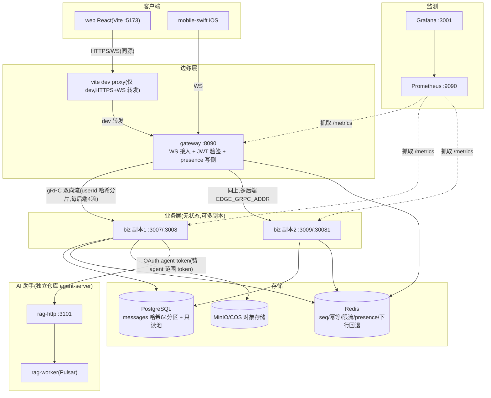
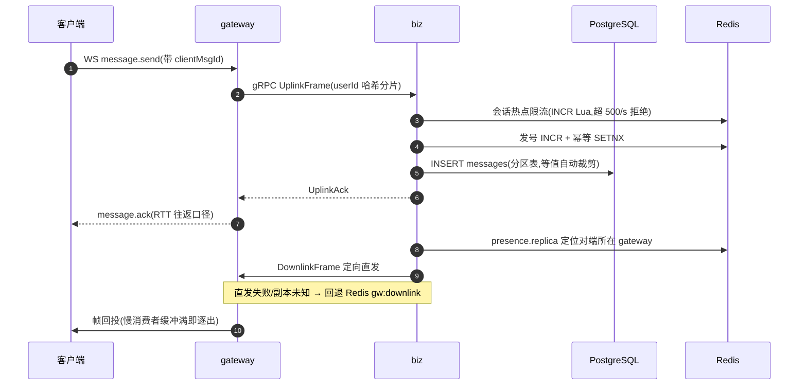

# our-chat

实时 IM + WebRTC 音视频通话。多语言、多服务单仓(monorepo),主开发分支 `dev`。
长连接接入在 `gateway`(Go),业务层在 `biz`(Go 模块化单体,可多副本)。

## 服务地图

| 服务 | 栈 | 端口 | 职责 |
|---|---|---|---|
| `biz/` | Go(gin HTTP + gRPC edge 双面)+ pgx + go-redis | 3007/3008(副本1)、3009/30081(副本2) | 业务 / 信令 / 发号 / OAuth IdP / 迁移 |
| `gateway/` | Go + gorilla/websocket + gRPC + JWT | 8090 | WebSocket 长连接接入、gRPC 流上行、下行路由、presence 写侧 |
| `web/` | React + Redux Toolkit + antd + Vite + WebRTC | 5173(dev,HTTPS) | Web 端 |
| `mobile-swift/` | iOS Swift | — | 移动端 |
| `perf/` | Node(mjs) | — | 压测 harness / 编排 / 报告生成(协议对齐生产客户端) |
| `docker/monitoring/` | Prometheus + Grafana | 9090 / 3001 | 监测栈(指标抓取 + 权威面板) |

> 部署编排收口在顶层 `docker/`;业务代码在 `biz/` 与 `gateway/`。

## 架构总览



- **实时链路**:客户端 WS → gateway → gRPC 双向流 → biz 处理(message.send / read.report / call:*)。
- **身份**:JWT(HS256,HttpOnly cookie)。biz 签发(同时是 OAuth 2.1/OIDC IdP,提供 JWKS);gateway 只验签不签发。
- **下行**:biz 按 presence.replica **经 gRPC 下行流定向直发**,失败回退 Redis `gw:downlink` pub/sub(双通道)。

## 关键设计

### 实时消息链路(上行 ack + 下行双通道)



| 节点 | 职责 | 关键事实 |
|---|---|---|
| 发号(seq) | 会话内单调序号 | Redis INCR 快路径;键缺失 Lua「GET or SET + INCR」装载 PG 初始值;60s checkpoint 写回 PG;Redis 故障降级 DB 行锁;防回卷校验 |
| 幂等 | 客户端 5s 超时同键重发收敛 | Redis SETNX(5min)+ 进程内缓存 + DB 唯一约束兜底;去重命中不重复扇出 |
| 下行双通道 | 定向下发 | ★ direct(按 replica 经 gRPC 流直发,少一跳)/ fallback(pub/sub 全副本广播);稳态 direct 占比 ≈100%,fallback 陡增=副本失联信号 |
| 多副本 failover | 副本故障零失败 | gateway 按 userId 哈希选后端,**目标不健康自动降级首个健康后端**(业务状态全外置,任意副本可处理任意用户) |
| 保护 | 背压与限流 | 会话热点限流 `CONV_RATE_LIMIT_MAX`(默认 500/s/会话,fail-open);每连接有界发送缓冲,满即逐出慢消费者;gRPC keepalive 客户端 ping 30s / 服务端 MinTime 20s(失配会 90s 周期 GOAWAY) |

★ **关键理解点**:业务层多副本无状态的根基是「状态全外置」——seq/幂等/限流/通话态/presence 全部在 Redis/PG,所以任意副本能处理任意用户,故障切换只是"换一条流"。下行 direct 的定位依赖 presence 里登记的 `replica`(gateway 副本标识),流未建立/副本未知时靠 pub/sub 兜底,保证不丢帧。

### 通话(WebRTC 信令 + 刷新重连)

- 信令走 WS(`call:start/accept/reject/end/ice/rejoin`),biz `callRelay` 维护 Redis 会话状态机(ringing→connected→reconnecting),断连 12s grace 窗,超时无人 rejoin 自动结束。
- 媒体直连(P2P 优先),失败自适应升级 relay-only(TURN over TCP/TLS,穿 VPN/对称 NAT);ICE servers 凭据从 `/api/turn-credentials` 短期签发。
- 刷新重连:前端持久化通话上下文(sessionStorage,2min TTL)→ 重连方发新 offer(`call:rejoin`)→ 对端重协商回 answer;重协商**复用已有媒体流**,不重新采集。

### 存储与迁移

- `messages` 表 `PARTITION BY HASH (conversation_id)` 64 分区,等值查询自动裁剪(写分散+读裁剪)。
- 读写分离:`store.RO()` 只读池,25 处纯读查询已切;`PG_READONLY_URL` 未配置时回退写库。
- 迁移 golang-migrate **embed 进二进制**:新增/修改迁移必须重新 `go build`(迁移版本号查 `biz/migrations/`)。

## 快速开始(本地开发)

```bash
# 1. 中间件(colima):PG/Redis/MinIO
docker compose -f docker/docker-compose.dev.yml up -d

# 2. 业务层双副本(端口/开关类 env 必须显式 export;迁移 embed,先 build)
cd biz && go build -o /tmp/biz-server ./cmd/biz
PORT=3007 EDGE_GRPC_ADDR=127.0.0.1:3008 EDGE_GRPC_ENABLED=true REPLICA_ID=biz-1 \
  AUTH_RATE_LIMIT_MAX=1000000 AUTH_RATE_LIMIT_WINDOW_MS=60000 CONV_RATE_LIMIT_MAX=500 \
  JWT_SECRET=dev-secret-change-me /tmp/biz-server &        # 副本2 用 3009/30081,REPLICA_ID=biz-2

# 3. 网关(gRPC 多后端 + HTTP 反代唯一入口)
cd gateway && GATEWAY_UPSTREAM=grpc EDGE_GRPC_ADDR=127.0.0.1:3008,127.0.0.1:30081 \
  GATEWAY_PROXY_API=true REPLICA_ID=gw-1 JWT_SECRET=dev-secret-change-me go run ./cmd/gateway

# 4. Web(HTTPS dev,首次需 mkcert;若报证书错误:brew install mkcert && mkcert -install)
cd web && pnpm i && npm start   # https://localhost:5173

# 5. 监测栈(可选)
docker compose -f docker/monitoring/docker-compose.monitoring.yml up -d
```

- 冒烟:`cd perf && node gw-probe.mjs`(uplink→ack→downlink 全链路),再 `CONNS=20 RATE=5 DURATION=10 node harness-gw.mjs`(应 980 全 ack 零错误)。
- 重启约定:biz 重启后**等 ~10s**(gRPC 流建立窗口)再注入负载;杀进程按二进制路径 `pkill -f`(SIGTERM 会卡在 gRPC 优雅关闭,本地请 `kill -9`)。
- AI 助手(独立仓库 `/Users/jaytu/agent-server`):`make dev` 拉起 rag-http(:3101)/rag-worker,前端自动对接(鉴权经 biz `/oauth/agent-token`)。

## 压测与监测

- **权威面板**:Grafana「Realtime: 系统权威监测」(`docker/monitoring/grafana/dashboards/realtime-system-authority.json`)覆盖连接/上行/消息/下行双通道/保护/通话/HTTP/DB/Go 运行时/副本 10 面。
- **压测工具链**:`perf/`(harness-gw 实现生产客户端等价协议:ack/5s 重发×3/25s 心跳/断线重连)、`run-gw-ab.sh`(11 场景×3 轮取中位)、`gen-report-v2.mjs`(单边深度 HTML,深色模式)。
- **SOP 与报告**:`docs/监测设施/压测分析SOPV2.md`(流程/红线/坑位)、`docs/监测设施/测试报告/<日期>/`(数据+报告)、`docs/音视频模块/debug/`(音视频排障记录)。

## 端口

| 端口 | 用途 |
|---|---|
| 5173 | web Vite dev server(HTTPS) |
| 3007 / 3008 | biz 副本1(HTTP / gRPC edge) |
| 3009 / 30081 | biz 副本2 |
| 8090 | gateway(WS / `/metrics` / `/healthz` / HTTP 反代) |
| 9090 / 3001 | Prometheus / Grafana |
| 5432 / 6379 | PostgreSQL / Redis |
| 9000 / 9001 | MinIO API / 控制台(仅 dev) |

## 目录结构

```
our-chat/
├── biz/            Go 业务层(模块化单体,多副本无状态)
├── gateway/        Go 长连接网关 —— 见 gateway/CLAUDE.md
├── web/            React Web 端 —— 见 web/CLAUDE.md
├── mobile-swift/   iOS 客户端
├── perf/           压测工具链
├── docker/         部署编排:compose(dev/prod) + monitoring(Prometheus/Grafana) + nginx
└── docs/           技术方案 / 架构 / 监测设施 / 音视频模块 / 性能优化 等
```

## 完工门禁

| 服务 | 命令 |
|---|---|
| biz | `go build ./... && go test ./...` |
| gateway | `go build ./... && go test ./...` |
| web | `pnpm lint && pnpm test` |

## 文档索引

- 压测流程与红线 — `docs/监测设施/压测分析SOPV2.md`
- 架构与关键设计 — `docs/架构/`、`docs/技术方案/`
- 音视频排障记录 — `docs/音视频模块/debug/`
- 各服务约定 — 各目录下 `CLAUDE.md`
