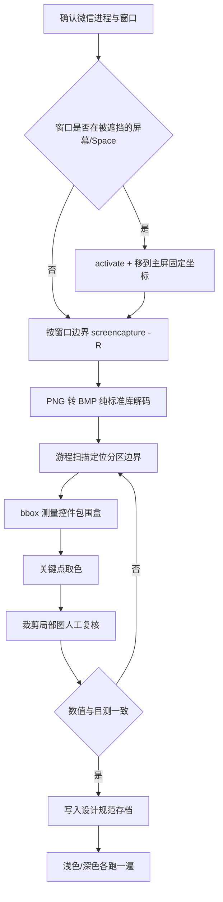

# 微信客户端 UI/UX 采样方法与工具链

> 目的:把「微信长什么样」变成**可复现、可复核的数值**,而不是凭印象抄配色。
> 本文记录采样环境、操作步骤、工具脚本、踩坑与修正。所有数值结论见 [02-实测设计规范](./02-实测设计规范.md)。

## 1. 采样环境(元数据)

| 项 | 值 |
|---|---|
| 采样时间 | 2026-11-15 04:15 ~ 04:25 |
| 操作系统 | macOS 26.4(build 25E246) |
| 微信版本 | **4.1.15**(`/Applications/微信.app`,进程名 `WeChat`) |
| 主屏 | 内置 Liquid Retina XDR,3456×2234,逻辑 1728×1117 |
| 副屏 | 外接 4K,3840×2160,UI 缩放后逻辑 1920×1080 |
| 采样窗口 | 微信主窗口,**1000×720 逻辑 px**,移到主屏 (100, 80) |
| 截图倍率 | @2x(Retina)→ 输出 PNG 2000×1440,**逻辑值 = 像素值 / 2** |
| 主题 | 深色(系统外观)+ 浅色(临时切换后立即切回) |

> **为什么要记版本**:微信 4.x 与 3.x 的界面差异很大(4.x 改了圆角、列表行高、输入框结构)。数值只在同版本内可信。

## 2. 采样流程



## 3. 操作步骤与命令(可复现)

### 3.1 定位窗口并把窗口挪到可控位置

```bash
# 读窗口名/位置/尺寸(需要「辅助功能」权限)
osascript -e 'tell application "System Events" to tell process "WeChat" to get {name, position, size} of every window'

# 微信可能停在副屏或另一个 Space:先置顶,再搬到主屏固定坐标
osascript -e 'tell application "System Events" to tell process "WeChat" to set frontmost to true'
osascript -e 'tell application "System Events" to tell process "WeChat" to set position of window 1 to {100, 80}'
```

### 3.2 按窗口边界截图(@2x)

```bash
screencapture -x -R100,80,1000,720 /tmp/wechat.png   # -x 静音,-R 区域(逻辑坐标)
sips -g pixelWidth -g pixelHeight /tmp/wechat.png     # 确认 2000×1440 = @2x
```

### 3.3 像素解码:PNG → BMP(绕开 PIL / ImageMagick)

本机没有 `PIL`、`imagemagick`,但 macOS 自带 `sips` 可转 32bit BMP,再用 Python 标准库 `struct` 直接读像素。工具见 [assets/tools/](./assets/tools/)。

```bash
sips -s format bmp wechat.png --out wechat.bmp
python3 assets/tools/probe.py wechat.bmp    # 游程扫描:找分区边界
python3 assets/tools/bbox.py  wechat.bmp    # 包围盒:量控件尺寸
python3 assets/tools/crop.py  wechat.bmp 600 1100 1400 340 out.bmp  # 裁剪局部
sips -s format png out.bmp --out out.png    # 转回 PNG 供目视复核
```

### 3.4 深/浅两套配色

```bash
# 浅色:临时切系统外观 → 截图 → 立刻切回(screencapture 与 appearance 都很快)
osascript -e 'tell application "System Events" to tell appearance preferences to set dark mode to false'
sleep 2 && screencapture -x -R100,80,1000,720 /tmp/wechat-light.png
osascript -e 'tell application "System Events" to tell appearance preferences to set dark mode to true'
```

## 4. 方法论:三种测量手段各管什么

| 手段 | 解决什么 | 原理 | 输出 |
|---|---|---|---|
| **游程扫描(run-length)** | 「分区边界在哪」 | 沿一行/一列逐像素比较相邻色差,超过阈值就记一次跳变 | `x=120 → #3b3b3d`,即竖栏/列表分界 |
| **包围盒(bbox)** | 「这个控件多大」 | 给定区域 + 背景色,求所有「异于背景」像素的 min/max | 头像 36×36、发送按钮 56×26 |
| **定点取色** | 「底色是什么」 | 直接读某坐标 RGB | 列表 `#3b3b3d` |

**为什么不用「看设计稿」**:微信没有公开的桌面端设计规范(WeUI 是**移动端**组件库,行高/栏宽与桌面端不通)。唯一可信源是实机像素。

**为什么字号可以反推**:中文字形的墨迹高度约为字号的 0.86~0.9,数字约 0.7。用 glyph 包围盒高度 + 文本宽度(等宽全角字 = 1em)双向校验,得到标题 14 / 预览 12 / 时间 11,与微信桌面端惯例一致。

## 5. 踩坑与修正(重要,下次直接绕开)

### 5.1 第一次截图抓到的是一段比赛直播

- **现象**:按 `(2229,187)` 截 1000×720,得到的是全屏播放的 LoL 直播画面。
- **原因**:双屏环境,微信窗口停在外接屏(全局坐标 x≈2229 落在第二块屏的坐标空间),而当时该屏被一个全屏播放器覆盖。`screencapture -R` 抓的是**屏幕像素**,不区分窗口层级,于是抓到遮挡物。
- **修正**:先 `activate` 再 `set position` 把窗口搬到主屏固定坐标,再抓。
- **教训**:多屏/多 Space 场景,**先确认窗口所在屏与被遮挡情况**;不要相信第一次 `position` 报出来的坐标就能直接截到窗口。

### 5.2 `sips -c ... --cropOffset` 裁出来全黑

- **现象**:裁剪后的 PNG 纯黑,`pixelWidth` 却是对的。
- **原因**:XDR 屏截图带广色域/高动态范围标记,`sips` 直接裁剪时色彩管理把它压成 0。
- **修正**:自写 `crop.py`(标准库 BMP 读写)裁剪,再交给 `sips` 只做 BMP→PNG 的格式转换。**裁剪归自己,转换归 sips**。
- **教训**:`sips` 适合「转格式/看尺寸」,不适合「像素级裁剪」。

### 5.3 没有 PIL / magick

- **修正**:`sips` 转 32bit BMP(自底向上存储、4 字节对齐) → `struct` 解析头 + 手工寻址。工具已沉淀到 `assets/tools/`,不依赖任何三方包。

### 5.4 竖栏底色在浅色下量出 `#d8dcdd`

- **原因**:macOS 微信竖栏是**毛玻璃半透明**,底色 = 自身色调 × 背景壁纸模糊色。深色下 `#26292b` 相对稳定,浅色下会随壁纸漂移(实测偏冷)。
- **决策**:规范里记 `#e3e3e5` 作为基准值,不追求「绝对精确」——因为它在真机上本来就随壁纸变。

## 6. 采样覆盖度(诚实记录)

| 已采 | 未采(已知缺口) |
|---|---|
| 竖栏、会话列表(搜索框/行结构/分隔线)、聊天头部、消息区(头像/图片消息/群昵称)、输入区(工具栏/发送按钮) | **纯文本气泡**(采样窗口内都是图片/贴纸消息,未能取到文字气泡的圆角与内边距)、语音条、引用/合并转发卡片、红包/转账卡片、@提醒、通讯录页与设置页、聊天记录面板、拖拽上传态 |

> 文本气泡的关键数值(圆角 4、尾巴 6px、内边距 8×12)依据微信移动端 WeUI + 桌面端同源视觉推定,**属推定值,后续应补采**。
