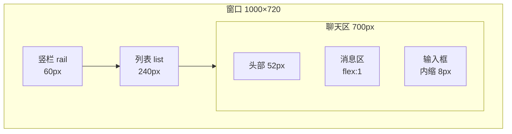

# 微信桌面端(4.1.15 / macOS)实测设计规范

> 全部数值来自 [实机截图](./assets/screens/) 像素量取,窗口 1000×720 逻辑 px,@2x 采样后除以 2。
> 标注 **推定** 的条目未直接采到(见 [01 §6 覆盖度](./01-采样方法与工具链.md#6-采样覆盖度诚实记录))。
> 可直接落地的 token 名对照见 §7。

## 1. 整体结构



三层横向分区,**只用明度差分区,不画描边**(竖栏↔列表↔聊天区之间没有 1px 分隔线)。

| 区域 | 尺寸 | 说明 |
|---|---|---|
| 竖栏 | 宽 60 | 头像 + 3 个 Tab + 底部菜单 |
| 列表 | 宽 240 | 顶部搜索区 52 + 会话/联系人行 |
| 聊天区 | 余量(700) | 头部 52 + 消息区 + 输入框 |

## 2. 竖栏(rail,60px)

| 元素 | 值 |
|---|---|
| 头像 | **36×36**,左 12(水平居中),**距顶 52** |
| Tab 图标 | 视觉 **20×20**,热区 40×40,纵向节奏 ≈ 52 |
| 选中态 | 图标变微信绿 `#07c160`,无背景块 |
| 底部 | ☰ 菜单,距底 10 |

> 距顶 52 是为 macOS 红绿灯窗口按钮留的位置。**Web 端没有原生窗口按钮**,不应机械照搬 52,取 24~32 更自然(见 03「不照搬项」)。

## 3. 会话列表

### 3.1 搜索区(高 52)

| 元素 | 值 |
|---|---|
| 容器 | 高 52,左右内边距 10 |
| 搜索框 | **高 26**,圆角 4,占满剩余宽(实测 180),图标 13,文字 12 |
| 搜索框底色 | 比列表底**更浅**(浅 `#fafafa` / 深 `#454547`) |
| 聚焦态 | 微信**不加绿色描边**,只有光标 |
| 右侧按钮 | `+` 圆环图标 20 |

### 3.2 会话行(高 64 + 1px 分隔线)

| 元素 | 值 |
|---|---|
| 行高 | **64 + 1px** 分隔线 |
| 左右内边距 | 12 |
| 头像 | **36×36**,圆角 4 |
| 头像↔文本 | **10** |
| 标题 | **14px**,常规字重,颜色 90% |
| 时间 | **11px**,颜色 35%,**与标题同基线(顶部对齐)**,距右 13 |
| 预览 | **12px**,颜色 55%,单行省略 |
| 标题↔预览 | 3 |
| 分隔线 | `rgba(0,0,0,.06)` / 深 `#414143`,**左缩进到文本起点**(12+36+10=58),右侧到列表边缘 |
| 悬停/选中 | 整行换底色(浅 `#dfdfe1` / 选中 `#d8d8da`),圆角 0 |

## 4. 聊天头部(高 52)

| 元素 | 值 |
|---|---|
| 高 | **52**,上下居中 |
| 左右内边距 | 16 |
| 标题 | **14px / 500**,单行省略;群名后缀成员数 `(30)` |
| 右侧动作 | **3 个**:语音通话、视频通话、更多(⋯);图标 20,间距 ≈ 18,距右 20 |
| 底边 | 1px 分隔线:浅 `#f2f2f2` / 深 `#252526` |
| 背景 | 与聊天区**同色**(不单独设色) |

## 5. 消息区

| 元素 | 值 |
|---|---|
| 内边距 | 上下 16 / 左右 **20** |
| 头像 | **40×40**,圆角 4,贴左/右边缘 |
| 头像↔气泡 | **12** |
| 气泡 | 圆角 **4**,内边距 **8×12**,字号 **14**,行高 1.5,最大宽 60% |
| 气泡尾巴 | 三角 **6px**,距气泡顶 **12**;自己右侧、对方左侧 |
| 时间分隔 | **12px**,居中,颜色 35%,上下留白 ≈ 10 |
| 群聊昵称 | 气泡上方 **12px** / 55%,与头像顶对齐 |
| 图片/贴纸 | 不带气泡壳,圆角 4,最大 200×150 级 |

## 6. 输入区(微信结构的关键差异)

微信桌面端的输入框是**一个描边圆角盒子**,盒子里「文本区在上、工具栏在下」:

```
┌──────────────────────────────────────────┐  ← 1px 描边,圆角 6
│  文本区(padding 10×12,14px)              │
│                                          │
│  😀  📦  📁  ✂▾  🎤        🎙  [ 发送 ]  │  ← 工具栏高 40
└──────────────────────────────────────────┘
   ↑ 盒内底部
```

| 元素 | 值 |
|---|---|
| 盒子位置 | 距聊天区左/右 **8**,距底 **12**,顶部贴消息区(≈ 0) |
| 盒子 | 圆角 **6**,1px 描边(浅 `#dfdfdf` / 深 `#323233`),底色浅 `#f7f7f7` / 深 `#202021` |
| 文本区 | 内边距 10×12,字号 14,透明背景 |
| 工具栏 | 高 **40**,左右 10;左侧 5 个图标(表情/收藏/文件/截图▾/语音),图标 20,间距 18 |
| 发送按钮 | **56×26**,圆角 **4**,字号 13;空内容 = 灰底灰字(禁用),有内容 = 绿底白字 |

> 这是与「顶部图标条 + 无边 textarea + 底部发送区」做法的**结构性差异**:微信的图标在盒内底部、发送按钮在右下角同一行。抄配色不抄结构,一眼就能看出不是微信。

## 7. 色彩(实测)

### 7.1 面(level)

| 面 | 浅色 | 深色 |
|---|---|---|
| 竖栏 | `#e3e3e5`(半透明,随壁纸微漂) | `#26292b` |
| 列表 | `#e6e6e8` | `#3b3b3d` |
| 列表内搜索框 | `#fafafa` | `#454547` |
| 聊天区 | `#fafafa` | `#1e1e1f` |
| 头部底边 | `#f2f2f2` | `#252526` |
| 行分隔线 | `rgba(0,0,0,.06)` | `#414143` |
| 输入框底 | `#f7f7f7` | `#202021` |
| 输入框描边 | `#dfdfdf` | `#323233` |
| 自己气泡 | `#95ec69` | `#3eb575` |
| 对方气泡 | `#ffffff` | `#2c2c2c` |

### 7.2 文字

| 角色 | 浅色 | 深色 |
|---|---|---|
| 正文 / 标题 | `rgba(0,0,0,.9)` | `rgba(255,255,255,.9)` |
| 次要(预览、图标) | `rgba(0,0,0,.55)` | `rgba(255,255,255,.55)` |
| 弱(时间、占位) | `rgba(0,0,0,.35)` | `rgba(255,255,255,.35)` |
| 主色(选中、发送可用) | `#07c160` | `#07c160` |

### 7.3 关键规律:深色模式**不是**浅色取反

| 关系 | 浅色 | 深色 |
|---|---|---|
| 竖栏 → 列表 | 变亮(+6) | 变亮(+21) |
| 列表 → 聊天区 | **变亮**(+20) | **变暗**(−29) |

- 浅色:越靠右越亮(`#e3e3e5 → #e6e6e8 → #fafafa`),内容区「纸张感」。
- 深色:`#3b3b3d` 的列表是**最亮**的面,聊天区反而最暗(`#1e1e1f`)——导航/列表浮起来,内容区沉下去,减少长阅读时的发光面积。

> 结论:深色 token 必须独立取值。用「浅色值 × 明度系数」自动生成,会把列表和聊天区的关系做反,这正是改造前的现状(见 03 §1 第 2 条)。

## 8. 排版与度量

| 项 | 值 |
|---|---|
| 字体栈 | `-apple-system, "PingFang SC"`(中文黑体,无衬线) |
| 字号阶梯 | 14(正文/标题) · 13(发送按钮/搜索) · 12(预览/时间分隔/昵称) · 11(列表时间) |
| 行高 | 正文 1.5;列表标题 1.35;预览 1.4 |
| 圆角阶梯 | 4(头像/气泡/搜索框/发送按钮)· 6(输入框盒子) |
| 间距阶梯 | 3 · 8 · 10 · 12 · 16 · 20 |
| 动效 | 悬停 120ms 底色渐变;无明显位移动画 |

## 9. Token 对照表(可直接抄进 SCSS)

| 语义 | CSS 变量 | SCSS 度量 |
|---|---|---|
| 竖栏宽 | — | `$wc-rail-w: 60px` |
| 列表宽 | — | `$wc-list-w: 240px` |
| 头部高 | — | `$wc-header-h: 52px` |
| 行高 | — | `$wc-item-h: 64px` |
| 头像(竖栏/列表/消息) | — | `36 / 36 / 40` |
| 气泡圆角 / 尾巴 | — | `$wc-bubble-radius: 4px` / `$wc-bubble-tail: 6px` |
| 输入框内缩 | — | `$wc-composer-inset: 8px` |
| 各面底色 | `--rail-bg` `--sidebar-bg` `--main-bg` `--search-bg` `--composer-bg` `--composer-border` | — |
| 分隔线 | `--list-divider` `--header-divider` | — |
| 气泡 | `--bubble-self` `--bubble-other` `--bubble-*-text` | — |
| 文字 | `--text-1/2/3` | — |
| 发送按钮 | `--send-bg` `--send-text` | `$wc-send-w/h` |
