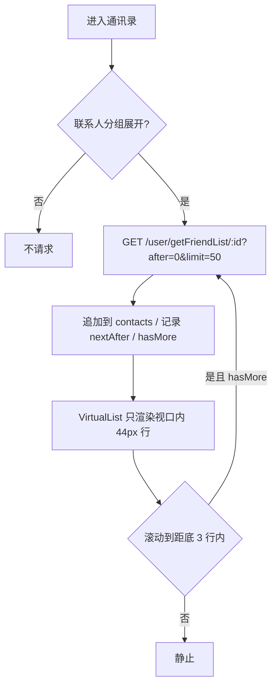

# 通讯录:分组展开 + 键集分页 + 虚拟列表

> 目标:通讯录从「一次性全量渲染」改成「手风琴分组 + 滚到底再取下一页 + 只渲染视口内的行」。
> 联系人数量无上限,原来的全量 `<DisplayItem>` 平铺会让首屏变慢、滚动掉帧。

## 1. 交互

- **新朋友**:点整行展开/收起,展开后原地列出好友请求(待处理显示「同意/拒绝」红色胶囊按钮,已处理显示「已同意/已拒绝」),行右侧带未处理数角标。
- **联系人**:点整行展开/收起,展开后是按 `friend_id` 升序的虚拟列表,滚到距底部 3 行内自动取下一页。

## 2. 数据流

## 3. 后端改动(`biz/internal/api/friend_routes.go`)

`GET /user/getFriendList/:id` **向后兼容**地支持可选分页:

| 参数 | 含义 |
|---|---|
| `limit` | 每页条数,缺省 = 旧行为(全量);上限 200 |
| `after` | 键集游标:只取 `friend_id > after` 的记录 |

响应在分页模式下多返回 `hasMore`、`nextAfter`。实现细节:SQL 用 `ORDER BY friend_id` + `LIMIT limit+1`,多取 1 条判断 `hasMore`,避免 `COUNT(*)`。

> 用键集(keyset)而不用 `OFFSET`:深翻页时 `OFFSET 10000` 要扫过前 1 万行,键集只走索引定位,页码越大也不会变慢。

## 4. 前端改动

| 文件 | 改动 |
|---|---|
| `globalComponents/virtualList/` | 新增定高虚拟列表:spacer 撑总高 + `translateY` 定位窗口 + `ResizeObserver` 重算 + 距底预取回调 |
| `globalApi/friendApi.ts` | 新增 `getFriendListPage(id, after, limit)` 与 `FriendPage` 类型 |
| `views/directoryView/index.tsx` | 新增 `reqOpen/contactsOpen` 手风琴状态、分页状态机(`contacts/hasMore/loadingMore/cursorRef`)、内联好友请求行 |
| `views/directoryView/style.module.scss` | 左栏改为「头部固定 + 虚拟列表自滚」;新增角标、请求行、加载行样式;修正 chevron 旋转方向 |

## 5. 验证

- 50 条数据下 `scrollHeight=2200`,实际 DOM 行数 **19**(视口 266px + overscan)
- 滚到底后 `scrollHeight 2200 → 4400`(下一页已追加),计数显示 `100+`
- `pnpm build` ✓ `pnpm lint` 0 error ✓ `pnpm test` 74 passed ✓

## 6. 新朋友同样分页 + 虚拟化(追加)

- 后端 `GET /user/getFriendReqs` 支持可选 `limit` / `before`(id 倒序键集),分页时多返回 `hasMore`、`nextBefore`;不传 limit 仍是全量。
- 前端新增 `getFriendReqsPage(userId, before, limit=30)`;新朋友展开才请求,滚到底再取下一页。
- 请求行同样进 `VirtualList`(行高 48);回复后只在本地改该行状态,不重拉整页。
- 实测:30 条时 DOM 仅 18 行;滚到底 `scrollHeight 1444 → 2884`(60 条)。

## 7. 新朋友选中 → 右侧按关系出面板(追加)

- 点「新朋友」里的某一行:`status=accepted`(已是好友)→ 复用好友详情面板(发消息/语音/视频);其他状态 → 右侧展示陌生人资料 + 「添加到通讯录」。
- `AddFriendModal` 增加 `inline` 模式(去 fixed 浮层、动作按钮左对齐),供右侧面板内嵌复用。
- 选中行用绿色高亮,与联系人/会话列表一致。
- **曾经的误判(已纠正)**:`friendships` 不是「同一好友多行」,而是**有向关系表**,`unique_friendship(user_id, friend_id)` 保证一对一;加好友时一次写两行(A→B sent、B→A pending)。之前看到「pending 显示已同意」的真因是接口以 `friend_id` 为 map key 返回,JS 对整数键**升序重排**,把最新的 pending 行排到了列表末尾(虚拟列表首屏不可见);前端已改为按行 `id` 倒序排序。
