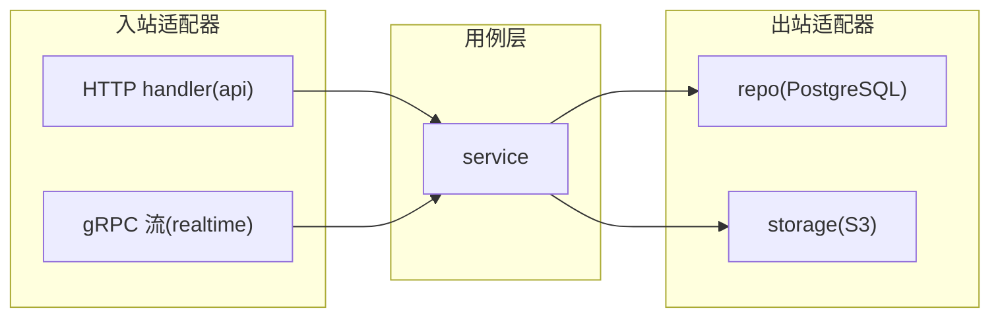
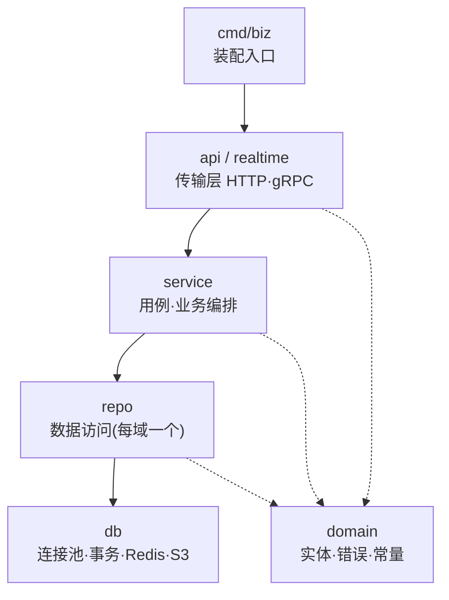
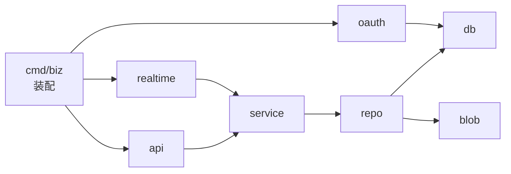

# biz/internal 架构规范(目标形态 + 迁移手册)

> 本文件定义 `biz` 业务层**应然的**分层与依赖方向。,
> 与本文存在差距;差距与迁移顺序见 §5。新增代码必须遵守本文,存量按 §5 增量迁移。

## 0. 范式定位:这是什么架构?

**一句话**:这是 **整洁架构(Clean Architecture)的简化版** —— 用「用例层(service)+ 数据访问层(repo)」实现依赖倒置,
但**没有**铺开完整的领域建模(无聚合根/值对象/领域事件)。业界也把它叫作
**分层架构(Layered Architecture) + 仓储模式(Repository Pattern)**,或 **COLA 四层的轻量版**。



在「架构光谱」上的位置:

```
事务脚本 ────────── 当前 biz ────────── 整洁架构 ────────── DDD 四层
(handler 里写 SQL)   (api→service→repo)   (含端口接口/实体)   (聚合/值对象/领域事件)
      简单 ←───────────── 复杂度 ─────────────→ 强表达力
```

## 0.1 术语(读本文前先对齐)

| 术语 | 含义 | 在本仓库的对应物 |
|---|---|---|
| **分层架构** | 按「传输 / 用例 / 数据」切层,依赖只向下 | api / service / repo |
| **用例(User Case)** | 一个用户动作对应一个业务函数(如"同意好友请求") | `service.FriendService.Reply` |
| **仓储(Repository)** | 把"持久化"抽象成集合操作,屏蔽 SQL | `repo.FriendRepo` |
| **端口 / 适配器** | 端口=抽象接口,适配器=具体实现(PG/HTTP) | `FriendRepo` 接口 + `friendRepo` 实现 |
| **依赖倒置(DIP)** | 上层定义接口,下层实现;依赖指向抽象 | service 只认 `repo.FriendRepo` |
| **DTO** | 跨层传输的纯数据结构 | `repo.Friend`、`repo.Page` |
| **事务脚本** | 一个请求一段脚本,SQL 直接写流程里 | 迁移前的 `api/friend_routes.go` |

## 0.2 为什么是这个范式(与其他方案对比)

| 维度 | ① 事务脚本(迁移前) | ② 分层 + 仓储(**当前**) | ③ 六边形/端口-适配器(全量) | ④ DDD 四层 |
|---|---|---|---|---|
| 学习成本 | 最低 | 低 | 中 | 高 |
| SQL 可定位性 | 散落 handler | **只在 repo** | 只在 repo | 只在基础设施层 |
| 可单测性 | 差(必须连库) | **中**(service 可 fake repo) | 好(端口全接口化) | 好 |
| 业务表达力 | 弱 | 中 | 中 | 强(聚合/不变量) |
| 改造风险 | — | **低**(逐域可回滚) | 中(要抽全部端口) | 高(要重建模型) |
| 适合阶段 | 原型/极简 CRUD | **接口已冻结、正在收敛的存量系统** | 多端复用/多存储 | 领域规则复杂的核心业务 |

**选 ② 而不是 ③/④ 的理由**

1. **存量系统 + 契约冻结**:前后端接口已经跑在线上了,重构的第一目标是"行为不变、结构变好",不是重写模型。
2. **症状驱动**:当前真实痛点是「SQL 散在 handler 和 service 里、改一个查询要看两处、没法单测」,这不是领域建模缺失的问题。
3. **增量可回滚**:一个域五步迁完就能合并,出问题只回退该域;③④ 往往要一次性铺开。
4. **避免过度设计**:本服务读多写少、不变量简单(好友关系/消息序号),聚合根、领域事件目前只会增加样板。

**代价(要认)**

- 业务规则仍可能漏在 service 里,缺少"实体自己保证不变量"的表达力;
- `repo` 返回的是 DTO 而非领域对象,复杂规则下会出现"贫血模型";
- 等某个域规则真的复杂起来(如群权限、红包资金流),**在那个域内部升级到 DDD**,而不是全仓升级。

## 1. 分层与依赖方向



**铁律**:依赖只能**向下**。`api` 不得 import `repo`/`db`;`service` 不得 import `api`;跨层调用一律经由 service。

| 层 | 职责 | 禁止 |
|---|---|---|
| `api` | 解析请求、鉴权、参数校验、调 service、序列化响应 | 写 SQL、拼业务流程、直接操作连接池 |
| `service` | 一个用例一个函数:编排 repo、事务边界、发事件、幂等 | 感知 HTTP(gin.Context)、拼 JSON |
| `repo` | 每域一个包,SQL 与映射只在这里 | 抛业务错误(应转成 `domain` 错误)、发事件 |
| `db` | 连接池单例、读写选择、事务 helper | 任何业务 SQL |
| `domain` | 实体、值对象、错误类型、枚举 | 依赖任何基础设施 |

### 1.1 同名概念的澄清

| 现名 | 它其实是什么 | 目标名 |
|---|---|---|
| ~~`store`~~ → **`db`** | **连接池单例**(`PG()/RO()/Redis()/S3()`),零数据访问方法 | 已改名 `db` |
| `service` | 业务编排 **+ 大量内联 SQL** | `service`(SQL 外移) |
| `api` | 路由 + handler + 中间件 + cookie + helper,且**部分 handler 直接写 SQL** | `api`(只留传输关切) |
| ~~`storage`~~ → **`blob`** | 对象存储(上传/分片/签名 URL) | 已改名 `blob` |

## 2. 目录结构(每个目录干什么)



| 目录 | 职责 | 允许依赖 | 不应该做 |
|---|---|---|---|
| **`cmd/biz`** | 唯一入口:读配置、初始化 db/blob、挂路由与 gRPC、优雅退出 | 全部 | 写业务逻辑 |
| **`api`** | HTTP 传输层:路由注册、中间件、鉴权、参数解析、错误映射、JSON 序列化;一域一文件(`friend_routes.go`/`chat_routes.go`…) | `service` | SQL、`db`/`repo`、业务流程 |
| **`realtime`** | gRPC edge 流:gateway 上行的帧处理、ack、断连通知、通话转发 | `service` | 直接查库 |
| **`service`** | 用例层:一个用户动作一个函数;编排 repo、事务边界、发事件、幂等 | `repo` `db`(仅事务)`blob` | `gin`/`net/http`、拼 JSON |
| **`repo`** | 数据访问:每个领域一个文件,**全部 SQL 只在这里**;返回 DTO | `db` | 发事件、业务规则 |
| **`db`** | 连接池单例(`PG()` 写/`RO()` 读/`Redis()`)与查询计时埋点 | `config` `metrics` | 任何业务 SQL |
| **`blob`** | 对象存储(S3/MinIO):上传、分片、签名 URL、对象键约定 | `config` | 业务判断 |
| **`oauth`** | 自建 IdP 垂直切片:client 注册、PKCE、token 签发/校验、审计(自带 handler) | `db` | — |
| **`contracts/gen`** | protobuf 生成物 | — | **手改** |
| **`config` `logx` `metrics` `migrate`** | 横切:配置加载、日志、Prometheus 指标、迁移执行器 | — | 依赖业务包 |

> 现无独立 `domain/` 包:实体类型暂时住在 `repo`(`Message`/`JSONTime`/`UserConversation`),靠 `service` 的类型别名复用。
> 这是为了避开 `repo↔service` 循环依赖的临时取舍;等领域规则变复杂时再抽 `domain`。

### 2.1 命名:为什么叫 `db` / `repo` / `blob`

| 曾用名 | 问题 | 现名 | 依据 |
|---|---|---|---|
| `store` | 字面意思是"存储/仓储",但里面**只有连接池**,零数据访问方法——和真正的仓储(`repo`)撞名,最容易误导 | **`db`** | Go 社区最通用的基础设施层命名(`db.PG()` 一眼看出是连接池);与 `repo` 职责不再混淆 |
| `storage` | 太泛("存储"可以是 DB/文件/缓存);与 `store` 视觉上几乎同义 | **`blob`** | 明确指向对象存储(blob storage),区别于关系库 |
| `repo` | — | `repo` | 仓储模式的标准叫法(`Repository`),对应 `XxxRepo` 接口 |

> 改名是机械的:`store.` → `db.`(22 个文件)、`storage.` → `blob.`(1 个文件),`go build` + 全量测试通过。
> 同类参考:Clean Architecture 的 "Infrastructure"、DDD 的 "Infrastructure/Repository"、Go 项目常见的 `internal/db` + `internal/repo`。

### 2.2 `service/` 为什么保持单包平铺(而不是按模块拆子包)

现状:13 个源文件、2141 行,最大文件 257 行(`message.go`)。按域命名(`friend.go`/`seq.go`/`call.go`…),**一个域一个文件**。

| 方案 | 优点 | 代价 | 结论 |
|---|---|---|---|
| **单包 + 按域分文件**(当前) | 域之间直接调用(如 `message` 调 `seq`、`reply` 发事件),无循环依赖;包内私有函数可共享;编译快 | 文件多时靠命名自律 | ✅ **保持** |
| 按域拆子包 (`service/friend`, `service/message`…) | 边界物理隔离,包级 API 更小 | 立刻遇到循环依赖:好友同意要调 `message` 发招呼语,`message` 又要 `seq`;只能再抽 `internal/bus` 或 `domain`,成本远大于收益 | ❌ 暂不拆 |
| 拆成 `app/` + `domain/`(DDD) | 表达力强 | 需要先完成领域建模,当前规则不复杂 | ⏳ 视需求 |

**什么时候才拆**:单个文件 > 500 行,或某个域需要独立依赖/独立部署,或出现两域互相调用形成环。届时按"域 → 子包",并把共享的 `EmitToUser`/`PersistAndBroadcastMessage` 提到 `internal/bus` 与 `internal/repo`。

**当前替代约束**(不拆包也能保边界):
1. 一域一文件,文件名 = 域名;文件内函数以域名开头或注释标注所属用例。
2. 跨域只调用对方**导出函数**,不直接读对方的表(表归属见 `repo/<域>.go`)。
3. 新增域先加 `repo/<域>.go`,再在 `service` 加对应文件,不允许塞进已有文件。

## 3. 统一约定

**错误**:`repo` 返回 `domain` 错误(`ErrNotFound`/`ErrConflict`),`api` 用 `httpError(c, err)` 统一映射,禁止在 handler 里 `if err != nil { c.JSON(500, ...) }` 复制粘贴。

**事务**:只在 service 开。`db.WithTx(ctx, func(tx) error {...})`,repo 方法接受 `db.Queryer` 接口(pool 与 tx 都满足),这样同一函数既能单条执行也能进事务。

**读写分离**:读接口在 repo 内部固定走 `db.RO()`,写走 `db.PG()`;handler 不再选池。

**分页**:统一键集(keyset),不用 OFFSET。请求 `?after=<cursor>&limit=<n>`,响应 `{items, hasMore, nextAfter}`。列表排序必须在 SQL 里显式 `ORDER BY` 且含唯一键,否则游标不稳定。

**返回结构**:分页接口返回**数组**而非以 id 为 key 的对象——JSON 对象的整数键会被 JS 按升序重排,顺序会丢。

**命名**:`repo.<Domain>Repo` 接口 + `repo/pg.<domain>Repo` 实现;service 字段 `friendRepo`;方法用业务动词(`ListFriends`/`AddFriend`),不用 `Get`。

**测试**:service 单测依赖 repo 接口的 fake;repo 用 `dockertest`/真实 PG 的集成测试;`api` 只测参数校验与错误映射。

## 4. 对照:biz 的现状反例 → 目标写法

**现状(反例)**:`api/friend_routes.go` 里 handler 直接连库并内联分页 SQL。

```go
// ❌ handler 里既有 HTTP 又有 SQL 和游标逻辑
func handleGetFriendList(c *gin.Context) {
    limit := parseLimit(c)                 // 传输关切
    rows, _ := store.RO().Query(ctx, q, ...) // 数据访问
    // ...60 行映射 ...
}
```

**目标**:

```go
// ✅ handler 只做传输
func (h *FriendHandler) List(c *gin.Context) {
    page, err := h.svc.ListFriends(c.Request.Context(), tokenUser(c), parsePage(c))
    respond(c, page, err)
}

// ✅ service 编排
func (s *FriendService) ListFriends(ctx context.Context, uid int64, p Page) (PageResult[Friend], error) {
    return s.repo.ListFriends(ctx, uid, p)
}

// ✅ repo 独占 SQL
func (r *friendRepo) ListFriends(ctx context.Context, uid int64, p Page) (PageResult[Friend], error) {
    // SELECT ... WHERE user_id=$1 AND friend_id>$2 ORDER BY friend_id LIMIT $3+1
}
```

判断标准:**handler 里出现 `SELECT`、`INSERT`、`store.` 就是违规**。

## 5. 迁移清单(按域,增量、可回滚)

| # | 域 | 位置 | 内联 SQL | 状态 |
|---|---|---|---|---|
| 1 | friend | `api/friend_routes.go` | 13 | ✅ 已完成(参考实现,见 `repo/friend.go`) |
| 2 | chat | `api/chat_routes.go` | 7 | ✅ 已完成(含 `sync_routes.go` 的增量拉取) |
| 3 | upload | `api/upload_routes.go` | 6 | ✅ 已完成 |
| 4 | auth | `api/auth_routes.go` | 2 | ✅ 已完成 |
| 5 | user | `api/user_routes.go` | 1 | ✅ 已完成 |
| 6 | service 内 SQL | `service/*.go` | 32 | 待做(seq/message/read/call/presence) |

每个域固定五步,一步一提交:

1. 建 `repo/<domain>.go`:接口 + 结构体 + 请求/返回类型(先只搬读路径);
2. SQL 原样搬进 repo,保持行为不变(不改语义,不改返回结构);
3. service 增同名方法转发(先薄后厚,业务规则后续再上提);
4. handler 瘦身成「解析 → 调 service → 序列化」,删掉 `store` import;
5. `go build ./... && go test ./... && make arch-check`,再手工冒烟该接口。

## 6. 验收与守卫

```bash
make arch-check   # 守卫:api 层不得出现 store./SELECT/INSERT/UPDATE/DELETE
go vet ./... && go test ./...
```

`arch-check` 是**机械约束**,比口头规范可靠:它会把"新写的 handler 又直接连库"挡在 CI 里。

## 7. 当前进度(2026-11-15)

- 目录改名:`store`→`db`(22 文件)、`storage`→`blob`(1 文件),`go build`/测试全绿。
- 已完成:`repo` 包(分页类型 + 好友域接口/实现)、`service/friend.go`(用例)、`api/friend_routes.go` 瘦身为纯传输;`arch-check` 守卫与 `make arch-check` 已接入。
- 已迁移:**friend / user / auth / upload / chat**,`api` 层违规 **29 → 0**;`sync_routes.go` 的增量拉取也改为走 `service.ChatService.MessagesSince`。
- 守卫用 `scripts/arch-baseline.txt` 登记存量(当前仅 `api/chat_routes.go`),**只允许删,不允许加**;`make arch-check` 对新违规直接失败。
- 类型上移:为打破 `repo↔service` 循环,`JSONTime`、`Message`、`UserConversation`、`Conversation` 已定义在 `repo`,service 用别名;api 通过 `service.*` 引用。
- chat 迁移要点:行扫描整体搬进 repo;`messages` 分页(limit/beforeSeq/hasMore)由 repo 承担;`lastMessages` 保持 snake_case 输出,只把数据来源换成 `repo.Message` 列表再映射。
- 好友域的**响应结构保持不变**(仍是以 id 为 key 的对象 + hasMore/nextXxx),避免前后端契约破坏。
