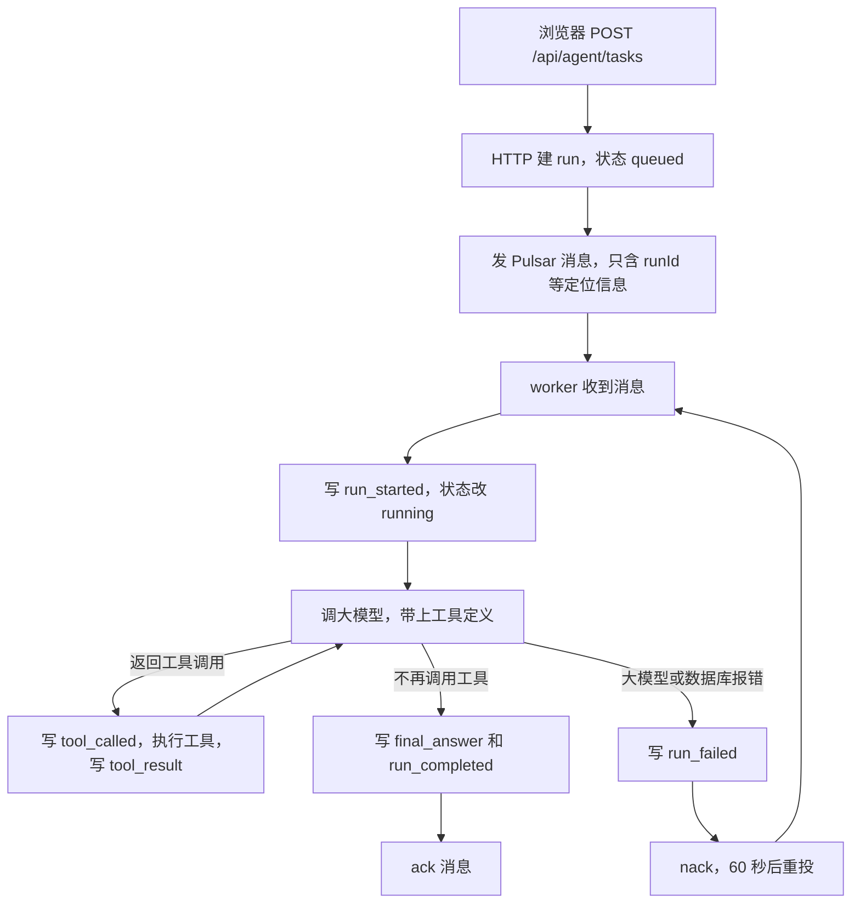
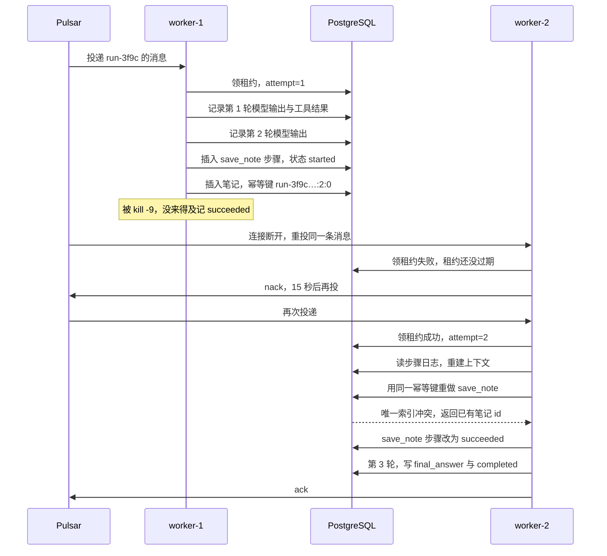
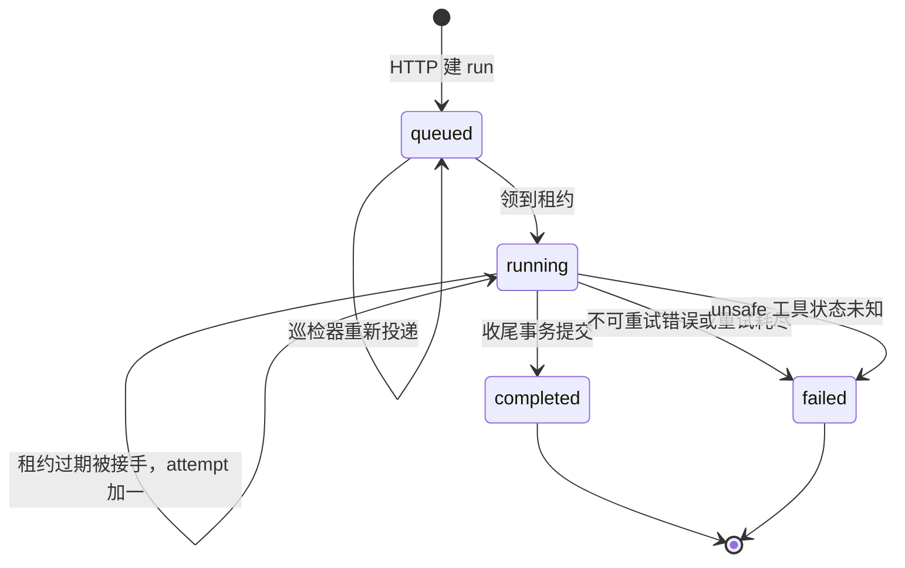
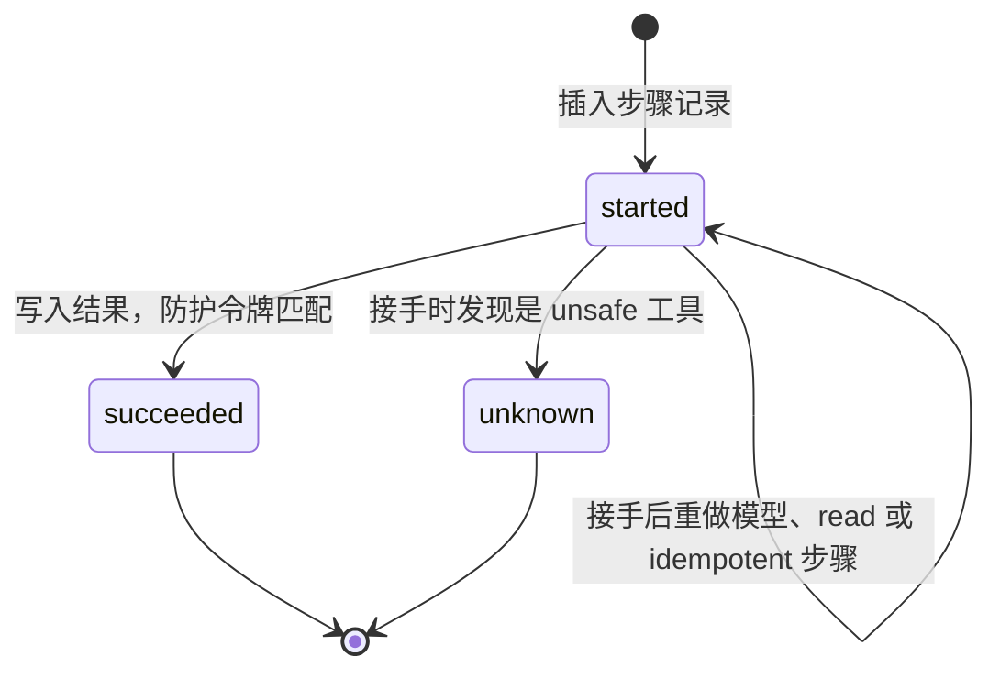

# Agent 服务开发计划

> 适用范围：agent-server 仓库的 Python 实现（Python 3.12、FastAPI 0.141、pulsar-client 3.13、PyJWT 2.14、SQLAlchemy 2.0、Milvus 2.5），以及它与 talqora Go 业务层（下称 biz）OAuth 的对接。文中 `apps/…`、`packages/…`、`docker/…` 等路径相对 agent-server 仓库根目录；talqora 仓库内的路径写作 `talqora:…`。
>
> 本文目标：读完能回答三个问题。第一，Agent 运行被中途杀掉后，怎样做到不丢、不从头重跑、有副作用的工具效果恰好一次；第二，3 月 7 日前和面试季各修什么、花多少小时、怎么验收；第三，这套设计在什么条件下会失效。
>
> 相关文档：[模块开发计划总览](../README.md)、[07 部署与交付](../07-部署与交付/开发计划.md)、[agent-server 现状问题与质量检查](../../现状问题与质量检查/04-agent-server.md)、[部署配置与密钥](../../现状问题与质量检查/01-部署配置与密钥.md)。

## 0. 一段话讲清

agent-server 是 talqora 的 AI 助手后端，单独一个仓库。用户在 talqora 网页的「AI 助手」页操作时，浏览器先向 biz 换一枚只给 agent-server 用的令牌，再直接调用 agent-server。普通问答在 HTTP 进程里完成：先检索用户自己的知识库，再把大模型（LLM，Large Language Model）的回答逐字推给浏览器。另外两类重活先投进 Pulsar 消息队列，由 worker 进程执行：一类是文档摄入（解析、切块、向量化、入库），另一类是 Agent 任务（大模型自己决定调用哪些工具、多轮推理直到给出答案）。现状最大的缺口在 worker：执行过程不能恢复，推理上下文只在内存里，工具调用也不落库；任务一失败，消息就被无限重投，每次都从头重跑。本计划分两段推进。3 月 7 日前只花 W2 的 3 小时，堵住两个严重问题：无限重投（AG-S1）和生产环境开放注册（AG-S2）。面试季先花 18 小时做「Agent 可靠执行」：每一步写进数据库里的步骤日志，进程被杀后从日志接着做；有副作用的工具靠幂等键做到效果恰好一次。剩下约 16 小时用来修其余重要问题，并补上 CI 门禁。

## 1. 现状与差距

### 1.1 现在一次 Agent 运行怎么走



图里有两类数据，持久化方式完全不同。

- 落库的只有两样：`runs` 表里的状态（queued、running、completed、failed），以及 `run_events` 表里给界面看的事件流（run_started、tool_called、tool_result、final_answer、run_completed 或 run_failed）。事件流按序号推给浏览器，浏览器断线重连后可以补发。
- 不落库的是 worker 内存里的 `messages` 列表。它保存着系统提示、用户任务、每一轮模型返回的 assistant 消息（含工具调用 id 和参数），以及每个工具的完整结果。进程一死，这些全部丢失。`run_events` 里的工具结果截断到 2000 字，也没有工具调用 id，所以拿它没法重建上下文。

工具报错不会让运行失败：错误文本作为工具结果回灌给模型，让模型自己换个办法（`apps/rag-server/src/rag_server/modules/agent/runner.py:100-109`）。真正让运行失败的是大模型调用报错、数据库或 Redis 报错。

下表是逐项核对代码后的现状（行号对应 agent-server 当前代码）：

| 环节 | 现状 | 证据 |
|---|---|---|
| 投递 | Shared 订阅（多个 worker 竞争消费，一条消息只给一个 worker），成功 ack、失败 nack；没有死信策略和重投上限，nack 后按客户端默认 60 秒重投 | `packages/agent-core/src/agent_core/queue.py:112-117`、`:148-152` |
| 入口 | 不检查 run 状态，任何一次投递都从 run_started 开始执行 | `apps/rag-server/src/rag_server/modules/runs/processor.py:45-64` |
| 失败处理 | 先写 run_failed，再把异常抛给消费循环，于是被 nack、被重投 | `processor.py:61-64` |
| 推理上下文 | `messages` 只在内存 | `modules/agent/runner.py:62-89` |
| 工具调用 | 只写审计事件，不保存工具调用 id，结果截断 2000 字 | `runner.py:83-88` |
| 事件序号 | 先查当前最大序号再加一插入，两条 SQL 不在一个事务里 | `packages/agent-core/src/agent_core/run_engine.py:181-191` |
| 状态变更 | 先写事件、再改状态，分两次提交 | `run_engine.py:145-179` |
| 任务文本 | 接口允许 2000 字，入库截成 255 字，worker 读的是截断后的文本 | `modules/agent/router.py:19`、`:43`；`runner.py:64` |
| 工具 | 4 个工具全部只读，都按 user_id 过滤 | `modules/agent/tools.py:58-66` |
| 停机 | 收到 SIGTERM 后等手头消息处理完；容器没配宽限时间，Docker 默认 10 秒后强杀 | `apps/rag-server/src/rag_server/worker.py:56-62`；`docker/docker-compose.prod.yml:193-209` |

### 1.2 差距与问题编号

问题编号与描述以 [agent-server 现状问题与质量检查](../../现状问题与质量检查/04-agent-server.md) 为准，这里只列和本计划相关的部分。

1. **投递语义与处理逻辑不匹配（AG-S1）。** Pulsar 保证消息至少送达一次，要求处理逻辑幂等；但 `process` 既不判断「这个 run 处理过没有」，也不区分错误能不能重试。于是一份纯图片 PDF 就能让同一个摄入任务每 60 秒重跑一次，永不停止。
2. **执行不可恢复。** 这不是某一行代码的 bug，而是执行模型少了一层：没有持久化的步骤日志。它带来三个后果：worker 崩溃后只能整段重跑；部署时被强杀的运行同样整段重跑（与 AG-I7 相关）；一旦接入有副作用的工具（比如发 IM 消息），重跑就会重复执行副作用。
3. **生产环境开放本地注册（AG-S2）。** 任何人都能注册账号、使用大模型额度；还能抢注 talqora 用户对应的用户名，让该用户首次访问时永久报 500。
4. **DP-S3 AI 助手跨仓配置断链。** 由 [07 部署与交付](../07-部署与交付/开发计划.md) 在 W1 修复。它修好之前，AI 助手在生产上整体不可用，本计划所有线上验证都要等它。
5. **其余重要问题与门禁。** AG-I1～AG-I9，以及 CI 没有门禁的问题（DP-I1）。处理方式见第 4 节的任务表。

### 1.3 贯穿全文的例子

后文所有机制都用同一个例子走一遍。用户 42 在任务会话里提交：「把文档 7（Q3 周报）的要点整理成一条笔记保存下来」。这次运行的 run_id 是 `run-3f9c2a10-5d1e-4b7a-9c3e-0a1b2c3d4e5f`。正常情况下分三轮：

| 轮次 | 大模型返回 | 工具执行 |
|---|---|---|
| 1 | 调用 `summarize_document(documentId=7)`，调用 id 为 `call_a1` | 读文档 7 的前 20 个分片，再调一次大模型生成摘要 |
| 2 | 调用 `save_note(title="Q3 周报要点", content=摘要)`，调用 id 为 `call_b2` | 往笔记表插入一行，这是副作用 |
| 3 | 不再调用工具，给出最终回答 | 无 |

`save_note` 是本计划新增的示范工具。现有 4 个工具都只读，没法演示副作用。

假设 worker 在第 2 轮刚把笔记插进数据库、还没来得及记「已完成」，就被 `kill -9` 杀掉了：

- **现状**：消息被重投，从第 1 轮重新开始。摘要再生成一遍，多花一次大模型调用；笔记再插一遍，用户得到两条笔记。如果第二次生成的摘要措辞不同，两条笔记的内容还不一样。
- **目标**：新 worker 读出步骤日志，看到第 1 轮已完成、第 2 轮的模型输出已记录、`save_note` 只有「开始」没有「完成」。于是它用同一个幂等键 `run-3f9c2a10-5d1e-4b7a-9c3e-0a1b2c3d4e5f:2:0` 再调一次 `save_note`。笔记表上的唯一索引认出这是重复请求，不插新行，直接返回已有笔记的 id。之后进入第 3 轮。最终用户只有一条笔记，大模型调用一次也没多。

## 2. 目标与验收指标

### 2.1 3 月 7 日前：W2 止血（共 3 小时）

这一段只求止血：不再无限循环，不再对公网开放注册。断点续跑留到面试季。

**AG-S1 要做到三件事：**

1. 错误分成两类。**不可重试**的包括：文档解析不出文本、run 或文档已不存在、参数非法、大模型返回 400/401/403/404/422。遇到这类错误，记一次 run_failed，然后 ack，不再重投。**可重试**的包括：网络错误、超时、429、5xx、数据库连接失败。遇到这类错误就 nack，等重投。
2. 消费者配置死信策略。死信队列（DLQ，Dead Letter Queue）是一个单独的 topic，专门转存多次处理失败的消息，免得它们一直占着主队列反复重投。重投上限设为 3 次。
3. 入口按状态做 CAS（Compare-And-Set，比较并设置：只有当前值符合预期才更新，这里用一条带条件的 `UPDATE` 实现）。已经是 completed 或 failed 的 run，收到消息直接 ack。

**AG-S2 要做到两件事：**

1. 新增配置 `LOCAL_AUTH_ENABLED`，默认关闭，开发环境的 `.env.example` 里打开。关闭时，注册和登录接口返回 404，验签拒绝 HS256 令牌。
2. 联邦建号遇到用户名冲突时，改用带随机后缀的用户名重试一次。

| 编号 | 验收操作 | 通过标准 |
|---|---|---|
| AG-S1-1 | 上传一份纯图片 PDF | run_failed 恰好出现 1 次；之后 10 分钟内这个 run 不再出现 run_started |
| AG-S1-2 | 让 llm_stub 对某个 Agent 任务连续返回 503 | 该 run 最多执行 4 次（首次加 3 次重投），最后状态为 failed，原因写明重试耗尽 |
| AG-S1-3 | 把一条已完成 run 的消息重新发一遍 | 不产生任何新事件，消息被 ack |
| AG-S2-1 | 生产配置下调 `POST /api/auth/register` | 返回 404 |
| AG-S2-2 | 用 HS256 令牌访问 `/api/auth/me` | 返回 401 |
| AG-S2-3 | 先注册用户名 `oc_42`，再用 sub=42 的 RS256 令牌访问 `/api/auth/me` | 返回 200，用户名带随机后缀 |

本地联调环境就能完成上表全部验收。上线后的复验要等 DP-S3 在 W1 修好。

### 2.2 面试季：Agent 可靠执行（18 小时）

先把「恰好一次」说清楚。这里指的是**效果**恰好一次：外部能观察到的结果（例子里笔记表的行数）恰好一份。工具函数本身可能被调用两次，第二次被接收方认出是重复请求而不生效。函数调用次数做不到「恰好一次」，原因在 3.1 节。

| 指标 | 定义 | 目标 |
|---|---|---|
| 副作用恰好一次率 | 注入故障的运行中，笔记行数等于计划写入数的比例 | 200 次全部满足 |
| 恢复时延 | 从 worker 被杀，到该运行在别的 worker 上重新开始执行 | 不超过 45 秒（租约 30 秒加重投延迟 15 秒） |
| 完成率 | 被杀的运行最终到达终态的比例 | 100% |
| 重复大模型调用 | 每次被杀后多出来的大模型调用次数 | 不超过 1 次，只重做被打断的那一步 |
| 界面事件重复 | 同一运行、同一步骤、同一类型的事件重复条数 | 0 |
| 部署不丢进度 | 滚动重启 worker 时，进行中的运行从断点继续 | 大模型总调用次数与不重启时相同（误差不超过 1 次） |
| 正常路径开销 | 每步新增的数据库写入次数与延迟 | 每步多 2 次写入，单步 P95 延迟增加不超过 20 毫秒（本机测） |

### 2.3 面试季：其余重要问题与 CI 门禁（约 16 小时）

- **DP-I1 的 agent-server 侧：** PR 和推送都要跑 ruff 检查、格式检查、mypy 严格模式、pytest，全部通过后部署任务才运行；在仓库根目录执行 `make test` 和 `make lint` 都能跑通。现状是前者 5 个用例失败，后者第一步就失败。
- **AG-I1～AG-I9：** 每条的验收方法见质检文档对应条目的「验证方法」，任务拆分和小时见第 4 节。

## 3. 设计

### 3.1 为什么现在的模型不够：三个事实

**事实一：重复投递是常态，不是事故。** Pulsar（Apache Pulsar，分布式消息队列）在这里的用法是「至少一次投递」（at-least-once：消息一定送到，但可能送到不止一次）。ack 是 worker 告诉 broker「这条处理完了，可以删」。worker 只要在 ack 之前死掉，broker 发现连接断了，就会把消息再投给别的 worker。所以同一个任务被执行多次，是这种投递语义的正常结果。现在的 `process` 把每次投递都当成新任务处理（`processor.py:45-64`），问题出在处理逻辑，不在 Pulsar。

**事实二：大模型的输出不确定。** 同样的消息再问一次，模型可能换一个工具，或者换一组参数。所以从头重跑不只是多花钱。第一次执行里已经发生的副作用撤不回来，第二次执行又可能做出另一件事。恢复时不能「重新问一遍模型」，只能用第一次的回答。

**事实三：副作用和「记一笔」之间总有一个窗口。** 有两种排法：

- 先记「已完成」，再执行：执行前崩溃，事情就永远没做，这叫至多一次（at-most-once）。
- 先执行，再记「已完成」：记之前崩溃，恢复后会再做一次，这叫至少一次。

无论怎么调换顺序，这个窗口都消不掉。唯一的办法是让「再做一次」不产生第二份效果：接收方根据一个在重试之间保持不变的键，认出这是重复请求。这个键就是幂等键（idempotency key）。

> ★ 关键理解点：效果恰好一次 = 至少一次执行 + 接收方按稳定的键去重。步骤日志不能单独做到恰好一次；它的作用是把「至少一次」的范围从整个任务缩小到一个步骤，并让幂等键在重试之间保持不变。

### 3.2 方案对比

| 维度 | A 现状：失败整段重跑 | B 只治理重投（W2 止血） | C 自建步骤日志 + 幂等键 + 租约（本计划） | D 引入 Temporal | E LangGraph 检查点 | F Pulsar 事务 |
|---|---|---|---|---|---|---|
| 崩溃后从哪继续 | 从头 | 从头 | 从最后一个完成的步骤 | 按工作流事件历史回放到断点 | 从最后一个图节点的检查点 | 从头 |
| 副作用是否恰好一次 | 否 | 否：不再无限循环，但每次重投仍重复 | 是：靠接收方按幂等键去重；不支持去重的工具降级为至多一次 | 要自己把 Activity 做成幂等（Activity 本身是至少一次执行） | 要自己处理，检查点只保存图状态 | 只覆盖「消费、处理、生产」都在 Pulsar 内的链路 |
| 怎么处理模型输出不确定 | 不处理，重跑可能走新路径 | 不处理 | 记录模型输出，恢复时用记录值 | 模型调用放进 Activity，结果写入事件历史 | 节点输出写入检查点 | 不涉及 |
| 新增基础设施 | 无 | 无 | 无，复用 PostgreSQL 与 Pulsar | Temporal 服务及其存储 | LangGraph 运行时 | 开启 broker 的事务协调器 |
| 与现有代码的契合度 | 不适用 | 高 | 高：复用 runs、run_events 与 RunEngine | 低：编排要改写成 workflow 与 activity，队列和事件流都要重做 | 低：现有循环是自建的（`runner.py:1-9` 注释写明不依赖 LangGraph），要整体迁移 | 低 |
| 工作量 | 0 | 3 小时 | 18 小时 | 远超 18 小时 | 估计 15～25 小时，副作用问题仍要另做 | 中等 |
| 主要代价 | 重复计费、重复副作用、无限重投 | 只止血 | 状态机要自己写、自己测 | 运维与学习成本 | 绑定框架 | 解决的不是这个问题 |

信息来源：D、E、F 三列依据各项目公开文档描述的通用机制，包括 Temporal 的事件历史回放与 Activity 重试、LangGraph 的 checkpointer、Pulsar 事务的作用范围。具体行为以当时版本的官方文档为准，待复核。

**选 C 的理由。**

1. 它正好补上缺的那一层：执行状态持久化。现有的 `runs` 表、`run_events` 表、RunEngine 端口和 Pulsar 订阅都能保留。
2. 18 小时做得完，不新增需要运维的服务。
3. 每个机制都能单独验证：步骤日志、幂等键、租约、防护令牌各管一件事，第 5 节的对照实验可以逐个拆开看贡献。

**选错的代价。**

- **停在 B。** 每次部署、每次崩溃仍整段重跑；接入写类工具（比如发 IM 消息）后会重复发送。
- **选 D。** 18 小时连 Temporal 的部署和编排改写都做不完，面试季目标落空。
- **选 F。** 投入之后，写数据库、调外部接口仍然会重复执行。Pulsar 事务管不到 Pulsar 之外的系统。

**C 不是终点。** 如果以后 Agent 编排变复杂（并行分支、长时间等待人工确认、定时触发），迁移到 D 的路径是现成的：步骤日志对应 Temporal 的事件历史，幂等键设计可以原样复用到 Activity。

### 3.3 术语

- **步骤日志（journal）**：把每一步「做了什么、结果是什么」按顺序写进数据库的表。恢复时按日志重建内存状态。
- **回放（replay）**：恢复时，已有记录的步骤不重新执行，直接读出当时的结果。
- **幂等键**：同一个逻辑操作在多次重试之间保持不变的唯一标识。接收方据此认出重复请求，只让它生效一次。
- **租约（lease）**：带过期时间的执行权。worker 持有租约期间，别的 worker 不能接手这个运行；worker 死了、租约到期，别人才能接手。
- **心跳（heartbeat）**：持有者定期把租约到期时间往后推，用来证明自己还活着。
- **防护令牌（fencing token）**：每次接手时递增的序号，本文用 `runs.attempt`。所有写操作都带上它。旧持有者可能因为停顿过久而失去租约，自己却不知道（俗称「僵尸」worker）；它的写入会因为令牌不匹配而被拒绝。
- **巡检器（sweeper）**：定时扫描数据库，把「租约过期但没完成」和「建好了却一直没被投递」的运行重新发到队列。

### 3.4 数据模型

新增一张步骤日志表 `agent_steps`，用 Alembic 加法迁移：

| 列 | 类型 | 含义 |
|---|---|---|
| `id` | 自增主键 | |
| `run_id` | VARCHAR(64)，外键到 `runs.run_id`，级联删除 | 属于哪次运行 |
| `iteration` | INT | 第几轮推理，从 1 开始 |
| `kind` | VARCHAR(8) | `llm` 或 `tool` |
| `call_index` | INT | 本轮第几个工具调用，从 0 开始；`llm` 步骤固定为 -1 |
| `tool_call_id` | VARCHAR(64)，可空 | 模型给的调用 id，用于回填 tool 消息和追溯 |
| `tool_name` | VARCHAR(64)，可空 | |
| `effect` | VARCHAR(16)，可空 | 工具的副作用级别：`read`、`idempotent`、`unsafe` |
| `idempotency_key` | VARCHAR(64)，可空，唯一 | 工具步骤的幂等键 |
| `status` | VARCHAR(16) | `started`、`succeeded`、`unknown` |
| `is_error` | BOOLEAN | 工具报错时为真，错误文本作为结果回灌模型 |
| `attempt` | INT | 写入者的防护令牌 |
| `request` | JSONB | 工具参数；`llm` 步骤只存消息条数与内容哈希 |
| `response` | JSONB，可空 | `llm` 步骤存完整 assistant 消息，`tool` 步骤存完整结果 |
| `created_at`、`finished_at` | TIMESTAMPTZ | |

唯一约束：`(run_id, iteration, kind, call_index)`。它保证同一个位置只能有一条记录。两个 worker 同时想记同一步时，只有一个能插入成功。

`runs` 表新增 6 列：

- `input TEXT`：任务原文，不再截断，顺带修掉 AG-I4；
- `attempt`：防护令牌；
- `lease_owner`、`lease_until`：租约持有者与到期时间；
- `last_seq`：事件序号计数器，替代「查最大值加一」；
- `failure_count`：可重试错误的累计次数。

`run_events` 表新增可空列 `dedup_key`，加唯一约束 `(run_id, dedup_key)`。PostgreSQL 的唯一约束不约束 NULL 值，旧数据不用回填。

示范工具用的笔记表 `agent_notes`：`id`、`user_id`、`run_id`、`idempotency_key`（唯一）、`title`、`content`、`created_at`。

**为什么新建 `agent_steps`，而不是把完整结果塞进 `run_events`：**

| 维度 | 复用 `run_events` | 新表 `agent_steps`（选用） |
|---|---|---|
| 内容 | 面向界面，结果截断到 2000 字 | 完整模型输出与工具结果 |
| 可变性 | 只追加，SSE 按序号推送 | 状态要从 started 改成 succeeded |
| 对契约的影响 | 字段变化直接进入 talqora 前端的事件流 | 内部表，不出接口 |
| 读取频率 | 每条都推给浏览器 | 只在恢复时读 |

选错的代价有两个。把完整模型输出塞进 `run_events`，SSE 每一帧的体积成倍增长，前端契约也被内部恢复需求绑死。把 `run_events` 改成可更新，则会破坏「先订阅、后补发、按序号去重」的推送逻辑（`modules/runs/router.py:84-109`）。

### 3.5 幂等键怎么取

| 键的来源 | 例子中的值 | 恢复后是否不变 | 问题 |
|---|---|---|---|
| 模型返回的工具调用 id | `call_b2` | 只有模型输出被回放时才不变；重新问模型会得到新 id | 格式由大模型供应商决定，单独使用不可靠 |
| 执行时随机生成的 UUID | 每次不同 | 变 | 每次重试都是新键，等于没有幂等 |
| 工具名加参数的哈希 | `sha256(save_note, 参数)` | 不变 | 用户确实想做两次相同操作时，第二次被误当成重复 |
| run_id + 轮次 + 调用序号（选用） | `run-3f9c2a10-5d1e-4b7a-9c3e-0a1b2c3d4e5f:2:0` | 不变，前提是日志回放保证位置稳定 | 依赖步骤日志；日志丢了键就会变 |

选第四种，理由有两条。第一，它只依赖「这是第几轮的第几个调用」这个位置信息。而步骤日志恰好保证：恢复后同一个位置对应同一个调用，因为模型输出是回放的，不是重新生成的。第二，用户在第 2 轮和第 5 轮各保存一次同样的笔记，会得到两个不同的键，不会被误去重。

键的长度：run_id 是 `run-` 加 36 位 UUID，共 40 个字符，再加上 `:2:0` 共 44 个字符，在 64 以内。这个上限是有意选的。talqora 的消息上行要求 `clientMsgId` 不超过 64 个字符（`talqora:biz/internal/realtime/handleUplink.go:72`）。以后做「发 IM 消息」工具时，幂等键可以直接当 `clientMsgId` 用。

### 3.6 工具的副作用分级

恢复时最难处理的是「步骤记了 started、没有结果」：上一个 worker 可能还没执行，也可能已经执行完、只是没来得及记录。能不能重做，取决于工具本身。所以每个工具注册时必须声明副作用级别：

| 级别 | 含义 | 例子 | 遇到「started 无结果」怎么办 |
|---|---|---|---|
| `read` | 只读，重做无害 | `retrieve_knowledge`、`list_documents`、`organize`、`summarize_document` | 直接重做 |
| `idempotent` | 有副作用，但接收方按幂等键去重 | `save_note`（笔记表唯一索引）；将来的「发 IM 消息」 | 用同一个幂等键重做，由接收方去重 |
| `unsafe` | 有副作用，接收方无法去重 | 不支持幂等键的第三方接口 | 不重做：步骤标 `unknown`，运行以 `side_effect_unknown` 失败，等人工确认 |

三点说明：

- **`summarize_document` 算只读，但有成本**：它内部要调一次大模型。正常情况下它的结果会被记录，恢复时回放，不会重复计费。只有在执行中途崩溃时才会重做一次。
- **「发 IM 消息」工具已经有现成的去重落点**：talqora biz 的消息表有唯一索引 `(conversation_id, sender_id, client_msg_id)`（`talqora:biz/migrations/0002_add_seq_idempotency_cursors.up.sql:63`），写入时用 `ON CONFLICT … DO NOTHING`（`talqora:biz/internal/service/message.go:135`）。把幂等键当 `clientMsgId` 传进去，重复请求就不会生成第二条消息。本期不做这个工具，因为 agent-server 调用 biz 还缺一条服务间鉴权通道。
- **级别缺省按 `unsafe` 处理**：注册工具时忘了声明，宁可让运行停下来等人确认，也不冒重复执行的风险。

### 3.7 执行与恢复流程

下图沿用 1.3 节的例子：worker-1 在 `save_note` 执行后、记录结果前被杀，worker-2 接手。



下面把流程拆到原子步骤，分领取、重建、推进、收尾四个阶段。

**阶段 A：领取执行权**

- **A1 收到消息。** 输入是消息体（runId、userId、kind）和 Pulsar 给出的重投次数，输出是 run_id。
- **A2 抢租约。** 执行一条带条件的 `UPDATE`：

```sql
UPDATE rag.runs
   SET status = 'running',
       attempt = attempt + 1,
       lease_owner = :worker_id,
       lease_until = now() + interval '30 seconds'
 WHERE run_id = :run_id
   AND status IN ('queued', 'running')
   AND (lease_until IS NULL OR lease_until < now())
RETURNING attempt;
```

  - 返回一行：拿到执行权，返回的 `attempt` 就是本次的防护令牌（例子里 worker-2 拿到 2）。
  - 返回零行：再查一次 run。已是 completed 或 failed，或 run 已被删除，就 ack 结束；租约仍有效（别的 worker 正在执行，或者刚死、租约还没到期），就 nack，等 15 秒再来。
- **A3 启动心跳。** 每 10 秒执行一次：

  `UPDATE rag.runs SET lease_until = now() + interval '30 seconds' WHERE run_id = :run_id AND attempt = :my_attempt`

  更新到零行，说明执行权已经被别人接手。本 worker 在下一个 `await` 点放弃执行，不再写任何东西。

**阶段 B：从日志重建上下文**

- **B1 读数据。** 读出 `runs.input`（任务原文）和该 run 的全部步骤，按 `(iteration, kind, call_index)` 排序。
- **B2 拼消息列表。** 先放 system 提示和 user 任务原文，再逐轮追加两类消息：该轮 `llm` 步骤里保存的 assistant 消息（含工具调用）；该轮每个 succeeded 的 `tool` 步骤结果（role 为 tool，`tool_call_id` 用保存的值）。
- **B3 找断点。** 断点是第一个满足以下任一条件的轮次：`llm` 步骤缺失或未完成，或者有 `tool` 步骤未完成。例子里断点是第 2 轮的 `save_note`。

**阶段 C：推进一轮**

- **C1 模型步骤。** 本轮已有 succeeded 记录，就直接用保存的 assistant 消息（回放）。没有记录或只有 started，就先写 started，再调大模型；成功后把完整 assistant 消息写入 `response`，状态改为 succeeded。这次更新带条件 `attempt = :my_attempt`。
- **C2 计算幂等键。** 对 assistant 消息里的第 j 个工具调用，幂等键是 `{run_id}:{iteration}:{j}`。
- **C3 判断该工具步骤的状态。**
  - **succeeded**：直接用保存的结果（回放），并补发界面事件。事件有去重键，已经发过的不会重复。
  - **started**（上次在执行中崩溃）：按 3.6 节的副作用级别处理。`read` 直接重做；`idempotent` 用同一个幂等键重做；`unsafe` 不重做，步骤标 `unknown`，运行失败并 ack。
  - **不存在**：插入一条 started 记录。唯一约束保证只有一个 worker 能插入成功；如果插入冲突，说明有僵尸 worker 抢先了，回到 C3 重新判断。
- **C4 发 `tool_called` 事件。** 去重键为 `{iteration}:{j}:called`。
- **C5 执行工具。** 把幂等键一起传给工具。
- **C6 写结果。** 执行：

  `UPDATE agent_steps SET status = 'succeeded', response = :result, finished_at = now() WHERE id = :step_id AND attempt = :my_attempt`

  更新到零行，说明本 worker 已失去执行权，立刻停止：不发事件，不 ack。
- **C7 发 `tool_result` 事件。** 去重键为 `{iteration}:{j}:result`。然后把结果追加到消息列表。
- **C8 进入下一步。** 本轮所有工具完成后回到 C1，进入下一轮。assistant 消息不再包含工具调用时，进入收尾。超过最大轮数（现为 8 轮，`apps/rag-server/src/rag_server/settings.py:55`）时，也进入收尾，并给出截断答复。

**阶段 D：收尾**

- **D1 收尾事务。** 在一个事务里完成三件事：写 `final_answer` 与 `run_completed` 事件（去重键固定）；把状态改为 completed；清空租约。条件仍是 `attempt = :my_attempt`。终态事件和终态状态在同一次提交里写入，所以不会再出现「终态事件之后又追加事件」的情况。
- **D2 ack 消息。** 如果 D1 已提交、D2 还没执行时崩溃，消息会被重投；重投后 A2 发现运行已是 completed，直接 ack。

**异常分支：**

| 情况 | 处理 |
|---|---|
| 大模型返回可重试错误（超时、429、5xx） | `failure_count` 加一。小于 3 次时，把 `lease_until` 设为当前时间（立即释放租约），然后 nack；达到 3 次时写 run_failed、状态改 failed、ack |
| 不可重试错误（400、参数非法、run 已删除） | 立即写 run_failed 并 ack |
| 收到 SIGTERM（部署或缩容） | 当前步骤做完后停止推进，释放租约，nack。别的 worker 马上能接手，不用等租约过期 |
| 心跳失败（数据库短暂不可用） | 租约可能过期、被别人接手；由 C6 和 D1 的防护令牌条件阻止旧 worker 继续写 |
| 步骤日志写入失败 | 按可重试错误处理 |

**事件序号改成原子分配。** 现在的做法是「查当前最大序号再加一」，两条 SQL 之间可能插进别的写入。改成在一个事务里完成四步：

1. `SELECT last_seq FROM rag.runs WHERE run_id = :run_id FOR UPDATE` 锁住这一行；
2. 插入事件，序号取 `last_seq + 1`，带 `ON CONFLICT (run_id, dedup_key) DO NOTHING`；
3. 确实插入了才执行 `UPDATE rag.runs SET last_seq = last_seq + 1`；
4. 提交。

提交之后再向 Redis 发布。发布失败只记日志，不影响任务，这一条同时修掉 AG-I2。行锁只锁一个 run，而同一个 run 的事件本来就只由租约持有者发出，锁竞争可以忽略。

**巡检器。** 它在 worker 进程里每 30 秒运行一次。先用 `pg_try_advisory_lock`（PostgreSQL 的应用级锁，按一个整数键加锁）抢锁，保证多个 worker 里同时只有一个在巡检。抢到锁后，查出两类运行：

- 状态为 running、`lease_until` 早于 5 秒前的，即持有者已死；
- 状态为 queued、`attempt = 0`、创建超过 60 秒的，即建了 run 却没发出消息（AG-I3）。

每次最多取 50 条，重新发到 Pulsar。重复发送是安全的：多出来的消息到了 A2，要么发现终态而 ack，要么发现租约有效而 nack。

> ★ 关键理解点：消息只是「唤醒信号」，数据库里的运行状态、租约和步骤日志才是真相。所以消息重复、丢失都能被兜住：重复由 A2 过滤，丢失由巡检器补发。

### 3.8 与 Pulsar 重投的配合

| 参数 | 现值（客户端默认） | 目标值 | 理由 |
|---|---|---|---|
| `consumer_type` | Shared | Shared | 多个 worker 竞争消费 |
| `receiver_queue_size`（预取队列长度：客户端提前拉到本地的消息数） | 1000 | 1 | 每个 worker 串行处理，预取多了只会让消息堆在某个忙碌的 worker 里，空闲的 worker 拿不到 |
| `negative_ack_redelivery_delay_ms`（nack 后多久重投） | 60000 | 15000 | 租约 30 秒，15 秒回来一次足够；设得太短会让「等租约」的消息空转 |
| `dead_letter_policy`（死信策略） | 无 | 最大重投 10 次，死信 topic 用默认名 | 只兜底「还没写库就把进程搞崩」的毒消息；业务重试预算改由 `runs.failure_count` 记 |
| `unacked_messages_timeout_ms`（ack 超时） | 不开 | 仍不开 | 理由见下表 |
| `initial_position`（新订阅从哪开始读） | Latest | Earliest | 订阅第一次建立之前入队的消息也能收到 |

重试预算从「Pulsar 的重投次数」改成「数据库里的 `failure_count`」，原因是 nack 现在有两种用途：一种是真的失败了，另一种是租约被占、稍后再来。后者不该消耗失败预算。W2 止血版还没有租约，nack 只用于失败，所以那时直接用 Pulsar 的重投次数，上限 3 次。

**为什么不用 ack 超时来发现死掉的 worker：**

| 维度 | ack 超时 | 租约加心跳（选用） |
|---|---|---|
| 判断依据 | 消息多久没被 ack | worker 是否还在续租 |
| 长任务 | 执行时间一超过超时，消息就被投给别人，两个 worker 并发执行同一个运行 | 只要心跳在，执行权不变 |
| 旧执行者 | 不知道自己已被替代，继续写 | 写入带防护令牌，会被拒绝 |
| 参数怎么定 | 超时必须大于最长任务时长，等于检测不出卡死 | 心跳 10 秒、租约 30 秒，与任务时长无关 |

### 3.9 状态机

运行（`runs.status`）：



步骤（`agent_steps.status`）：



工具报错沿用现有约定：错误文本作为结果回灌模型。这种步骤记为 succeeded，同时 `is_error` 为真。回放时原样回灌，模型看到的上下文和第一次完全一样。

### 3.10 示范副作用工具 `save_note`

工具定义：参数为 `title`（字符串，不超过 255 字）和 `content`（字符串，不超过 6000 字），副作用级别 `idempotent`。执行逻辑：

```sql
INSERT INTO rag.agent_notes (user_id, run_id, idempotency_key, title, content)
VALUES (:user_id, :run_id, :key, :title, :content)
ON CONFLICT (idempotency_key) DO NOTHING
RETURNING id;
```

返回了 id，说明是第一次写入。没返回（冲突），就按 `idempotency_key` 查出已有的那行 id。两种情况返回给模型的文字一样：「已保存笔记（id=…）」。这样第二次执行的结果和第一次完全一致，模型后续的推理不受影响。

选它做示范有两个原因。一是副作用看得见、数得清：数一下笔记表的行数就知道执行了几次。二是去重方式和 talqora 消息表相同，都是唯一索引加 `ON CONFLICT DO NOTHING`，以后接「发 IM 消息」可以照搬。笔记只写当前用户自己的数据，被提示注入（文档里夹带指令诱导模型调用工具）利用时，影响也限于本人（见质检文档 AG-N4）。

### 3.11 W2 止血版的实现要点

W2 只有 3 小时，只做不依赖新表的部分：

1. **消费者（agent-core 的 `RunJobConsumer`）**
   - 把 `msg.redelivery_count()` 传给处理函数（pulsar-client 3.13 提供该方法）；
   - 订阅时传入 `ConsumerDeadLetterPolicy(max_redeliver_count=3)`；
   - 把 `negative_ack_redelivery_delay_ms` 设为 15000。
2. **错误分类。** agent-core 增加 `NonRetryableError`。parser 的「未提取到文本」、文档或 run 不存在、参数校验失败，都改抛这个异常。大模型侧按 openai SDK 的异常类型映射：`BadRequestError`、`AuthenticationError`、`PermissionDeniedError`、`NotFoundError`、`UnprocessableEntityError` 不可重试；`APITimeoutError`、`APIConnectionError`、`RateLimitError`、`InternalServerError` 可重试。
3. **入口 CAS。** 执行 `UPDATE rag.runs SET status = 'running', started_at = now() WHERE run_id = :id AND status IN ('queued', 'running') RETURNING run_id`，返回零行就 ack。这一版仍允许状态为 running 的重投进来执行，因为崩溃重投时 run 就停在 running。两个 worker 并发执行同一 run 的情况很少见，留给租约解决。
4. **失败出口。** 不可重试错误写 run_failed 后 ack。可重试错误在重投次数小于 3 时 nack；等于 3 时写 run_failed（原因：重试耗尽）后 ack，这样运行一定有终态事件。死信 topic 只会收到「还没来得及写终态就让进程崩溃」的消息。
5. **AG-S2。**
   - 在 Settings 里加 `local_auth_enabled: bool = False`；
   - 关闭时，注册和登录路由返回 404，`JwtVerifier` 遇到 HS256 直接拒绝；
   - 联邦建号捕获 `IntegrityError` 后，先按 `(issuer, subject)` 回查；回查为空，说明撞的是用户名唯一约束，就用 `oc_{sub}_{6 位随机}` 再建一次。
6. **单元测试。** 覆盖四类情况：错误分类表、终态 run 直接 ack、不可重试错误只失败一次、用户名冲突重试。都用现有测试里的假仓储写法，不依赖数据库。

部署端口不对外发布属于部署配置，建议并入 07 的 W1 改动，不占这 3 小时。

## 4. 任务分解

周次口径：W1 为 11/16–11/22，W16 为 3/1–3/7，W17 起进入面试季（W17 为 3/8–3/14，W25 为 5/3–5/9）。面试季部分按本模块每周约 4 小时排，给其他模块留出另一半时间。如果总览给本模块的周时数不同，就按依赖顺序整体平移，任务本身不变。

### 4.1 W2 止血（3 小时）

| 编号 | 任务 | 产出 | 小时 | 依赖 | 周次 |
|---|---|---|---|---|---|
| T1 | AG-S1：错误分类、死信策略（上限 3 次）、入口状态 CAS、失败出口 | agent-core 消费者与 rag-server 处理器的改动，附单元测试 | 1.75 | 无（线上复验要等 DP-S3） | W2 |
| T2 | AG-S2：`LOCAL_AUTH_ENABLED` 开关、关闭 HS256、联邦用户名冲突重试 | 配置项、路由守卫、验签开关、建号重试，附单元测试 | 1.25 | 无 | W2 |

时间不够时先保 T1：无限重投每分钟都在花钱、写脏数据。T2 的最小版本是只做开关（关注册、关 HS256），用户名冲突重试顺延到面试季的 C2 一起做。

### 4.2 面试季：Agent 可靠执行（18 小时）

| 编号 | 任务 | 产出 | 小时 | 依赖 | 周次 |
|---|---|---|---|---|---|
| R1 | 数据模型 | Alembic 迁移：`agent_steps`、`runs` 新增 6 列、`run_events.dedup_key`、`agent_notes`；旧数据的 `input` 用 `task` 回填 | 2 | T1 | W17 |
| R2 | 租约、心跳与防护令牌 | 领取 CAS、10 秒心跳、失租即停、SIGTERM 时在步骤边界释放租约 | 2.5 | R1 | W18 |
| R5 | 事件去重与原子序号 | `last_seq` 行锁分配序号、`dedup_key` 去重、终态事件与状态同事务、Redis 发布失败只记日志（AG-I2） | 1.5 | R1 | W18 |
| R3 | 步骤日志与回放 | 日志读写仓储、重建消息列表、找断点、模型步骤记录与复用 | 3 | R1 | W19 |
| R7 | Pulsar 参数与重试预算 | 3.8 节的参数调整；重试预算从重投次数迁到 `failure_count` | 0.5 | R2 | W19 |
| R4 | 工具执行协议 | 副作用分级声明、幂等键传递、started/succeeded/unknown 处理、`save_note` 工具 | 3 | R3 | W20 |
| R6 | 巡检器 | 每 30 秒扫描过期租约与滞留 queued，advisory lock 保证单实例 | 1.5 | R2 | W20 |
| R8 | 故障注入与实验 | 5 个注入点、调用计数、E1～E4 实验脚本与结果表 | 4 | R2～R7 | W21 |

合计 18 小时。到 W21 结束（4/11），可靠执行完成并有实验数据。

### 4.3 面试季：其余重要问题与 CI 门禁（约 16 小时）

| 编号 | 任务 | 产出 | 小时 | 依赖 | 周次 |
|---|---|---|---|---|---|
| C1 | DP-I1 的 agent-server 侧门禁 | 新增 CI 工作流：`uv sync --frozen`、`ruff check`、`ruff format --check`、mypy 严格模式、在 `apps/rag-server` 下跑 pytest；部署任务依赖它。把 `asyncio_mode` 提到根目录 pyproject，让 `make test` 能跑通。修掉 tools 下 2 处 RUF100 和 1 处格式问题 | 2 | 与 07 的 DP-I1 约定保持一致 | W17 |
| C2 | AG-I1 事件循环阻塞 | JWKS 拉取放线程并在启动时预热，失败退避；bcrypt 放线程；顺带补 T2 的冲突重试（如果 W2 没做完） | 1.5 | 无 | W22 |
| C4 | AG-I3 双写兜底 | 上传与提交路径依赖巡检器补发；订阅改 Earliest | 0.5 | R6 | W22 |
| C5 | AG-I4 任务原文 | 接口写入 `runs.input`，`task` 只作列表标题 | 0.5 | R1 | W22 |
| C6 | AG-I5 关系加载 | 关系默认 `lazy="raise"`，详情接口显式 `selectinload`，列表接口只查需要的列 | 1.5 | C1 | W22 |
| C7 | AG-I6 上传与解析上限 | 先看 `UploadFile.size`、分块读取超限即停；限制解压后字节数与 PDF 页数，解析放子进程并设超时 | 1.5 | 无 | W23 |
| C8 | AG-I7 worker 运维语义 | 消费循环退出即退出进程；心跳文件加健康检查；`stop_grace_period` 60 秒；并发度可配（默认 2） | 2 | R2 | W23 |
| C9 | AG-I8 限流 | Redis 令牌桶按用户限流（对话每分钟 20 次、任务每分钟 5 次、上传每小时 10 次）；全局大模型并发信号量 | 3 | 无 | W24 |
| C10 | AG-I9 SSE 令牌 | 一次性票据接口（Redis 存 60 秒）；`?access_token=` 只允许 SSE 路由；日志脱敏 | 2 | 需与 talqora 前端约定切换时间 | W25 |
| C11 | 回归 | 跑通全部 e2e 脚本，更新质检文档里各问题的状态 | 1 | 以上全部 | W25 |

合计 15.5 小时，余 0.5 小时作缓冲。一般级问题（AG-N1～AG-N13）不单独排期：改动小的随相关任务顺手修，例如 AG-N5 随 R3、AG-N10 随 C1；其余留在待办里。

## 5. 实验与验证

### 5.1 E1：副作用恰好一次（核心实验）

**目的。** 证明效果恰好一次，并且拆开看步骤日志和幂等键各自贡献了什么。

**分组。** 三组用同一套任务和注入点，只有执行机制不同：

| 组 | 执行机制 | 作用 |
|---|---|---|
| A 对照组 | 现状代码：失败或崩溃后整段重跑 | 基线。也用来证明注入确实生效：A 组必须测出重复，否则说明故障没注入到位 |
| B 对照组 | 步骤日志加租约；工具不传幂等键，笔记表也不建唯一索引 | 单独看日志的贡献 |
| C 实验组 | 步骤日志、幂等键、租约、防护令牌全开 | 目标方案 |

**环境与任务。**
- 本机起全部中间件和 llm_stub，跑两个 worker；
- llm_stub 按 1.3 节的剧本返回三轮：`summarize_document`、`save_note`、最终回答；
- 每个运行的任务文本带唯一标记（如 `#E1-017`），llm_stub 按这个标记统计每个运行收到的请求数。

**注入点。** 用环境变量 `AGENT_FAULT_POINT` 指定注入点。到达该点时调用 `os._exit(137)`。不用抛异常，是因为异常会走 except 分支（写失败、nack），那是另一种场景；`os._exit` 跳过所有清理代码，和真实的 `kill -9` 一样：不 ack，不执行 finally。另外随机挑一部分运行，在执行期间的随机时刻从外部执行 `kill -9`，覆盖预设点之外的窗口。

| 注入点 | 位置 | 这个窗口考验什么 |
|---|---|---|
| P1 | 第 2 轮调大模型的过程中 | 模型步骤只有 started，没有结果 |
| P2 | `save_note` 步骤写了 started，还没执行 | 「开始了但没做」 |
| P3 | `save_note` 已执行，结果还没写入 | 「做了但没记」，最关键的窗口 |
| P4 | 结果已写入，`tool_result` 事件还没发 | 界面事件要补发且不能重复 |
| P5 | 收尾事务已提交，还没 ack | 已完成的运行收到重投 |

每个注入点每组 40 次，每组共 200 次。

**统计口径。**
- 笔记数：按 run_id 统计 `agent_notes` 的行数；
- 工具调用数：`save_note` 每次被调用都写一行调用日志（含幂等键），实验后按键统计；
- 大模型调用数：取 llm_stub 的计数；
- 恢复时延：从注入时刻到新 worker 写出第一条步骤日志的时间；
- 重复事件：按 `(run_id, 事件类型, 工具调用位置)` 统计重复条数。

**预期结果。** 下表是假设，实验用来证实或推翻：

| 注入点 | A 组笔记数 / 多出的模型调用 | B 组 | C 组 |
|---|---|---|---|
| P1 | 1 / 2～3 次（整段重跑） | 1 / 1 次 | 1 / 1 次 |
| P2 | 1 / 2～3 次 | 1 / 0 次 | 1 / 0 次 |
| P3 | 2（重复）/ 2～3 次 | 2（重复：重做时没有键可去重）/ 0 次 | 1 / 0 次（工具被调用 2 次，第二次被去重） |
| P4 | 2（重复）/ 2～3 次 | 1 / 0 次 | 1 / 0 次 |
| P5 | 2（已完成的运行又跑一遍）/ 3 次 | 1 / 0 次 | 1 / 0 次 |

**通过标准。**
1. C 组 200 次全部恰好 1 条笔记，被杀的运行全部到达终态，恢复时延不超过 45 秒，重复事件为 0。
2. A 组在 P3～P5 测出重复。
3. B 组只在 P3 测出重复。

第 3 条就是幂等键存在的理由：去掉它，恰好在「做了但没记」的窗口里会重复。

### 5.2 E2：防护令牌（僵尸 worker）

**步骤。** worker-1 执行到 `save_note` 的 C6 之前时，用 `SIGSTOP` 暂停它 45 秒（超过 30 秒租约），期间 worker-2 接手并完成运行；然后用 `SIGCONT` 恢复 worker-1。

**通过标准。**
- worker-1 的 C6 更新到零行并停止；
- 笔记仍为 1 条；
- 接手之后没有任何来自 attempt=1 的写入；
- 最终步骤记录的 `attempt` 都是 2。

**对照。** 用开关去掉写入里的 `attempt` 条件，预期看到 worker-1 覆盖步骤记录、补发多余事件。

### 5.3 E3：部署不丢进度

**步骤。** llm_stub 给每次请求加 5 秒延迟，让每个运行持续约 30 秒；同时跑 10 个运行。执行 `docker compose up -d --force-recreate rag-worker`，触发 SIGTERM，宽限 60 秒。

**通过标准。** 10 个运行全部完成；大模型总调用次数与不重启时相比，多出不超过 10 次（每个运行至多 1 次）。

**对照。** 现状代码在 10 秒宽限后被强杀，被打断的运行整段重跑，大模型调用约翻倍。

### 5.4 E4：正常路径开销

不注入故障跑 100 个运行，比较开启和关闭步骤日志时的单步延迟 P50/P95，以及每个运行的数据库写入次数。

**通过标准。** 单步 P95 增加不超过 20 毫秒；每步多 2 次写入（started 一次、succeeded 一次）。

### 5.5 单元测试

两组表驱动测试，用内存假仓储，不依赖数据库：

- **找断点（B3）**：给定各种步骤日志状态，断言选中的断点。至少覆盖：空日志、模型步骤只有 started、工具全部完成、工具 started 无结果、已到最大轮数。
- **判定（C3）**：给定 `(步骤状态, 副作用级别)` 的全部组合，断言动作是回放、重做、带键重做还是标 unknown。

### 5.6 结果怎么记

每个实验产出一张表：分组 × 注入点 × 指标。表里写原始计数，不只写百分比。同时注明运行环境（机器、Docker 版本、各组件版本）和执行时间段。

结果写进本模块的实验记录里，并更新质检文档里 AG-S1 和 AG-I7 的状态。

## 6. 风险与回退

| 风险 | 表现 | 预防 | 回退 |
|---|---|---|---|
| 回放的消息不被大模型供应商接受 | 把保存的 assistant 消息原样填回去后，千问接口返回 400（例如多出值为 null 的字段） | 只保存规范化字段：role、content、tool_calls 里的 id/name/arguments；R3 完成后用真实千问端点跑一遍 e2e | 开关 `AGENT_JOURNAL_ENABLED=false`，回到 W2 止血版行为 |
| 租约参数不当 | 心跳间隔接近租约时长，被误判为死亡，频繁接手 | 心跳 10 秒、租约 30 秒；接手次数记指标，一天超过 5 次就排查 | 调大租约，不需要改代码 |
| 防护令牌漏在某处写入 | 旧 worker 写坏步骤日志或补发多余事件 | 所有步骤写入走同一个仓储方法，统一带 `attempt` 条件；用 E2 验证 | 同上，关开关 |
| 巡检器重投风暴 | 中间件恢复后大量运行同时被重投 | 每次最多 50 条，按创建时间排序；advisory lock 保证单实例 | 开关 `AGENT_SWEEPER_ENABLED=false` |
| 副作用级别标错 | 把不能去重的工具标成 `idempotent`，恢复时重复执行 | 缺省按 `unsafe` 处理；新增工具时审查必须看到接收方的去重证据（唯一索引或接口说明） | 改回 `unsafe` |
| 迁移出问题 | 新增列或表影响现有查询 | 全部是加法迁移，旧代码不读新列；`input` 回填只读 `task` | Alembic downgrade |
| W2 时间不够 | 3 小时修不完两个严重问题 | 先做 T1；T2 最小版本只做开关 | 冲突重试顺延到 C2 |
| 跨仓切换（C10） | talqora 前端还在用 URL 里的令牌 | 新旧两种方式并存一个版本周期 | 确认前端切换后再关旧方式 |
| 提示注入随副作用工具放大 | 文档里夹带的指令诱导模型调用写类工具 | `save_note` 只写本人数据；将来的「发 IM 消息」需用户确认后才执行，不在本期 | 下线该工具 |
| 步骤日志体积增长 | 每步保存完整结果，单步最大约 6000 字 | 每个运行最多 8 轮，单个运行在百 KB 量级；随运行级联删除 | 定期清空 30 天前已完成运行的 `response` 列 |

回退的设计原则：所有新行为都挂在开关后面，迁移只做加法，所以关闭开关就能回到 W2 止血版，不需要回滚数据库。

## 7. 面试视角

这一节整理怎样在有限时间里把这个模块的技术问题讲清楚，以及常见追问的回答要点。

### 7.1 两分钟讲法

1. **问题。** Agent 任务跑在队列 worker 上，Pulsar 是至少一次投递。原实现失败后无限重投、崩溃后整段重跑：一份扫描件 PDF 就能让同一个任务每分钟重跑一次。这是从 Node 版移植到 Python 时丢掉了重试上限。
2. **关键认识。** 消息的恰好一次投递做不到，能做到的是效果恰好一次：至少一次执行，加上接收方按稳定的键去重。大模型输出不确定，所以恢复时必须回放记录下来的输出，不能重新问。
3. **设计。** 四个机制各管一件事：步骤日志管「做到哪了」，位置幂等键管「重做不重复」，租约和防护令牌管「同一时刻只有一个执行者能写」，巡检器管「消息丢了能补」。消息只是唤醒信号，数据库才是真相。
4. **证据。** 三组对照实验，每组 5 个注入点、每点 40 次。实验组 200 次全部恰好一次。只有日志、没有幂等键的对照组恰好在「执行了还没记录」的窗口里出现重复，这说明幂等键不可省。
5. **取舍。** 不用 Temporal，是因为 18 小时内做不完、契合度低；步骤日志对应它的事件历史，以后可以迁移。

### 7.2 常见追问与回答要点

| 追问 | 回答要点 |
|---|---|
| Pulsar 不是有事务和去重吗？ | 事务只覆盖 Pulsar 内部的「消费、处理、生产」；broker 端去重防的是生产者把同一条消息发两次，不是消费端把一条消息处理两次。副作用发生在数据库和外部接口里，只能靠接收方幂等 |
| 为什么不重新问一遍大模型？ | 输出不确定，第二次可能调用别的工具，而第一次的副作用已经发生；而且多花钱 |
| 租约过期了，旧 worker 其实还活着怎么办？ | 两层兜底：防护令牌让它的写入全部失败；如果它在失去执行权前已经调用了外部接口，新 worker 用同一个幂等键重做，接收方去重 |
| 幂等键为什么用位置，不用参数哈希？ | 用户真的想重复同一个操作时，参数哈希会把第二次误判成重复；位置在回放下稳定，又能区分有意的重复 |
| 外部接口不支持幂等怎么办？ | 只能至多一次：标 `unknown`，让人确认。「先查询再执行」能缩小窗口，但查询和执行之间仍有空隙，消不掉 |
| 为什么不开 ack 超时？ | 长任务会被投给第二个 worker 并发执行；租约加心跳与任务时长无关，还能配合防护令牌 |
| 正常路径慢多少？ | 每步多 2 次数据库写入，单步 P95 延迟的增量以 E4 的实测为准，目标不超过 20 毫秒 |

### 7.3 要记住的数字

租约 30 秒，心跳 10 秒，nack 重投延迟 15 秒，恢复时延上限约 45 秒；死信上限 10 次，业务重试 3 次；幂等键 44 个字符（上限 64）；最大推理轮数 8。

### 7.4 不要说过头

- 不说「消息恰好一次投递」，要说「效果恰好一次，前提是接收方能按键去重」。
- 不说「任务永远不丢」，要说「已入库的运行不会丢，丢了消息由巡检器补发；入库之前就失败的请求直接返回错误，由用户重试」。
- 不说「支持任意工具」，要说「`unsafe` 工具只能做到至多一次」。

## 8. ★ 关键理解点

### 8.1 正向：靠什么做到

靠三件事叠加。

- **第一，步骤日志。** 它把「执行过什么、结果是什么」写进数据库，于是恢复变成「重建上下文，然后续跑」，而不是从头再来。
- **第二，记录并回放模型输出。** 恢复后走的一定是第一次的那条路径，已执行的副作用和后续计划保持一致。
- **第三，幂等键由日志位置派生。** 在重试之间不变，接收方据此认出重复请求。

此外，租约和防护令牌保证同一时刻只有一个执行者能写入。巡检器保证消息丢了也有人补发。四者缺一，恰好一次就会在某个窗口里破掉，第 5 节的对照实验就是逐个验证这一点。

### 8.2 反向：怎样会失效

| 做法 | 后果 |
|---|---|
| 幂等键随机生成，或者里面带时间戳 | 每次重试都是新键，接收方认不出重复，副作用照样重复 |
| 先把步骤标为 succeeded，再执行工具 | 执行前崩溃，这一步就永远没做，而且没有任何报错 |
| 恢复时重新调用大模型，而不是回放 | 新输出可能调用别的工具，已执行的副作用和新计划对不上 |
| 接收方只在应用层「先查有没有，再插入」，没有唯一约束 | 两个并发请求都查不到、都插入，去重失效 |
| 步骤写入不带防护令牌 | 僵尸 worker 覆盖新执行者的日志，或补发多余事件 |
| 开了比任务时长还短的 ack 超时 | 长任务被投给第二个 worker 并发执行 |
| 巡检器多实例并行、没有 advisory lock | 同一运行被重复投递；虽然会被 A2 过滤，但浪费资源，还会让问题被掩盖 |

### 8.3 边界：防不住什么

- **外部系统不支持幂等。** 只能做到至多一次，或者交给人确认。这是理论限制，不是实现缺陷。
- **接收方的去重窗口有限。** 比如键只保留 24 小时，那么超过窗口的重试会重复。所以巡检器和死信的重投都必须发生在窗口之内。
- **步骤日志本身丢失。** 例如数据库恢复到旧快照。这时幂等键仍然相同，接收方还能去重；但模型输出的记录没了，恢复时只能重新问模型，路径可能改变。
- **不是分布式事务。** 多个副作用之间没有原子性：第 2 个工具失败，不会撤销第 1 个工具的效果。要撤销需要补偿事务（Saga：为每一步准备一个反向操作，失败时按逆序执行），本期不做。
- **用户中途删除任务会话。** 级联删除会把运行和日志一起删掉，worker 在 A2 查不到运行就 ack 结束。已经发生的副作用不会回滚。

### 8.4 对比：看起来一样，其实不同

- **同一个「started 无结果」，处理方式取决于工具。** 对 `read` 工具，重做是对的；对 `unsafe` 工具，重做就是错的。决定动作的是副作用级别，不是日志状态本身。
- **「租约过期接手」和「ack 超时重投」都在检测失联。** 前者与任务时长无关，接手后旧执行者的写入被防护令牌拒绝；后者没有任何身份校验，长任务一定会被并发执行。
- **「重投」和「重试」是两层概念。** 重投是 Pulsar 层的「这条消息再送一次」，重试是业务层的「这次失败要不要再执行」。W2 止血版用重投次数当重试预算；引入租约后必须拆开，因为 nack 还用于「等租约」。
- **事件去重键和幂等键管的是不同层面。** 事件去重键保证界面不会看到重复事件，属于展示层；幂等键保证外部效果不重复，属于业务层。只有前者时，界面看起来很干净，但笔记照样会重复，这正是 E1 中 B 组在 P3 的预期现象。
- **Pulsar 生产者去重和消费端幂等解决的是两个问题。** 前者防止同一条消息被重复写进 topic；后者防止同一条消息被处理两次、产生两份效果。开了前者，不能省掉后者。
