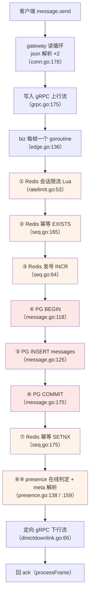
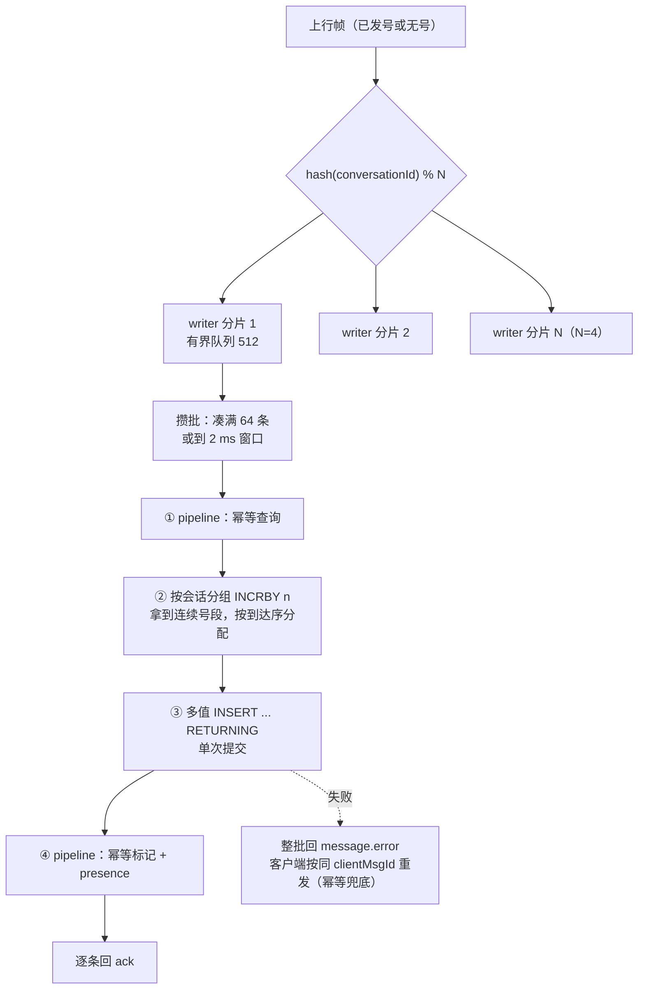
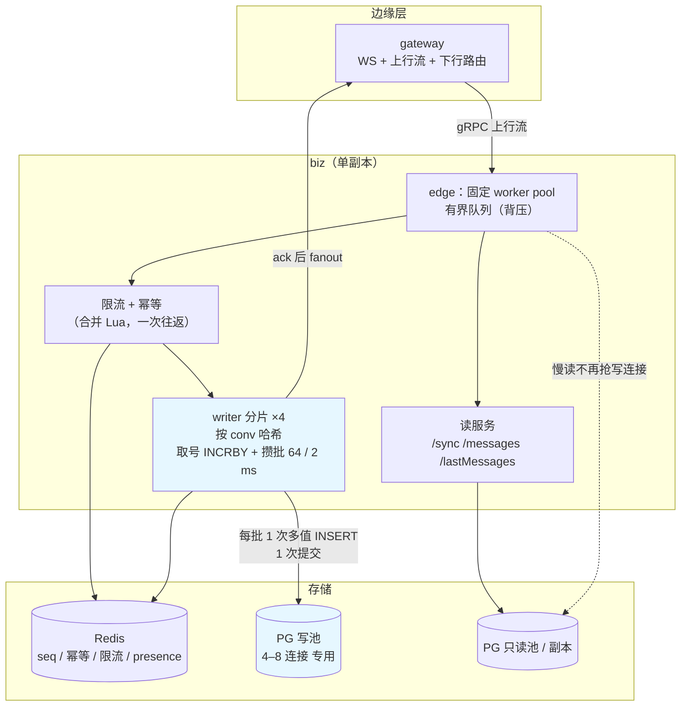
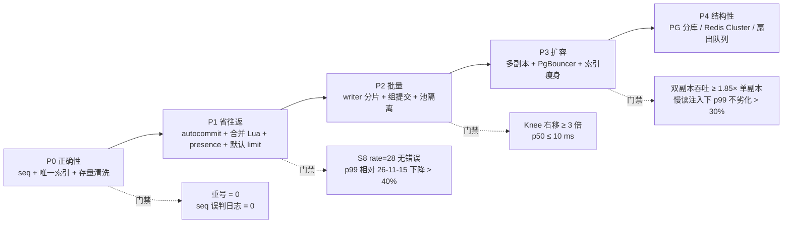

# 消息链路吞吐上限分析与提升技术方案

> 输入证据：`docs/监测设施/测试报告/26-11-15-全Go体系V3基线/`（S8 极限测试三点曲线 + 池满采样 + 正确性校验）
> 与源码事实（本文所有结论都给 `file:line`，不靠推测）。
> 验收口径见配套文档 [`问题分析/10-吞吐提升验收方案与压测口径.md`](../../../监测设施/测试报告/26-11-15-全Go体系V3基线/问题分析/10-吞吐提升验收方案与压测口径.md)。

---

## 分册索引

本文只给"整体判断、容量模型、路线图"。**每个优化方向的现状分析、优化原理、作用机制、具体方案与坑点，各有一篇独立分册**：

| 分册 | 方向 | 一句话 | 优先级 |
|---|---|---|---|
| [01](./01-seq发号器并发缺陷修复.md) | A · seq 修复 | 并发下 `seq > last` 必然误判并删键，实测 10.9% 重号 | **P0** |
| [02](./02-落库去显式事务.md) | B · 去显式事务 | BEGIN/COMMIT 是纯开销，3 次 PG 往返压成 1 次 → 2.5× | P1 |
| [03](./03-发号幂等限流合并Lua.md) | C · 合并 Lua | 限流+幂等+发号进一个脚本，3 次 Redis 往返 → 1 次 | P1 |
| [04](./04-presence定向下行定位优化.md) | D · presence 定位 | 两跳键合成一次 Lua + 短缓存；顺带删掉群扇出的重复检索 | P1 |
| [05](./05-组提交批量写入.md) | E · 组提交写批 | 每条一次提交 → 每批一次，4–7×，瓶颈从池迁到 CPU | **P2** |
| [06](./06-读写连接池隔离.md) | F · 池隔离 | 慢读不再抢占写连接；隔离而非扩容 | P1 |
| [07](./07-读端点分页与慢查询治理.md) | G · 读端点止血 | 无 limit 全量返回，558× 差距，0.2 人日 | P1 |
| [08](./08-索引瘦身与序列优化.md) | H · 索引瘦身 | 4 个索引里 2 个无消费方；序列不是瓶颈（含常见误判纠正） | P2 |
| [09](./09-边缘层背压与流写入串行化.md) | I · 边缘层 | 每帧 goroutine 无上界；gRPC 流并发 `SendMsg` 不安全 | P1 |
| [10](./10-横向扩容与连接池代理.md) | J · 横向扩容 | 代码早已支持多副本，卡在 `max_connections=100` | P3 |
| [11](./11-分库分片与Redis集群.md) | K · 分库与 Cluster | 64 个逻辑分区映射到多库；唯一跨分片查询是 lastMessages | P4 |

读法建议：**先读本文 §4（容量模型）判断该做到哪一级，再按优先级读对应分册**。每条分册都可独立实施，末尾有"与其他方向的关系"说明依赖。

排查中另发现 8 个**不属于优化方向**的独立问题（越权读取、正文长度未校验、多设备漏投、分区表建索引受限等），各有一篇文档，见 [`问题分析/`](./问题分析/00-问题清单与索引.md)。其中 3 个是现网缺陷，建议在动性能之前先修。

**如果对"分区/分表/分库/分片/副本"的底层机制还不清楚**，先读 [`技术分析/`](./技术分析/00-概念地图-分区-分表-分库-分片-副本.md)：那里按概念拆了 7 篇，讲的是 PG 内部目录结构、tuple routing、WAL 重放、分片键与再平衡、跨片代价等原理，本文只给结论。

---

## 0. 一句话结论

**能提升，而且现在离真实上限还很远。**

当前 2800 msg/s 的天花板**不是 CPU、不是网关、不是压测机**，而是"每条消息持有一次数据库连接、并且在这一次持有里做 3 次串行往返"造成的**连接池持有时间**。把它拆开就得到三级台阶：

| 台阶 | 动作 | 单副本预期 | 相对现状 | 依据 |
|---|---|---|---|---|
| 现状 | — | **2800 msg/s** | 1× | 实测（S8 Knee 25–27 msg/s/连接） |
| 第一级 | 3 次 PG 往返 → 1 次（autocommit），Redis 6 次 → 2 次 | **~7000 msg/s** | 2.5× | 池容量模型（§4，模型回算 2808，与实测吻合） |
| 第二级 | 每条消息一次提交 → 每批一次提交（组提交） | **1.2 万–2 万 msg/s** | 4–7× | CPU 约束推算（§4.4） |
| 第三级 | 多 biz 副本 + 连接池代理 + 读路径隔离 | **线性到 PG 上限；再往上按会话分库** | ×N | `EDGE_GRPC_ADDR` 已支持多后端 |

**但有一个前置条件**：必须先修 `seq` 发号器的并发缺陷（P0，本轮实测 10.9% 消息重号）。在错误的发号器上做吞吐优化，等于把"会重号"放大 7 倍。

---

## 1. 术语与口径

| 名词 | 全称 / 通俗解释 |
|---|---|
| **吞吐（msg/s）** | 每秒被服务端确认落库的消息条数。本项目口径 = `message.ack` 数 ÷ 稳态秒数。 |
| **Knee（拐点）** | 延迟开始超线性增长的负载点。S8 用"p99 相对上一级 > 2 倍"判定。 |
| **Cliff（崩溃点）** | ack 大面积超时的负载点。Knee 与 Cliff 之间只给区间，不给单点容量。 |
| **RTT（Round-Trip Time）** | 一次请求-响应的完整往返。本文特指"业务进程 → Redis/PG → 业务进程"的一次往返。 |
| **连接池持有时间** | 一条消息从 `pool.Acquire()` 到 `Release()` 的时长。**池的容量不是"并发数"，是"连接·秒/秒"**——32 个连接意味着每秒只有 32 个"连接·秒"可分配。 |
| **组提交（group commit）** | 把多条消息合并成一次事务提交，共用一次 WAL fsync。数据库自己的 group commit 只在**同一个连接**上生效，跨连接要靠应用层合并。 |
| **A/A 底噪** | 同一参数连跑两轮的差异。本轮实测 p99 相对差 **32.0%**（p50 2.9%），故小于 20% 的改善不可信。 |
| **读扩散** | 消息只落一份，投递时按"谁在线"扩散；离线成员靠 `/sync` 补拉。 |

---

## 2. 上游证据：三个必须尊重的硬事实

来自 V3 基线，本文不重复论证，只引用：

| 事实 | 数值 | 出处 |
|---|---|---|
| 吞吐拐点 | 2500–2700 msg/s（Knee），3000 msg/s（Cliff） | 报告 §四 S8 表 |
| 先失效的是连接池 | 压测中 `pg_conn` 恒定 **33**（池 32 + psql 1 条），goroutine 91→1445 振荡，负载一停回落到 20 | 报告 §五 |
| 资源远未饱和 | 服务端 CPU 1.37→1.89 核（18 核的 10.5%）、网关 0.44–0.48 核、压测端 ≤1.1% | 报告 §四 |

**这三条同时成立，唯一自洽的解释是：请求都堵在"等一个固定容量资源"上，而这个资源就是 pgxpool 的 32 条连接。**

---

## 3. 全链路逐跳成本（代码级）

### 3.1 一条单聊消息现在要花 9 次串行往返

上行链路：客户端 WS → gateway → gRPC 上行流 → biz `HandleUplink` → 落库 → ack → 下行。



| 序号 | 环节 | 介质 | 往返数 | 代码位置 |
|---|---|---|---|---|
| ① | 会话热点限流（Lua INCR + EXPIRE） | Redis | 1 | `biz/internal/service/ratelimit.go:53` |
| ② | 幂等前置查询（EXISTS） | Redis | 1 | `biz/internal/service/seq.go:165` |
| ③ | 发号（INCR） | Redis | 1 | `biz/internal/service/seq.go:64` |
| ④ | 开事务（BEGIN，**同时从池里取走一条连接**） | PG | 1 | `biz/internal/service/message.go:118` |
| ⑤ | 插入消息 | PG | 1 | `biz/internal/service/message.go:125` |
| ⑥ | 提交（COMMIT，**含一次 WAL fsync**） | PG | 1 | `biz/internal/service/message.go:175` |
| ⑦ | 幂等标记（SETNX） | Redis | 1 | `biz/internal/service/seq.go:175` |
| ⑧⑨ | 下行目标定位（在线判定 + meta 解析，两条 pipeline） | Redis | 2 | `biz/internal/service/presence.go:138,159` |
| — | 定向投递 | 内存/gRPC | 0 | `biz/internal/realtime/directdownlink.go:66` |

**合计：Redis 6 次 + PG 3 次 = 9 次串行往返。** 其中 ④⑤⑥ 全程持有同一条池连接（pgxpool 的 `Begin` 就是 Acquire）。

### 3.2 为什么"9 次往返"会变成吞吐上限

PG 在 colima 容器里，单语句平均 **3.1 ms**（`db_query_duration_seconds_sum/count`）。这条消息占用池的时间 ≈ 3 次 × 3.1 ms ≈ **9.3 ms**（实测按 2.5 条语句计为 7.75 ms）。

> 池容量不是"32 个并发"，而是**每秒 32 个"连接·秒"**。每条消息吃掉 7.75 ms，则理论极限 = 32 ÷ 0.00775 s ≈ **4129 msg/s**，实测拐点在 2800（利用率 68% 时 p99 已不可接受）。详见 §4。

### 3.3 顺带被忽略的三处"重复劳动"

| 现象 | 位置 | 代价 |
|---|---|---|
| 群消息查两次成员关系 | `realtime/handleUplink.go:123`（`GetConversationMembers`）+ `service/message.go:82-90`（`IsMember`） | 群消息多 2 次 PG 查询；且两次结果本可互推 |
| 群扇出查三次 presence | `handleUplink.go:155`（`FilterOnline`）+ `service/downlink.go:98`（`ReplicaOfBatch` 内部 2 次） | `ReplicaOfBatch` 返回"有 replica 的用户"本身已含在线判定，`FilterOnline` 是纯重复的 1 次往返 |
| 同一帧被 JSON 全量扫描 5 次 | gateway `conn.go:129`+`:184`（2 次 Unmarshal）；biz `edge_util.go:72`（`json.Valid`）+ `handleUplink.go:36`+`:69`（2 次 Unmarshal） | 每次都是全量扫描；20k msg/s 时是可见的 CPU。`json.Valid` 完全可删（后续 Unmarshal 自带校验） |

### 3.4 全项目排查：确认**不是**瓶颈的部分

为避免"只盯着看到的地方优化"，把仓库内可能与吞吐相关的部件逐一过一遍，附排除依据：

| 部件 | 排查结论 | 依据 |
|---|---|---|
| gateway 转发 | 不是瓶颈 | 2800 msg/s 时 0.44–0.48 核；10,000 连接 291 MB / 20,028 goroutine（2/连接）；建连成功率 100% |
| gRPC 上行流 | 不是瓶颈（但流数上限是个隐藏参数） | 每后端 4 条流（`config.go:60`），1 MB 流控窗口；2800 msg/s × ~300 B ≈ 0.84 MB/s，远低于窗口 |
| 连接维持 / 心跳 | 不是瓶颈，成本被误估过 | 25 s 心跳 → 10k 连接仅 400 RPS 的 presence 续约（`conn.go:139`）；"16 核"实为 bcrypt 登录（问题 04） |
| OAuth / JWKS / 发现端点 | 健康 | 补测 ≈1.1 万 rps、p99 4 ms（问题 08） |
| HTTP 读端点 | 不占 WS 链路，但**与写共享连接池** | 见 §5.4；`/user/messages` 无 limit 是最大单点消耗 |
| MinIO / S3 上传 | 不在消息链路 | 仅 `/user/uploads/*` 触发，与 `message.send` 无交集 |
| agent-server（独立仓库） | 不在消息链路 | 只在 biz 铸 `agent-token` 时被调用（低频），消息路径不经过 |
| Redis 单实例 | 现在不是瓶颈，优化后需复核 | 2800 msg/s × 6 命令 ≈ 1.7 万 ops/s；优化后每消息约 2 命令（幂等写 + presence 读，批内 pipeline），2 万 msg/s 时约 4 万 ops/s——单实例仍有余量，但已是第三级扩容的硬边界 |
| PG 读副本 | 未启用 | `PG_READONLY_URL` 未配置时 `RO()` 直接返回写池（`db.go:38-42`） |

**结论：吞吐链路上只有"业务层的落库方式"和"读端点对共用池的侵占"两处是真问题；其余部件的余量都在 5 倍以上。**

---

## 4. 容量模型：把"还能提升多少"算出来

### 4.1 公式

```
单副本吞吐上限 T ≈ pool_size / (q_per_msg × t_query) × η
```

- `q_per_msg`：每条消息消耗的 PG 语句数（实测 2.5：`messages` 2734/s + `raw` 4267/s @ 2800 msg/s）
- `t_query`：单语句平均耗时（实测 3.1 ms）
- `η`：可接受的池利用率（尾延迟约束下的工程系数，由本轮实测拐点**反推标定**为 **0.68**，不是理论值）
- `pool_size`：`biz/internal/db/db.go:67` 硬编码 32

### 4.2 模型自校验（先证明模型可信）

```
T = 32 ÷ (2.5 × 0.0031) × 0.68 = 2808 msg/s
```

**实测拐点 2800 msg/s。误差 0.3%。** 模型成立，可以拿它做外推。

### 4.3 第一级：削减往返

| 改动 | q_per_msg | 理论 T（η=1） | 预期 T（η=0.68） |
|---|---|---|---|
| 现状 | 2.5 | 4129 | **2808** |
| 只把池 32→64 | 2.5 | 8258 | 5615（**不可行，见 §5.6**） |
| BEGIN/COMMIT 合并为 autocommit（1 条语句） | 1.0 | 10323 | **7020** |
| 再把单语句耗时压到 2.5 ms（少一个索引） | 1.0 | 12800 | **8704** |

关键点：**`q_per_msg` 从 2.5 降到 1，等价于把池变大 2.5 倍，而且不占 PG 的 `max_connections`。** 这是投入产出比最高的一步。

### 4.4 第二级：组提交后，瓶颈迁移到 CPU

批量后 `q_per_msg` 不再是约束（每 32 条一次提交，池占用趋近于 0）。此时代码路径的 CPU 成为新上限：

```
现状：2800 msg/s 时 biz 1.89 核 → 0.675 核 / 1000 msg/s
18 核按 70% 可用（留 GC / 网关 / 压测端）≈ 12.6 核
→ CPU 上限 ≈ 12.6 ÷ 0.675 × 1000 ≈ 18,600 msg/s
```

叠加 §3.3 的 JSON 解析次数削减（-1/3 的帧解析）与对象分配优化，单副本落在 **1.2 万–2 万 msg/s** 是合理区间。超过这个量级必须横向扩副本。

### 4.5 第三级：扩副本的上限在哪

biz 无状态（seq/幂等/限流/presence 全在 Redis/PG），`EDGE_GRPC_ADDR` 逗号分隔即可多后端（`gateway/internal/upstream/multi.go:37`）。但：

| 约束 | 数值 | 何时撞上 |
|---|---|---|
| PG `max_connections` | 100 | 3 副本 × 32 = 96，加运维连接即超 → **2 副本是当前配置的硬顶** |
| 单 Redis 实例 | ~10 万 ops/s（理论） | 优化后每消息 2 次 Redis 命令，约 5 万 msg/s 时打满 |
| 单个 PG 写实例 | 取决于批量大小 | 组提交后 2 万–5 万 msg/s 区间见真章 |

→ 3 副本以上必须同时引入 **PgBouncer（transaction pooling）** 或提高 `max_connections`；再往上按 `conversation_id` **分库**（当前 64 个哈希分区已经是逻辑分片，可直接映射到 2–4 个 PG 实例）。

---

## 5. 提升方案（按"先正确、再省往返、再批量、最后扩容"排序）

### 5.0 优先级总表

| # | 方案 | 类型 | 单副本收益 | 风险 | 工作量 |
|---|---|---|---|---|---|
| A | [修 `seq` 并发缺陷 + 唯一约束](./01-seq发号器并发缺陷修复.md) | **正确性前置** | 0（但避免优化放大错误） | 中（需清洗存量） | 2–3 d |
| B | [单条 `INSERT`（去 BEGIN/COMMIT）](./02-落库去显式事务.md) | 省往返 | **2.5×** | 低 | 0.5 d |
| C | [限流/幂等/发号合并为一次 Lua](./03-发号幂等限流合并Lua.md) | 省往返 | 与 B 叠加，降 p50 | 低 | 1 d |
| D | [presence 单次 Lua + 短 TTL 本地缓存](./04-presence定向下行定位优化.md) | 省往返 | 降 p50 | 低 | 1 d |
| E | [**组提交写批（batch writer）**](./05-组提交批量写入.md) | 批量 | **3–7×**（相对 A–D） | 中 | 3–5 d |
| F | [写池 / 读池物理隔离](./06-读写连接池隔离.md) | 隔离 | 混合负载下大幅稳定 | 低 | 1 d |
| G | [`/user/messages` 默认 limit](./07-读端点分页与慢查询治理.md) | 止血 | 混合负载 +40% 池 | 极低 | 0.2 d |
| H | [索引瘦身与序列优化](./08-索引瘦身与序列优化.md) | 单语句成本 | -10%~20% 单语句耗时 | 低 | 0.5 d |
| I | [边缘层：有界 worker、SendMsg 串行化](./09-边缘层背压与流写入串行化.md) | 稳定性 + CPU | 降抖动 | 低 | 1–2 d |
| J | [横向扩副本 + PgBouncer](./10-横向扩容与连接池代理.md) | 扩容 | 近线性 | 中 | 2 d |
| K | [PG 按会话分库 / Redis Cluster](./11-分库分片与Redis集群.md) | 结构性 | 突破单实例 | 高 | 1–2 周 |

---

### 5.1 A：先修 `seq` —— 不改这一条，其他优化都是在放大错误

**缺陷**：`seq.go:69-76` 用**进程级共享**的 `convLastSeq` 判断"Redis 键是否被重建"。并发下 A 拿到 101、B 拿到 102 并把 `last` 写成 102，A 比较 `101 > 102` 为假 → 误判 → `Del(key)` → 从滞后的 `max(seq)` 重新装载 → 序号回退、与他人的 seq 重叠。本轮实测 **10.9% 新消息重号**。

**为什么它同时是吞吐问题**：每次误判多一次 `DEL` + 一次 `GREATEST(next_seq,max(seq))` 查询（占池），并让 `seqInitialized` 失效把后续请求推回双往返慢路径 → **负载越高误判越多，正反馈**。

**修法三件套**：① 快路径只做 `INCR`，删掉比较与 `Del`；② 键缺失时按 `GREATEST(...) + 安全余量` 装载（`max(seq)` 看不到在途事务）；③ 加 `UNIQUE(conversation_id, seq)` 兜底并实现**冲突重试**。存量 21 万组重复需先清洗；`CREATE INDEX CONCURRENTLY` 不支持分区表，要逐分区建后 `ATTACH`。

> 完整现状证据链、清洗 SQL、建索引两种姿势、6 个坑点：**[分册 01](./01-seq发号器并发缺陷修复.md)**

---

### 5.2 B+C+D：把 9 次往返压到 3 次

| 子方向 | 现状 | 改法 | 收益 |
|---|---|---|---|
| [B 去显式事务](./02-落库去显式事务.md) | `Begin → INSERT → Commit`（`message.go:118/125/175`），稳态下 3 条语句里 2 条是纯开销 | 稳态走单条语句自动提交；仅"首条消息/新成员"才开事务 | 池持有 3×3.1 ms → 1×3.1 ms，**吞吐 2.5×** |
| [C 合并 Lua](./03-发号幂等限流合并Lua.md) | 限流 / 幂等 / 发号三次 Redis 往返（`ratelimit.go:53`、`seq.go:165`、`seq.go:64`） | 一个脚本一次往返返回 `{limited, deduped, seq}`；键缺失走两阶段冷路径 | 3 RTT → 1 RTT |
| [D presence 定位](./04-presence定向下行定位优化.md) | `ZRANGEBYSCORE` + `HMGET` 两次往返（`presence.go:107-123`）；群扇出还多一次重复的 `FilterOnline` | 合成一次 Lua + 短 TTL 缓存；删掉重复检索 | 2 RTT → 1（热命中 0） |

**三者叠加：9 次往返 → 3 次（1 次合并 Lua + 1 次 INSERT + 1 次 pipeline）**，理论上限外推到 ~7000 msg/s。

三个方向各有一篇分册，其中 B 的坑点在"关系行不再与消息原子"，C 的坑点在"初值不能在热路径查 PG"，D 的坑点在"**缓存命中到旧副本会静默丢帧**，比不缓存更糟"。

---

### 5.3 E：组提交写批 —— 真正突破池约束（核心方案）

**原理**：数据库自己的 group commit 只在**同一连接/同一事务边界**生效。应用层把 N 条消息合成一条多值 `INSERT`、只提交一次，就把 N 次 fsync + N 次连接获取压成 1 次。池占用从「每条 3.1 ms」变成「每批 4 ms ÷ 32 条 ≈ 0.125 ms/条」，池不再是瓶颈，瓶颈迁移到 CPU（§4.4）。



**四个必须锁死的决策**（每个都有对应的坑，详见分册）：

| # | 决策 | 为什么不能省 |
|---|---|---|
| 1 | 按 `conversationId` 哈希分片到**固定 writer 串行处理** | `/user/sync` 是 `seq > since` 升序补拉，若 seq=5 的提交晚于 seq=6，已看到 6 的客户端**永远取不到 5**。当前代码本来就乱序（`edge.go:136`），批量会把窗口放大到批级 |
| 2 | 发号移进 writer，用 `INCRBY n` 取号段 | 先发号再入队会让 seq 顺序 ≠ 入队顺序；号段内按到达序分配才天然保序 |
| 3 | **ack 仍在 commit 之后** | 架构红线"禁止先 ack 后落库"。批量只是把 ack 推迟 ≤2 ms，语义不变 |
| 4 | 写池改为 writer 专属小池（N=4~8） | writer 数 = 并发写连接数，与读池物理隔离（§5.4） |

**最容易踩的三个坑**：① 用 `stream.Context()` 做批量 DB 调用 → 一个客户端断连毒死整批；② 毒丸消息（单条 1 MB）凑成 64 MB 批 → 整批失败 → 全客户端重发雪崩（当前**不校验 content 长度**）；③ 批内同一 `clientMsgId` 出现两次 → 白跳号且拿不到 `RETURNING` 行。

> 完整设计（数据结构、`unnest` 批量 SQL、12 个坑点、S9/S10 验证）：**[分册 05](./05-组提交批量写入.md)**

---

### 5.4 F+G：读写隔离与止血（各 1 d / 0.2 d）

**F. 写池 / 读池物理隔离**（[分册 06](./06-读写连接池隔离.md)）

`db.go:38-42`：`PG_READONLY_URL` 未配置时 `roPool = pgPool`，即**所有读请求与写请求共用 32 条连接**。隔离的本质不是扩容，而是把慢请求关进自己的隔间——即便连的是同一个库，只要池对象独立，队头阻塞就被切断。

**G. 读端点止血**（[分册 07](./07-读端点分页与慢查询治理.md)）

`chat_routes.go:78-88` 不传 `limit` 时走 `AllMessages`（`chat.go:81-83`，`ORDER BY timestamp ASC` 无 LIMIT）。实测 **7 rps / p50 1874 ms** vs `limit=50` 的 **3964 rps / p50 5 ms**，差 558 倍。按"连接·秒"算，**7 rps 就吃掉 41% 的池**。同类还有 `/user/lastMessages`（p50 52 ms，成本来自"每个会话各一次索引查找 + 多分区归并"，与会话数线性相关，而非扫全表）。

> 这条是**投入最小、止血最大**的一项：0.2 人日。不修它，分册 06 的隔离只是把漏洞挪个地方。

---

### 5.5 H+I：单语句成本与边缘层（各 0.5–2 d）

**H. 索引瘦身与序列**（[分册 08](./08-索引瘦身与序列优化.md)）

`0007_messages_partition.up.sql:102-105` 建了 4 个索引，每次 INSERT 维护 4 份。其中 **`idx_messages_conv_ts` 只被 `AllMessages` 消费**（G 修完后无消费方）、**`idx_messages_sender_ts` 全仓无消费方**，两个都可以删。预期单语句耗时 −10%~20%。

序列的常见误判要纠正：`CACHE 1` **并不是每次 `nextval` 都写 WAL**（PG 内部按 32 次一批记录），所以"改 CACHE 200 提升吞吐"通常是伪优化，需实测确认。

**I. 边缘层两处必须修**（[分册 09](./09-边缘层背压与流写入串行化.md)）

| 问题 | 位置 | 影响 |
|---|---|---|
| **gRPC 流并发 `SendMsg`** | `directdownlink.go:66`、`grpc.go:175/200`；`grpc.go:174` 的注释「grpc-go 保证 SendMsg 并发安全」是**错的** | grpc-go 明确"同一 stream 上多 goroutine 并发 `SendMsg` 不安全"。失败 → 回退 pub/sub 全副本广播（O(副本数)），与实测 fallback 0.35% 吻合 |
| **每帧一个 goroutine，无上界** | `edge.go:136`、`gateway/hub/conn.go:199` | 10k 连接 × 30 msg/s ≈ 30 万 goroutine/s 创建；实测峰值 5809 且负载一停即回落 |

修法：每流一条"单写 goroutine + 有界帧队列"（**不是**一把大锁——`Send` 会因流控窗口阻塞，锁会把延迟传染给同流的其他用户）；上行改固定 worker 池 + 有界队列。

---

### 5.6 明确不做的四件事（避免走弯路）

| 想法 | 为什么不做 |
|---|---|
| **只把 `MaxConns` 32 → 64** | PG `max_connections=100`，双副本 128 直接越界；且 `q_per_msg` 未变，只能拿到 ~1.9×（模型 §4.3），还会与读路径抢连接。**先降 `q_per_msg`，再谈扩池。** |
| **`synchronous_commit=off`** | 能立刻 3×，但已 ack 的消息在崩溃时可能丢最后 ~600 ms，违反"落库即真相"红线。组提交用同样的机制（减少 fsync 次数）拿到收益而不牺牲持久性。 |
| **消息队列前置（写队列 → 消费落库 → ack）** | ack 语义被拆成两段，需 reply 通道重建关联，延迟从 ~3 ms 涨到 5–100 ms。已被架构文档论证并否决（§4.1）。队列的正确位置是扇出与旁路事件流。 |
| **加 gateway 副本 / 加 gRPC 流数（4→16）** | 网关实测 0.44–0.48 核，纯转发；1 MB 流控窗口在 2800 msg/s × 300 B ≈ 0.84 MB/s 下远未触及。都不是瓶颈。 |

### 5.7 J/K：扩容与结构性突破

| 方向 | 核心约束（一句话） | 分册 |
|---|---|---|
| J 横向扩容 | 代码早支持多副本，卡在 `max_connections=100`：2 副本 × 32 已是 69%，3 副本越界。所以**先把每副本连接降下来，再谈加副本** | [分册 10](./10-横向扩容与连接池代理.md) |
| K 分库/Cluster | 64 个逻辑分区已就绪，缺的是"分区 → 物理库"映射。唯一跨分片查询是 `lastMessages`；`user_conversations` 按 `user_id` 查、无法与消息同键 | [分册 11](./11-分库分片与Redis集群.md) |

---

## 6. 目标态架构



**链路变化（相对现状）**：

| 维度 | 现状 | 目标 |
|---|---|---|
| 每消息 PG 语句 | 2.5 | **0.03**（1/32） |
| 每消息 Redis 往返 | 6 | **0.1**（2/32 + 1 取号） |
| 每消息持有池连接 | 9.3 ms | **~0.13 ms** |
| ack 时机 | commit 后（同现状） | commit 后（**语义不变**） |
| p50 RTT | 25 ms @ 2500 msg/s | 5–7 ms（预估） |

---

## 7. 实施路线与门禁



| 阶段 | 内容（→ 分册） | 验收（详细口径见配套文档） |
|---|---|---|
| **P0**（2–3 d） | [01](./01-seq发号器并发缺陷修复.md)：删 `seq > last` 与 `Del(key)`；清洗 21 万组重复；建 `UNIQUE(conversation_id, seq)`；并发单测（N goroutine × 10 万次取号断言集合大小 = 10 万） | 重号 0；`seq 疑似键重建` 日志 0；L4/L16 链路校验通过 |
| **P1**（3–4 d） | [02](./02-落库去显式事务.md)/[03](./03-发号幂等限流合并Lua.md)/[04](./04-presence定向下行定位优化.md)/[07](./07-读端点分页与慢查询治理.md) 四项；`MaxConns` 改为 env 可配 | S8 `rate=28` 零错误；p99 至少下降 40%（远超 32% 底噪） |
| **P2**（5–7 d） | [05](./05-组提交批量写入.md) batch writer；[06](./06-读写连接池隔离.md) 池隔离；`pool_wait_seconds` 指标 | Knee 右移到 ≥ 8000 msg/s；p50 ≤ 10 ms；提交顺序一致性校验通过 |
| **P3**（3–5 d） | [08](./08-索引瘦身与序列优化.md) 索引瘦身；[09](./09-边缘层背压与流写入串行化.md) worker pool 与流写入串行化；[10](./10-横向扩容与连接池代理.md) 多副本 + PgBouncer | 双副本线性度 ≥ 1.85×；混合负载（慢读/慢消费者注入）下 p99 不劣化 |
| **P4**（1–2 周） | [11](./11-分库分片与Redis集群.md) 按 conv 分库、Redis Cluster、万人大群扇出队列 | 按届时的容量目标定义 |

---

## 8. 附录：证据索引

| 事实 | 位置 |
|---|---|
| 池上限 32（硬编码） | `biz/internal/db/db.go:67` |
| RO 池未配置时与写池同池 | `biz/internal/db/db.go:38-42` |
| 显式事务 3 条语句 | `biz/internal/service/message.go:118,125,175` |
| 幂等前置查询 / 标记 | `biz/internal/service/seq.go:165,175` |
| 发号快路径与误判 `Del` | `biz/internal/service/seq.go:63-78` |
| 发号 Lua（键缺失装载） | `biz/internal/service/seq.go:35-41` |
| 会话限流 Lua | `biz/internal/service/ratelimit.go:35-58` |
| presence 两次往返 | `biz/internal/service/presence.go:138,159` |
| 每帧一个 goroutine（无上界） | `biz/internal/realtime/edge.go:136` |
| 定向下行并发 `Send` | `biz/internal/realtime/directdownlink.go:66` |
| "SendMsg 并发安全"错误注释 | `gateway/internal/upstream/grpc.go:174` |
| 每连接 in-flight 上限 64 | `gateway/internal/hub/conn.go:44,197-199` |
| 每后端流数默认 4 | `gateway/internal/config/config.go:60` |
| `/user/messages` 无 limit 全量 | `biz/internal/api/chat_routes.go:78-88`、`biz/internal/repo/chat.go:81-83` |
| 4 个索引 | `biz/migrations/0007_messages_partition.up.sql:102-105` |
| 多后端哈希 + 健康降级 | `gateway/internal/upstream/multi.go:37-50` |
| DB 埋点已是 Histogram | `biz/internal/metrics/metrics.go:91-95` |
| 吞吐拐点 / 池满 / 10.9% 重号 | `26-11-15-全Go体系V3基线/` 报告 §四、§五、§8.1 |

**一处需要更正的历史结论**：V3 报告 §十-1 写「`db_query_duration_seconds` 是 Summary，无 bucket」。代码核查（`metrics.go:91`，2026-09-18 起即为 `HistogramVec`，buckets 齐全）表明该判断不成立——若 `histogram_quantile()` 返回空，原因在查询写法（缺 `sum by (le)`）或抓取目标，而不是指标类型。排水位时不要照着"改 Summary 为 Histogram"去改。
