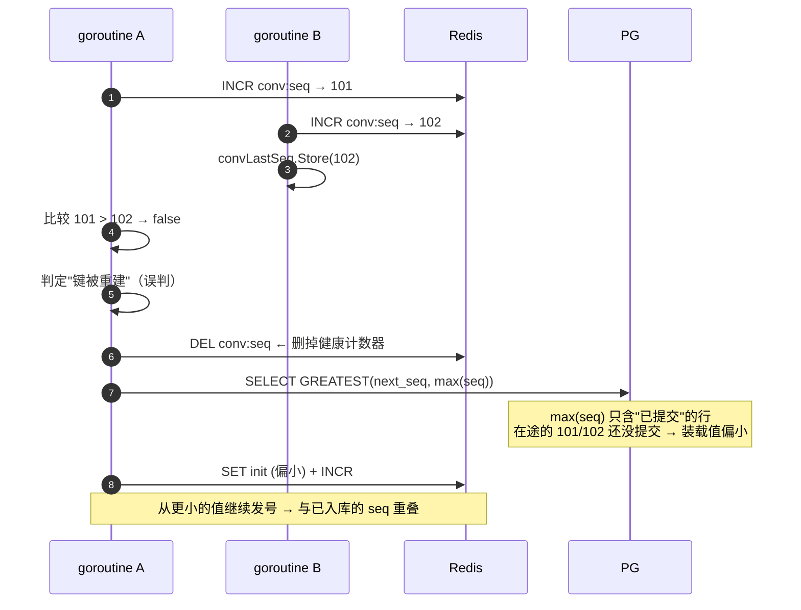
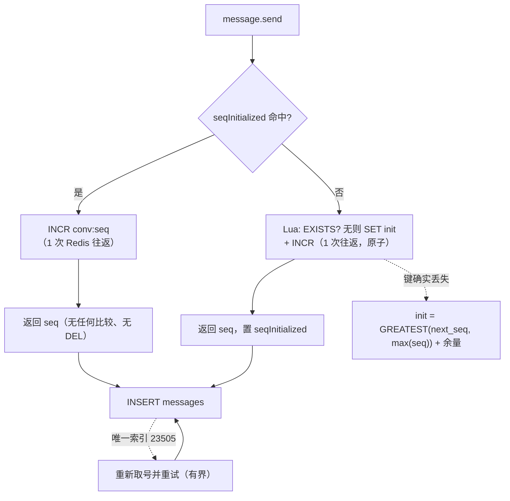

# 01 · seq 发号器并发缺陷修复（方向 A）

> 归属：[`00-消息吞吐上限分析与提升技术方案.md`](./00-消息吞吐上限分析与提升技术方案.md) §5.1
> 优先级：**P0（正确性前置，必须先于任何吞吐优化）**
> 一句话：`seq > last` 这个"防回卷"判据在并发下必然误判，误判后 `Del(key)` 把健康计数器删掉，从滞后的 DB 最大值重新装载 → 序号回退 + 重号。本轮实测 **10.9% 的新增消息 seq 与别人重复**。

---

## 一、现状分析

### 1.1 三条独立证据同时指向同一处

| 证据 | 观测 | 出处 |
|---|---|---|
| 数据 | `(conversation_id, seq)` 重复 **212,113 组**，其中本轮新增 199,611 组；本轮新增消息 1,838,365 条 → **10.9%** | V3 报告 §8.1 |
| 日志 | `seq 疑似键重建,回慢路径重新装载` 出现 **170,415 次**，且全时段连续（每分钟 1,300–7,300 次），不是启动突发 | 同上 |
| 代码 | 该日志只可能来自 `seq.go:74`，紧跟着就是 `Del(ctx, key)` | `biz/internal/service/seq.go:74-75` |

三条互相印证：**判据被误触发 17 万次，每次触发都真的删了一次键。**

### 1.2 代码现场

`biz/internal/service/seq.go:63-87`：

```go
if _, ok := seqInitialized.Load(convID); ok {          // 本进程已装载过
    seq, err := rdb.Incr(ctx, key).Result()            // 原子自增，返回互不相同的值
    if err == nil {
        if last, ok2 := convLastSeq.Load(convID); !ok2 || seq > last.(int64) {
            convLastSeq.Store(convID, seq)
            return seq, nil
        }
        slog.Warn("seq 疑似键重建,回慢路径重新装载", ...)  // ← 误判点
        _ = rdb.Del(ctx, key).Err()                    // ← 破坏性动作
    }
    seqInitialized.Delete(convID)
}
seq, err := nextSeqWith(ctx, rdb, convID, loadInit, bump)  // 慢路径：GET → loadInit → Lua
```

`convLastSeq`（`seq.go:93`）是**进程级共享**的"本进程见过的最大 seq"，而 `Incr` 的返回值在并发下**不保证与写入 `last` 的顺序一致**。

### 1.3 误判的完整因果链



**关键点**：`max(seq)` 在 READ COMMITTED 下**看不到未提交的行**。任何"从 DB 重新装载"的动作，在并发中都只能装载到一个**落后于在途发号**的值。

### 1.4 为什么这个缺陷能长期存在

`messages` 表只有 `PRIMARY KEY (id, conversation_id)`（`migrations/0007:25`），**没有任何约束能拦住重复的 `(conversation_id, seq)`**。所以每次误判都只是静默写脏数据，直到有人主动跑聚合查询才发现——历史上 9-14、9-17、9-18、9-20 各有一批同形态重复，只是此前没做这项校验。

### 1.5 它同时是一个吞吐问题（正反馈）

每次误判的代价不止一条脏数据：

1. 一次 `DEL`（Redis）；
2. 一次 `loadNextSeqFromPG` 的 `GREATEST(next_seq, max(seq))` 查询——**要占一条 PG 连接**（`seq.go:132-134`）；
3. `seqInitialized.Delete(convID)` 让后续请求退回"`GET` + Lua"的**双往返慢路径**。

于是形成正反馈：**负载越高 → 在途越宽 → 误判越多 → 池越满 → 在途更宽**。这正是 V3 报告里"退化倍率随负载单调上升（3000 msg/s 档 p99 退化 20×）"的机制来源。

---

## 二、优化原理

### 2.1 `INCR` 已经提供了所需的全部保证

| 需求 | `INCR` 是否满足 | 说明 |
|---|---|---|
| 会话内单调递增 | ✅ | Redis 单线程执行，命令天然串行化 |
| 并发不重号 | ✅ | 每次 `INCR` 返回的值全局唯一（同一键） |
| 崩溃后不回退 | ⚠️ 仅当键还在 | Redis 无持久化时重启会丢键，`INCR` 从 0 开始 → 返回 1 |

也就是说：**"并发正确性"完全由 Redis 保证，"防回卷"只应针对"键丢失"这一种情况。** 而现有代码用一个**进程内共享变量**去判断"键是否丢失"，在并发下无法区分"键丢了"和"别人比我快"。

### 2.2 判据设计原则

一个正确的"键丢失检测"必须满足：**判据本身不依赖跨 goroutine 的时序**。三种可行做法：

| 做法 | 机制 | 评价 |
|---|---|---|
| Redis 持久化（AOF everysec） | 键根本不会丢 | **首选**，把问题消灭在源头 |
| Lua 内做 `GREATEST` | `SET key GREATEST(GET, init) + INCR`，判据在 Redis 单线程内 | 可选，能防"装载值偏小"，但不能防"在途未提交" |
| 键缺失时按**安全余量**装载 | `init = max(seq) + 余量(如 1000)` | 兜底，接受跳号 |

**推荐组合：AOF 常开 + 键缺失时 `+余量` + 唯一索引兜底。** 三者职责不同：AOF 是预防，余量是补偿，唯一索引是最后一道门（也是唯一能证明"再也不会重号"的东西）。

---

## 三、作用机制（改完之后链路长什么样）



与现状的差别只有三点：**不比较、不删除、冲突可重试**。

---

## 四、具体方案

### 4.1 代码改动（三处删、两处加）

**改动 1：快路径只做 INCR**

```go
// seq.go nextSeq 快路径
if _, ok := seqInitialized.Load(convID); ok {
    seq, err := rdb.Incr(ctx, key).Result()
    if err == nil {
        return seq, nil          // 删除 convLastSeq 比较、删除 Del、删除 Delete(seqInitialized)
    }
    seqInitialized.Delete(convID) // 仅 INCR 出错时才回慢路径
}
```

**改动 2：删除 `convLastSeq` 整张表**

它唯一的用途就是那个错误判据。删掉后顺带解决一个隐性内存问题：`convLastSeq` 与 `seqInitialized` 都是 `sync.Map`，**按会话数无界增长、永不清理**。保留 `seqInitialized` 是值得的（省一次 `GET`），但建议加容量护栏（与 `idemLocal` 的 `1_000_000` 清空策略同款，见 `seq.go:154-157`）。

**改动 3：键缺失时装载加安全余量**

```go
// loadNextSeqFromPG
SELECT GREATEST(c.next_seq,
                COALESCE((SELECT max(seq) FROM messages WHERE conversation_id = $1), 0))
       + $2   -- $2 = seqLoadMargin（默认 1000，可配）
```
理由见 §1.3：`max(seq)` 看不到在途事务，纯装载必落后。

**改动 4：唯一索引**

```sql
-- 分区键 conversation_id 已在索引列中，PG 11+ 允许直接在分区主表上建
CREATE UNIQUE INDEX uq_messages_conv_seq ON messages (conversation_id, seq);
```

**改动 5：冲突重试（必须与改动 4 同批上线）**

```go
const maxSeqRetry = 3
for attempt := 0; attempt < maxSeqRetry; attempt++ {
    seq, err = NextSeq(ctx, convID)
    ...
    err = tx.QueryRow(insertSQL, ...).Scan(...)
    if isUniqueViolation(err, "uq_messages_conv_seq") { continue } // 换个号重来
    break
}
```

### 4.2 存量数据清洗（建索引之前）

21 万组重复无法直接建唯一索引。清洗策略：

```sql
-- 每组重复保留 id 最小的一条，其余按 (created_at, id) 重排到 max(seq) 之后
WITH dup AS (
  SELECT id, conversation_id, seq,
         row_number() OVER (PARTITION BY conversation_id, seq ORDER BY id) AS rn
  FROM messages
), mx AS (
  SELECT conversation_id, max(seq) AS base FROM messages GROUP BY 1
), renum AS (
  SELECT d.id, m.base + row_number() OVER (PARTITION BY d.conversation_id ORDER BY d.id) AS new_seq
  FROM dup d JOIN mx m USING (conversation_id)
  WHERE d.rn > 1
)
UPDATE messages m SET seq = r.new_seq FROM renum r WHERE m.id = r.id;
```

> 清洗前**必须**按会话导出快照（`COPY ... TO`），便于回滚。分区表上这条 UPDATE 是一次全表重写，请在维护窗口做，并把 `synchronous_commit` 临时设为 `off`（这是**离线维护**，不违反线上"落库即真相"的红线）。

### 4.3 建索引的两种姿势

| 方式 | 阻塞 | 适用 |
|---|---|---|
| 维护窗口直接 `CREATE UNIQUE INDEX` | 对写入持 `SHARE` 锁（阻塞 INSERT） | 数据量小、可停机 |
| 逐分区 `CONCURRENTLY` + `ALTER INDEX ... ATTACH PARTITION` | 零阻塞 | 线上 747 万行 |

**注意：`CREATE INDEX CONCURRENTLY` 不支持分区表**（PG 16 仍报 `cannot create index on partitioned table concurrently`）。第二种姿势要生成 64 段 DDL：先在每个 `messages_pNN` 上并发建 `uq_messages_pNN_conv_seq`，再在父表建空索引，最后逐个 `ATTACH PARTITION`。

---

## 五、坑点

### 坑 1：现有单测把错误行为固化了

`seq_test.go:106-141` 的 `TestNextSeqKeyRebuild` 断言的正是"比较 `seq > last` → 回慢路径重新装载"。修复后它必然失败。**必须重写**为：

- 并发场景：N goroutine × 10 万次取号，断言集合大小 = 10 万且严格递增；
- 键丢失场景：清空 Redis 键后取号，断言 `>= max(seq)+margin`；
- 冲突重试：构造重复 seq，断言最终插入成功且 seq 唯一。

### 坑 2：唯一索引上线后，冲突不重试就等于丢消息

插入撞 `23505` 时当前代码会走"幂等查询 → 找不到 → 返回 `errUnexpectedIdemMiss`"（`message.go:146`），客户端收到 `message.error` 后重发，但**重发仍会撞同一个重复 seq**（因为新号段可能又撞），形成死循环。所以**冲突重试不是可选项，是唯一索引的配套件**。

### 坑 3：Redis 无持久化时，"装载 + 余量"仍可能撞在途

极端时序：Redis 重启 → 键丢失 → 会话 S 有 5 条在途消息（seq 101-105 已分配、未提交）→ 重新装载得到 `max(seq)=100` → 余量 1000 → 新号从 1101 开始 → **不会撞**。余量必须大于"重启瞬间的最大在途数"，1000 对单会话足够大。

但若某会话是超热点（500 msg/s × 30 s = 15000 条在途），1000 不够。所以**真正的解法是开 AOF**：

```conf
appendonly yes
appendfsync everysec   # 最多丢 1s 的 key 变更，配合余量足够
```

代价：Redis 写入吞吐下降约 10–20%，需要重新标定（见分册 00 §3.4：当前 Redis 远未饱和）。

### 坑 4：`CONCURRENTLY` 与分区表

见 §4.3。另一个细节：`ATTACH PARTITION` 要求父索引与子索引的**列、顺序、操作符类、排序规则、谓词完全一致**，否则报错；建子索引时不要加 `WHERE`。

### 坑 5：多副本下 `convLastSeq` 本来就没有跨副本语义

每个 biz 副本各自维护一份 `convLastSeq`，副本 A 不知道副本 B 发了多少号。也就是说**这个判据在任何多副本部署下都是失效的**——它不是"偶发误判"，而是"设计上不可能正确"。这条应当写进 commit message，避免后人再把它"优化"回来。

### 坑 6：清洗期间的 seq 跳变会误导客户端

重排后的 seq 会跳到 `max(seq)` 之后。如果客户端缓存了旧 seq（如未读计数按 `lastSyncedSeq` 差值算），会出现一次"未读暴增"。建议：清洗窗口内公告 + 客户端重新全量同步一次。

---

## 六、验证方法

| 项 | 方法 | 通过标准 |
|---|---|---|
| 重号归零 | `SELECT count(*) FROM (SELECT conversation_id, seq FROM messages WHERE created_at > $1 GROUP BY 1,2 HAVING count(*)>1) t` | = 0 |
| 误判归零 | `grep -c 'seq 疑似键重建'` | = 0 |
| 键重建不触发 DEL | Redis `COMMANDSTATS` 或 `redis_exporter` 的 `cmdstat_del` | 稳态无 `DEL conv:seq:*` |
| 并发正确性 | 单元测试：50 goroutine × 2000 次 | 无重复、无回退 |
| 池压力下降 | `db_query_duration_seconds{model="raw"}` QPS @ 2800 msg/s | `max(seq)` 装载查询明显减少 |
| 索引生效 | `\d+ messages` 与 `\d+ messages_p00` | 父索引 + 64 个分区索引均存在 |

---

## 七、与其他方向的关系

| 方向 | 关系 |
|---|---|
| 02 去显式事务 | 独立，可并行；但冲突重试逻辑在 02 改写后的单语句路径里更好实现 |
| 05 组提交批量写入 | **强依赖本方向**。批量写入把并发窗口从"单条"放大到"一批"，乱序提交的概率显著上升；没有唯一索引 + 保序设计，批量会成倍放大重号 |
| 03 合并 Lua | 合并脚本文本里保留 `SET init` 分支，需与本方向的"装载 + 余量"一致 |
| 08 索引瘦身 | 唯一索引是**新增**，不要和"删冗余索引"混在一次迁移里做 |
