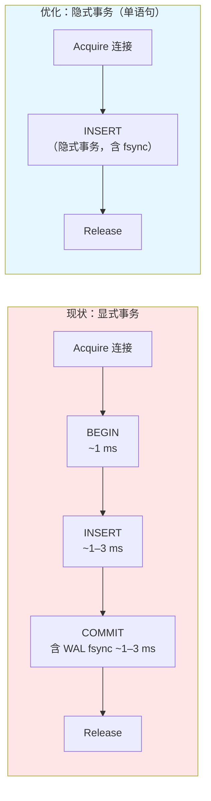
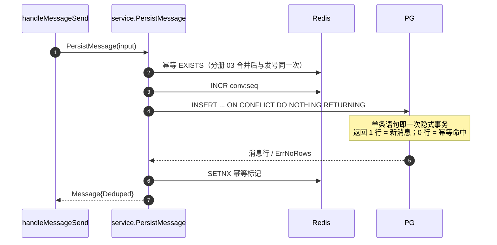

# 02 · 落库去显式事务：3 次 PG 往返压成 1 次（方向 B）

> 归属：[`00-消息吞吐上限分析与提升技术方案.md`](./00-消息吞吐上限分析与提升技术方案.md) §5.2-B
> 优先级：**P1（投入产出比最高的一步：0.5 人日换 2.5× 吞吐）**
> 一句话：稳态下 `user_conversations` 已被进程内缓存命中，`BEGIN` 与 `COMMIT` 是**纯开开销**——它们不产生任何业务效果，却让每条消息多占两次网络往返、并把连接池持有时间放大 3 倍。

---

## 一、现状分析

### 1.1 代码现场

`biz/internal/service/message.go:117-179`：

```go
tx, err := db.PG().Begin(ctx)        // ① 从连接池 Acquire 一条连接
if err != nil { return nil, err }
defer tx.Rollback(ctx)

err = tx.QueryRow(ctx, `INSERT INTO messages (...) VALUES (...)
    ON CONFLICT (conversation_id, sender_id, client_msg_id) DO NOTHING
    RETURNING id, ...`).Scan(...)     // ② 一条 INSERT

// ③ 关系行：只有 missing 非空时才执行（稳态 missing 为空，见 :155-173）
if len(missing) > 0 { tx.Exec(...) }

if err := tx.Commit(ctx); err != nil { return nil, err }   // ④ COMMIT
```

在压测的稳态单聊场景里，实际发生的是 **① → ② → ④** 三步，中间没有任何别的语句。

### 1.2 这三次往返在池上的成本

| 量 | 数值 | 来源 |
|---|---|---|
| 单语句平均耗时 | 3.1 ms | `db_query_duration_seconds` 均值 |
| 每消息 PG 语句数 | 2.5（`messages` 2734/s + `raw` 4267/s @ 2800 msg/s） | V3 报告 §五 |
| 每消息池占用 | **7.75 ms** | 2.5 × 3.1 ms |
| 池容量 | 32 条连接 = 每秒 32 个「连接·秒」 | `db.go:67` |
| 理论上限 | 32 ÷ 0.00775 ≈ 4129 msg/s | 推算 |
| 实测拐点 | 2800 msg/s | S8 |

**注意 `raw` 这个标签**：`queryTracer` 用正则从 SQL 里抽表名（`db.go:127`），`BEGIN` / `COMMIT` 抽不到表名，于是全部落进 `model="raw"`。所以 **4267/s 的 `raw` 几乎全部来自 BEGIN + COMMIT**：稳态每条消息 2 条，实测 1.56 条/消息，差额来自**幂等命中**（`message.go:98-103` 在 `Begin` 之前就返回，不产生事务）。这就是"2.5 条语句"的构成：1 条 INSERT + 1.56 条事务开销。

### 1.3 为什么稳态不需要事务

事务在这里承担两个职责：

| 职责 | 稳态是否仍需要 | 理由 |
|---|---|---|
| 保证「消息行 + 关系行」原子写入 | **不需要** | 关系行在稳态恒为空（`ucExistsCache` 命中），只有**会话首条消息**或**新成员入群**才会写 |
| 保证 `seq` 与 `INSERT` 的原子性 | **本来就没有** | `seq` 在 Redis 里取（`message.go:106`），与 PG 事务无关 |

换句话说：**事务保护的是"一个几乎不会发生的分支"，代价却由每一条消息承担。**

---

## 二、优化原理

### 2.1 显式事务 vs 隐式事务

PostgreSQL 的扩展查询协议下，一条不在事务块里的 `INSERT` 会自动包在**隐式事务**里执行（autocommit）。两者在数据库侧的差别只有一点：显式事务需要 `BEGIN` / `COMMIT` 两条额外的协议消息往返。



| 维度 | 显式事务 | 隐式事务 |
|---|---|---|
| 应用↔PG 往返 | 3 | **1** |
| 连接持有时间 | 3 × 单语句耗时 | 1 × 单语句耗时 |
| WAL fsync 次数 | 1（COMMIT 时） | 1（语句结束时） |
| 原子性范围 | 多语句 | 单语句 |

**关键认知：这一步省的是往返与连接持有，不是 fsync。** 所以收益上限是 `q_per_msg` 的比值（2.5×），而不是无限大。真正减少 fsync 要靠分册 05 的组提交。

### 2.2 为什么"少 2 次往返"能换 2.5 倍吞吐

因为吞吐被**池的持有时间**卡住，而不是被"每秒能发多少请求"卡住。用 Little 定律看：

```
池内并发 = 到达率 × 单请求持有时间
池容量 32 恒定 → 到达率上限 = 32 ÷ 持有时间
```

持有时间从 7.75 ms 降到 3.1 ms，上限就从 4129 涨到 10323（理论），乘工程系数 0.68 后约 **7000 msg/s**。模型与实测拐点吻合到 0.3%（见 00 §4.2）。

---

## 三、作用机制

改完之后，单聊稳态路径变成：



- 连接只在"INSERT 那一瞬间"被持有，acquire→release 窗口从 ~9 ms 缩到 ~3 ms；
- 同一时刻池能容纳的**在途消息数**翻 3 倍，排队长度与 p99 同步下降。

---

## 四、具体方案

### 4.1 改写后的 PersistMessage

```go
// 稳态：单条语句，自动提交
const insertMsgSQL = `INSERT INTO messages
    (conversation_id, sender_id, seq, client_msg_id, content, type, status, mentions, extra, file_info)
    VALUES ($1,$2,$3,$4,$5,$6,'sent',$7,$8,$9)
    ON CONFLICT (conversation_id, sender_id, client_msg_id) DO NOTHING
    RETURNING id, conversation_id, sender_id, seq, client_msg_id, content, type, status,
              mentions, is_edited, is_deleted, extra, file_info, edit_history, timestamp, created_at, updated_at`

var m Message
err := db.PG().QueryRow(ctx, insertMsgSQL, ...).Scan(...)
if errors.Is(err, pgx.ErrNoRows) {
    // 幂等命中：查首次结果返回（不重复扇出）
    MarkIdempotent(ctx, ...)
    return &PersistMessageResult{Message: findByIdemKey(...), Deduped: true}, nil
}
if err != nil { return nil, err }

// 关系行：只有首条消息 / 新成员才走事务（低频路径，保持原样）
if len(missing) > 0 {
    if err := insertUserConversations(ctx, input.ConversationID, missing); err != nil { ... }
    // 注意：此处已无"与消息同事务"的保证，见坑 2
}
MarkIdempotent(ctx, ...)
return &PersistMessageResult{Message: &m}, nil
```

### 4.2 关系行归属的三种取舍

| 方案 | 原子性 | 复杂度 | 建议 |
|---|---|---|---|
| A. 关系行先写，再写消息（各一条语句） | 消息可能失败而关系行留下（无害：关系行冗余但幂等） | 低 | **推荐**。关系行"多写"不影响正确性，缺了才会影响 |
| B. `missing` 非空时仍用事务包住两条语句 | 强 | 低（保留原路径） | 可选，首条消息频率极低 |
| C. 用 CTE 把两条语句合成一条 | 强 | 中（可读性差） | 不必要 |

**推荐 B**（`missing` 非空时才开事务）：这条路径每会话只走 1~2 次，多两个 RTT 可忽略，换来"关系行与消息原子"。若不想引入分支、坚持全程单语句，则**必须按 A 的顺序**（先写关系行、再写消息）。

**不要选"不写关系行"**——`IsConversationMember`（`read.go:15-24`）与 `/user/sync` 的鉴权都依赖它（`sync_routes.go:72`）。

> 顺序不是随便定的：**"先写关系行、再写消息"** 的失败模式是"多一行冗余关系"（无害）；反过来是"消息在、关系行缺"（该用户永久 403）。完整的代价分析、四种写法对比见 [性能优化 06](./技术分析/性能优化/06-显式事务与隐式事务的取舍.md)。

### 4.3 顺带做掉的两件小事

1. **`RETURNING` 列裁剪**：ack 只需要 `seq` 与 `id`，下行扇出需要完整行。可以只 `RETURNING id, seq` 再用已知入参拼装 Message，少一次 17 列的解码（约 3–5 μs/条，1 万条/秒时是 3–5% CPU）。
2. **`MaxConns` 改为 env 可配**：`db.go:67` 硬编码 32。改成 `PG_MAX_CONNS`（默认 32）是分册 06/10 的前置。

---

## 五、坑点

### 坑 1：`ErrNoRows` 分支必须原样保留

`ON CONFLICT DO NOTHING` 在冲突时**不返回任何行**，pgx 会报 `pgx.ErrNoRows`。这是幂等命中的**唯一信号**，不能当成错误吞掉，也不能改成 `SELECT ... FOR UPDATE` 先查后插（那是两次往返，还引入竞态）。

### 坑 2：关系行与消息不再原子

方案 A 下若"消息插入成功、关系行插入失败"，结果是：消息在库里，但成员关系缺失 → 该用户 `/sync` 会被 403 拒绝（`sync_routes.go:77`）。

缓解：
- 关系行插入失败只记日志、**不影响 ack**（因为消息已落库，回滚不了）；
- 补一个后台补偿任务，或让 `IsConversationMember` 在 miss 时回退到"从 `conversation_id` 前缀推导"（单聊 `single_<u1>_<u2>` 可完全推导，群聊必须查表）。

### 坑 3：不减少 fsync，别期待"再快 3 倍"

这一步只是把 3 条语句变 1 条。`synchronous_commit=on` 下每条语句仍要等一次 WAL 落盘。若只做这一步，吞吐上限约 7000–8700 msg/s（见 00 §4.3），不会到 2 万。

### 坑 4：pgx 的语句缓存与 PgBouncer 冲突

pgx 默认 `QueryExecModeCacheStatement`，会在连接上准备并缓存 prepared statement。**一旦前面挂了 PgBouncer 的 transaction pooling（分册 10），同一逻辑连接的物理连接会漂移，prepared statement 失效**，报 `prepared statement "stmtcache_xxx" does not exist`。

对策（二选一）：
- PgBouncer ≥ 1.21 开 `max_prepared_statements=100`（推荐）；
- 或用 `pgx.QueryExecModeSimpleProtocol`（`connConfig.DefaultQueryExecMode`），代价是失去二进制传输与参数类型推断。

### 坑 5：`defer tx.Rollback` 的错误用法

现有代码在 `Commit` 之后仍挂着 `defer tx.Rollback(ctx)`（`message.go:122`）。pgx 里 Commit 后再 Rollback 是安全的 no-op，但**在改写后如果还保留这个 defer 却没开事务，会 panic（nil tx）**。删干净。

### 坑 6：上下文取消

`handleMessageSend` 用的是 `stream.Context()`。客户端断连 → 流取消 → 正在执行的 INSERT 被取消。单条语句下影响面只有这一条消息（客户端会重发），可接受；**但一旦引入批量（分册 05），共享 ctx 会导致"一个客户端断连拖垮整批"**，届时必须换成 detached ctx。这一步先不改，留个 TODO 注释。

---

## 六、验证方法

| 指标 | 期望 | 反证 |
|---|---|---|
| `db_query_duration_seconds{model="raw"}` QPS @ 2800 msg/s | 从 4267/s 降到 **≈0** | 没降 = 事务还在 |
| `db_query_duration_seconds{model="messages"}` QPS | 保持 ≈1 次/条 | — |
| `pg_conn`（`pg_stat_activity`）@ 2800 msg/s | 不再恒定 33，出现明显的 acquire/release 波动 | 仍恒定 = 池仍被长持有 |
| S8 `rate=28` 的 p50 | 下降 ~2 个 RTT（约 6 ms） | 无变化 = 改动没生效 |
| S8 Knee | 从 25–27 右移到 ≥ 40 msg/s/连接 | 只涨一点 = 瓶颈不只在往返 |
| 幂等回归 | 同 clientMsgId 重复提交 1000 次 | 只落库 1 条、只 ack 1 次非 dedupe |

```bash
# 单测（不需要 PG）：用 pgxmock 断言"稳态只执行一条语句"
go test ./biz/internal/service -run TestPersistMessageSingleStatement -v
```

---

## 七、与其他方向的关系

| 方向 | 关系 |
|---|---|
| 01 唯一索引 | 冲突重试要在新路径里实现（旧路径的 `ErrNoRows` 分支只处理幂等键冲突，不处理 seq 冲突） |
| 03 合并 Lua | 独立，可并行；两者叠加把"9 次往返"压到 3 次 |
| 05 组提交 | **本方向是它的前置**：批量写入的多值 INSERT 本身就是单语句，不再需要事务 |
| 06 池隔离 | 本方向降低持有时间，06 隔离队列，两者叠加才让慢读不再影响写 |
| 10 PgBouncer | 见坑 4，动 PgBouncer 前先确认 `DefaultQueryExecMode` |
