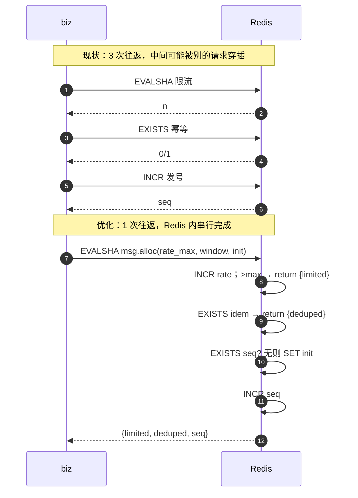

# 03 · 限流 + 幂等 + 发号合并成一次 Lua（方向 C）

> 归属：[`00-消息吞吐上限分析与提升技术方案.md`](./00-消息吞吐上限分析与提升技术方案.md) §5.2-C
> 优先级：P1（1 人日，降 p50 与 Redis 往返数，不改变任何业务语义）
> 一句话：一条消息现在要打 3 次 Redis（限流 / 幂等查询 / 发号），三者都只操作"与这条消息相关的键"，完全可以放进**同一个 Lua 脚本、同一次往返**里。

---

## 一、现状分析

### 1.1 三次独立的 Redis 往返

| 顺序 | 动作 | 代码 | 命令 |
|---|---|---|---|
| 1 | 会话热点限流 | `service/ratelimit.go:53` | `EVALSHA`（内部 `INCR` + 条件 `EXPIRE`） |
| 2 | 幂等前置查询 | `service/seq.go:165` | `EXISTS msg:idem:{conv}:{sender}:{cmid}` |
| 3 | 发号 | `service/seq.go:64` | `INCR conv:seq:{conv}` |

调用链见 `realtime/handleUplink.go:114`（限流）→ `service/message.go:98`（幂等）→ `message.go:106`（发号）。

### 1.2 为什么是"串行"而不是"并行"

三者有严格的**语义依赖**：

```
限流拒绝 → 不发号（否则白占号，制造洞）
幂等命中 → 不发号（否则重发也跳号，`seq.go:27-29` 的注释已说明这一点）
```

所以不能简单地用 pipeline 并发发出——必须**按序、原子**。这正是 Lua 的适用场景：Redis 执行脚本期间不处理其他命令，脚本内部的多条命令等效于一个事务，但**没有 MULTI/EXEC 的额外往返**。

### 1.3 成本核算

| 指标 | 现状 |
|---|---|
| 每消息 Redis 往返 | 3（限流 + 幂等 + 发号），另有 commit 后 1 次 `SETNX` 与 2 次 presence |
| 2800 msg/s 时 Redis 命令数 | ≈ 1.7 万 ops/s |
| 单次 Redis 往返（同机容器网络） | 亚毫秒量级，但**乘以 3 就是 1–2 ms 的纯等待** |

在 2800 msg/s 的稳态里，ACK 的 p50 是 25 ms——其中协议栈与排队占大头，但 3 次串行 Redis 往返是**可以整段消除**的部分。

---

## 二、优化原理

### 2.1 Lua 脚本在 Redis 里的三条保证

| 保证 | 含义 | 对本场景的价值 |
|---|---|---|
| **原子性** | 脚本执行期间不插入其他客户端命令 | 限流计数、幂等判断、发号三者不会被别的请求穿插 |
| **单次往返** | `EVALSHA` 一次调用返回全部结果 | 3 RTT → 1 RTT |
| **可条件分支** | 脚本内可 `if` 决定是否继续 | 满足"限流拒绝就不发号"的依赖 |

### 2.2 为什么不是 pipeline

Pipeline 只是把 N 条命令打包成一次网络往返，**命令之间仍然可以被其他客户端穿插**，且无法根据前一条的结果决定后一条是否执行。用在"限流 → 幂等 → 发号"上会破坏语义（比如超限的请求仍然占了一个号）。

> 一句话区分：**pipeline 省网络往返但不保证顺序语义；Lua 省网络往返并保证原子语义。**

---

## 三、作用机制



---

## 四、具体方案

### 4.1 热路径脚本

```lua
-- KEYS[1] = rate:{conv}
-- KEYS[2] = idem:{conv}:{sender}:{clientMsgId}
-- KEYS[3] = seq:{conv}
-- ARGV[1] = rate_max（<=0 表示不限流）
-- ARGV[2] = window_sec
-- 返回 { limited, deduped, seq, need_init }
local max = tonumber(ARGV[1])
if max and max > 0 then
  local n = redis.call('INCR', KEYS[1])
  if n == 1 then redis.call('EXPIRE', KEYS[1], ARGV[2]) end
  if n > max then return {1, 0, 0, 0} end
end

if redis.call('EXISTS', KEYS[2]) == 1 then return {0, 1, 0, 0} end

-- 键存在性只在"冷路径"才有意义：交给调用方决定是否装载初值
if redis.call('EXISTS', KEYS[3]) == 0 then return {0, 0, 0, 1} end

return {0, 0, redis.call('INCR', KEYS[3]), 0}
```

### 4.2 冷路径（`need_init = 1`）

**这是本方案最关键的设计点**：初值不能预先查。若在热路径里先 `SELECT GREATEST(...)` 再调脚本，就等于把一次 PG 查询加回每条消息——收益立刻被吃掉。

正确做法是**两阶段**：

```go
r, err := allocScript.Run(ctx, rdb, keys, max, window).Int64Slice(...)
switch {
case r[0] == 1:  // 限流
    return errLimited
case r[1] == 1:  // 幂等命中
    return errDeduped
case r[3] == 1:  // 键缺失 → 走冷路径
    init, err := loadNextSeqFromPG(ctx, convID)   // 只有这里才查 PG
    if err != nil { return err }
    seq, err := initScript.Run(ctx, rdb, []string{seqKey}, init).Int64()  // SET NX + INCR
    return seq, err
default:
    return r[2], nil
}
```

冷路径每个会话只会走一次（之后 `seqInitialized` + Redis 键都在），频率可忽略。

### 4.3 幂等标记为什么不进脚本

`SETNX msg:idem:...` 必须在 **INSERT 提交之后**才能写（否则提交失败但幂等键已写 → 客户端重发被误判为重复 → 消息永久丢失）。

所以它留在 `PersistMessage` 尾部，与 presence 查询合并成一条 pipeline（分册 04）：

```go
pipe := rdb.Pipeline()
pipe.SetNX(ctx, idemKey, "1", 5*time.Minute)
pipe.Eval(ctx, presenceLua, ...)   // 见分册 04
```

---

## 五、坑点

### 坑 1：Redis Cluster 下三个键必须同槽

脚本同时访问 `rate:{conv}` / `idem:{conv}:...` / `seq:{conv}`。单实例无所谓，一旦上 Cluster 会直接报 `CROSSSLOT Keys in request don't hash to the same slot`。

**现在就把 key 命名改成 hash tag**（改成本几乎为零）：

```
rate:{single_1_2}   idem:{single_1_2}:1:abc   seq:{single_1_2}
```

注意：现有键名是 `conv:rate:` / `msg:idem:` / `conv:seq:`（`ratelimit.go:43`、`seq.go:31`、`seq.go:44`）。**改名等于丢号**，必须连同迁移脚本一起做（把旧键 `RENAME` 或按前缀重写）。如果暂时不打算上 Cluster，可以在文档里标注"迁移窗口再做"，但**分支里不要留一半**。

### 坑 2：`EXISTS` 与 `INCR` 的先后顺序不能换

若先发号再判幂等，重发会拿到新号 → 产生洞。本项目已声明"跳号无害"（`seq.go:27-29`），但那是针对**崩溃/降级**的容忍，不是让重发常态化跳号——洞会让"未读数差值"与"gap 检测"这类未来功能失去基础。

### 坑 3：限流计数在重发时也会 +1

现状就是这样（限流在幂等之前）。保持行为一致即可，但要知道：**客户端 5 s 超时重发会消耗限流配额**。若某会话恰好卡在 500/s 的阈值上，重发会把它推进 429。若要改，必须同时改客户端语义（重发不应计入用户配额），属于产品决策，别在性能优化里顺手改。

### 坑 4：脚本报错时的降级策略要分开

| 场景 | 现状 | 合并后建议 |
|---|---|---|
| 限流脚本失败 | **fail-open**（`ratelimit.go:55-57`） | 保持 fail-open（保护性限流不应叠加中间件故障） |
| 发号失败 | 降级 DB 行锁（`seq.go:118-121`） | 保持降级 |
| 合并脚本失败 | — | **整体回退到旧的三段式路径**（一个 `fallback()` 函数），不要试图在脚本失败后只补做其中一步 |

### 坑 5：`EVALSHA` 的 `NOSCRIPT`

`redis.NewScript` 会自动处理 `NOSCRIPT`（先 `EVALSHA`，失败则 `EVAL` 并缓存）。但**Redis 重启/主从切换后第一次调用会多一次往返**，属于正常现象，不要为此在业务层加重试。

### 坑 6：单测用 miniredis 时的 Lua 支持

`seq_test.go` 用的是 `miniredis`（`seq_test.go:16`）。miniredis 的 Lua 支持是子集，`redis.call('EXISTS')` / `INCR` / `EXPIRE` 可用，但**不要用 `redis.call('TIME')`、`cjson`、`pcall`** 等高级能力，否则 CI 挂而线上正常。

### 坑 7：限流窗口语义没变，但要注意"跨脚本的 TTL"

`EXPIRE` 只在 `n == 1` 时设置，这是**固定窗口**（非滑动）。合并后语义不变，但如果把窗口参数改成动态（按会话等级），要保证同一会话不会一会儿用 1 s、一会儿用 60 s——那会让计数窗口错乱。建议窗口参数固定，只让 `max` 动态。

---

## 六、验证方法

| 指标 | 期望 | 反证 |
|---|---|---|
| Redis `eval`/`evalsha` QPS @ 2800 msg/s | 从 3 次/条降到 **1 次/条** | 仍 ≈3 → 合并没生效 |
| `server_message_duration_seconds` p50 | 下降 ≥ 2 个 RTT | 无变化 → Redis 不是 p50 的组成部分（回到池的结论） |
| 429 比例（`CONV_RATE_LIMIT_MAX=500`，每会话 30/s 场景） | 保持 0 | 出现 429 → 计数逻辑写错 |
| 重发幂等 | 同 clientMsgId 发 1000 次 | 只产生 1 条消息、只发 1 个号 |
| 冷启动 | 清空 Redis 后首条消息 | seq 从 `PG 最大值 + 余量` 开始 |

```bash
# 直接对脚本做单测（miniredis）
go test ./biz/internal/service -run 'TestAllocScript' -v
```

---

## 七、与其他方向的关系

| 方向 | 关系 |
|---|---|
| 01 seq 修复 | 脚本里的 `SET init` 分支与 01 的"装载 + 余量"必须一致；01 删掉 `Del(key)` 后，脚本的 `need_init` 是唯一的冷路径入口 |
| 02 去事务 | 独立，可并行 |
| 04 presence | 本方向省 2 次往返，04 省另外 2 次；两者叠加才到"3 次往返" |
| 05 组提交 | 05 会把 `INCR` 换成 `INCRBY n`（按会话一次取一批号），本热路径脚本退化为"限流 + 幂等"，仍然有效 |
| 11 Redis Cluster | 坑 1 的 hash tag 是前置改造 |
