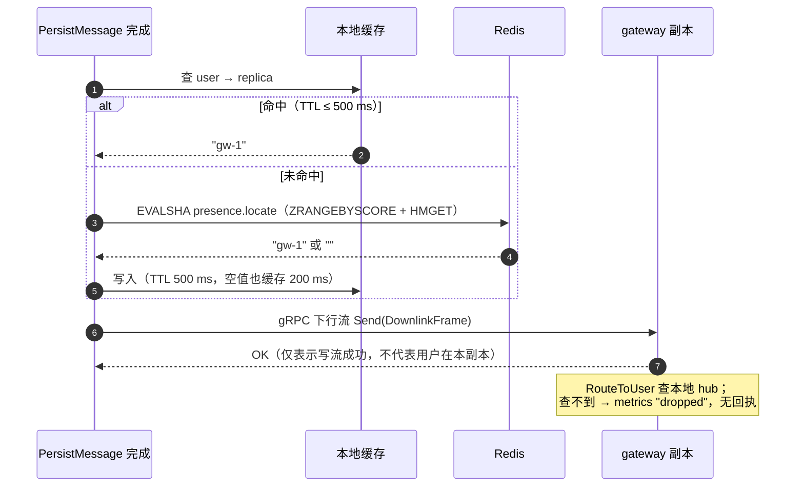

# 04 · 定向下行的 presence 定位优化（方向 D）

> 归属：[`00-消息吞吐上限分析与提升技术方案.md`](./00-消息吞吐上限分析与提升技术方案.md) §5.2-D
> 优先级：P1（1 人日，省 2 次 Redis 往返；顺带修掉群扇出的 1 次重复检索）
> 一句话：定向下行需要"这个用户在哪个网关副本"，现在这件事要查两个 Redis 键（`ZRANGEBYSCORE` + `HMGET`）两次往返；合并成一次 Lua 即可，并且**这个查询可以安全地本地缓存几百毫秒**——但缓存错了比不缓存更糟，见坑 2。

---

## 一、现状分析

### 1.1 两跳键结构

网关写、业务层读（`gateway/internal/presence/presence.go:28-29` 与 `biz/internal/service/presence.go:21` 必须完全一致）：

| 键 | 类型 | 内容 | 写入方 |
|---|---|---|---|
| `presence:{userId}` | ZSET | member = deviceId，score = 过期时刻(ms) | gateway `Register` / `Refresh` / `Remove` |
| `presence:{userId}:meta` | HASH | field = deviceId，value = `"{replica}:{socketId}"` | 同上 |

为什么是两个键：ZSET 负责"哪些设备还活着"（按时间排序 + 范围查询），HASH 负责"设备在哪个副本"。一个键存不下两种访问模式。

### 1.2 读路径的两次往返

`biz/internal/service/presence.go:107-123`：

```go
alive, _ := rdb.ZRangeByScore(ctx, "presence:{uid}", now, "+inf", Count:1)  // ① 找一台活设备
raw, _  := rdb.HMGet(ctx, "presence:{uid}:meta", alive[0])                  // ② 查它在哪个副本
```

单聊消息必须给双方各投一次（`downlink.go:93` 的 `FanoutDownlink`），所以单条消息的下行定位成本是 **2 次往返（批量版是 2 条 pipeline）**。

### 1.3 群扇出里还有一次纯重复的检索

`realtime/handleUplink.go:154-167`：

```go
if isGroup {
    online, _ := service.FilterOnline(ctx, participants)   // ← 1 次 pipeline（N 个 ZRANGEBYSCORE）
    targets = online
}
...
service.FanoutDownlink(ctx, targetIDs, ...)                // ← 内部再调 ReplicaOfBatch（2 次 pipeline）
```

而 `ReplicaOfBatch`（`presence.go:127-175`）返回的 map **本身就是"有 replica 的在线用户"**——在线判定已经隐含在里面。所以 `FilterOnline` 是**纯重复的一次往返**，群消息白白多付一次。

### 1.4 一次消息的下行定位成本汇总

| 场景 | 现状往返数 |
|---|---|
| 单聊 | 2（`ReplicaOfBatch` 的两条 pipeline） |
| 群聊 | 1（FilterOnline）+ 2（ReplicaOfBatch）= **3** |

---

## 二、优化原理

### 2.1 两个键的访问可以原子合并

`ZRANGEBYSCORE` 取到的 member 立刻用作 `HMGET` 的 field，两步有数据依赖但不跨进程。放进 Lua 后：

```lua
local now = redis.call('TIME')                 -- 用 Redis 时钟，避免各副本时钟漂移
local ts  = tostring(tonumber(now[1]) * 1000 + math.floor(tonumber(now[2]) / 1000))
local d   = redis.call('ZRANGEBYSCORE', KEYS[1], ts, '+inf', 'LIMIT', 0, 1)
if #d == 0 then return '' end
local m = redis.call('HMGET', KEYS[2], d[1])
local v = m[1]
if not v then return '' end
return string.sub(v, 1, string.find(v, ':') - 1)
```

**收益**：2 次往返 → 1 次，且时钟统一由 Redis 提供（见坑 3）。

### 2.2 为什么可以本地缓存

下行目标在**秒级内**漂移的概率极低：用户换设备/换网关意味着重新握手 + presence 重写，本身有 TTL 语义。所以"这个用户在哪个副本"是天然的短周期缓存对象。

但**缓存错 ≠ 缓存未命中**（见坑 2）：

| 情况 | 后果 |
|---|---|
| 未命中（返回空） | `tryDirect` 返回 false → 走 pub/sub 兜底 → **一定能送达** |
| 命中但过期（指向旧副本） | `stream.Send` 成功 → 业务层认为已投递 → **目标网关查不到该用户 → 静默丢弃** |

也就是说：**这个缓存只允许"短"，不允许"错得久"**。

---

## 三、作用机制



---

## 四、具体方案

### 4.1 改动清单

| # | 改动 | 文件 |
|---|---|---|
| 1 | `ReplicaOf` 改为一次 Lua | `service/presence.go:107-123` |
| 2 | `ReplicaOfBatch` 改为一次 pipeline 的 Lua（N 个 KEYS 对） | `service/presence.go:127-175` |
| 3 | 群扇出删掉 `FilterOnline`，直接用 `ReplicaOfBatch` 的结果 | `realtime/handleUplink.go:154-167` |
| 4 | 加进程内 `replicaCache sync.Map`（TTL 500 ms，容量护栏） | `service/presence.go` |
| 5 | `@mention` 分支同样删掉 `FilterOnline`（`handleUplink.go:179`） | 同上 |

> `FilterOnline` 本身保留（`chat` 的"在线状态展示"等功能可能用到），只是**扇出路径不再调用**。

### 4.2 缓存的数据结构

```go
type replicaEntry struct {
    replica string   // "" 表示当前无在线设备
    exp     int64    // unix nano 过期时刻
}
var replicaCache sync.Map // userID -> *replicaEntry
```

命中判定用原子读 + 惰性过期（不启 goroutine 清理，避免 10 万用户的定时器开销）。

### 4.3 参数建议

| 参数 | 建议值 | 理由 |
|---|---|---|
| 正命中 TTL | **500 ms** | 用户切网关注册后 500 ms 内可见；期间最多丢 500 ms 的实时帧，由 `/sync` 补 |
| 负命中 TTL（无在线） | 200 ms | 用户上线后最多 200 ms 收不到实时帧 |
| 缓存容量上限 | 50 万条，超限整体清空 | 与 `idemLocal` 同款护栏（`seq.go:154-157`） |

---

## 五、坑点

### 坑 1：`FilterOnline` 删掉后，"离线成员不推送"的语义还在吗

在。`ReplicaOfBatch` 对离线用户返回"不在 map 里"，`FanoutDownlink` 会把它们放进 `fallback` 列表（`downlink.go:112`）——**离线用户仍会被 publish 一次**（浪费，但不错误）。

如果希望在扇出前就把离线用户剔掉（省 pub/sub 开销），正确做法是：**用 `ReplicaOfBatch` 的返回 map 过滤，而不是再查一次 Redis**：

```go
replicas, _ := ReplicaOfBatch(ctx, participants)
targets := make([]int64, 0, len(replicas))
for uid := range replicas { targets = append(targets, uid) }   // 只有在线且有 replica 的
FanoutDownlink(ctx, targets, ...)
```

### 坑 2（最重要）：缓存命中到"旧副本"会静默丢帧

`tryDirectDownlink`（`directdownlink.go:51-72`）只在 `stream.Send` 失败时返回 false。若目标网关活着但**这个用户已经不在这台网关上**，`Send` 依然成功 → 业务层记 `DownlinkDirectTotal` → gateway `RouteToUser` 查本地 hub 查不到 → `metrics.Downlink.WithLabelValues("dropped").Inc()`（`hub.go:136`）→ **帧被丢弃，没有任何回执**。

后果：用户 A 从 gw-1 断线重连到 gw-2，presence 已更新，但 biz 缓存还是 gw-1 → 500 ms 内的消息全部只走 gw-1 → 丢。

缓解措施（按成本排序）：

| 措施 | 成本 | 效果 |
|---|---|---|
| 缓存 TTL 压到 500 ms | 0 | 丢帧窗口 ≤ 500 ms，靠 `/sync` 兜 |
| 缓存"未命中"时**不写负缓存**给刚离线的用户 | 低 | 减少误命中 |
| 让 gateway 在查不到用户时**回一个 NACK 帧**，biz 收到后清缓存并改走 pub/sub | 中（协议改动） | 根治 |
| 干脆不缓存（只做 Lua 合并） | 0 | 1 次往返，无正确性风险 |

**建议：先只做 Lua 合并 + 删重复检索（零风险），缓存作为独立开关 `PRESENCE_CACHE_TTL=0|500ms` 灰度。** 如果 `dropped` 指标出现明显上升，立刻关掉缓存。

### 坑 3：时钟必须用 Redis 的

现状用 `biz` 进程的 `nowMillis()` 作为 `ZRangeByScore` 的 `Min`。多副本部署时，副本 A 的时钟比 Redis 快 2 s，就会把"还有 1 s 过期"的设备判成已过期 → 误判离线 → 走下 pub/sub（多花一次广播，但不出错）。

合并进 Lua 后用 `redis.call('TIME')` 可消除这一层不确定性，顺带省掉一次参数构造。注意 **miniredis 对 `TIME` 支持有限**（见分册 03 坑 6），单测里要留可注入的时钟。

### 坑 4：Redis Cluster 下两个键不同槽

`presence:{uid}` 与 `presence:{uid}:meta` 在 Cluster 下必须同槽。现有键名没有 hash tag，改造方式：

```
presence:{123}          ZSET
presence:{123}:meta     HASH
```

但**这是网关与业务层共享的键**，改名前必须两边同时上线，否则一侧读不到另一侧的连接（`presence.go:4` 的注释明确要求"必须一致"）。建议与分册 11 的 Cluster 改造一起做，不要单独改。

### 坑 5：`HMGET` 返回 nil 的分支

设备在 ZSET 里但 HASH 里没有 meta（写入时 `TxPipeline` 部分失败、或人工清理过 ZSET）。此时 Lua 返回空字符串，调用方必须按"未找到 → 走 fallback"处理，**不能当成 replica = ""** 继续构造帧。

### 坑 6：多设备用户只取一台

`ReplicaOf` 只取 `Count:1` 的一台设备（`presence.go:110`）。若该用户在 gw-1 和 gw-2 各有设备，而取到的那台恰好在 gw-1，另一台设备也在 gw-1 吗？不一定——**同一用户的不同设备可以连不同网关**。

所以"按 replica 定位"本质是**按设备定位**。当前实现对"多设备跨网关"的用户会漏投一部分设备（`RouteToUser` 会把帧投给该用户在本副本的**全部**连接，所以只要投到一台在线的网关就能覆盖该网关上的所有设备，但覆盖不了另一台网关）。

这是**现存的正确性缺口**，不是本次优化引入的。修法是把 `ZRANGEBYSCORE` 的 `Count` 设为 0（全取）并按 replica 分组，对每个 replica 各发一次。成本是返回结果变长。建议单独立项，先在文档里登记。

---

## 六、验证方法

| 指标 | 期望 | 反证 |
|---|---|---|
| `server_downlink_direct_total` / (direct+fallback) | ≥ 99.5%，且**不下降** | 下降 = 缓存导致定位失败 |
| gateway `gateway_downlink_total{result="dropped"}` | 不上升 | 上升 = 缓存指向了错误副本（关闭缓存） |
| 单聊消息的 Redis 命令数 | 从 2 降到 1（无缓存）/ 0（缓存命中） | — |
| 群消息的 Redis 命令数 | 从 3 降到 1 | — |
| 消息 p50 | 下降 ~1–2 ms | — |

```bash
# 端到端：连接迁移后立即发消息，验证 500ms 内不丢
node perf/gw-probe.mjs            # 冒烟
# 人为把某个用户从 gw-1 断连并重连到 gw-2（双网关副本环境），观察 dropped 指标
```

---

## 七、与其他方向的关系

| 方向 | 关系 |
|---|---|
| 03 合并 Lua | 同批做最自然：两者都在削 Redis 往返，03 省 2 次、04 省 1–2 次 |
| 05 组提交 | 批量后 fanout 仍是"每消息一次"，本方向的收益与批大小无关，独立成立 |
| 11 Cluster | 坑 4 的 hash tag 必须与网关同步改 |
| 群扇出规模化 | 多设备跨网关漏投（坑 6）应在"万人大群"之前修掉 |
