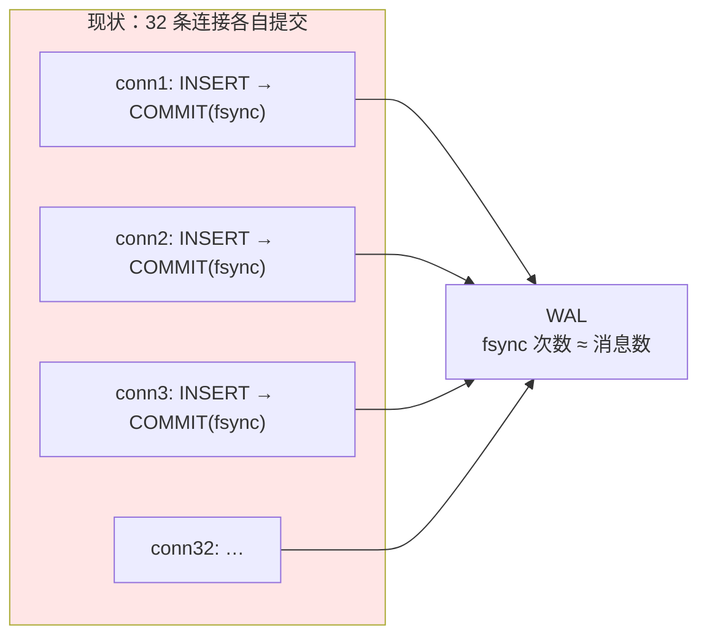
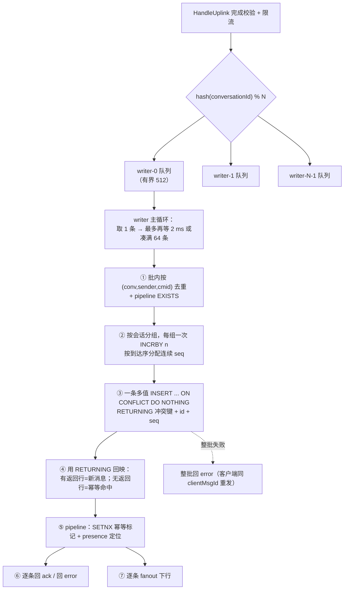
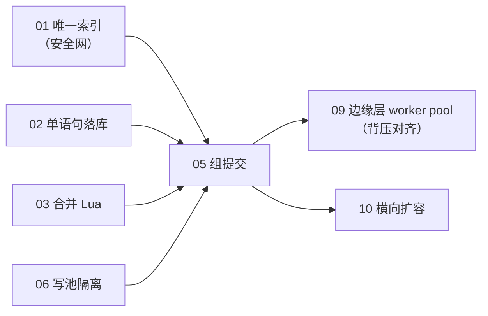

# 05 · 组提交批量写入：从"每条一次提交"到"每批一次提交"（方向 E）

> 归属：[`00-消息吞吐上限分析与提升技术方案.md`](./00-消息吞吐上限分析与提升技术方案.md) §5.3
> 优先级：**P2（核心方案，单副本 4–7×）**
> 依赖：分册 01（唯一索引）、02（单语句落库）、03（合并 Lua）
> 一句话：前三个方向把"每消息 2.5 条语句"压到 1 条，但**仍是每条消息一次事务提交、一次 WAL fsync**。批量写入把 N 条消息合成一条多值 `INSERT`、只提交一次，让 fsync 与连接持有按 N 摊薄——这才是把吞吐从"池的极限"推到"CPU 的极限"的那一步。

---

## 一、现状分析

### 1.1 每条消息都在做一次"昂贵的完整仪式"

| 步骤 | 代码 | 成本 |
|---|---|---|
| 取池连接 | `message.go:118` | 排队（池满时是主要成本） |
| 写一条 INSERT | `message.go:125` | ~1–3 ms |
| 一次 WAL fsync + 提交 | `message.go:175` | 组提交由 PG 在**同一连接**内合并，跨连接不合并 |
| 一帧一个 goroutine | `edge.go:136` | 无上界，30 万 goroutine/s @ 1 万连接 × 30 msg/s |

### 1.2 PG 侧的真实写入形态



PG 的 group commit 只在**同一条连接/同一事务边界**内合并 fsync。32 条连接各自提交，等于让 PG 在 32 个队列之间反复仲裁，fsync 次数基本等于消息数。

实测侧证：2800 msg/s 时 `pg_conn` 恒定 33（池满），单语句 3.1 ms —— 3.1 ms 里有相当一部分就是**等 fsync**。

### 1.3 为什么"再去调参"没有用

| 调参 | 为什么没用 |
|---|---|
| 池 32 → 64 | `max_connections=100` 卡死；且每消息仍是一次提交 |
| `synchronous_commit=off` | 已 ack 的消息在崩溃时可能丢最后 ~600 ms，违反红线 |
| 换更快的盘 | fsync 数不变，只是单次变快 |
| 加 biz 副本 | 池按副本独立，确实能线性扩；但单副本上限不动，且 PG 是共享的 |

---

## 二、优化原理

### 2.1 组提交的数学

一次提交的固定成本（fsync 延迟）记为 `F`，单条插入的变动成本记为 `c`。则：

```
每条一提交：单条成本 = F + c
每批 N 条：  单条成本 = (F + N·c) / N = F/N + c
```

`F` 在容器盘上约 1–3 ms，`c` 约 0.05–0.2 ms。N=32 时，单条成本从 ~2 ms 降到 ~0.15 ms，**约 13×**。实际还会被网络往返、CPU、索引维护吃掉一部分，落在 **4–7×** 是保守估计。

### 2.2 池占用同步下降

```
现状：每条 7.75 ms 连接·秒
批量：每批 ~4 ms / 32 条 ≈ 0.125 ms 连接·秒
→ 池利用率在 2 万 msg/s 时约 8%，彻底退出瓶颈
```

瓶颈随之迁移到 **biz 的 CPU**（见 00 §4.4：约 1.2 万–2 万 msg/s）。

### 2.3 为什么不用消息队列来做这件事

队列也能削峰，但它改变的是 **ack 语义**（写队列成功 ≠ 落库成功），需要 reply 通道重建关联，延迟从 ~3 ms 涨到 5–100 ms。批量写入**保持"提交成功才 ack"**，只是把 ack 推迟一个批窗口（≤2 ms）——语义不变，这是它能被接受的根本原因。参见 `docs/架构/消息同步架构分析-为什么不用消息队列-三段式同步与队列边界.md` §4.1。

---

## 三、作用机制



### 3.1 五个必须锁死的决策

#### 决策 1：按 `conversationId` 哈希分片到固定 writer

同一会话的所有消息必须由**同一个 writer 串行处理**。否则会出现"seq 小的消息后提交"：

```
goroutine A ← seq 10 ；goroutine B ← seq 11
B 先提交（seq 11 可见）→ 客户端看到 11 并推进游标
A 后提交（seq 10）→ /user/sync?since=11 永远取不到 10
```

`/user/sync` 的契约就是 `seq > since` 升序补拉（`api/sync_routes.go:93`），客户端游标取返回集最大 seq（`sync_routes.go:101-105`）。所以**顺序不是性能偏好，是数据正确性**。

> 当前代码本来就是乱序提交（`edge.go:136` 每帧一个 goroutine）。web 端目前只做全量拉取（`lastSyncedSeq` 恒 0），所以这个缺陷尚未暴露；批量会把窗口从"毫秒级"放大到"批窗口级"，必须在设计里锁死。

#### 决策 2：发号放进 writer，用 `INCRBY n` 取号段

如果先发号再入队，seq 顺序与入队顺序可能不一致（两次 Redis 调用的返回顺序 ≠ 入队顺序）。放进 writer 后：

```lua
-- KEYS[1] = seq:{conv}   ARGV[1] = init   ARGV[2] = n
if redis.call('EXISTS', KEYS[1]) == 0 then redis.call('SET', KEYS[1], ARGV[1]) end
return redis.call('INCRBY', KEYS[1], ARGV[2])
```

返回 `end`，则该会话本批的 n 条消息依次拿 `end-n+1 … end`（按到达序），**号段内天然保序**；跨批由 writer 串行保证。

#### 决策 3：ack 仍在 commit 之后

红线的原文是"禁止先 ack 后落库"。批量写入只是把 ack 推迟 ≤2 ms，**语义仍是提交成功才 ack**。

#### 决策 4：DB 调用必须用 detached context

现在 `processFrame` 用的是 `stream.Context()`（`edge_util.go:68`）。一旦批量共享这个 ctx：**任意一个客户端断连，整批 32 条消息的 INSERT 全部被取消**。

必须：

```go
ctx, cancel := context.WithTimeout(context.WithoutCancel(streamCtx), 5*time.Second)
defer cancel()
```

（Go 1.21+ 的 `context.WithoutCancel`；低版本用 `context.Background()` + 显式超时。）

#### 决策 5：写池独立、连接数 = writer 数

writer 只有 N 个 goroutine，每条持有一条连接完成一批。所以写池只需要 `N + 2` 条连接（N 默认 4），与 HTTP 读池物理隔离（分册 06）。

---

## 四、具体方案

### 4.1 核心数据结构

```go
type pendingMsg struct {
    // 业务
    convID, senderID, clientMsgID string
    content, msgType              string
    mentions, extra, fileInfo     []byte
    // 回执
    reply func(seq, serverMsgID int64, err error)   // 由 handleMessageSend 注入
    ctx   context.Context                            // 仅用于日志/链路追踪，不用于 DB 调用
}

type writer struct {
    id    int
    queue chan *pendingMsg
    pool  *pgxpool.Pool   // 专属小池（或从主池 Acquire 但限流）
    batchMax  int
    batchWait time.Duration
    maxBytes  int
}
```

### 4.2 writer 主循环（伪代码）

```go
func (w *writer) run() {
    for {
        first, ok := <-w.queue
        if !ok { return }                       // 队列已关闭 → 退出（drain 完成）
        batch := []*pendingMsg{first}
        bytes := len(first.content)
        deadline := time.NewTimer(w.batchWait)

    collect:
        for len(batch) < w.batchMax && bytes < w.maxBytes {
            select {
            case m, ok := <-w.queue:
                if !ok { break collect }
                batch = append(batch, m)
                bytes += len(m.content)
            case <-deadline.C:
                break collect
            }
        }
        deadline.Stop()
        w.flush(batch)                          // 见 4.3
    }
}
```

### 4.3 flush：一次 Redis + 一次 PG + 一次 Redis

```go
func (w *writer) flush(batch []*pendingMsg) {
    ctx, cancel := context.WithTimeout(context.Background(), 5*time.Second)
    defer cancel()

    // ① 批内去重（同一 clientMsgId 可能在同一批出现两次）
    batch = dedupeInBatch(batch)

    // ② pipeline 查幂等（N 条 EXISTS，1 次往返）
    existFlags := pipelineExists(ctx, batch)

    // ③ 按会话分组，每组一次 INCRBY
    seqs := allocateSeqs(ctx, batch, existFlags)   // 幂等命中的不参与分配

    // ④ 一条多值 INSERT（只含非幂等命中的消息）
    rows, err := w.insertBatch(ctx, batch, seqs)
    if err != nil { failAll(batch, err); return }

    // ⑤ 回映：RETURNING 带回冲突键，能确定哪些行真的插入了
    inserted := map[idemTriple]rowMeta{}
    for _, r := range rows { inserted[trip(r)] = rowMeta{id: r.ID, seq: r.Seq} }

    // ⑥ pipeline：SETNX 幂等 + presence 定位（1 次往返）
    pipelineMarkAndLocate(ctx, batch)

    // ⑦ 逐条回执 + 扇出
    for _, m := range batch {
        if r, ok := inserted[trip(m)]; ok {
            m.reply(r.seq, r.id, nil)
            fanout(m, r.seq, r.id)
        } else {
            seq, id := lookupExisting(ctx, m)        // 幂等命中：查首次结果
            m.reply(seq, id, nil)
            if seq == 0 { m.reply(0, 0, errIdemMiss) }
        }
    }
}
```

### 4.4 批量 INSERT 的 SQL 形态

不要用 `VALUES ($1,$2,...),($10,...)`（64 行 × 10 列 = 640 个参数，接近可读性极限，且难以动态拼装）。用 `unnest` 数组：

```sql
INSERT INTO messages
  (conversation_id, sender_id, seq, client_msg_id, content, type, status, mentions, extra, file_info)
SELECT u.conv, u.sender, u.seq, u.cmid, u.content, u.ctype, 'sent', u.mentions, u.extra, u.file
FROM unnest(
  $1::text[], $2::bigint[], $3::bigint[], $4::text[], $5::text[],
  $6::text[], $7::jsonb[], $8::jsonb[], $9::jsonb[]
) AS u(conv, sender, seq, cmid, content, ctype, mentions, extra, file)
ON CONFLICT (conversation_id, sender_id, client_msg_id) DO NOTHING
RETURNING conversation_id, sender_id, client_msg_id, id, seq;
```

**同一批 64 条，六种形态的实际差别：**

| 形态 | SQL 关键片段 | 语句数 | commit 数 | 参数个数 | 预编译可复用 |
|---|---|---|---|---|---|
| 现状（逐条） | `INSERT ... VALUES ($1..$9)` | 64 | **64** | 9 | ✅ |
| 显式事务包 64 条 | `BEGIN; INSERT ×64; COMMIT;` | 64 | **1** | 9（复用） | ✅ |
| 多值 `VALUES` | `INSERT ... VALUES (...),(...)` ×64 | 1 | 1 | **576** | ❌ 批大小变则语句文本变 |
| **`unnest` 数组** | `INSERT ... SELECT ... FROM unnest($1::text[],…)` | **1** | **1** | **9（恒定）** | ✅ |
| `jsonb_to_recordset` | `... FROM jsonb_to_recordset($1::jsonb) AS x(...)` | 1 | 1 | **1** | ✅ |
| `COPY` | `COPY messages (...) FROM STDIN` | 1 | 1 | 流式 | — 但**不支持 `ON CONFLICT` / `RETURNING`** |

选型理由：`unnest` 的参数个数**与批大小无关**，因此同一份 prepared statement 可以永久复用；多值 `VALUES` 每换一个批大小就是一条新语句，会把 pgx 的 statement cache 冲爆（详见[技术分析 · 02 分表原理](./技术分析/02-分表原理-应用层切表与数据库原生切表的差异.md) §3.2 的同类问题）。

**`RETURNING` 必须带冲突键三列**——`ON CONFLICT DO NOTHING` 不会告诉你是哪一行被跳过，只有带上 `(conversation_id, sender_id, client_msg_id)` 才能回映到输入。

### 4.5 参数与默认值

| env | 默认 | 说明 |
|---|---|---|
| `MSG_BATCH_SHARDS` | 4 | writer 分片数（= 写连接数）。CPU 核数 × 1~2 可尝试 |
| `MSG_BATCH_MAX` | 64 | 单批最大条数。再大则分区路由与索引维护的收益递减 |
| `MSG_BATCH_WINDOW_MS` | 2 | 攒批窗口。p50 直接受它影响 |
| `MSG_BATCH_QUEUE` | 512 | 每分片队列长度 |
| `MSG_BATCH_MAX_BYTES` | 1 MB | 单批最大字节数（防毒丸，见坑 3） |
| `MSG_BATCH_CTX_TIMEOUT_MS` | 5000 | 批 DB 调用超时 |

### 4.6 新增指标

| 指标 | 类型 | 用途 |
|---|---|---|
| `server_message_batch_size` | Histogram | 中位数 < 8 = 窗口太短或队列太空；打满 64 = 窗口偏小 |
| `server_message_batch_wait_seconds` | Histogram | 从入队到提交的等待 |
| `server_message_batch_failures_total{reason}` | Counter | 整批失败次数（致命信号） |
| `server_writer_queue_depth{shard}` | Gauge | 队列水位，背压前兆 |

---

## 五、坑点

### 坑 1：顺序必须由"分片 + 串行"保证，不能靠"发号早"

见决策 1/2。补充一个反直觉点：**即使批内按 `(conv, seq)` 排序也没用**——跨批仍会逆序。唯一可靠的是"同一会话永远进同一个 writer，且 writer 串行 flush"。

### 坑 2：`stream.Context()` 会毒死整批

见决策 4。这是最容易写错、也最难在压测中复现的一条（需要"客户端在批提交瞬间断连"才会触发）。

### 坑 3：毒丸消息会拖垮全批

当前 `parseSendMessage`（`handleUplink.go:67-85`）只校验 `clientMsgId ≤64`、`conversationId ≤100`、`type ≤32`，**完全不校验 `content` 长度**。而网关帧上限是 1 MB（`conn.go:105`）、gRPC 上限 1 MB（`edge.go:40`）——即单条消息最大约 1 MB。

若 64 条 × 1 MB 组成一批：单语句 64 MB，PG 会显著变慢甚至触发 `statement timeout` → **整批失败 → 64 个客户端同时重发 → 再次组成 64 MB 批 → 雪崩**。

必须做两层防护：

1. **行级校验前置**：`len(content) > 64 KB` → 直接回 `message.error`（不进队列）。这个阈值应与产品确认，但**必须存在**；
2. **批量字节上限**：累计超过 `MSG_BATCH_MAX_BYTES` 就立刻 flush，不等待凑满条数。

### 坑 4：批内同一 clientMsgId 出现两次

客户端 5 s 超时重发，两次可能落在同一批。若都参与发号，就白白跳两个号，且第二条会撞唯一索引被 `DO NOTHING` 掉、拿不到返回行。

**必须在 flush 最开始按 `(conv, sender, clientMsgId)` 批内去重**，只保留第一条，其余在回执阶段直接返回第一条的结果。

### 坑 5：拿不到 `RETURNING` 行不等于失败

`ON CONFLICT DO NOTHING` 跳过的行不会出现在 `RETURNING` 里。这是**幂等命中**（正常路径），不是错误。处理方式：查一次首次结果（`findByIdemKey`），返回 `Deduped: true`，**不重复扇出**——与现状语义一致（`handleUplink.go:151`）。

注意：这个"查一次"是批内串行执行的，如果一批里有大量重复（攻击场景），会退化成 N 次查询。建议对"无返回行"的比例加指标，异常时告警。

### 坑 6：参数个数与类型推断

`unnest` 的多数组形式要求所有数组长度一致，且每个数组必须显式 cast（`$1::text[]`）。pgx 传 Go slice 时会自动映射，但 `nil` slice 与空 slice 行为不同——**空批必须提前返回**，不要发给 PG。

### 坑 7：队列满 = 主动摘连接

队列满时阻塞入队 → 读循环停摆 → 心跳帧也读不到 → 60 s 读截止到期后下一次读直接失败（`conn.go:106`）→ 连接被摘。

这是**蓄意的 fail-fast**，但必须：

- 有指标（`writer_queue_depth`）让人能看见；
- 压测里显式观测"因过载被摘除的连接数"；
- 客户端退避重连已验证有效（`web/src/ws/wsClient.ts` 的指数退避）。

### 坑 8：优雅退出必须 drain

`biz` 收到 SIGTERM 后的顺序是：`httpSrv.Shutdown` → `edgeSrv.GracefulStop`（1 s 超时）→ `FinalCheckpoint`（`cmd/biz/main.go:130-138`）。

批量引入后要**在 GracefulStop 之前**关闭队列并等待 drain（超时 5 s），否则在途的几十条消息会直接丢（客户端重发可救，但会制造一阵 5 s 延迟）。建议顺序：停止接收新帧 → `writer.Close()`（关闭 channel）→ 等所有 writer 退出 → 再 GracefulStop。

### 坑 9：HTTP 上行路径也要走同一个 writer

`api/internal_routes.go` 里还有一条 HTTP 上行入口（`/internal/gateway/uplink`）。如果它绕过 writer 直接 `PersistMessage`，就会**同一会话的两种写入路径并发**，顺序保证被破坏。

要么让 HTTP 入口也入队，要么在 `GATEWAY_UPSTREAM=grpc` 成为唯一形态后删掉 HTTP 入口（推荐后者，少一条要维护的路径）。

### 坑 10：批失败的重试策略

整批失败时**不要自动重试**。原因：失败多半是系统性问题（PG 抖动、连接超时），立刻重试只会放大压力。正确做法是回 `message.error`，由客户端按 5 s 超时 + 同 clientMsgId 重发（已有的幂等语义天然吸收）。

### 坑 11：批大小与分区表的交互

64 条消息按 `conversation_id` 哈希散到最多 64 个分区。PG 的多值 INSERT 会对每个目标分区路由一次，属于正常成本；但如果批内**全部落在同一分区**（例如热门单会话），该分区的索引竞争会集中。压测里要看"单会话 500 msg/s 限流下"的 p99，而不是只看均匀场景。

### 坑 12：单测策略

`miniredis` 只能覆盖 Redis 部分；批量 INSERT 的 SQL 形态必须用**真 PG**（testcontainers 或本地 dev 库）。建议两个层次：

- 单元：`dedupeInBatch`、`allocateSeqs` 的纯函数测试；
- 集成：`go test -tags=integration`，起 PG 后跑 100 批 × 64 条，断言总数、seq 连续、无重复。

---

## 六、验证方法

| 项 | 方法 | 通过标准 |
|---|---|---|
| 批大小生效 | `server_message_batch_size` 中位数 | ≥ 16（64 上限、2 ms 窗口） |
| 提交次数下降 | `xact_commit` 增速 ÷ 消息速率 | ≈ 1/批大小（S9） |
| Knee 右移 | `OUT_SUBDIR=<新目录> MODE=rate LEVELS=28,40,60,80 bash perf/s8-limit.sh` | Knee ≥ 8000 msg/s |
| 池退出瓶颈 | `pg_conn` / `db_pool_wait_seconds` | 2 万 msg/s 时池利用率 < 20% |
| **提交顺序** | S10 观察者连接断言下行 seq 严格递增 | 3 轮 × 5000 条全绿 |
| 崩溃语义 | `kill -9` 后重启 | 已 ack 的消息 100% 存在 |
| 毒丸 | 发一条 200 KB content | 该条被拒，同批其它消息正常 ack |

---

## 七、与其他方向的关系



| 方向 | 关系 |
|---|---|
| 01 | 没有唯一索引，批量放大乱序就无从兜底；冲突重试也依赖它 |
| 02 | 批量的多值 INSERT 本身是单语句，02 的改造是它的地基 |
| 03 | 取号脚本从 `INCR` 换成 `INCRBY`，其余不变 |
| 06 | writer 数 = 写连接数，必须独立成池 |
| 09 | 边缘层的 worker pool 与 writer 队列要**同向背压**，否则会在两处各积一层队列 |
| 10 | 批量后单副本可到 1.2–2 万，再往上必须扩副本 |
