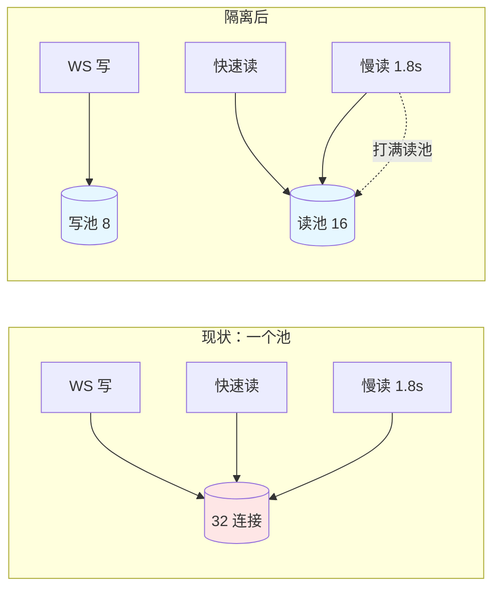

# 06 · 读写连接池隔离（方向 F）

> 归属：[`00-消息吞吐上限分析与提升技术方案.md`](./00-消息吞吐上限分析与提升技术方案.md) §5.4-F
> 优先级：P1（1 人日；单看吞吐不涨，但决定"混合负载下的稳定性"）
> 一句话：现在**所有读写共用同一个 32 连接的池**，一条要跑 1.8 秒的读请求就吃掉 5.8% 的池容量，7 条并发就吃掉 41%。隔离的本质是把"慢请求"关进自己的隔间，让它占不满写路径。

---

## 一、现状分析

### 1.1 代码事实

`biz/internal/db/db.go:36-49`：

```go
func NewRO(ctx context.Context, url string) (*pgxpool.Pool, error) {
    if strings.TrimSpace(url) == "" {
        roPool = pgPool          // ← 未配置只读库时，读池 = 写池
        return roPool, nil
    }
    ...
}
```

压测环境与默认配置下 `PG_READONLY_URL` 为空 → **`db.RO()` 与 `db.PG()` 返回同一个池**。所有 HTTP 读接口（`/user/messages`、`/user/sync`、`/user/lastMessages`、`/user/userConversations`、`/user/mentions`）与 WS 上行写入共用这 32 条连接。

### 1.2 单请求的池成本差异极大

用"每 rps 占用多少条连接"衡量（= 单请求耗时 × 速率）：

| 端点 | 单请求 p50 | 每 1 rps 占用连接 | 10 rps 时占池 |
|---|---|---|---|
| `/user/messages`（无 limit） | **1874 ms** | **1.87** | **58%** |
| `/user/messages?limit=50` | 5 ms | 0.005 | 0.16% |
| `/user/lastMessages` | 52 ms | 0.052 | 1.6% |
| `/user/sync` | 5 ms | 0.005 | 0.16% |
| `/user/userConversations` | p99 9 ms | ~0.003 | 0.1% |
| WS 消息写入 | 3.1 ms（单语句） | — | — |

**同一池里，最贵的请求比最便宜的贵 375 倍。** 池是按"个数"分配的，不区分请求的贵贱——这正是队头阻塞（head-of-line blocking）的温床。

### 1.3 一个具体的失效场景

```
t=0   Web 用户点开一个 3.5 万条消息的会话 → 发起 1 条无 limit 的 /user/messages
      占用 1 条连接 1.87 s
t=0~1.87s  并发 7 个这样的请求 → 13 条连接被占（40%）
      WS 消息此时只能抢剩下的 19 条 → p99 抬升
```

压测的纯 WS 场景里没有这些读请求，所以 S8 没暴露；**生产环境一定有**（web 端首屏就会拉消息）。

---

## 二、优化原理

### 2.1 隔舱（bulkhead）

系统里不同类型的请求对资源的"占用时长"差异越大，共享池的期望排队时间就越差。隔离的思路是给每类请求分配**独立配额**，把故障限制在隔间内：



### 2.2 隔离后不会降低总容量，只会降低总峰值

| 指标 | 共享池 | 隔离池 |
|---|---|---|
| 总连接数 | 32 | 8 + 16 = 24（还可 +8 给慢查询） |
| 单端点最大 rps | 由池容量决定 | 由**自己的配额**决定 |
| 慢端点打满 | 拖垮写路径 | 只影响自己 |
| 突发弹性 | 好（谁抢到算谁的） | 差（配额是硬的） |

这是典型的**用峰值换确定性**。对 IM 来说，"消息不卡"比"读接口能跑到理论峰值"重要得多。

---

## 三、具体方案

### 3.1 三个池

| 池 | 连接数（建议） | 使用者 | 说明 |
|---|---|---|---|
| `writerPool` | `MSG_BATCH_SHARDS + 2` ≈ 6 | writer 分片（分册 05） | 只做 INSERT / checkpoint |
| `readPool` | 16 | 全部 `db.RO()` 查询 | 可指向只读副本 |
| `slowPool`（可选） | 4 | `/user/messages` 全量、`lastMessages` | 打满即 429，不拖累别人 |

> 未上批量时，`writerPool` 可以先取 12–16，其余给读池；上了批量后再按 writer 数收缩。

### 3.2 代码改动

```go
// db.go
var writePool *pgxpool.Pool   // db.PG()
var readPool  *pgxpool.Pool   // 现有 roPool 语义不变
var slowPool  *pgxpool.Pool   // 新增

func PG() *pgxpool.Pool   { return writePool }
func RO() *pgxpool.Pool   { return readPool }
func SLOW() *pgxpool.Pool { return slowPool }   // 空时回退 readPool
```

配置：

| env | 默认 | 说明 |
|---|---|---|
| `PG_MAX_CONNS_WRITE` | 32（未上批量）/ 8（上批量后） | 写池 |
| `PG_MAX_CONNS_READ` | 16 | 读池（未配只读库时与写库同实例，但**不同池**） |
| `PG_MAX_CONNS_SLOW` | 4 | 慢查询专用，0 = 关闭 |
| `PG_READONLY_URL` | 空 | 空则读池仍连主库，但连接独立 |

**关键点：即使 `PG_READONLY_URL` 为空，也要建独立的池对象。** 池是应用侧的排队结构，与它连哪个库无关——分开池就已经能挡住队头阻塞。

### 3.3 `max_connections` 预算

```
PG max_connections (100)
  ≥ 副本数 × (write + read + slow) + maintenance(5) + 运维(5)
```

单副本：32 + 16 + 4 + 10 = 62 ✅
双副本：2 × (8 + 16 + 4) + 10 = 66 ✅（上了批量之后）
双副本未上批量：2 × (32+16+4) + 10 = 114 ❌ → 必须先上批量或上 PgBouncer（分册 10）

---

## 四、坑点

### 坑 1：只读副本的延迟会破坏"读己之写"

把 `/user/messages` 指向只读副本后，用户发完消息立即刷新，可能读不到（复制延迟通常 1–50 ms，但抖动时可达秒级）。

三种处理：

| 方案 | 做法 | 代价 |
|---|---|---|
| 时间窗回主库 | 该用户/会话在最近 N 秒内写过 → 这次读走主库 | 需要维护"最近写入"标记（Redis 或进程内） |
| 按游标判断 | 请求带 `since` 且 `since >= 会话最新 seq` 时走主库 | 需要先知道最新 seq（又是一次查询） |
| 接受 | 前端靠 WS 的 `receiveMessage` 增量补齐，读接口只负责历史 | 最简单，但首屏可能少最后一条 |

IM 场景推荐第三种 + 关键路径（`/user/sync`）走主库。**`/user/sync` 是补拉的正确性通道，绝不能容忍延迟。**

### 坑 2：池拆分后总量变大，反而能压垮 PG

拆成 32 + 16 + 4 = 52，如果 `max_connections` 没跟着调，PG 会在第 101 条连接时拒绝所有新连接（包括运维连接）。**必须按 §3.3 的预算算一遍再上线。**

### 坑 3：慢池满了要快速失败，不能排队

慢池的语义是"隔离"，一旦排长队就失去意义。建议：`pgxpool` 没有"队列超时"配置，但可以通过 `context.WithTimeout(ctx, 200*time.Millisecond)` 包住 slow 查询，超时直接返回 503/`Retry-After`。这比让请求在池里排 3 秒体验更好。

### 坑 4：`RO()` 的调用点已经铺开，不要漏

现有 25 处纯读已切到 `RO()`（README 记录）。拆池后这些点自动落到读池，无需改动；但要 grep 一遍确认**没有读路径误用 `PG()`**：

```bash
grep -rn 'db.PG()' biz/internal | grep -E 'SELECT|FROM'
```

### 坑 5：连接池预热

`pgxpool` 默认 `MinConns=0`，冷启动时首批请求要现建连接（TCP + 认证 ~5–20 ms）。建议 `MinConns = MaxConns/4`，并保留 `MaxConnIdleTime`（默认 30 min）。压测前记得预热，否则前几秒的 p99 会非常难看（这也是历史报告里"首档 p99 偏高"的来源之一）。

### 坑 6：PgBouncer 与 pgx 语句缓存

见分册 02 坑 4。拆池 + PgBouncer 同时做时，务必确认 `DefaultQueryExecMode`。

---

## 五、验证方法

| 项 | 方法 | 通过标准 |
|---|---|---|
| 隔离生效 | 注入 7 rps 无 limit `/user/messages`，同时跑 WS 2000 msg/s | 消息侧 p99 劣化 ≤ 10%（共享池下预期 ≥ 30%） |
| 慢池满不拖累 | 把慢池打到 100% | 写路径 p99 无变化；慢请求返回 503 而非排队 |
| 连接预算 | `SELECT count(*) FROM pg_stat_activity` | ≤ max_connections 的 70% |
| 读池独立 | `db_pool_acquired{pool="read"}` 与 `{pool="write"}` | 两条曲线独立起伏 |

---

## 六、与其他方向的关系

| 方向 | 关系 |
|---|---|
| 05 组提交 | writer 需要专属小池，本方向是它的前置（否则 writer 与读抢连接） |
| 07 读端点治理 | 07 降低单请求成本，06 限制其影响范围；两者叠加才彻底 |
| 10 扩容 / PgBouncer | 总连接数是扩容的硬约束，见 §3.3 |
