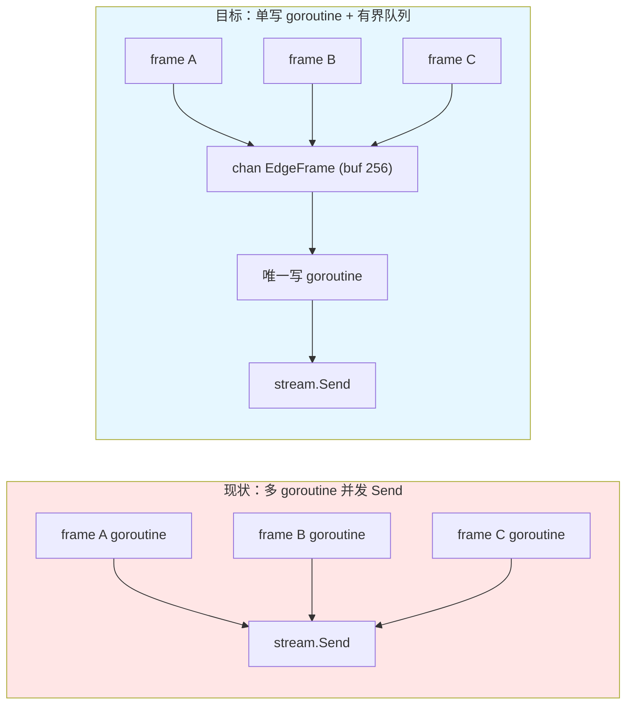

# 09 · 边缘层：有界 worker 池与 gRPC 流写入串行化（方向 I）

> 归属：[`00-消息吞吐上限分析与提升技术方案.md`](./00-消息吞吐上限分析与提升技术方案.md) §5.5-I
> 优先级：P1（1–2 人日；**其中"流写入串行化"是正确性修复，不是性能优化**）
> 一句话：biz 侧"每帧一个 goroutine"没有上界，gateway 侧同样如此；同时业务层与网关**两边都在多个 goroutine 里对同一条 gRPC 流并发调用 `SendMsg`**，而 grpc-go 明确不支持这样做。前者烧 CPU 与调度，后者会偶发写流失败并触发昂贵的 pub/sub 全广播兜底。

---

## 一、现状分析

### 1.1 biz：每帧一个 goroutine，无上界

`biz/internal/realtime/edge.go:127-141`：

```go
for {
    frame, err := stream.Recv()
    ...
    go func(f *edgev1.EdgeFrame) {      // ← 每帧一个 goroutine，无池化、无上限
        if err := processFrame(stream, f, s); err != nil { ... }
    }(frame)
}
```

上游只有 gateway 侧的**每连接** in-flight 上限 64（`hub/conn.go:44`）。10,000 连接 × 64 = 64 万个潜在并发 goroutine；实测 2800 msg/s 时 goroutine 峰值 5809，负载一停立刻回落（V3 报告 §五）——典型的"短命 goroutine 洪水"。

单次 goroutine 创建+调度约 1–3 μs。按 2 万 msg/s 估算，仅创建/销毁就是 **2–6% 的 CPU**，还不含栈分配与调度器竞争。

### 1.2 biz：定向下行的 `SendMsg` 并发

`biz/internal/realtime/directdownlink.go:51-72`：

```go
e.mu.Lock()
stream := e.streams[e.next%len(e.streams)]   // 4 条流轮询
e.next++
e.mu.Unlock()                                  // ← 锁在这里就放掉了

if err := stream.Send(&edgev1.EdgeFrame{...}); err != nil {   // ← 无锁并发 Send
    return false
}
```

4 条流按轮询分摊，但**两条 goroutine 完全可能同时选中同一条流**（`e.next` 只保证递增，不保证互斥到某个 stream 对象）。

### 1.3 gateway：同样的模式，加上一条错误的注释

`gateway/internal/upstream/grpc.go:168-177`：

```go
// grpc-go 保证 SendMsg 并发安全;同用户帧顺序由服务端 seq 发号保证,上行乱序无害(方案文档 §4.4)。
if err := stream.Send(uf); err != nil {
```

**这条注释是错的。** grpc-go 的文档原文：

> It is safe to have a goroutine calling SendMsg and another goroutine calling RecvMsg on the same stream at the same time, but it is **not safe to call SendMsg on the same stream in different goroutines**.

也就是说：**Send 与 Recv 并行 OK（这是双向流的基础），多个 goroutine 同时 Send 不 OK。**

### 1.4 失败后的代价被放大

下行直发失败 → `PublishDownlink` 回退 Redis pub/sub（`downlink.go:73-89`）→ **每个网关副本都收到并解析一遍**（`backplane.go:34-61`），只有持有该用户连接的那一个会真正投递。

实测 fallback 占比 0.35%（V3 报告 §9）。在 2800 msg/s 下就是 ~10 次/秒的全副本广播；如果 fallback 因并发 Send 失败而升高，成本是 **O(网关副本数)** 的放大。

---

## 二、优化原理

### 2.1 goroutine 不是免费的

| 成本项 | 量级 | 影响 |
|---|---|---|
| 创建 + 销毁 | 1–3 μs | 2 万/s → 2–6% CPU |
| 栈初始分配（2 KB） | 每次一次 malloc | GC 压力 |
| 调度器竞争 | 与 P 数量相关 | 高并发下 `runtime.schedule` 成为热点 |

把"每帧一个 goroutine"换成"固定 N 个 worker + 有界队列"，把**并发度**从"帧速率"解耦成"配置值"，同时让背压有一个明确的落点（队列），而不是无限膨胀的 goroutine 数。

### 2.2 gRPC 流的写侧模型



**为什么是"单写 goroutine"而不是"一把锁"**：

gRPC 有流控窗口（本项目 `InitialWindowSize = 1MB`，`edge.go:53`）。当接收端消费慢、窗口耗尽时，`Send` 会**阻塞**。如果用的是锁，阻塞期间**同一流上的所有发送者都被挡住**，延迟直接传染给其他用户。

用"有界队列 + 单写 goroutine"，阻塞只发生在写 goroutine 内部，生产者在队列满时才被阻塞（或者干脆降级走 pub/sub）。

---

## 三、具体方案

### 3.1 biz 上行：有界 worker 池

```go
// realtime/pool.go
type framePool struct {
    tasks chan *task
    wg    sync.WaitGroup
}

type task struct {
    stream edgev1.Realtime_StreamServer
    frame  *edgev1.EdgeFrame
}

func newFramePool(workers, queue int) *framePool {
    p := &framePool{tasks: make(chan *task, queue)}
    for i := 0; i < workers; i++ {
        p.wg.Add(1)
        go func() {
            defer p.wg.Done()
            for t := range p.tasks {
                if err := processFrame(t.stream, t.frame, nil); err != nil { log... }
            }
        }()
    }
    return p
}
```

`Stream()` 里把 `go func(...)` 换成 `p.tasks <- &task{stream, frame}`（阻塞入队 = 背压）。

| 参数 | 建议 | 说明 |
|---|---|---|
| `EDGE_WORKERS` | `max(8, CPU×2)` | 处理是 IO 密集（等 PG/Redis），可以超配 |
| `EDGE_QUEUE` | 4096 | 全局队列；满了阻塞 `Recv` → gRPC 流控 → 反压到 gateway → 客户端 |

**注意**：worker 池只解决"goroutine 数量"，不解决"同一会话乱序"。乱序由分册 05 的按会话分片解决。

### 3.2 gateway 上行：同样的池

`hub/conn.go:178-225` 的 `dispatchConcurrent` 也是每帧一个 goroutine（受每连接信号量 64 限制）。改成 hub 级共享 worker 池（每连接信号量保留，语义不变），效果与 3.1 相同。

### 3.3 流写入串行化（两边都要）

**biz 侧**（`directdownlink.go`）：

```go
type replicaEntry struct {
    mu      sync.Mutex
    streams []*streamWriter      // 每条流一个 writer
    next    int
}

type streamWriter struct {
    stream edgev1.Realtime_StreamServer
    ch     chan *edgev1.EdgeFrame   // 有界 256
}

func (w *streamWriter) run() {
    for f := range w.ch {
        if err := w.stream.Send(f); err != nil {
            drainAndMarkDead(w)      // 标记该流不可用，后续走 fallback
            return
        }
    }
}

// 调用方：非阻塞投递，队列满视为失败 → 调用方回退 pub/sub
func (w *streamWriter) trySend(f *edgev1.EdgeFrame) bool {
    select {
    case w.ch <- f:
        return true
    default:
        return false
    }
}
```

**gateway 侧**（`upstream/grpc.go`）：`streamShard` 增加同样的 `sendCh chan *edgev1.EdgeFrame` + 单写 goroutine；`forward` 改成"投递到 sendCh → 等 ack"，`NotifyDisconnect` 的 `send` 同样走队列。

> 关键取舍：**队列满时返回失败**，而不是阻塞。因为调用方（`PublishDownlink`）本来就有 fallback 路径，快速失败 → 走兜底 → 仍然送达；而阻塞会把网关的行循环拖住。

### 3.4 顺带修掉 `grpc.go:174` 的错误注释

改成：

```go
// 单写 goroutine 保证同一 stream 上不会并发 SendMsg（grpc-go 不允许多 goroutine 并发 Send）。
```

这条注释错了两年（误导了后续所有"顺手并发发一下"的改动），值得单独提交。

---

## 四、坑点

### 坑 1：不要用"一把大锁包住 Send 和 Recv"

`Send` 与 `Recv` 在不同 goroutine 上是**允许**的，这是双向流的常态。用同一把锁把两者串起来会导致：

- `Recv` 阻塞等待下一帧（可能几秒没数据）→ 持锁 → `Send` 全部卡住 → 整个流死锁。

只序列化 **Send 侧**。

### 坑 2：流控窗口导致的"假死"

`Send` 在窗口耗尽时阻塞。如果写 goroutine 阻塞，而队列持续被填充，队列满后调用方走 fallback——**这是设计意图**。但要注意：**不能把"队列满"也计入 `DownlinkDirectTotal`**，否则命中率指标会虚高，掩盖真实故障。

### 坑 3：流重建期间的队列

流断开 → `replicaStreams` 摘除 → 新的流建立后注册。旧 `streamWriter` 的队列里可能还有未发送的帧。**必须显式丢弃并标记死流**，不能把它接到新流上（帧的顺序与目标副本都已不确定）。

### 坑 4：ack 的发送也必须串行

`processFrame` 里的 `stream.Send(makeAck(...))`（`edge_util.go:73/80/84/93`）同样是**多 worker 并发**调用。worker 池化之后并发度从"帧速率"降到 worker 数，但仍然是多 goroutine。上行 ack 与下行帧走的是**同一条流**（`EdgeFrame` 的两个 oneof 分支），所以：

- 要么 ack 也进同一个 `streamWriter` 队列（推荐，统一出口）；
- 要么把 worker 数设成 1（性能不可接受）。

**推荐统一出口**：一条流一个写队列，ack 与 downlink 都投进去。这也顺带保证了 ack 与下行的相对顺序可控。

### 坑 5：优雅退出要 drain

`GracefulStop` 只等 1 s（`edge.go:95`）。若写队列里还有几百帧，会直接被丢弃。下行帧丢了不致命（客户端靠 `/sync` 补），但**必须记录丢弃数量**，否则故障时无法归因。

### 坑 6：worker 数与 PG/Redis 池不匹配

worker 池开成 128，而上游池只有 32 条连接 → 96 个 worker 在等连接，goroutine 数又从"每帧"变成"常驻 128"，收益打折。

**建议**：`EDGE_WORKERS ≈ 2 × (writer 数 + 池大小)`，并在压测里对比 32/64/128 三档（批量化之后这个数可以显著降低）。

### 坑 7：不要顺手把 `json.Valid` 删了却忘了另一种用法

`edge_util.go:72` 的 `json.Valid` 在随后 `HandleUplink` 里还有一次 `Unmarshal`，属于**重复校验**（分册 00 §3.3）。删它是对的，但要确保 `HandleUplink` 的 `Unmarshal` 失败分支能正确回 `message.error`（`handleUplink.go:36-38` 已有），否则非法帧会被静默忽略。

---

## 五、验证方法

| 项 | 方法 | 通过标准 |
|---|---|---|
| goroutine 峰值 | `go_goroutines` / `runtime.NumGoroutine` | 2 万 msg/s 下 ≤ `EDGE_WORKERS + 连接相关常数`，不再随速率线性增长 |
| 并发 Send 修复 | `go test -race ./...` + 压测 30 分钟 | 无 data race；`fallback` 比例不高于 0.5% |
| 下行命中率 | `server_downlink_direct_total / (direct+fallback)` | ≥ 99.5%（与现状持平或更好） |
| 网关 CPU | `gatewayCpuCores` @ 2800 msg/s | 0.4–0.5 核（不劣化） |
| 流控压力 | 人为让某网关副本消费变慢（`tc`/注入延迟） | 只有该副本的流阻塞，其他副本不受影响；该副本上的用户走 fallback 送达 |
| 优雅退出 | 压测中 `kill -TERM` | 在 5 s 内退出，丢弃帧数被记录 |

```bash
go test -race ./biz/internal/realtime/... ./gateway/internal/upstream/...
```

---

## 六、与其他方向的关系

| 方向 | 关系 |
|---|---|
| 05 组提交 | 05 的 writer 队列与 09 的 worker 池是**两级背压**，必须同向（都阻塞入队），否则会出现"上游无限堆、下游慢慢消费" |
| 04 presence | 直发失败率降低后，fallback 的 O(副本数) 开销同步下降 |
| 10 扩容 | 每后端 4 条流（`config.go:60`）在多副本下变成"每副本每后端 4 条"；流数上升会放大并发 Send 的风险，故本方向应先于 10 |
