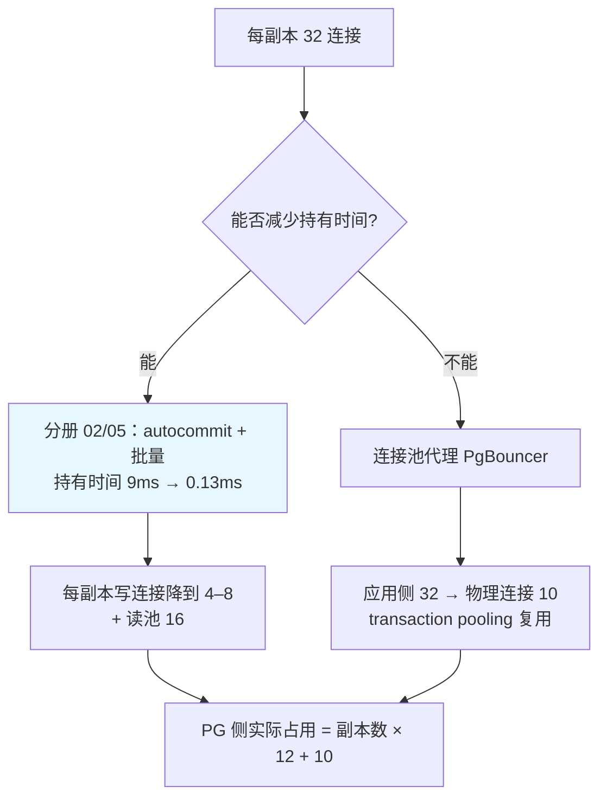

# 10 · 横向扩容与连接池代理（方向 J）

> 归属：[`00-消息吞吐上限分析与提升技术方案.md`](./00-消息吞吐上限分析与提升技术方案.md) §4.5 / §5.6
> 优先级：P3（2 人日；**在单副本跑到 1 万 msg/s 之前不要做**，否则只是把低效复制两份）
> 一句话：biz 是无状态的，加副本本来就是设计内的能力（`EDGE_GRPC_ADDR` 逗号分隔即可）。真正的约束不是代码，而是 **PG 的 `max_connections=100`**——2 副本 × 32 连接就已经顶到 84%，3 副本直接越界。所以"扩容"这件事的本质是**先把每副本的连接数降下来，再谈加副本**。

---

## 一、现状分析

### 1.1 代码里早就支持多副本

`gateway/internal/upstream/multi.go:19-50`：

```go
func NewMultiGrpc(addrs []string, streamsPerBackend int, ...) (*MultiGrpc, error)
// 每个地址一组流池，按 userId 哈希选后端；目标不健康则降级到首个健康后端
```

启动方式（README 已记录）：

```bash
EDGE_GRPC_ADDR=127.0.0.1:3008,127.0.0.1:30081 GATEWAY_UPSTREAM=grpc ...
```

业务层无状态的根基是"状态全外置"：seq/幂等/限流/presence 在 Redis，消息与会话在 PG，通话态在 Redis。任意副本能处理任意用户。

### 1.2 但连接预算先越界了

| 项 | 数值 | 来源 |
|---|---|---|
| PG `max_connections` | 100 | `SHOW max_connections` |
| 每副本连接池 | 32 | `db.go:67` 硬编码 |
| 1 副本占用 | 32（+ 运维/监控 ~5） | — |
| 2 副本占用 | **64**（+5 = 69，69%） | — |
| 3 副本占用 | **96**（+5 = 101，**越界**） | — |

也就是说：**当前配置下最多 2 个副本**。而 2 副本 × 2800 msg/s = 5600 msg/s，距离单副本优化后的 1–2 万还很远——**用扩容去补单副本的低效，是最贵的做法**。

### 1.3 `REPLICA_ID` 在 biz 里是死配置

```bash
grep -rn "ReplicaID" biz/internal biz/cmd
# config.go:65   ReplicaID string     ← 定义
# config.go:112  ReplicaID: envOr(...)  ← 赋值
```

**没有任何使用点。** 真正需要副本标识的是 gateway（写进 `presence:{uid}:meta` 的 `"{replica}:{socketId}"`，`gateway/internal/presence/presence.go:39`）。

所以多副本部署时：**biz 的 `REPLICA_ID` 可以随便填**（不影响路由），但 gateway 的 `GATEWAY_REPLICA_ID` 必须唯一，否则 presence 会被互相覆盖（`gateway/internal/config/config.go:65-67` 的注释已经警告过这点）。

---

## 二、优化原理

### 2.1 无状态服务的扩容曲线

理论上线性，实际受三个共享资源约束：

| 共享资源 | 是否随副本线性增长 | 何时成为瓶颈 |
|---|---|---|
| PG 连接数 | ❌ 固定 100 | 3 副本即越界 |
| PG 写入带宽（WAL / fsync） | ❌ 单实例 | 2 万–5 万 msg/s |
| Redis 命令吞吐 | ❌ 单实例 | ~5 万 msg/s（优化后） |
| biz CPU | ✅ 每副本独占 | 不成为全局瓶颈 |
| gateway 连接 | ✅ 每副本独占 | 不成为全局瓶颈 |

**结论：扩容的天花板由最慢的共享资源决定，而不是副本数。**

### 2.2 两种降低"每副本连接占用"的手段



| 手段 | 原理 | 效果 |
|---|---|---|
| 减少持有时间（02/05） | 单请求占用连接从 9 ms 降到 0.13 ms，同样吞吐只需更少连接 | 写池 32 → 6–8 |
| PgBouncer（transaction pooling） | 应用侧持有"逻辑连接"，真实物理连接在事务边界释放并复用 | 100 个应用连接 → 10 个物理连接 |

两者不冲突：**先用 02/05 把需求降下来，再用 PgBouncer 把余量放大**。

---

## 三、具体方案

### 3.1 阶段一：双副本（不改代码，只改部署）

```bash
# biz-1
PORT=3007 EDGE_GRPC_ADDR=127.0.0.1:3008 EDGE_GRPC_ENABLED=true \
PG_MAX_CONNS_WRITE=16 PG_MAX_CONNS_READ=12 \
REPLICA_ID=biz-1 /tmp/biz-server

# biz-2
PORT=3009 EDGE_GRPC_ADDR=127.0.0.1:30081 EDGE_GRPC_ENABLED=true \
PG_MAX_CONNS_WRITE=16 PG_MAX_CONNS_READ=12 \
REPLICA_ID=biz-2 /tmp/biz-server

# gateway
GATEWAY_UPSTREAM=grpc \
EDGE_GRPC_ADDR=127.0.0.1:3008,127.0.0.1:30081 \
EDGE_GRPC_STREAMS=4 GATEWAY_REPLICA_ID=gw-1 ...
```

预算：`2 × (16 + 12) + 10 = 66 < 100` ✅

### 3.2 阶段二：三副本 + PgBouncer

```
biz-1/2/3  ──(各 8 写 + 8 读)──►  PgBouncer (pool_mode=transaction, default_pool_size=40)
                                        │
                                        └──► PG (max_connections=100, 实际占用 ~45)
```

| PgBouncer 参数 | 建议 | 说明 |
|---|---|---|
| `pool_mode` | `transaction` | 事务边界归还连接，复用率最高 |
| `default_pool_size` | 40 | 每个 (user,db) 的最大物理连接 |
| `max_client_conn` | 1000 | 应用侧逻辑连接上限 |
| `max_prepared_statements` | 100（≥1.21） | 见坑 2 |
| `server_idle_timeout` | 60 | — |

### 3.3 阶段三：读写分离

`PG_READONLY_URL` 指向只读副本（分册 06），读池不再占主库连接。此时主库连接预算可以只算写池。

---

## 四、坑点

### 坑 1：哈希分片会不均，但不能改成随机

`clientFor` 按 `userId % N` 选后端（`multi.go:39`）。用户 ID 通常是自增的，`% 2` 会很均匀；但如果将来引入"大客户"（某个 ID 段特别活跃），会形成热点。

**不要改成随机**——同一用户必须恒落同一后端，否则 ack 与上行帧会跨流（`forward` 的 pending 表是按分片存的，`grpc.go:135`）。这一点没有商量余地。

真正的解法是**在网关侧按 userId 做一致性哈希 + 虚拟节点**，但那是 gateway 的事，与 biz 无关。

### 坑 2：PgBouncer 与 pgx 预编译语句冲突

pgx 默认 `QueryExecModeCacheStatement`，会在连接的会话状态里准备语句。`transaction` 模式下物理连接会漂移 → 报 `prepared statement "stmtcache_..." does not exist`。

三个解法：

| 解法 | 代价 |
|---|---|
| PgBouncer ≥ 1.21 + `max_prepared_statements=100` | 推荐，改动最小 |
| pgx 改用 `QueryExecModeSimpleProtocol` | 失去二进制传输，CPU 略升 |
| `pool_mode=session` | 复用率下降，等于没用 PgBouncer |

### 坑 3：扩容不解决热点会话

如果某个群有 1 万人同时在线、每秒 500 条消息（已被 `CONV_RATE_LIMIT_MAX=500` 限制），这个会话的所有写入**永远落在同一台 PG、同一个分区**。加副本没用——副本只是让更多请求并发到达，热点仍然串行。

热点问题要靠"扇出解耦"（消息队列旁路）或"大群拆分区"，不属于本方向。

### 坑 4：滚动重启会触发重连风暴

biz 重启 → 该副本上的 gRPC 流全部断开 → `streamShard.recvLoop` 指数退避重建（`grpc.go:296-303`，0.1s→3.2s 封顶）。同时客户端侧：连接所在的 gateway 失联 → 客户端重连（S7 实测 300/300 成功、p99 43 ms，健康）。

但**两个副本同时重启**会让所有流同时重建，出现短暂的 ack 超时。滚动发布必须一次只动一个副本，并等 `IsHealthy()` 恢复后再动下一个。

### 坑 5：`EDGE_GRPC_STREAMS` 与并发 Send 的冲突

每后端 4 条流（`config.go:60`），下行按副本轮询（`directdownlink.go:62`）。流越多，同一条流上的并发写越少——**这其实缓解了分册 09 的并发 Send 问题**。

但别指望用"加流数"来解决：它同时放大了流重建时的 pending 拒绝面（`failAll`，`grpc.go:278-286`），且 1 MB 流控窗口下 4 条流远未饱和（2800 msg/s × 300 B ≈ 0.84 MB/s）。**先把并发 Send 修对，再考虑流数。**

### 坑 6：`max_connections` 上调的隐性成本

每连接在 PG 侧约占 5–10 MB 私有内存（含 work_mem 等）。提到 500 需要 ~5 GB，且进程数上升会加剧上下文切换。**PgBouncer 比调大 `max_connections` 更划算**。

### 坑 7：多副本后 `seq` 的 checkpoint 会互相覆盖吗

不会。`CheckpointAll` 用 `UPDATE ... SET next_seq = GREATEST(next_seq, $2)`（`seq.go:238-241`），**单调取大**，多副本并发 checkpoint 不会写回旧值。这是设计好的。

但要注意：`knownConvs` 是**每副本的内存集合**（`seq.go:186-189`），副本只 checkpoint 自己发过号的会话。所以一个会话的位点可能由多个副本各写一部分——`GREATEST` 保证最终正确。

---

## 五、验证方法

| 项 | 方法 | 通过标准 |
|---|---|---|
| 线性度 | 单副本 vs 双副本同参数跑 S8 | 双副本吞吐 ÷ 单副本 ≥ **1.85** |
| 连接预算 | `SELECT count(*) FROM pg_stat_activity` | ≤ `max_connections × 0.7` |
| 故障切换 | `kill -9` 一个 biz 副本 | 客户端消息零失败（gateway 降级到健康副本），p99 短暂上冲后恢复 |
| 分片均匀 | 两副本的 `server_message_in_total` | 偏差 ≤ 20% |
| 滚动发布 | 依次重启两个副本 | 全程无 `message.ack_timeout` |
| PgBouncer | `SHOW POOLS` 的 `sv_active` / `cl_active` | 物理连接 ≤ 40，逻辑连接数千 |

---

## 六、与其他方向的关系

| 方向 | 关系 |
|---|---|
| 02 / 05 | **前置**：把每副本连接需求降下来，否则 3 副本直接越界 |
| 06 池隔离 | 写/读分开后预算更清晰 |
| 09 并发 Send | 多副本 + 多流会放大该缺陷，应先修 |
| 11 分库 | 当"扩容到 N 副本"也无法提升时，才需要动 PG 的物理分片 |
