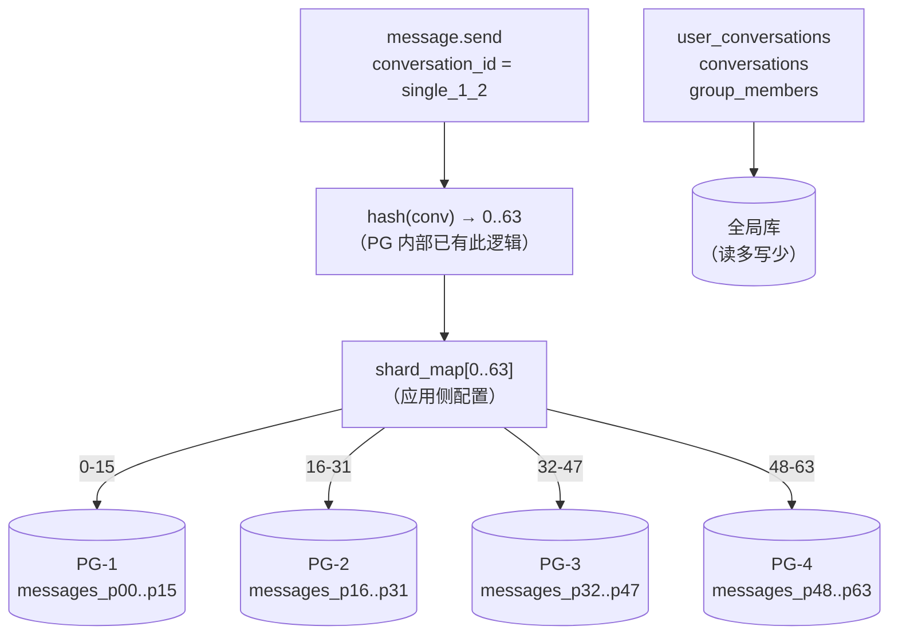

# 11 · 分库分片与 Redis 集群（方向 K）

> 归属：[`00-消息吞吐上限分析与提升技术方案.md`](./00-消息吞吐上限分析与提升技术方案.md) §4.5 / §5.0-K
> 优先级：P4（1–2 周；**当"加副本"不再带来收益时才做**）
> 一句话：当前 `messages` 已经按 `conversation_id` 哈希成 64 个**逻辑分区**，但都在同一个 PG 实例里。分库就是把这 64 个逻辑分区**映射到 2–4 个物理实例**——分片键早就选对了，缺的只是路由层。真正难的不是消息表，而是那些**没有分区键的表**（`user_conversations`、`conversations`）。

---

## 一、现状分析

### 1.1 已经做对的部分

`migrations/0007_messages_partition.up.sql`：

```sql
CREATE TABLE messages_partitioned (...) PARTITION BY HASH (conversation_id);
-- 64 个分区 messages_p00 … messages_p63
```

| 设计决策 | 现状 | 评价 |
|---|---|---|
| 分区键 | `conversation_id` | ✅ 与所有热查询的等值条件一致，天然可裁剪 |
| 分区数 | 64 | ✅ 对单实例合适（太少热点集中，太多规划开销） |
| 主键 | `(id, conversation_id)` | ✅ 满足"唯一约束必须含分区键"的硬要求 |
| 查询模式 | 全部带 `conversation_id` 等值 | ✅ 分片友好 |

**这意味着：消息表的分片键已经选定，分库时不需要重新设计表结构，只需要决定"哪 16 个分区放哪个库"。**

### 1.1.1 边界澄清：分区 ≠ 分库，而且分区不能跨实例

这是一个容易混淆的点，单独写清楚：

| 说法 | 是否成立 | 说明 |
|---|---|---|
| "我们现在分表了" | ✅ 成立 | PG 原生声明式分区（declarative partitioning），64 个物理子表 |
| "我们现在分库了" | ❌ **不成立** | 只有一个 `DATABASE_URL`；`db.go` 只有 `pgPool` 与 `roPool` 两个池，后者默认回退前者 |
| "分区可以放到不同机器" | ❌ **不成立** | 分区必须属于**同一个 database**，即同一个 postmaster：共享 catalog、WAL、buffer pool、连接限额 |
| "分区可以放到不同磁盘" | ⚠️ 有限成立 | 可给分区指定不同的 `TABLESPACE`（挂到不同挂载点），但仍是同一实例、同一份 WAL、同一个 CPU/内存 |
| "读副本算分库" | ❌ 不算 | `PG_READONLY_URL` 是流复制副本（同一份数据的拷贝），不是"一部分数据在一台、另一部分在另一台" |

**代码证据**：

```bash
$ grep -rniE "shard|分库" --include="*.go" biz gateway
# 只命中：上传分片（multipart chunk）、gRPC 流按 userId 哈希分片 —— 与数据库无关
$ grep -c "^  postgres:" docker/docker-compose*.yml
# 每套编排都只有 1 个 postgres 服务
```

PG 本身**不提供跨实例分片**。要做真正的分库，只有三条路：

| 路径 | 形态 | 本项目是否采用 |
|---|---|---|
| 应用层路由（本文方案） | 应用算 `conv → 库`，连不同的 `pgxpool` | 规划中（P4） |
| 中间件（Citus / ShardingSphere） | 对应用暴露单一入口，内部转发 | 未采用 |
| FDW（`postgres_fdw` / `dblink`） | 一个库挂外部表指向另一个库 | 未采用（跨库事务/性能都差） |

所以当前的准确表述是：**「单库 + PG 原生分区」**——写能力的天花板就是那一台 PG 实例（见 §1.3）。

### 1.2 没有分区键的表

| 表 | 规模 | 访问模式 | 分片难度 |
|---|---|---|---|
| `messages` | 747 万行（增长最快） | 全部按 `conversation_id` | ✅ 易 |
| `conversations` | 与消息同量级、但每会话一行 | 按 `id` 等值（发号 checkpoint、ensureConversation） | ✅ 可随 `messages` 同库 |
| `user_conversations` | 用户 × 会话 | 按 `user_id` 查（`/user/userConversations`、`/user/mentions`、成员校验） | ⚠️ **分片键不同** |
| `group_members` | 群 × 成员 | 按 `group_id` / `user_id` | ⚠️ 同理 |
| `users` / `device_sync_state` | 小 | 按 `user_id` | 可留全局 |

**核心矛盾：消息按 `conversation_id` 分片，而"我的会话列表/未读/@我"按 `user_id` 查。** 两者无法用同一个分片键。

### 1.3 单实例的物理上限

| 资源 | 当前 | 何时成为墙 |
|---|---|---|
| 写入（WAL / fsync） | 2800 msg/s（未优化）→ 2 万+（批量后） | 单实例 2 万–5 万 msg/s |
| 存储 | 747 万行 | 单实例可撑到亿级（配合冷热分离） |
| 连接 | 100 | 已见分册 10 |
| 单分区热点 | 64 分区均匀 | 超大群（单会话 500 msg/s）永远落一个分区 |

**结论：分库解决的是"写入带宽"，解决不了"单会话热点"。** 后者要靠扇出解耦或大群拆分。

---

## 二、优化原理

### 2.1 二级分片：逻辑分区 → 物理库



**为什么用"逻辑分区 → 物理库"而不是"直接 `hash % N 库`"：**

| 方式 | 扩缩容 | 迁移粒度 |
|---|---|---|
| `hash(conv) % N` | 改 N 就要全量重分布 | 灾难 |
| 固定 64 分区 + 映射表 | 只需搬"整个分区"，映射表改一行 | 单分区（~1/64 数据） |

这与 Redis Cluster 的 16384 槽是同一个思想：**把"数据归属"与"节点数量"解耦**。

### 2.2 全局表的两条路

| 方案 | 做法 | 一致性 | 复杂度 |
|---|---|---|---|
| 单库 + 应用缓存 | `user_conversations` 留在全局库，热点（成员关系）用进程内缓存 | 强（单库） | 低 |
| 按 `user_id` 再分片 | 用户维度一张分片表，跨分片查询用 scatter-gather | 强（同库事务） | 高 |

**推荐先做第一种。** `user_conversations` 的写只发生在"首条消息/新成员入群"，读有 `ucExistsCache`（`message.go:51-54`）兜底，留在全局库不会成为写瓶颈。

---

## 三、具体方案

### 3.1 路由层（唯一需要改代码的地方）

所有 SQL 已经集中在 `biz/internal/repo/`（约定见 `repo/page.go:1-3`），所以路由只需要在 repo 层做一次：

```go
// repo/shard.go
func poolFor(convID string) *pgxpool.Pool {
    n := int(hash32(convID) % 64)      // 必须与 PG 的 HASH 分区函数一致？不需要——见坑 1
    return shardPools[shardMap[n]]
}
```

**注意**：应用侧的 `hash32` 不需要与 PG 的 `HASH` 分区函数一致。因为分区表在每个物理库里仍然按 `HASH(conversation_id)` 自行分区——应用只需要保证"同一个 conv 恒去同一个库"，库内部由 PG 再分 64 份（此时每库的 64 个分区只是本地分片，数量可减到 16）。

### 3.2 需要改的查询清单

| 查询 | 现状 | 分库后 |
|---|---|---|
| `Messages` / `MessagesSince` / `max(seq)` | 单库 | 按 conv 路由 ✅ |
| `INSERT messages` | 单库 | 按 conv 路由 ✅ |
| `ensureConversation` / `bumpSeqDB` / checkpoint | 单库 | 按 conv 路由 ✅ |
| `GetConversationMembers`（群） | 查 `group_members` | 全局库 ✅ |
| `IsMember`（群） | 全局库 ✅ |
| `/user/lastMessages` | 一次查 N 个会话 | **跨库 scatter-gather** ⚠️ |
| `/user/userConversations` | 全局库 ✅ |
| `/user/mentions` | 全局库 ✅ |
| `/user/readCount` | 全局库 ✅ |

**只有一个查询会跨分片**：`lastMessages`。而它恰好是分册 07 要改造的慢查询——改完之后（逐会话点查 + 按库分组并发）天然适配分库。

### 3.3 Redis Cluster

单 Redis 目前在 ~1.7 万 ops/s（分册 00 §3.4），优化后会降到 ~4 万 ops/s @ 2 万 msg/s，仍未饱和。上 Cluster 的触发条件是 **> 5 万 msg/s**。

前置改造（**现在做成本最低**）：

| 键 | 现状 | Cluster 要求 |
|---|---|---|
| `conv:seq:{conv}` | 无 tag | `seq:{conv}` |
| `conv:rate:{conv}` | 无 tag | `rate:{conv}` |
| `msg:idem:{conv}:{sender}:{cmid}` | 无 tag | `idem:{conv}:{sender}:{cmid}` |
| `presence:{uid}` + `presence:{uid}:meta` | 无 tag | `presence:{uid}` / `presence:{uid}:meta` |

统一用 `{...}` 包住"同一业务实体"，保证同槽（分册 03 坑 1、分册 04 坑 4）。

> **改键名 = 丢号**。必须在维护窗口做，并写迁移脚本（`SCAN` 旧前缀 → `RENAME` 或重建）。

---

## 四、坑点

### 坑 1：不要把应用侧哈希与 PG 分区数耦合

应用只需要"conv → 库"的稳定映射；库内部怎么分区是 PG 的事。如果应用写死 `hash % 64` 并且库内也用 64 分区，将来想改成 16 分区就会两处不一致。

**建议**：应用侧只做 `hash(conv) % 1024` 再查映射表，映射表决定库与本地分区数。表在配置中心或一张小表里。

### 坑 2：`lastMessages` 是唯一跨分片查询，别为它做分布式事务

`DISTINCT ON` 的语义是"每个会话取最新一条"，各分片独立可算，最后**在应用层合并**（按会话分组取最大 `timestamp`）即可，不需要任何分布式协调。

### 坑 3：`seq` 必须与消息同分片

`seq` 的权威在 Redis（不是 PG），但 `loadNextSeqFromPG` 要查 `max(seq)`（`seq.go:133`）。如果消息分库而 `conversations.next_seq` 留在全局库，checkpoint 的 `UPDATE` 与 `max(seq)` 就会跨库——虽然能工作，但**每次键丢失都要跨库查询**，且无法用本地事务保证。

**把 `conversations` 跟着 `messages` 按 conv 同库。** 表很小，迁移成本低。

### 坑 4：迁移期间的双写与校验

从单库到 4 库不是"改配置"，而是**搬数据**：

| 阶段 | 动作 |
|---|---|
| 1 | 建 4 个新库 + 同结构 schema（迁移文件已 embed，直接跑 `migrate.Up`） |
| 2 | 按分区把历史数据导出/导入（`COPY (SELECT ... WHERE hash%4=k) TO`），可离线 |
| 3 | 应用切换读路由 + **双写**（或短暂停写） |
| 4 | 校验：逐会话比对 `count(*)` 与 `max(seq)` |
| 5 | 去掉单库写入，保留只读一段时间 |

**校验必须逐会话，不是全表 count**——总数相等不代表分对了。

### 坑 5：跨库的 `user_conversations` 与消息分片会短暂不一致

用户发消息 → 消息落库 A、关系行落库 G（全局）。若 A 成功 G 失败，`/user/sync` 会 403（`sync_routes.go:77`）。这与分册 02 坑 2 是同一个问题，分库只是把它从"同库不同表"变成"跨库"，概率不变。

### 坑 6：Redis Cluster 的 failover 会丢 seq 键

主从切换时，未同步到从库的写入会丢（异步复制）。`seq` 键丢失 → 走"装载 + 余量"路径（分册 01）。所以**分册 01 的余量机制是 Cluster 的前置条件**，不是可选项。

### 坑 7：不要同时上 Cluster 和分库

两件事同时做，出问题时无法判断是分片路由错了还是 Redis 槽错了。**先 Redis（对业务透明，只改键名），再 PG 分库（改路由）。**

---

## 五、验证方法

| 项 | 方法 | 通过标准 |
|---|---|---|
| 路由正确 | 随机取 1 万会话，比对应用路由与数据实际所在库 | 100% 一致 |
| 数据完整 | 逐会话 `count(*)` / `max(seq)` 与迁移前快照比对 | 完全一致 |
| 吞吐线性 | 4 库 vs 1 库 同参数 | ≥ 3.4× |
| 跨库查询 | `/user/lastMessages` 在 4 库下 | p50 ≤ 15 ms（分册 07 之后） |
| Cluster 槽 | `CLUSTER KEYSLOT` 检查同业务键 | 同一 conv 的三个键同槽 |
| 故障切换 | 杀掉一个 Redis 主节点 | 30 s 内恢复；seq 无回退、无重号 |

---

## 六、与其他方向的关系

| 方向 | 关系 |
|---|---|
| 01 seq | 余量装载是 Cluster failover 的前置（坑 6） |
| 03 合并 Lua | 键名 hash tag 必须在合并脚本前后一致，最好一次改到位 |
| 04 presence | 同槽要求见分册 04 坑 4；两键改名要与网关同步 |
| 05 组提交 | 批量写入后单库可到 2 万–5 万，分库的触发点由它决定 |
| 07 lastMessages | 唯一跨分片查询，07 改造后天然适配 |
| 10 扩容 | 分库是"加副本也不涨"之后的下一级手段 |
