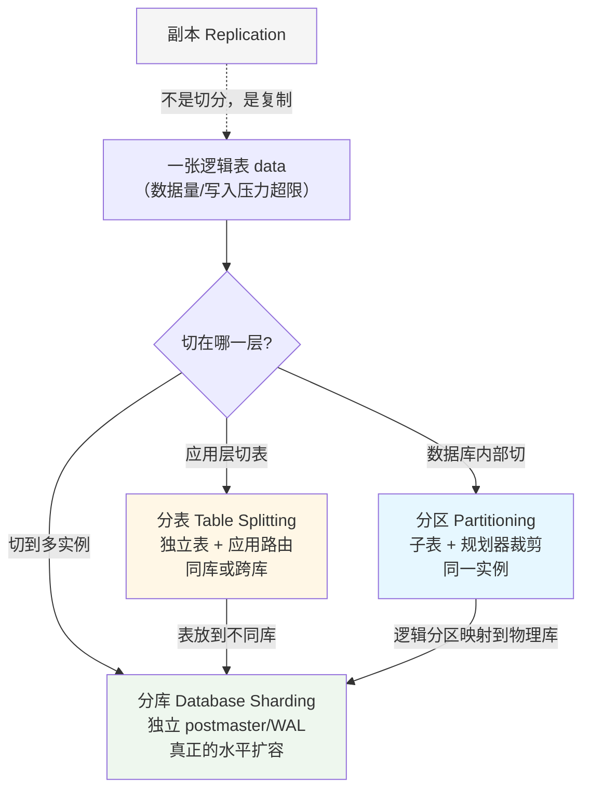

# 00 · 概念地图：分区、分表、分库、分片、副本到底在说什么

> 这是"底层原理"系列的总纲。目标是先建立坐标系：**这几个词不是并列的四种技术，而是"同一个动作在不同层次上的不同叫法"**。
> 读完本文只需记住一句话：**它们都在回答"一份数据被切到哪几个物理单元里"，区别只在"切在哪一层"和"谁来负责找路"。**

---

## 一、先把"物理单元"这个词钉死

任何一种切分，本质都是把一张逻辑表的数据分散到若干**物理单元**上。物理单元的粒度从细到粗是：

```
行（row）  <  页（8 KB page）  <  表/分区（heap + 索引）  <  数据库（database）  <  实例（postmaster + 共享内存 + WAL）  <  机器
```

| 切分方式 | 切到的物理单元 | 谁负责路由 | 能否跨机器 |
|---|---|---|---|
| **分区**（partitioning） | 同一数据库内的子表 | **数据库自己**（tuple routing + 分区裁剪） | ❌ 不能 |
| **分表**（table splitting） | 同一数据库内的独立表 | **应用**（拼表名） | 同库内不能；若跨库则升级为分库 |
| **分库**（database sharding） | 不同实例上的数据库 | **应用 / 中间件** | ✅ 能 |
| **分片**（sharding） | 抽象说法：任意物理单元 | 取决于实现 | 取决于实现 |
| **副本**（replication） | 另一台机器上的**完整拷贝** | 不需要路由（数据一样） | ✅ 但**不增加写能力** |

> 注意最后一行：副本经常被误当成"分片"，但它不是"切"，而是"复制"。这是最容易混淆的一组。

---

## 二、四个词的精确定义

### 2.1 分区（Partitioning）

**数据库内部**把一张逻辑表拆成多个物理子表，对外仍是**一个表名**。SQL 写 `SELECT ... FROM messages WHERE conversation_id = 'x'`，由**数据库的规划器与执行器**决定去哪个子表取。

关键特征：

- 表名不变 → 应用代码零改动；
- 数据库知道"它们是一伙的" → 能做**分区裁剪**（只扫相关子表）；
- 分区必须属于**同一个 database**（同一个 postmaster）；
- **唯一约束必须包含分区键**（因为唯一性是按分区各自保证的，没有全局索引）。

### 2.2 分表（Table Splitting）

**应用层**把一张表拆成 N 张**独立表**（`messages_00` … `messages_63`），数据库完全不知道它们有关系。

关键特征：

- 应用负责把表名拼出来（或由 ORM/中间件拼）；
- 数据库对它们**一视同仁**：每张表有自己的统计信息、vacuum、索引；
- 跨表查询只能 `UNION ALL` 或由应用分多次查再合并；
- 因为是独立表，**可以放到不同的数据库**——一旦跨库，就变成"分库"。

### 2.3 分库（Database Sharding / 分实例）

数据分布在**多个数据库实例**上（每个实例是独立的 postmaster、独立共享内存、独立 WAL、独立 CPU/磁盘）。

关键特征：

- 这是**唯一能真正增加写入能力的切分**（分区和同库分表都不增加）；
- 事务跨库时必须 2PC 或 Saga；
- 连接、备份、迁移、DDL 都变成 N 份；
- 需要一个**路由层**（应用内或中间件）。

### 2.4 分片（Sharding）

**是一个上位概念，不是一种具体技术。** 它的定义是：按某个键把数据分布到多个物理单元，使单单元的数据量/负载可控。

所以：

- 分区 **是** 分片（片在同一个实例内）；
- 分表 **是** 分片（片是独立表）；
- 分库 **是** 分片（片跨实例）；
- 业界口语里说"分片"时，通常特指**跨节点的水平切分**（即分库），因为同库内的切分已经有更精确的词了。

> 一句话：**分片是"切"这件事的通用名；分区/分表/分库是三种具体切法。**

---

## 三、一张图看懂层次关系



图中那条从"分区"指向"分库"的虚线，就是本项目 P4 的路线：**64 个逻辑分区 → 映射到 2–4 个物理库**。分片键早就选好了，缺的只是路由层。

---

## 四、五个维度对比（决策用这张表）

| 维度 | 分区 | 分表（同库） | 分库 | 副本 |
|---|---|---|---|---|
| 数据是否被切开 | ✅ 按 key 切 | ✅ 按 key 切 | ✅ 按 key 切 | ❌ 完整拷贝 |
| 单实例写入能力 | **不变** | **不变** | **随实例数增加** | **不变**（副本只读） |
| 单表大小 | 变小（每片小） | 变小 | 变小 | 不变（每份都是全量） |
| 查询是否需要改 | ❌ 零改动 | ✅ 必须路由正确 | ✅ 必须路由 + 可能跨片 | ❌ 零改动 |
| 事务 | 本地 ACID（跨分区仍是一个事务） | 本地 ACID（同库） | **跨库需 2PC/Saga** | 只读；写必须去主库 |
| 维护成本 | 一次 DDL 全分区生效 | N 份 DDL / 统计信息 | N 个实例的备份、升级、监控 | 复制延迟、故障切换 |
| 典型解决的问题 | 单表膨胀、索引变高、维护窗口、冷热分层、扫描裁剪 | 分区特性不够用时的替代品 | **写吞吐 / 存储物理上限** | 读扩展、高可用 |

**最重要的一行是"单实例写入能力"**：只有分库会变。这就是为什么"我们分了 64 个区，写入还是 2800 msg/s"——分区解决的是"单表管理问题"，不是"单机物理瓶颈"。

---

## 五、三个最常见误解

### 误解 1："分区了就是分布式了"

不是。分区是**同一个 postmaster 内部的目录结构**：共享 `shared_buffers`、共享一份 WAL、共享 `max_connections`、共享 CPU。64 个分区只是 64 个 `relfilenode`，写入仍然串行排队在同一套 WAL 与 fsync 上。

**判据**：如果杀掉一个进程就全部不可用，那它就是一个实例——无论内部切了多少片。

### 误解 2："分表能提升写入性能"

同库分表**不增加**写能力，因为：

- WAL 只有一份（所有表共享），fsync 次数不变；
- buffer pool 只有一份；
- 磁盘 IOPS 只有一份。

分表真正带来的收益是**减少单表的索引竞争与维护开销**（B-tree 更矮、vacuum 更快、DDL 更快），以及**为将来搬到不同库做准备**。

### 误解 3："加了只读副本就等于扩容"

副本承担的是**读**流量。写入仍然要打到主库，而且每一份副本都要重放同一份 WAL——**副本越多，主库的 WAL 发送压力越大**。所以副本解决的是"读不够"，不是"写不够"。

---

## 六、本项目的现状与坐标

| 项 | 现状 | 对应本文概念 |
|---|---|---|
| `messages` 表 | `PARTITION BY HASH (conversation_id)`，64 个子表 | **分区**（数据库原生） |
| 是否有应用层分表 | 没有 | — |
| 是否有分库 | 没有（只有一个 `DATABASE_URL`，一套 `pgxpool`） | — |
| 是否有副本 | 代码支持（`PG_READONLY_URL`），**默认未配置**，`RO()` 回退写池 | 副本（读扩展） |
| 是否有分片路由 | 没有（代码里没有 shard 路由；只有上传分片与 gRPC 流分片，与 DB 无关） | — |

准确表述：**单库 + PG 原生分区**。写入天花板 = 那一台 PG 实例的 WAL/fsync 能力。

---

## 七、本系列文档怎么读

| 文档 | 回答的问题 |
|---|---|
| [01 分区原理](./01-分区原理-PostgreSQL是怎么做分区的.md) | 一张表怎么变成 64 个物理子表？插入时谁决定去哪？查询时怎么只扫一片？ |
| [02 分表原理](./02-分表原理-应用层切表与数据库原生切表的差异.md) | 应用层自己切表和数据库切表，规划器看到的东西差在哪？ |
| [03 分库原理](./03-分库原理-从单实例到多实例到底变了什么.md) | 多一个实例，到底多了什么、丢了什么？为什么只有它能提升写吞吐？ |
| [04 分片原理](./04-分片原理-分片键-路由-再平衡-热点.md) | 分片键怎么选？`hash % N` 为什么危险？一致性哈希和槽位有什么区别？ |
| [05 副本原理](./05-副本原理-流复制与读写分离.md) | 副本是怎么做到"字节一致"的？为什么它不是分片？读己之写怎么破？ |
| [06 跨分片的代价](./06-跨分片的代价-查询-分页-事务.md) | 跨片查询为什么贵？全局分页为什么不能用 offset？2PC 卡在哪？ |
| [07 PG 与 MySQL 的差异](./07-PG与MySQL的差异-从开发者视角.md) | 我们这些优化在 MySQL 上也成立吗？哪些必须重写？ |
| [09 分库后消息 ID 重复与全局 ID 方案](./09-分库后消息ID重复与全局ID方案.md) | 两个库各自自增，id 撞了怎么办？号段/雪花/UUIDv7/复合 ID 怎么选；JS 2^53 的坑 |
| [10 Redis pub/sub 算不算 MQ](./10-Redis-pubsub算不算MQ-要不要引入消息队列.md) | 它为什么不是 MQ、现在只承担 0.0002% 流量、什么条件下才该上 Kafka/Pulsar |
| [11 定向下行原理](./11-定向下行原理-与pipeline的区别.md) | 与 pipeline 的本质区别：pipeline 省往返，直发省"广播放大" |

建议顺序阅读：**01 → 02 → 04 → 03 → 05 → 06 → 07**（先理解"切"，再理解"跨"，再理解"复制"，最后看"换引擎时哪些会变"）。

### 深入某一层：性能优化专题

上面 7 篇讲的是"数据怎么分布"。如果你的问题是"**为什么慢、慢在哪一层、优化能拿多少**"，看 `性能优化/` 子目录：

| 文档 | 回答 |
|---|---|
| [00 前置术语表](./性能优化/00-前置术语表.md) | 会话、seq、事务、锁、连接池……**如果这些词不熟，先看这篇** |
| [01 事务对性能的影响](./性能优化/01-事务对性能的影响-从fsync到连接池.md) | 一条 INSERT 的四类成本（xid / commit record / fsync / 连接占用），哪类能省、怎么省 |
| [02 发号器的性能原理](./性能优化/02-发号器的性能原理.md) | 为什么 Redis INCR 比数据库行锁快两个数量级（临界区长度差 4 个数量级） |
| [03 性能优化收益排名](./性能优化/03-性能优化收益排名.md) | 10 项已完成的实测排名 + 11 项待实施的预期排名，以及为什么倍率不能相乘 |
| [04 四级进程内缓存原理](./性能优化/04-四级进程内缓存原理.md) | 为什么"少写两次"能换回 19 倍：幂等 upsert、肯定缓存、`sync.Map` |
| [05 群扇出批量 PUBLISH 原理](./性能优化/05-群扇出批量PUBLISH原理.md) | pipeline 只省 RTT 不省广播放大；为什么后来还要定向下行 |
| [06 显式事务与隐式事务的取舍](./性能优化/06-显式事务与隐式事务的取舍.md) | 去事务不是免费的：原子性缩水、多语句 fsync 翻倍、四种写法的决策矩阵 |
| [07 从行锁到 Redis 的完整流程对比](./性能优化/07-从行锁到Redis-消息写入全流程对比.md) | 两条并发消息的时间线：B 到底在等什么、锁藏在元组头的哪个字段、互斥搬到了哪里 |
| [08 为什么需要 seq](./性能优化/08-为什么需要seq-从next_seq到发号器.md) | `next_seq` 是干什么的、`conversations` 表为什么存在、改表能不能消除竞争、为什么不能直接用 `id` 排序 |
