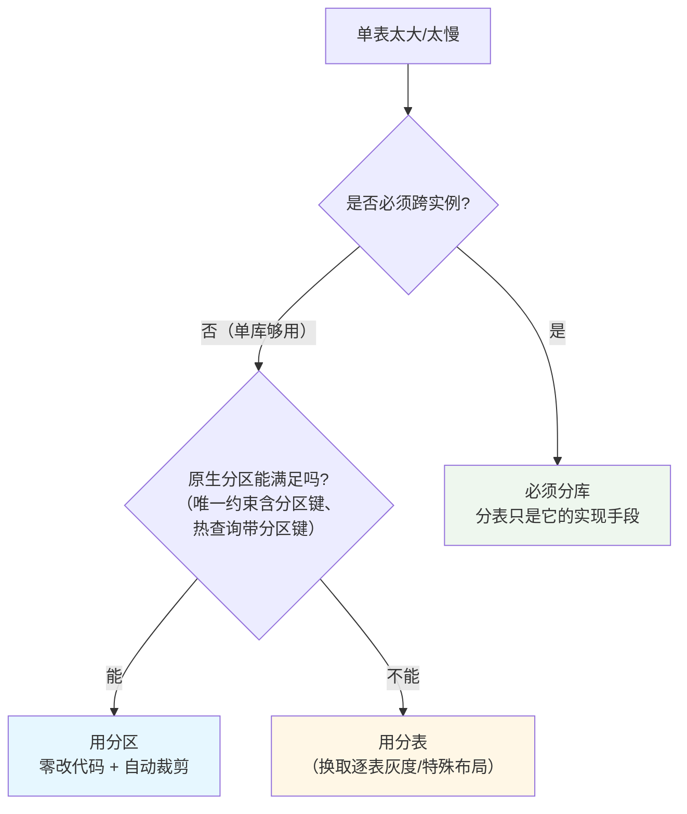

# 02 · 分表原理：应用层切表，数据库到底"看不见"什么

> 本文讲**分表**（table splitting）：在应用层把一张表拆成 N 张独立表。
> 核心结论：**分表与分区在磁盘上的物理形态几乎一样（都是 N 套堆 + N 套索引），真正的差别在"数据库是否知道它们是一伙的"。** 这个差别会一路传导到查询计划、约束、预编译语句、DDL、统计信息。

---

## 一、两种分表

### 1.1 水平分表（horizontal）：按行切

```
messages  →  messages_00 … messages_63
             按 hash(conversation_id) % 64 决定去哪张
```

每张表**列相同、行不同**。这是 IM/订单类系统里说的"分表"。

### 1.2 垂直分表（vertical）：按列切

```
messages(content, extra, file_info, mentions, ...)
   ↓
messages_core(id, conversation_id, seq, sender_id, type, status, timestamp)
messages_blob(id, content, extra, file_info, mentions)
```

每张表**行相同、列不同**，靠主键关联。

垂直分表的底层动机是 PG 的**行存 + 整页读取**：

```
页 = 8 KB，一行 = 页里的一段连续字节
读一行 → 必须把整行所在的页读进内存 → 行越宽，每页能放的行越少
       → 同样扫 1000 行，宽表要读更多页
```

所以把"很大但很少用"的列（长文本、JSON、二进制）挪到另一张表，可以让主表**每页放更多行**，扫描同样行数时 IO 更少。

> **但 PG 已经有 TOAST 机制**：单列超过约 2 KB 的变长值会被压缩/外置到 `pg_toast_*` 表，主表只留一个 18 字节的指针。**读取主表时不会读 TOAST**（除非 `SELECT` 到那一列）。
> 所以垂直分表的收益集中在"**几百字节到 2 KB 之间、不常访问**"的列上——太大有 TOAST 兜底，太常访问拆了反而多一次 JOIN。

---

## 二、底层：分表在系统目录里是什么样

### 2.1 与分区的目录对比

| 对象 | 分区方案 | 分表方案 |
|---|---|---|
| `pg_class` 行数 | 父表 1 + 子表 64 | **独立表 64**（没有父表） |
| `pg_inherits` | 有 64 行父子关系 | **没有**（互不相干） |
| `pg_partitioned_table` | 有 1 行（策略/键） | **没有** |
| `relpartbound` | 每个子表有边界 | **没有** |
| 物理文件 | 64 套堆 + 索引 | 64 套堆 + 索引（**一样**） |
| 规划器看到 | 一个 `Append` 节点，能裁剪 | **64 个互不相关的表**，无法裁剪 |

**结论：物理上一样，逻辑上完全不同。**

### 2.2 "数据库不知道"意味着什么

因为 `pg_inherits` 里没有记录，规划器无法做这三件事：

| 能力 | 分区有 | 分表没有 |
|---|---|---|
| **分区裁剪**：根据 `WHERE` 条件跳过不相关子表 | ✅ 自动 | ❌ 必须应用自己只查那张表 |
| **统一约束**：父表上的唯一/检查约束覆盖所有子表 | ✅ | ❌ 每张表各自建，且无法跨表保证 |
| **统一 DDL**：`ALTER TABLE messages ADD COLUMN` 一次生效 | ✅ | ❌ 要执行 64 次 |

---

## 三、路由：分表必须由应用完成

### 3.1 应用侧要做什么

```go
func tableFor(convID string) string {
    return fmt.Sprintf("messages_%02d", hash(convID)%64)   // 拼表名
}

sql := "INSERT INTO " + tableFor(convID) + " (...) VALUES ($1,$2,...)"
```

**注意：表名是"标识符"，不是"值"**。这带来一个非常实际的限制：

### 3.2 预编译语句无法参数化表名

SQL 的协议层区分两类东西：

| 类别 | 例子 | 能否用 `$1` 绑定 |
|---|---|---|
| **值**（literal/value） | `WHERE id = $1` | ✅ |
| **标识符**（表名、列名、schema） | `FROM messages_37` | ❌ **不能** |

所以分表方案下，pgx 的 statement cache 会为**每张表各缓存一份 prepared statement**：

```
stmtcache_xxx: INSERT INTO messages_00 (...)
stmtcache_yyy: INSERT INTO messages_01 (...)
...                                       ← 64 份
```

后果：

- 每个连接要准备并缓存 64 条语句（内存与首次解析成本 ×64）；
- 如果分片数是 1024，就是 1024 条——**statement cache 直接爆掉**；
- 解法只有两个：用 `SimpleProtocol`（放弃二进制传输与类型推断），或把分片数压小。

**这是"分表 vs 分区"最容易被忽略的工程差异**：分区方案里 SQL 文本是**恒定**的（`INSERT INTO messages ...`），预编译语句只有一份。

### 3.3 跨表查询只能靠应用拼

```sql
-- 分区：一条 SQL，规划器展开
SELECT * FROM messages WHERE conversation_id = ANY($1) ORDER BY seq DESC LIMIT 50;

-- 分表：应用必须知道 $1 里每个 conv 属于哪张表，然后
SELECT ... FROM messages_03 WHERE conversation_id = 'a'
UNION ALL
SELECT ... FROM messages_17 WHERE conversation_id = 'b'
...
ORDER BY seq DESC LIMIT 50;
```

`UNION ALL` 的代价：

- 每个分支都要单独规划（N 次 planner 调用）；
- 结果要在应用或 PG 侧归并排序（`LIMIT` 不能下推到每个分支，除非逐分支各取 50 再归并）；
- 分支数超过几十个时，**SQL 文本本身就很长**，解析成本可观。

---

## 四、约束与唯一性

### 4.1 跨表唯一约束不存在

分表方案下：

```sql
-- 每张表各建一个
CREATE UNIQUE INDEX ON messages_00 (conversation_id, seq);
...
```

**这只保证"表内唯一"。** 因为路由是 `hash(conv)%64`，同一会话恒定落同一张表，所以"会话内唯一"仍然成立——**但这是靠路由算法保证的，数据库没有为你保证**。

一旦出现以下情况，唯一性就被破坏而数据库不会拦：

- 路由算法改了（比如从 `%64` 改成 `%128`），旧数据没迁移；
- 某次写入用了错误的表名（bug / 手工修数据）；
- 双写迁移期间两边都写。

> 分区方案里，父表的唯一索引也是"每分区一个本地索引"，但它至少有一个**统一声明**：`UNIQUE (conversation_id, seq)` 写在父表上，PG 保证每个分区都有。分表方案连这个声明都没有。

### 4.2 外键与 JOIN

- 分表后，`messages_37.sender_id` 想引用 `users.id`，需要每张表各建一个外键（64 个）；
- 跨表 JOIN 无法用普通 `JOIN`，只能 `UNION ALL` 后聚合，或者应用层拼装。

---

## 五、统计信息与执行计划

### 5.1 每张表独立统计

PG 的 `pg_statistic` 是**按表**存的。分表后：

- 64 张表各有自己的 `reltuples`、直方图、`n_distinct`；
- `ANALYZE` 要跑 64 次；
- 某个分区数据倾斜时，只有那张表的计划会变差，**排查时容易误判为"偶发慢查询"**。

分区方案里，`ANALYZE messages` 会自动遍历所有分区——虽然仍是每片一份统计，但**入口是一个**。

### 5.2 计划缓存与"通用计划"

参数化查询在 PG 里会经历"前 5 次生成自定义计划 → 之后可能切通用计划"。分表方案下，每张表有独立的计划缓存条目，**同一逻辑查询在不同表上可能拿到不同的计划形态**，这会让性能表现难以预测。

---

## 六、DDL 与运维

| 操作 | 分区 | 分表 |
|---|---|---|
| 加列 | `ALTER TABLE messages ADD COLUMN` 一次 | 64 次（且要保证顺序/失败重试） |
| 建索引 | 父表一次 | 64 次（可用 `CONCURRENTLY` 逐张做，反而更灵活） |
| 备份 | 一个表（逻辑上是 65 个关系） | 64 个表，脚本要枚举 |
| 迁移库 | `pg_dump -t messages` 含所有分区 | 要枚举 64 个表名 |
| 删除历史数据 | range 分区可 `DROP` | 必须 `DELETE`（产生大量 dead tuple） |
| 扩容分片数 | 改分区定义（代价高） | 改路由 + 迁移数据（同样高） |

> 分表在"逐表灰度"上有优势：可以先给 `messages_00` 加列并观察，再推其余。分区做不到逐片灰度（父表 DDL 会传播）。

---

## 七、分表 vs 分区：怎么选



| 判据 | 选分区 | 选分表 |
|---|---|---|
| 单库足够 | ✅ | ✅（但没必要） |
| 需要自动裁剪 | ✅ | ❌ |
| 需要统一约束 | ✅ | ❌ |
| 需要逐表灰度 DDL | ❌ | ✅ |
| 需要把不同片放到不同表空间/磁盘 | ⚠️ 可以（`SET TABLESPACE`），但仍是同实例 | ✅ 更灵活 |
| 需要跨实例 | ❌ | ✅（此时叫分库） |
| 分片数很大（>1000） | ⚠️ 规划开销上升 | ❌ 预编译语句爆炸 |

**行业经验**：单库内优先用原生分区；只有当"分区特性的限制"（唯一约束、DDL 灰度、跨实例）成为硬约束时，才退回应用层分表。

---

## 八、本项目的形态

| 项 | 现状 |
|---|---|
| 是否分表 | ❌ 没有 |
| 是否分区 | ✅ `PARTITION BY HASH (conversation_id)`，64 片 |
| 为什么不分表 | 单库够用；且 `messages` 的热查询全部带 `conversation_id`，原生分区裁剪正好覆盖 |
| 未来分库时要不要分表 | **要**——分库的落地形态就是"每个库内一张 `messages` 表（本身仍是分区表）"，由应用按 conv 选**库**；库内继续用原生分区 |

> 换句话说：**分库与分区不冲突**，可以叠加——"先按 conv 选库，库内再按 conv 哈希分 16 个区"。这就是[分册 11](../11-分库分片与Redis集群.md) 的二级分片模型。

---

## 九、坑点

### 坑 1：表名拼接 = SQL 注入面

```go
sql := "SELECT * FROM " + tableName          // ❌ 若 tableName 来自用户输入，直接注入
```

必须用**白名单/枚举**：

```go
var tables = [64]string{"messages_00", ..., "messages_63"}
t := tables[hash(conv)%64]                    // ✅ 只可能是预定义值
```

### 坑 2：分片数变了 = 数据要搬家

`hash % 64` → `hash % 128`，约一半数据要迁移。这是 [04 分片原理](./04-分片原理-分片键-路由-再平衡-热点.md) 里"再平衡"问题的具体表现。

### 坑 3：COUNT / 全局排序 / 分页

- `SELECT count(*)` 要 64 次求和；
- `ORDER BY timestamp LIMIT 50` 要 64 次各取 50 再归并（**不能各取 50 就结束**，因为全局第 50 名可能来自任何一片）；
- `OFFSET 10000` 在分表下尤其昂贵（每片都要跳过一段）。

### 坑 4：事务

同一库内的分表**仍然共享本地事务**（一个连接可以 `BEGIN` 后写多张表），这点比分库好。但要注意：**跨表写入的顺序与锁**会让死锁概率上升（不同事务以不同顺序锁多张表）。

### 坑 5：迁移脚本的枚举成本

`pg_dump` 单表、`VACUUM`、`REINDEX`、备份策略，全部要枚举 64 个对象。分区方案里它们是一个逻辑对象。

### 坑 6：垂直分表会让"读一行"变成"读两行 + 一次 JOIN"

如果拆出去的列其实**经常被读**，垂直拆分是负优化：原本一次页读拿到整行，现在要两次索引查找 + 可能的随机 IO。判断标准是"该列的访问频率"，不是"该列的大小"。

---

## 十、验证方法

| 项 | 方法 | 观察 |
|---|---|---|
| 分表后规划器是否"看不见"彼此 | `EXPLAIN` 一条只查一张表的 SQL | 只有一个 `Seq Scan`/`Index Scan`，没有 `Append` |
| 预编译语句数量 | `SELECT count(*) FROM pg_prepared_statements` | 分表方案下会随表数增长；分区方案恒定 |
| 约束是否只覆盖单表 | 在 `messages_00` 插入与 `messages_01` 重复的键 | 不会报错（证明没有跨表约束） |
| 垂直拆分收益 | 对比 `pg_relation_size` 与 `EXPLAIN (BUFFERS)` 的 `shared hit` | 主表页数下降、扫描命中页数下降 |

---

## 十一、小结

| 问题 | 答案 |
|---|---|
| 分表和分区物理上有区别吗 | **几乎没有**：都是 N 套堆 + N 套索引 |
| 差别在哪 | **数据库是否知道它们是一伙的**（`pg_inherits` / `relpartbound`） |
| 这个差别导致什么 | 裁剪、统一约束、统一 DDL、预编译语句复用 |
| 什么时候必须分表 | 需要跨实例，或需要逐表灰度/特殊布局 |
| 什么时候别分表 | 单库内能用原生分区时——分表是"手工重造分区轮子" |
