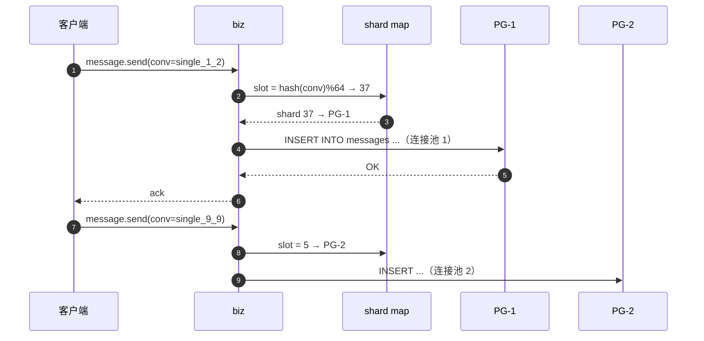
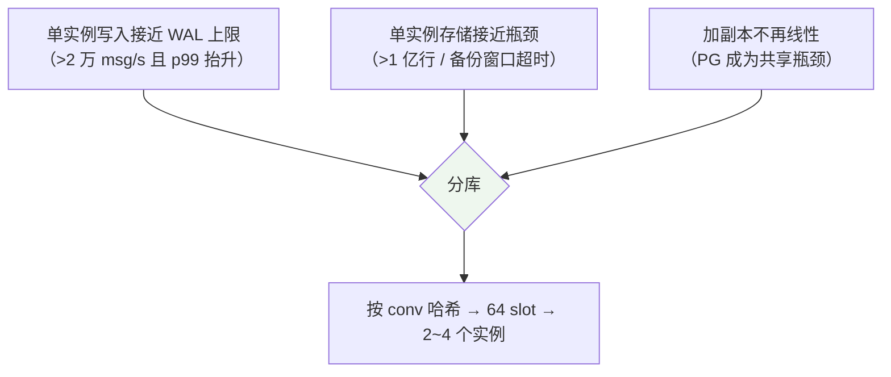

# 03 · 分库原理：从 1 个实例到 N 个实例，到底变了什么

> 本文讲**分库**（sharding across instances）：数据分布在多个数据库实例上。
> 核心结论：**分库唯一真正增加的是"资源"（WAL/CPU/磁盘/连接），代价是"原子性边界"被切开。** 前者是收益，后者是所有复杂度的来源。

---

## 一、先搞清楚"一个实例"是什么

分库不是"多建几个 database"，而是"多起几个 postmaster"。这两者差别巨大。

### 1.1 PG 的进程与内存模型

```
postmaster（父进程，监听端口、fork backend）
├── backend × N          ← 每条连接一个进程
├── checkpointer         ← 定期刷脏页、写 checkpoint
├── bgwriter             ← 后台预刷
├── walwriter            ← 异步写 WAL
├── autovacuum launcher  ← 拉起 autovacuum worker
└── wal sender × M       ← 给副本发 WAL

共享内存（所有 backend 共享）
├── shared_buffers       ← 数据页缓存（默认 128MB，生产通常按内存 25% 配）
├── WAL buffers          ← WAL 写缓冲
├── lock table           ← 锁与 LWLocks
└── proc array            ← 活跃事务快照
```

一个实例内部：

- **所有连接共享同一个 `shared_buffers`** → 缓存命中率是全局的；
- **所有事务写同一份 WAL** → fsync 是全局串行的（组提交能缓解，但仍是同一队列）；
- **所有连接共享同一个 `max_connections`** → 100 就是 100；
- **所有查询抢同一批 CPU 核**。

> 一句话：**"实例"= 一个故障域 + 一个资源池 + 一个事务域。**

### 1.2 同一个实例里的多个 database 不是分库

```sql
CREATE DATABASE shard_1;
CREATE DATABASE shard_2;
```

这两个库：

- 共享同一个 `postmaster`、同一份 `shared_buffers`、**同一份 WAL**（WAL 是实例级的，不是库级的）；
- 同一批 CPU；
- 同一个 `max_connections`；
- 崩溃时一起崩。

所以 **`CREATE DATABASE` 不增加任何写入能力**，它只是命名空间隔离。真正要分库，必须是多个**实例**（多个端口/多台机器/多个容器）。

---

## 二、分库后"得到"什么

| 维度 | 单实例 | N 个实例 |
|---|---|---|
| WAL 与 fsync | 1 份，全局串行 | N 份，**并行** ← 核心收益 |
| `shared_buffers` | 1 份 | N 份（总缓存 ×N） |
| CPU | 一台机器的核 | N 台机器的核 |
| 磁盘 IOPS | 一块盘 | N 块盘 |
| `max_connections` | 100 | 100 × N |
| 故障域 | 全挂 | 挂一个只影响 1/N 用户（**部分可用**） |
| 备份窗口 | 全量一份 | 可分片并行备份 |

**写入吞吐的提升来自"fsync 并行"**，这是分库与分区最本质的区别：

```
分区：  64 个分区 → 同一条 WAL 队列 → 同一个 fsync 点
分库：  4 个实例   → 4 条 WAL 队列   → 4 个 fsync 点并行
```

---

## 三、分库后"失去"什么

### 3.1 本地事务

```
单库：BEGIN; INSERT messages; UPDATE user_conversations; COMMIT;   ← 一个原子操作
分库：messages 在库 A，user_conversations 在库 B
      → 两个独立事务，中间可能失败
```

这是分库最硬的代价：**ACID 的 A（原子性）和 I（隔离性）只在单库内成立**。

### 3.2 跨库 JOIN

`messages JOIN users` 在跨库后变成"两次查询 + 应用层拼装"，或者把 `users` 做成全局表（每库一份冗余）。

### 3.3 全局唯一索引

每个库各自有唯一索引，**跨库无法保证唯一**。所以：

- 全局唯一的 `id` 必须由外部生成（不发号器，见 §5）；
- "某会话内 seq 唯一"这种约束，只有在**同一会话恒定落同一库**时才成立（靠路由算法保证，数据库不保证）。

### 3.4 一致性快照与备份

PG 没有"跨实例全局快照"。备份 N 个库时，各库的备份时间点不同：

```
库A 备份于 10:00:00
库B 备份于 10:00:07   ← 这 7 秒内的跨库写入，恢复后可能只落在一半
```

要做到一致，需要：全局停写 → 各库同时 `pg_start_backup` → 备份 → 恢复时对齐 LSN/时间点。成本极高，多数系统选择"接受跨库不一致，靠业务对账"。

### 3.5 统一 DDL

`ALTER TABLE messages ADD COLUMN` 变成 N 次执行，且必须保证"所有库最终一致"。一旦某个库失败，就出现**schema 漂移**（不同库结构不同），后续查询可能随机报错。

所以分库系统必须有**schema 版本管理 + 迁移编排**（逐库执行、失败重试、版本校验）。

---

## 四、路由层：分库必须有一个"找路的人"

### 4.1 最小实现：shard map

```go
// 配置：逻辑分片号 → 连接池
var shardPools = map[int]*pgxpool.Pool{
    0: poolA, 1: poolB, 2: poolC, 3: poolD,
}
// 路由：conv → 逻辑分片号（0..63）→ 物理库
func poolFor(convID string) *pgxpool.Pool {
    slot := hash(convID) % 64          // 逻辑分片
    return shardPools[shardMap[slot]]  // 间接层：slot → 库
}
```

**为什么要两层（slot → 库），而不是直接 `hash % 库数`**：见 [04 分片原理](./04-分片原理-分片键-路由-再平衡-热点.md) §4。一句话：直接取模的话，库数一变就要全量重分布；加一层映射，扩容只是"搬走几个 slot"。

### 4.2 请求生命周期多了一步



**每个库一个连接池**。这意味着：

- 连接总数 = 库数 × 每库池大小；
- 每个池都要预热（`MinConns`）；
- 池的监控要按库拆分（`db_pool_*{shard="1"}`）。

### 4.3 三种落地形态

| 形态 | 谁做路由 | 优点 | 缺点 |
|---|---|---|---|
| **应用内路由** | 业务代码 / repo 层 | 无额外组件，行为可控，易调试 | 每个语言/服务都要实现一遍；SQL 全部要过路由层 |
| **中间件**（ShardingSphere / ProxySQL 类） | 代理 | 应用无感，SQL 兼容性好 | 多一跳网络；复杂 SQL（跨片 JOIN/子查询）支持有限；本身要高可用 |
| **FDW**（`postgres_fdw`） | PG 自己 | SQL 透明，可跨库 JOIN | 每个外部表一次网络往返；无分布式事务；性能差 |
| **Citus 扩展** | 扩展 | 原生分布式，支持跨节点查询/聚合 | 侵入性强（要装扩展）、版本绑定、运维复杂 |

本项目若分库，建议**应用内路由**（repo 层已有"SQL 只出现在这里"的约定，`repo/page.go:1-3`），成本最低。

---

## 五、全局唯一 ID：分库后自增失效

### 5.1 问题

`BIGSERIAL` 的自增只在**单个实例**内唯一。分库后：

```
库A: id = 1, 2, 3 ...
库B: id = 1, 2, 3 ...   ← 与库A 冲突
```

而 `messages.id` 是对外暴露的 `serverMsgId`，必须全局唯一。

### 5.2 三种解法

| 方案 | 机制 | 优点 | 缺点 |
|---|---|---|---|
| **号段（segment）** | 每个实例从中心（DB 一行 / Redis）领一段 `[1000, 1999]`，本地分配 | 无网络往返、ID 递增、实现简单 | 重启丢段（空洞）；中心是单点 |
| **雪花（snowflake）** | `41b 时间 + 10b 机器 + 12b 序列` | 完全去中心、趋势递增、性能极高 | 依赖时钟（回拨会重号）；机器号要分配 |
| **UUIDv7** | 时间前缀 + 随机 | 去中心、无序冲突风险极低 | 16 字节（比 bigint 大一倍），索引更大 |

**本项目的选择**：现在单库用 `BIGSERIAL` 就够。分库时必须换成上面之一——**注意 `id` 的语义是"对外消息 ID"，换生成方式要与客户端兼容**（当前是字符串输出，兼容）。

### 5.3 更简单的替代：不要全局 id

如果业务上不需要"全局唯一 ID"（只需要"会话内可定位"），可以：

- 用 `(conversation_id, seq)` 作为业务主键；
- `id` 只在库内唯一，对外用 `serverMsgId = base64(shard_id || local_id)` 组合。

**成本最低，但要求所有消费方接受"ID 里有分片信息"。**

---

## 六、事务：分库后怎么写

### 6.1 首选：让业务写在同一个分片

**分片键 = 事务边界**，这是分库设计的第一原则。

本项目的写路径恰好满足：

```
message.send：
  INSERT messages            ← 按 conv 路由
  INSERT user_conversations  ← 按 (user, conv) 查，但写的是"参与者"
```

如果 `user_conversations` 也按 conv 分片，那么"消息 + 关系行"就在同一个库，**本地事务即可**。

这就是[分册 11 §3.3](../11-分库分片与Redis集群.md) 建议"`conversations` 跟 `messages` 同库"的原因：**让需要原子性的数据落在同一个分片**。

### 6.2 次选：2PC（两阶段提交）

```sql
-- 协调者
PREPARE TRANSACTION 'tx-123';    -- 库A、库B 各 prepare（持锁、持久化到 WAL）
COMMIT PREPARED 'tx-123';        -- 两边各 commit
```

PG 的 2PC 需要 `max_prepared_transactions > 0`。代价：

| 问题 | 说明 |
|---|---|
| **长时间持锁** | prepare 之后锁一直持有，直到 commit/rollback |
| **协调者故障** | 悬挂事务（in-doubt）会一直占锁，需要人工或超时机制介入 |
| **性能** | 至少 2 轮跨库网络往返 + 2 次 WAL 落盘 |
| **只读副本不支持** | 备库上不能 prepare |

**结论：2PC 只适合"低频但必须原子"的场景**（如跨库转账），绝不适合消息主链路。

### 6.3 常用：Saga / 本地消息表（最终一致）

把跨库操作拆成"本地事务 + 事件"，失败靠补偿：

```
库A: INSERT messages; INSERT outbox(evt)     ← 同一个本地事务（原子）
后台: 读 outbox → 发 MQ → 库B 消费 → INSERT user_conversations
失败: 重试 / 死信 / 人工
```

这就是"把分布式事务降级为最终一致"。代价是**中间态可见**（关系行可能晚几百毫秒才出现），需要业务能容忍。

---

## 七、扩容：分库最难的部分

分库不是"配好了就完事"，库数变化时**数据要搬家**：

| 方式 | 机制 | 影响 |
|---|---|---|
| 直接 `hash % N` | 改 N → 大部分 key 映射变化 | 几乎全量迁移，不可接受 |
| 固定 slot + 映射表 | 64/1024 个逻辑槽，槽→库可配置 | 只迁移"被移动的槽"，可控 |
| 一致性哈希 | 环 + 虚拟节点 | 只影响相邻区间，但实现复杂、均匀性依赖 vnode 数 |

详见 [04 分片原理](./04-分片原理-分片键-路由-再平衡-热点.md)。本项目的"64 个逻辑分区"天然就是 slot 方案，**分库时不需要重新设计**。

---

## 八、本项目：现在为什么不分库，什么时候分

### 8.1 现在不分库的理由

| 理由 | 数据 |
|---|---|
| 单实例还没跑满 | 优化后单副本预计 1.2–2 万 msg/s，单 PG 的上限约 2–5 万 |
| 分库解决不了当前瓶颈 | 当前瓶颈是连接池与往返次数（[分册 00 §4](../00-消息吞吐上限分析与提升技术方案.md)），不是 WAL |
| 复杂度陡增 | 全局 ID、跨库查询、备份、schema 漂移，全部要建设 |
| 有更便宜的扩容手段 | 加 biz 副本（近线性），只受 `max_connections` 限制 |

### 8.2 触发条件（满足其一再动手）



### 8.3 落地顺序（不要一次做完）

1. **抽路由层**（单库也走路由，`shardMap` 全部指向同一个池）——这一步不影响行为，但把"未来分库"的开关预留好；
2. **全局 ID 改造**（号段/雪花）——必须先做，否则分库那天数据主键冲突；
3. **全局表下沉**（`users`、`group_members` 冗余到每库）；
4. **分批搬迁 slot**（一次搬 8–16 个 slot，双写 + 校验 + 切读）；
5. **拆跨片查询**（`lastMessages` 改按库分组并发）。

---

## 九、坑点

### 坑 1：连接池总数爆炸

N 个库 × 每库 32 连接 = 320 连接。每个 PG 的 `max_connections` 是 100，**总和不是 100**，但要为每个库单独预留。

**建议**：分库后每库池大小 = 总预算 / N，并配合 PgBouncer（见[分册 10](../10-横向扩容与连接池代理.md)）。注意 PgBouncer 的 transaction pooling 与 pgx 预编译语句的冲突。

### 坑 2：跨库分页不能"各取 N 再拼"

```
SELECT * FROM messages ORDER BY seq DESC LIMIT 50 OFFSET 10000
```

分库后每个库都要跳过 10000 条再取 50 → 总成本 = N × 10050。**必须改成键集分页**（`WHERE seq < $cursor`），让每个库只扫一段。

### 坑 3：跨库 `count(*)` 是 N 次全扫

`SELECT count(*) FROM messages` 在分库后毫无意义（且极慢）。要么维护计数器（写入时 +1），要么用估算（`reltuples`）。

### 坑 4：故障域变多，不是变少

单库时"库挂了全挂"；分库后"挂一个只挂 1/N"。听起来更好，但**运维复杂度上升**：

- 要有降级策略（某库不可用时，该库用户的请求快速失败还是排队？）；
- 要有全局健康视图（N 个库的状态聚合）；
- 故障排查要跨库对日志（trace id 必须贯穿）。

### 坑 5：schema 漂移

逐库执行 DDL 时，如果某库失败后重试成功但顺序不同，可能出现"库A 有列 c，库B 没有"。**必须有版本表 + 启动时校验 + 拒绝服务而不是带病运行**。

### 坑 6：跨库 JOIN 的诱惑

"就 JOIN 一下 users 表"——在分库后要么查两次，要么把 users 全量同步到每库（全局表）。**后者会带来一致性维护成本**（用户改昵称要更新 N 个库）。IM 场景通常可以接受"N 秒延迟"，但不能接受"永远不一致"。

---

## 十、验证方法

| 项 | 方法 | 通过标准 |
|---|---|---|
| 路由正确 | 随机 1 万 conv，比对应用路由与数据实际所在库 | 100% |
| 线性度 | 1 库 vs 4 库 同参数压测 | ≥ 3.4× |
| 事务边界 | 检查所有写路径是否单库完成 | 无跨库写（除 outbox 异步） |
| 全局 ID | 4 库并发写 100 万条 | ID 无重复 |
| 备份一致性 | 恢复演练 | 跨库数据可对账（或业务接受少量不一致） |
| 故障演练 | 停掉 1 个库 | 只有该库用户受影响，其他库正常 |

---

## 十一、小结

| 问题 | 答案 |
|---|---|
| 分库增加了什么 | **WAL/fsync 并行、CPU、磁盘、连接、故障隔离** |
| 分库失去了什么 | **跨库原子性、跨库 JOIN、全局唯一索引、统一 DDL、一致性备份** |
| 为什么只有它能提升写吞吐 | 因为写入的上限是 fsync，而 fsync 队列是实例级的 |
| 分库的第一原则 | **分片键 = 事务边界**（让需要原子的数据落在同一片） |
| 分库最容易被低估的成本 | 全局 ID、跨库查询、schema 漂移、备份一致性 |
