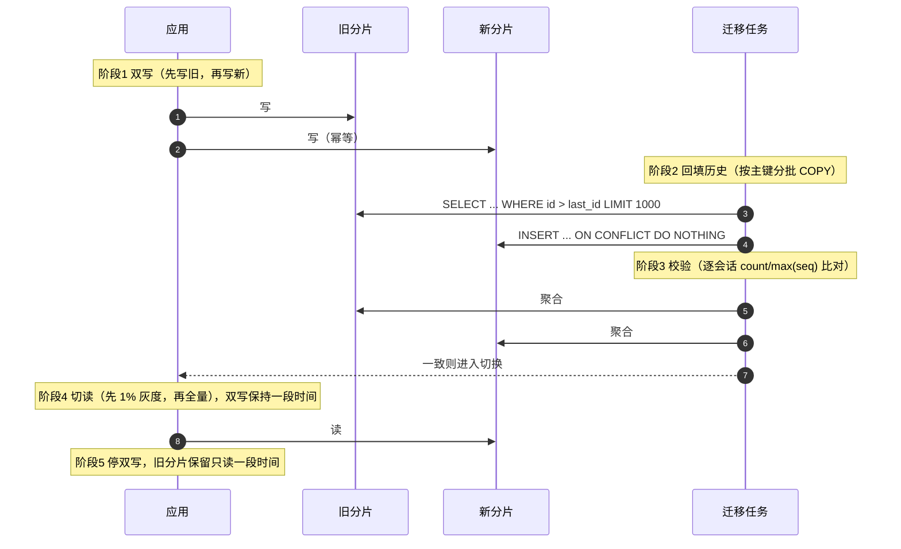
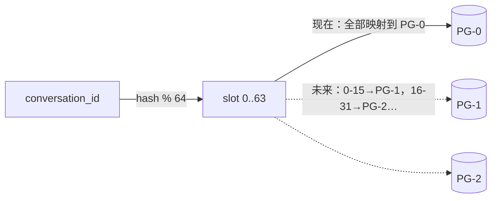

# 04 · 分片原理：分片键、路由、再平衡与热点

> 本文讲**分片**（sharding）这件事本身——不管片是"表"、"分区"还是"实例"。
> 核心结论：**分片的全部性质，都由一个映射函数 `f(key) → 物理单元` 决定。** 选键、选算法、扩容、热点，本质上都是在讨论这个函数的四个性质：**均匀性、稳定性、查询对齐、可迁移性**。

---

## 一、分片的数学定义

```
分片 = 一个映射函数 f: Key → ShardId
      + 一组物理单元 S = {s0, s1, ..., s_{n-1}}
      + 一组约束（唯一性、事务、查询模式）
```

所有"分片方案"的差别，只在于 `f` 长什么样、`S` 有多大、以及当 `n` 变化时 `f` 怎么调整。

---

## 二、分片键：选错了后面全错

### 2.1 六个评估维度

| 维度 | 含义 | 选错的后果 |
|---|---|---|
| **基数（cardinality）** | 不同取值的个数 | 基数低（如"性别"）→ 只能分出 2 片 |
| **均匀性（uniformity）** | 各片数据量是否接近 | 倾斜 → 热点片先满先慢 |
| **查询对齐（query alignment）** | 热查询是否都带这个键 | 不带 → 每次查询都扫全部分片 |
| **单调性（monotonicity）** | 新数据是否总是落在同一片 | 时间戳做键 → **所有写入打到最后一片** |
| **事务边界** | 需要原子的数据是否同片 | 不同片 → 必须 2PC/Saga |
| **不可变性** | 键值会不会变 | 会变 → 等于"迁移一行数据"，成本极高 |

### 2.2 四个典型反例

| 分片键 | 问题 | 现象 |
|---|---|---|
| **时间戳**（`created_at`） | 单调 | 所有新写入都落到"当前时间片"，等于没分片；老片只读 |
| **自增 ID** | 单调 | 同上，写入永远集中在最后一片 |
| **用户 ID（单聊/群聊混用）** | 查询不对齐 | "取会话消息"要知道对方 ID 才能定位，跨用户查询要扫全片 |
| **性别/地区** | 基数低 | 只能分几片，且严重倾斜 |

### 2.3 为什么 `conversation_id` 是合适的分片键（本项目）

| 维度 | `conversation_id` 的表现 |
|---|---|
| 基数 | 极高（每个会话一个值，用户数 × 会话数） |
| 均匀性 | 哈希后接近均匀（会话 ID 里含用户 ID，分布接近随机） |
| 查询对齐 | **所有消息查询都带它**（分页、同步、发号装载、max(seq)） |
| 单调性 | 不单调（新会话随机分布）→ 写入自然打散 |
| 事务边界 | "消息 + 会话位点"都以它为单位 → 天然单分片事务 |
| 不可变 | 会话 ID 创建后不变 |

这是"选对了"的典型：**一个键同时满足均匀、对齐、不单调、事务内聚**。

---

## 三、路由算法：四种形态

### 3.1 范围（Range）

```
key ∈ [0, 1000)   → s0
key ∈ [1000, 2000) → s1
...
```

- ✅ 范围查询友好（`WHERE id BETWEEN` 只碰少数片）；
- ❌ 单调键会造成写热点；
- 典型：HBase region、TiDB 的 range 分片。

### 3.2 取模（Hash Modulo）

```
shard = hash(key) % N
```

- ✅ 均匀性好、实现最简单、等值查询 O(1)；
- ❌ **N 一变，几乎全量重分布**；
- 典型：早期分库分表方案、Redis 单机多库。

**扩容的代价可以精确算**：

```
从 N 片扩到 2N 片：key 的新旧分片分别为 (h % 2N) 与 (h % N)
  h % 2N < N  → 新旧相同（不动）
  h % 2N ≥ N  → 新分片 = 旧分片 + N（要搬）
→ 恰好 50% 的数据要迁移
```

扩到 3N 时约 2/3 要搬。**分片数越多、扩容越频繁，这个代价越不可接受。**

### 3.3 一致性哈希（Consistent Hashing）

把 `hash(key)` 和 `hash(node)` 都映射到一个 2^32 的环上，key 顺时针找到第一个节点。

| 性质 | 说明 |
|---|---|
| 增删节点 | 只影响**相邻区间**，平均迁移 `K/N` 个 key（K 为总量） |
| 均匀性 | 节点少时很差（可能一个节点包揽半环）→ 用**虚拟节点**（每物理节点映射 100–200 个 vnode） |
| 范围查询 | 不支持（相邻 key 可能在不同节点） |

```
无 vnode：3 个节点 → 负载可能是 60% / 30% / 10%
有 vnode：3 个节点 × 150 vnode → 负载接近 33% / 33% / 33%
```

典型：DynamoDB、Cassandra、Memcached 客户端、部分 MQ。

### 3.4 目录 / 槽位（Directory / Slot）

**在 key 与物理单元之间插一层"逻辑槽"**：

```
key --hash--> slot(0..16383) --映射表--> 物理节点
```

| 性质 | 说明 |
|---|---|
| 扩容 | 只搬"被移动的 slot"，粒度可控 |
| 均匀性 | 由 slot 数保证（16384 个槽足够细） |
| 灵活性 | 可以按需把某几个 slot 挪走（例如处理热点） |
| 成本 | 多一次查表（内存 O(1)） |

典型：**Redis Cluster 的 16384 槽**、Codis、本项目的 64 个逻辑分区。

**这是工业界最常用的方案**，因为它把"数据归属"与"节点数量"解耦了。

### 3.5 四种算法对比

| 维度 | Range | Hash % N | 一致性哈希 | Slot/目录 |
|---|---|---|---|---|
| 均匀性 | 差（依赖键分布） | 好 | 中（需 vnode） | 好 |
| 范围查询 | ✅ 最好 | ❌ | ❌ | ⚠️ 同槽内可以 |
| 扩容迁移量 | 边界数据 | **≈ 全部**（N→2N 时 50%） | ≈ K/N | **只搬移动的槽** |
| 实现复杂度 | 低 | 最低 | 中 | 中 |
| 热点可控性 | 差 | 差 | 中 | ✅ 可单独挪槽 |

**结论：写多、扩容频繁、等值查询为主的系统，用 Slot；范围查询为主的，用 Range；不要用裸 `hash % N` 上生产。**

---

## 四、再平衡（Rebalance）：数据怎么搬

### 4.1 为什么不能"停写搬完再开"

747 万行 × 64 分区的一次全量搬迁可能是小时级。停写意味着不可用，所以必须**在线迁移**。

### 4.2 标准的四阶段流程



### 4.3 迁移中的四个坑

| 坑 | 说明 |
|---|---|
| **更新丢失** | 回填期间旧分片上的 UPDATE 不会被复制 → 回填完成后要再补一轮"增量追赶"（按 `updated_at` 或 WAL 变更流） |
| **删除丢失** | 同上，`DELETE` 不会被回填复制 → 需要软删标记 + 二次对账 |
| **校验口径** | 只比 `count(*)` 会漏掉"数量相同但内容不同"；要按会话比 `count + max(seq) + checksum` |
| **回滚** | 切读后发现问题，必须能切回旧分片——所以旧分片在观察期内**不能删** |

### 4.4 本项目（如果分库）的迁移粒度

64 个 slot → 2~4 个库。一次搬 8–16 个 slot，每个 slot 覆盖约 1.6% 的会话。**这就是"slot 方案"的价值：迁移单位是"槽"，不是"全表"。**

---

## 五、热点：哈希解决不了的那部分

### 5.1 两种完全不同的"不均"

| 类型 | 成因 | 哈希能解决吗 |
|---|---|---|
| **数据倾斜** | 某些键的数据量特别大 | ✅ 哈希可以把不同键打散 |
| **访问热点** | 某些键的**访问频率**特别高 | ❌ **不能**——同一个键永远在同一个片 |

本项目：

- 数据倾斜：64 个分区，747 万行 → 平均每片 11.7 万行，`hash` 后接近均匀 ✅
- 访问热点：一个 5 万人大群，每秒 500 条消息 → **全部落在一个分区** ❌

### 5.2 热点的三种解法

| 解法 | 机制 | 代价 |
|---|---|---|
| **限流** | 单会话 `CONV_RATE_LIMIT_MAX=500/s`（本项目已做） | 拒绝超额请求，体验下降 |
| **拆分热 key** | 把"一个大会话"拆成 N 个逻辑子流（`conv#0..conv#N`），各自独立发号/落库 | 读取要合并 N 个子流，seq 语义被破坏（除非只在存储层拆） |
| **旁路缓存/异步** | 热点消息先进内存/MQ，异步落库 | 改变 ack 语义（违反"落库即真相"） |

**对本项目**：热点会话的上限由限流兜住（500/s），单条消息的写入成本由批量写入压到极低。**不建议为热点拆 key**，因为会破坏 seq 的会话内单调查询（`/sync` 的游标）。

### 5.3 热点与分片数的关系

```
分片数 ↑ → 单片的平均负载 ↓ → 但"最大键"的负载不变
```

也就是说：**分片只能摊薄"总量"，摊不薄"单键"**。这是分片原理里最反直觉、也最重要的一条。

---

## 六、均匀性怎么度量

### 6.1 不要用"感觉"，用分布

```sql
-- 本项目：每个分区的行数
SELECT tableoid::regclass AS part, count(*)
FROM messages GROUP BY 1 ORDER BY 2 DESC;

-- 理想：max / avg 接近 1.0；超过 1.5 视为倾斜
```

### 6.2 卡方检验（统计上是否均匀）

```
χ² = Σ (观测值 - 期望值)² / 期望值
自由度 df = 分区数 - 1
若 χ² 远大于 df（例如 > 2×df），说明分布不均匀
```

对本项目 64 个分区、747 万行：期望每片 11.7 万；若某片 30 万、另一片 2 万，χ² 会显著偏大。

### 6.3 哈希函数的质量

- PG 的 `hash` 系列是 MurmurHash 变体，对有序输入（如自增 ID）也能打散；
- **但不要在应用层自己写 `key.hashCode() % N`**（Java 的 `String.hashCode` 对短字符串分布很差，Go 的 `hash/fnv` 也有类似问题）；
- 若必须应用层哈希，用 `xxhash` / `murmur3`，并**固定种子 + 版本**（换实现 = 全量重分布）。

---

## 七、全局约束：分片后哪些东西不再成立

| 约束 | 单片 | 跨片 |
|---|---|---|
| 行唯一（主键） | ✅ | ❌ 需全局 ID |
| 业务唯一（如"会话内 seq"） | ✅ | ✅ **前提是同一会话恒同片** |
| 外键 | ✅ | ❌ |
| 全局排序 | ✅ | ⚠️ 需归并 |
| 全局分页 | ✅ | ❌ offset 不可用（见 [06](./06-跨分片的代价-查询-分页-事务.md)） |
| 事务原子性 | ✅ | ❌ 需 2PC/Saga |

### 7.1 "同一键恒同片"是所有业务不变量的地基

本项目的核心不变量：

```
会话内 seq 单调、不重复  ←  依赖 "同一 conversation_id 永远在同一分区"
```

- 分区方案：由 `PARTITION BY HASH` 保证；
- 分表方案：由应用路由保证（**数据库不保证**）；
- 分库方案：由 slot 映射保证（**映射表不能配错**）。

**一旦某条数据被写到错误的分片，唯一性就静默失效**——这就是[问题 01/02](../问题分析/00-问题清单与索引.md) 反复强调"安全网"的原因。

---

## 八、本项目的分片坐标

| 层 | 现状 | 分片键 | 路由 | 片数 |
|---|---|---|---|---|
| 表内 | PG 原生分区 | `conversation_id` | 数据库（tuple routing） | 64 |
| 库内 | 无（单库） | — | — | 1 |
| 未来 | 分库 | 同上 | 应用（slot → 库） | 2–4 |

**关键点：分片键不用变。** 因为 64 个逻辑槽已经存在，分库只是在"槽 → 物理单元"这一层加一个映射。



---

## 九、坑点

### 坑 1：分片数不是越多越好

| 分片数 | 问题 |
|---|---|
| 太少（< 8） | 倾斜明显，扩容粒度粗 |
| 合适（32–256） | 均匀、迁移粒度可接受 |
| 太多（> 1024） | 元数据/连接/规划开销上升；分表方案下预编译语句爆炸（见[02](./02-分表原理-应用层切表与数据库原生切表的差异.md) §3.2） |

### 坑 2：哈希函数换实现 = 全量重分布

`fnv` → `xxhash`，或者加了不同的种子，所有 key 的归属都会变。**必须把哈希函数与种子写进配置并版本化**，改之前当作一次"全量迁移"来评估。

### 坑 3：跨片查询的"看起来能用"

很多系统在数据量小时跨片查询很快，于是有人写出 `JOIN`、`COUNT`、`ORDER BY ... LIMIT`。等到分片数从 2 变 8，这些查询会突然慢 4 倍——**因为它们本来就是 O(N)**。

### 坑 4：分片键的可变性

如果键会变（例如"用户改手机号，而手机号是分片键"），那每次变都等于"把数据从一片搬到另一片"，还要保证唯一性不被破坏。**分片键必须选不可变的字段。**

### 坑 5：热点键迁移无效

把热点键所在的分片搬到更强的机器上，只能缓解一时；**热点是"单键"问题，不是"分片"问题**。真正的解法是限流、拆键或缓存。

### 坑 6：跨片事务的隐性成本

即便用了 Saga，也要考虑"补偿操作的幂等"与"中间态可见"。**在 IM 场景里，最好的方案是"设计成不需要跨片事务"**（让消息与关系行同片）。

---

## 十、验证方法

| 项 | 方法 | 通过标准 |
|---|---|---|
| 分布均匀 | 各片行数 / 平均值 | 1.0 ± 0.3 |
| 卡方检验 | `χ²` vs 自由度 | < 2×df |
| 热点可控 | 单会话 500 msg/s 压测 | 该片 p99 不劣化到全局 2 倍以上 |
| 路由正确 | 随机 key 比对与应用路由 | 100% |
| 迁移演练 | 搬 1 个 slot，双写 + 校验 + 切读 | 零丢失、可回滚 |
| 扩容线性度 | 2 片 vs 4 片 | ≥ 1.85× |

---

## 十一、小结

| 问题 | 答案 |
|---|---|
| 分片是什么 | 一个映射函数 `key → 物理单元`，加上一组约束 |
| 分片键怎么选 | 高基数、均匀、**热查询都带它**、不单调、不可变、与事务边界对齐 |
| 为什么不直接用 `hash % N` | 扩缩容时 50%+ 数据要搬 |
| 工业界主流 | 固定 slot + 映射表（Redis Cluster 16384 槽；本项目 64 槽） |
| 分片能解决热点吗 | **不能**。分片摊薄总量，摊不薄单键 |
| 分片后什么最容易坏 | 唯一性（靠路由保证）、跨片查询、跨片事务 |
