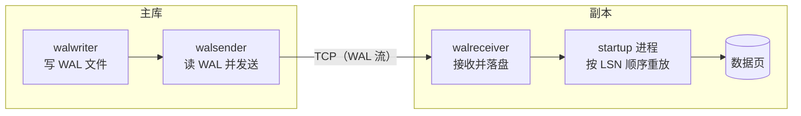

# 05 · 副本原理：流复制、读写分离，以及为什么它不是分片

> 本文讲**副本**（replication）。
> 核心结论：**副本是"复制"，不是"切分"**——它复制的是**同一份数据的完整拷贝**，所以它增加的是"读能力"与"可用性"，**不增加写能力**。把它当成分片是分布式系统里最常见的误解之一。

---

## 一、副本到底复制了什么

### 1.1 WAL 是物理日志

PG 的所有修改都先写 WAL（Write-Ahead Log），再改数据页。WAL 记录的是**"哪个页的哪几个字节被改成了什么"**：

```
WAL record = { LSN, 事务ID, 资源管理器(heap/btree/...), 页号, 变更前后的数据 }
```

关键性质：

| 性质 | 含义 |
|---|---|
| **物理性** | 记录的是页级变更，不是 SQL 语句 |
| **确定性** | 同一条 WAL 在任何副本上重放，得到**完全相同**的页 |
| **有序性** | LSN 单调递增，重放必须按序 |
| **幂等性** | 从 checkpoint 重放是安全的（页上有 LSN 标记） |

### 1.2 复制的链路



- `walsender` 从 WAL 文件（或 `wal_buffers`）里读，按 LSN 连续发送；
- `walreceiver` 收到后先**落盘**（保证不丢），再由 `startup` 进程**重放**；
- 重放是**单进程**的——这是副本延迟的主要来源之一。

### 1.3 为什么副本"字节级一致"

因为重放的是**页级变更**，不是"再执行一次 SQL"。所以：

- 不需要关心 SQL 的语义（`now()`、`random()`、`nextval()` 的结果都在 WAL 里定死了）；
- 副本上的页与主库**逐字节相同**（在同一个 LSN 上）；
- 索引、TOAST、可见性映射（VM）、空闲空间映射（FSM）全都跟着变。

> 这就是物理复制与逻辑复制（logical replication，基于行变更 + 发布订阅）的本质差别：逻辑复制是"重新执行"，物理复制是"照着改页"。

---

## 二、同步与异步：持久性 vs 延迟

### 2.1 `synchronous_commit` 的五个档位

| 档位 | 等待什么 | 崩溃时最多丢 | 延迟 |
|---|---|---|---|
| `off` | 不等待本地 WAL 落盘 | 最近 ~600 ms（3×wal_writer_delay） | 最低 |
| `local` | 本地 WAL 落盘 | 0（本机） | 低 |
| `on`（默认） | 本地 WAL 落盘 | 0（本机） | 低 |
| `remote_write` | 至少一个同步副本**收到并写入 OS 缓存** | 副本宕机可能丢 | +1 网络 RTT |
| `remote_apply` | 至少一个同步副本**已重放** | 0，且副本可立即读 | +1 RTT + 重放时间 |

**注意**：`remote_apply` 才是"写主库后立刻去副本读一定能读到"的保证，代价最大。

### 2.2 同步复制不等于高可用

- 同步副本挂掉 → 主库的 `COMMIT` 会**卡住**（等待应答），直到超时或降级；
- 所以生产上通常配"一同步 + 一异步"，并设置 `synchronous_standby_names` 与超时；
- PG 没有内置的自动故障切换，需要 Patroni / pg_auto_failover / 云厂商托管。

### 2.3 副本数量与写性能的关系

```
主库：每条事务 fsync 1 次（本地）
同步副本：每条事务多等 1 个 RTT
异步副本：主库不等，但 walsender 要持续发送 N 份 WAL
```

**副本越多，主库的 WAL 发送压力越大**（网络带宽、walsender 进程数）。所以"加副本来扩展写"是反的。

---

## 三、只读查询与重放冲突

### 3.1 副本上会发生什么

副本在重放 WAL 的同时，还要服务只读查询。两者会冲突：

| 冲突 | 场景 | 结果 |
|---|---|---|
| **清理冲突** | 主库的 vacuum 想回收副本上还有查询在看的旧版本 | 副本要么延迟重放，要么**取消查询** |
| **锁冲突** | 重放 `ACCESS EXCLUSIVE`（如 DDL）时副本上有长查询 | 取消查询或延迟重放 |

控制参数：

| 参数 | 作用 |
|---|---|
| `max_standby_streaming_delay` | 重放最多等多久（默认 30 s），超时**取消查询** |
| `hot_standby_feedback` | 副本把"我还有老快照"告诉主库，让主库别 vacuum 太狠 → **代价是主库膨胀** |
| `statement_timeout` | 副本上的长查询自我保护 |

**结论：副本上的查询可能被随时取消**（`ERROR: canceling statement due to conflict with recovery`）。所以：

- 关键读路径要有重试；
- 长报表查询不要放在副本上跑（或者单独一个延迟容忍的副本）。

---

## 四、读己之写（read-your-writes）

### 4.1 问题

```
t0  用户发消息 → 主库 commit（seq=100）
t1  用户立刻刷新 → 路由到副本 → 副本还停在 seq=98
t2  用户看不到自己刚发的消息
```

这是"读写分离"最经典的坑。**它不影响数据正确性，只影响体验**，但用户感知极强。

### 4.2 四种解法

| 方案 | 机制 | 代价 |
|---|---|---|
| **写后读主** | 记录"该用户最近写入时间"，N 秒内读走主库 | 需要一张"最近写入"表/Redis key |
| **按游标判断** | 请求带 `since`，若 `since >= 主库最新 seq` 则走主库 | 需要先知道最新 seq（可能又是一次查询） |
| **会话粘性** | 同一用户固定走主库（或固定走同一副本） | 负载不均 |
| **让客户端自愈** | 实时通道（WS）已把新消息推给发送方，不依赖读接口 | 只对"发送者自己"有效；对"其他设备"无效 |

**IM 场景的常见组合**：实时消息靠 WS 推送（发送方与接收方都拿到），读接口只负责"历史"，允许少量延迟。但 `/user/sync` 这种**补拉接口必须走主库**——它是正确性通道，不能容忍延迟。

---

## 五、故障切换

### 5.1 发生了什么

```
主库宕机
  → 副本提升（promote）为新主库
  → 时间线（timeline）编号 +1         ← 防止新旧主库的 WAL 混淆
  → 其他副本改从新主库复制
  → 旧主库恢复后必须 pg_rewind 才能重新加入（否则会分叉）
```

### 5.2 三个必须知道的坑

| 坑 | 说明 |
|---|---|
| **脑裂（split-brain）** | 旧主库没死透、新主库已接管 → 两边都接受写入 → 数据分叉。必须有 fencing 机制（STONITH、VIP 摘除、仲裁） |
| **异步复制的数据丢失** | 异步副本可能落后几百毫秒，切换时会丢这部分事务 |
| **序列回退** | 序列值的缓存段（`CACHE`）在切换时未用完的部分丢失；新主库可能分配出比旧主库更小的值 → **依赖"ID 单调"的逻辑会出错** |

### 5.3 对本项目的影响

本项目的 `seq` 权威在 **Redis**，不在 PG 的序列。所以 PG 切换不影响 `seq`，但：

- `conversations.next_seq` 是 checkpoint 写回的**兜底值**，切换后可能落后 → 键丢失时装载会取到偏小值（[方向 A](../01-seq发号器并发缺陷修复.md) 已用"装载 + 余量"覆盖）；
- `messages.id` 是 `BIGSERIAL`，切换后可能重复分配（新主库的序列落后）→ **主键冲突**。这是分库/主从场景下"不要用自增做主键"的真实理由之一。

---

## 六、为什么副本不算分片

| 维度 | 副本 | 分片 |
|---|---|---|
| 数据 | 每份都是**全量** | 每份是**一部分** |
| 写入 | 只有主库接受写入 | 每个分片都能接受写入 |
| 写吞吐 | **不变**（甚至因同步复制变慢） | **随分片数增加** |
| 读吞吐 | ✅ 增加（可并行读） | 增加（各自读自己那份） |
| 容量 | 不增加（每份都存全量） | 增加（合起来才是全量） |
| 故障影响 | 主库挂 → 切换；副本挂 → 无影响 | 一片挂 → 该片数据不可用 |
| 路由 | 不需要（数据一样，读哪个都行） | 必需（必须找到对的那片） |

**一句话：副本是"同一份数据的多个拷贝"，分片是"一份数据切成多份"。**

---

## 七、本项目的现状

| 项 | 值 | 说明 |
|---|---|---|
| `PG_READONLY_URL` | 默认空 | 为空时 `db.RO()` 直接返回写池（`db.go:38-42`），**读写共用一个池** |
| 副本数量 | 0 | 压测环境无副本 |
| 读写分离 | 代码已支持（25 处纯读走 `RO()`） | 配了 URL 即可生效 |
| 读己之写处理 | ❌ 没有 | 配副本后必须补 |

### 配副本时的检查清单

- [ ] `/user/sync`、`/user/read` 走主库（正确性通道）
- [ ] `/user/messages` 等历史读可以走副本，但要有"写后读主"或前端靠 WS 自愈
- [ ] 副本查询加 `statement_timeout`，并对 `conflict with recovery` 做重试
- [ ] 复制延迟指标（`pg_stat_replication.replay_lag`）接入监控
- [ ] 切换演练（含 `pg_rewind` 与序列回退的影响）

---

## 八、坑点

### 坑 1：把副本当"写扩容"

副本不承担写。`INSERT` 到副本会直接报错：`cannot execute INSERT in a read-only transaction`。

### 坑 2：`synchronous_commit=on` 不是"同步复制"

`on` 只保证**本地** WAL 落盘。要"至少一个副本收到"必须配 `synchronous_standby_names` + `remote_write`/`on`。

### 坑 3：副本上的长查询会拖慢重放

`hot_standby_feedback=on` 会让主库保留旧版本 → **主库膨胀**；`max_standby_streaming_delay` 太小则查询频繁被取消。两者要平衡。

### 坑 4：DDL 也会复制，而且更贵

主库的 `ALTER TABLE` 在副本上重放时需要 `ACCESS EXCLUSIVE` 锁。如果副本上有长查询，会**阻塞重放**，进而让所有后续 WAL 都延迟——表现为"副本突然落后很多"。

### 坑 5：序列值在切换后可能回退

见 §5.2。**不要用自增 ID 做"全局唯一且单调"的假设**。

### 坑 6：备份要在副本做，但要注意一致性

在副本上做物理备份是标准做法（不影响主库），但要确保备份期间的 WAL 归档完整，否则恢复出来不能用。逻辑备份（`pg_dump`）在副本上跑会给副本带来压力，可能拖慢重放。

---

## 九、验证方法

| 项 | 方法 | 通过标准 |
|---|---|---|
| 复制是否正常 | `SELECT * FROM pg_stat_replication` | `state=streaming`，`replay_lag` 稳定 |
| 延迟 | `pg_wal_lsn_diff(pg_current_wal_lsn(), replay_lsn)` | 稳态 < 1 MB |
| 读己之写 | 写后立即读副本 | 按方案能读到（或确认允许延迟） |
| 切换演练 | `pg_ctl promote` + 应用重连 | 无数据分叉，序列可用 |
| 冲突重试 | 副本上跑长查询同时制造 vacuum | 查询被取消后能重试成功 |

---

## 十、小结

| 问题 | 答案 |
|---|---|
| 副本复制的是什么 | WAL（物理日志），重放得到**字节一致**的数据页 |
| 副本能提升写吞吐吗 | **不能**。写入仍只在主库，且同步复制会更慢 |
| 副本能提升什么 | 读吞吐、可用性（切换）、备份窗口 |
| 为什么它不是分片 | 每份都是**全量**，不需要路由，写不接受 |
| 最容易踩的坑 | 读己之写、长查询与重放冲突、切换后序列回退 |
