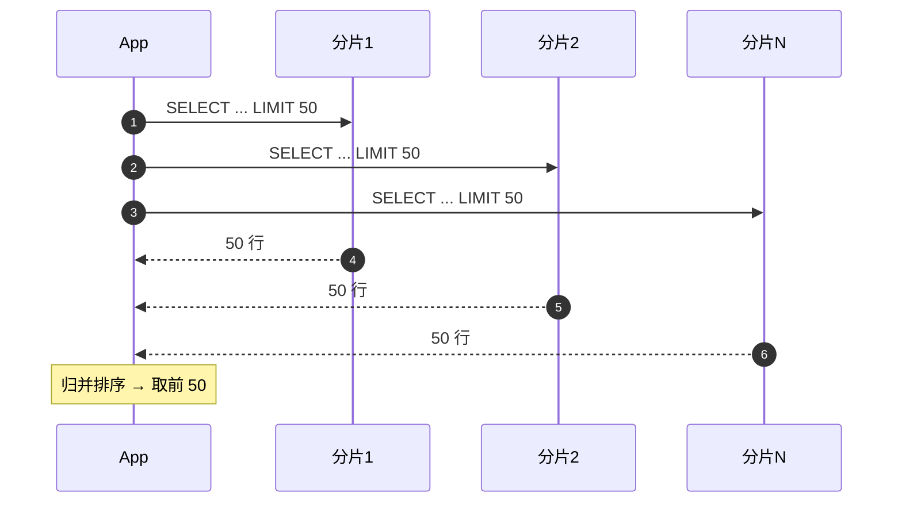
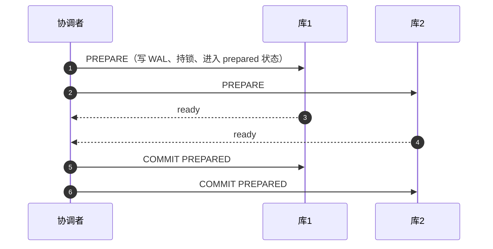

# 06 · 跨分片的代价：查询、分页、事务、一致性

> 本文讲"分片之后，那些不能再一条 SQL 搞定的事"。
> 核心结论：**跨片的成本不是"多几次查询"这么简单，而是三个乘数叠加：网络往返 × 分片数、尾延迟被放大（tail at scale）、原子性从"免费"变成"要设计"。**

---

## 一、成本模型：三个乘数

```
跨片查询成本 ≈ N × (单次查询成本) + 归并成本
跨片尾延迟   ≈ 1 - (1 - p)^N          ← p 为单片超时概率
跨片原子性   ≈ 2PC / Saga 的协调成本
```

下面逐条拆。

---

## 二、查询放大：scatter-gather

### 2.1 一次跨片查询发生了什么



关键点：

- **往返是并行的**，所以延迟 ≈ max(各片)，不是 sum；
- **但最慢的那片决定整体**（尾延迟放大，见 §3）；
- 数据量 = N × limit（内存与网络放大）。

### 2.2 什么时候必须跨片

| 查询形态 | 是否跨片 |
|---|---|
| `WHERE conversation_id = 'x'` | ❌ 单片（路由到一片） |
| `WHERE conversation_id = ANY(数组)` | ✅ 多片（数组里有几个会话的片就查几片） |
| `WHERE sender_id = 5`（无分区键） | ✅ 全片 |
| `GROUP BY conversation_id` | ✅ 全片 |
| `count(*)`（全表） | ✅ 全片 |

**判断标准只有一条：查询条件里有没有分片键的等值条件。**

---

## 三、尾延迟放大（tail at scale）

这是分布式系统里最容易被忽略、但对用户体验影响最大的效应。

### 3.1 数学

设单片查询"超过 t 毫秒"的概率为 p。跨 N 片时，**只要有一片超过 t，整体就超过 t**：

```
P(整体 > t) = 1 - (1 - p)^N
```

### 3.2 具体数字（p = 1%，即单片 p99 = t）

| 分片数 N | 整体超过 t 的概率 | 含义 |
|---|---|---|
| 1 | 1% | t 是 p99 |
| 2 | 2.0% | t 是 p98 |
| 8 | 7.7% | t 是 p92 |
| 16 | 14.8% | t 是 p85 |
| 32 | 27.5% | t 是 p72 |
| 64 | **47.4%** | **t 变成了 p53（中位数！）** |

**也就是说：64 个分片、每片 p99 = 10 ms 时，整体查询有一半的概率超过 10 ms。**

这就是为什么"每片都很快"的跨片查询，用户体感却很慢。

### 3.3 缓解

| 手段 | 原理 |
|---|---|
| 减少分片数（或只查命中的分片） | N 变小 |
| 对冲请求（hedged request） | 向两片同时发，取先返回的（用带宽换尾延迟） |
| 单片超时 + 降级 | 慢片返回部分结果并标记（体验取舍） |
| 把查询改成"路由到单片" | 最根本：让查询带分片键 |

---

## 四、全局排序与 LIMIT

### 4.1 为什么"各片取 50 再归并"是正确的

要全局前 50，可以证明：**全局第 50 名，一定在某一分片的前 50 名里**。

> 反证：若全局第 50 名不在任何一片的前 50 名里，则每片至少有 50 条比它大 → 总共至少 50N 条比它大 → 它不可能进前 50。矛盾。

所以：

```sql
-- 每片执行
SELECT * FROM messages WHERE conversation_id = $1 ORDER BY seq DESC LIMIT 50;
-- 应用层归并 64 份结果，取前 50
```

**这是正确且高效的**（每片只返回 limit 行）。

### 4.2 但 OFFSET 不行

```sql
SELECT ... ORDER BY seq DESC LIMIT 50 OFFSET 10000
```

要正确，每片必须返回自己的前 `10000+50` 条，然后归并后再丢弃前 10000 条。成本 = `N × (offset + limit)`，**随页码线性增长**。

| 页码 | 单片要扫 | 64 片合计 |
|---|---|---|
| 第 1 页 | 50 | 3,200 |
| 第 100 页 | 5,050 | 323,200 |
| 第 1000 页 | 50,050 | 3,203,200 |

**结论：跨片分页必须用键集（keyset / cursor）分页，不能用 offset。**

### 4.3 键集分页在跨片下怎么做

```sql
-- 每片
SELECT * FROM messages
WHERE conversation_id = $1 AND seq < $cursor
ORDER BY seq DESC LIMIT 50;

-- 归并后，取最小的 seq 作为下一页的 cursor
```

关键：**cursor 必须是全局有序的键**（这里是 `seq`），且每片都能用它做过滤。这就把"页码"换成了"位置"，成本恒定。

> 本项目的 `/user/messages?limit=50&beforeSeq=...` 正是键集分页（`chat_routes.go:96-111`）。**如果将来分库，这个接口天然适配，不需要改。**

---

## 五、聚合

| 聚合 | 能否合并 | 做法 |
|---|---|---|
| `COUNT` | ✅ | 各片求和 |
| `SUM` / `MIN` / `MAX` | ✅ | 各片求和/取极值 |
| `AVG` | ⚠️ | **不能直接平均**，要各片返回 `(sum, count)` 再合并 |
| `COUNT(DISTINCT)` | ⚠️ | 各片的去重集合合并后可能仍重复 → 需要把候选值汇总去重 |
| 百分位（p99） | ❌ | 各片的 p99 无法合并；需要全量数据或近似算法（t-digest/HLL） |
| `GROUP BY 非分片键` | ❌ | 需要按分组键重分布（shuffle） |

**本项目的 `/user/messages` 无 limit 时是全量返回**，如果分库，这个查询会变成"N 片各返回全量再拼"——所以[分册 07](../07-读端点分页与慢查询治理.md) 的分页改造是分库的前置条件。

---

## 六、分布式事务

### 6.1 为什么本地事务不够

```
单库：BEGIN; A; B; COMMIT;   ← A、B 要么都成功，要么都失败
跨库：A 在库1，B 在库2
      → 两个独立事务
      → A 成功、B 失败时，A 已经提交，无法回滚
```

### 6.2 2PC（两阶段提交）



PG 的实现：`PREPARE TRANSACTION 'gid'` / `COMMIT PREPARED 'gid'`，需要 `max_prepared_transactions > 0`。

| 代价 | 说明 |
|---|---|
| **持锁时间长** | prepare 到 commit 之间，行锁一直持有 |
| **协调者故障** | 已 prepare 的事务会悬空（in-doubt），占锁直到人工介入或超时 |
| **两次落盘** | prepare 一次 WAL、commit 再一次 |
| **不适合高频** | 消息主链路每秒钟几万次，2PC 直接压垮 |

### 6.3 更实用的三条路

| 方案 | 机制 | 适用 |
|---|---|---|
| **让写落在同一片** | 分片键 = 事务边界（消息 + 会话位点同片） | **首选**，零分布式成本 |
| **本地消息表 + 异步** | 本地事务写业务表 + outbox，后台投递 | 最终一致可接受 |
| **Saga** | 每步有补偿操作 | 长流程业务（订单、支付） |

**IM 的最佳实践是第一条**：把"需要原子的一组写"设计在同一个分片里。这也是[分册 11](../11-分库分片与Redis集群.md) 建议"`conversations` 跟 `messages` 同库"的原因。

### 6.4 PG 的 2PC 细节（容易踩的坑）

- prepared 事务**跨重启存活**（写在 WAL 里），会一直占锁；
- `pg_prepared_xacts` 能查到，但**没有自动超时**，必须人工 `ROLLBACK PREPARED`；
- 备库上不能执行 `PREPARE TRANSACTION`；
- 2PC + 连接池（尤其是 PgBouncer 的 transaction 模式）会互相干扰：prepared 事务绑定在物理连接上，而连接池会把连接借给别人。

---

## 七、一致性读：跨片没有统一快照

### 7.1 PG 的快照是实例级的

```sql
BEGIN ISOLATION LEVEL REPEATABLE READ;
-- 此刻拿到一个 snapshot（xmin/xmax/活跃事务列表）
SELECT ...;  -- 整个事务内看到一致的数据
COMMIT;
```

这个快照**只在单个实例内有效**。跨两个库时：

```
库1 的快照 = {xmin: 1000, xmax: 1050}
库2 的快照 = {xmin: 980,  xmax: 1030}     ← 两个不同的时间点
```

于是你可能读到"库1 里已经删掉、库2 里还在"的数据，或者"库1 已更新、库2 还没更新"的组合。

### 7.2 三种处理

| 方案 | 机制 | 成本 |
|---|---|---|
| **接受**（大多数 IM 场景） | 各片独立快照，业务上不依赖跨片一致性 | 0 |
| **版本号过滤** | 每条数据带全局版本（如 commit timestamp / HLC），查询时用同一个版本上界 | 需要全局时钟或版本分配器 |
| **全局快照协调** | 协调者统一发号，各片按号裁剪可见性 | 复杂，性能差 |

**结论：分片系统通常放弃"跨片强一致读"，改用"业务上不跨片读"来规避。**

---

## 八、跨片 JOIN

| 方式 | 机制 | 代价 |
|---|---|---|
| **全局表（广播小表）** | `users`、`group_members` 每库一份 | 更新要同步 N 份 |
| **co-location join** | 两张表用同一个分片键 → 同片 JOIN | 要求分片键一致 |
| **应用层拼装** | 查 A 得到 ID 列表 → 查 B | 两次往返 + 内存 |
| **重分布（shuffle）** | 把数据按 JOIN 键重新分发 | 大表不可行 |

本项目的 `lastMessages` 属于第四类问题的轻量版：它不需要 JOIN，但需要"按会话列表在多个分片里各取一条，再合并"。

---

## 九、本项目的实例：`lastMessages` 为什么 52 ms

```sql
SELECT DISTINCT ON (conversation_id) <17 列>
FROM messages
WHERE conversation_id = ANY($1::text[])
ORDER BY conversation_id, timestamp DESC
```

拆解它的成本（单库、64 分区）：

| 步骤 | 成本 |
|---|---|
| 裁剪到命中的分区 | 假设 50 个会话落在 ~40 个分区 |
| 每个分区一次索引扫描 `(conversation_id, timestamp DESC)` | ~0.5–1 ms × 40 |
| 归并 + `DISTINCT ON` | 小 |
| **合计** | **~20–50 ms** ← 与实测 52 ms 吻合 |

**关键认知**：它不是"扫了全表"，而是"**每个会话一次索引扫描**"——成本与**会话数**线性相关，与分区数关系不大。

如果将来分库，这个成本变成"N 个库各自做一遍，再合并"，**至少不劣化**（因为每个库只处理落在自己身上的会话），这也是它天然适配分片的原因。

---

## 十、缓解手段清单（按性价比）

| 手段 | 效果 | 成本 |
|---|---|---|
| **让查询带分片键** | 从 O(N) 降到 O(1) | 改接口/加参数 |
| **键集分页替代 offset** | 深分页从 O(offset) 降到 O(1) | 改接口（本项目已有 `beforeSeq`） |
| **减少分片数** | 直接降低 N | 容量取舍 |
| **按库分组并发** | 延迟从 sum 降到 max | 并发控制 |
| **全局表/冗余** | 消除 JOIN | 一致性维护 |
| **单分片事务设计** | 消除 2PC | 分片键设计 |
| **对冲请求** | 降低尾延迟 | 带宽翻倍 |
| **接受最终一致** | 零成本 | 业务约束 |

---

## 十一、验证方法

| 项 | 方法 | 观察 |
|---|---|---|
| 跨片查询占比 | 埋点统计"命中的分片数" | 大部分请求应为 1 |
| 尾延迟 | 对比 N=1 与 N=4 的 p99 | 应接近 `1-(1-p)^N` 的预测 |
| 分页成本 | 第 1 页 vs 第 100 页 | 键集分页应基本持平 |
| 事务边界 | 审计写路径 | 无跨片写 |
| 一致性读 | 人为在跨片写后立即读 | 按设计表现为"允许的延迟" |

---

## 十二、小结

| 问题 | 答案 |
|---|---|
| 跨片查询贵在哪 | N 次往返 + 归并 + **尾延迟放大** |
| 为什么不能用 offset 分页 | 每片都要扫 `offset+limit`，成本随页码线性增长 |
| 为什么"各片取 N 再归并"是对的 | 全局前 N 名必在某一分片的前 N 名里 |
| 2PC 的致命问题 | prepare 后持锁，协调者故障会留下悬挂事务 |
| 跨片能强一致读吗 | 不能（快照是实例级的），只能靠业务规避或全局版本 |
| 最好的优化 | **让查询带分片键**，让事务落在单片 |
