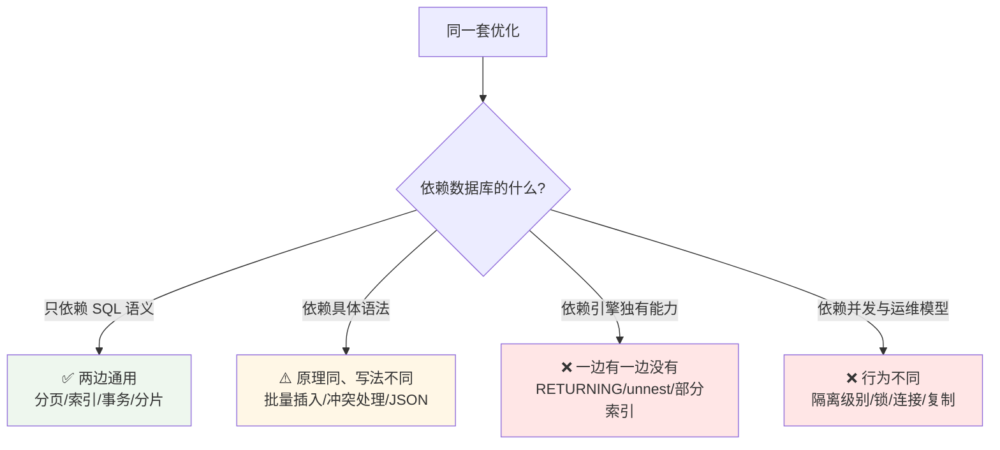

# 07 · PostgreSQL 与 MySQL：从开发者视角看，到底差在哪

> 起因：一个很自然的判断——"两者在使用上几乎没有区别，只是底层存储引擎不同；从开发者视角看没有区别"。
> 本文的结论：**这个判断对"应用层设计"成立（约八成），对"实现细节与并发语义"不成立（约两成）。**
> 我们做的 11 个优化方向里，**8 个在 MySQL 上一字不改**；但 **3 个必须重写实现**（`RETURNING`、`unnest`、分区表 DDL），另有 **4 处并发/类型/连接/复制的差异**会改变行为。

---

## 一、一句话结论

| 层次 | 是否"没区别" | 说明 |
|---|---|---|
| **应用层架构**（连接池、缓存、发号、幂等、限流、扇出、分片、尾延迟） | ✅ **几乎完全一样** | 这些都是"应用怎么用数据库"，与引擎无关 |
| **SQL 语义**（事务、隔离、唯一约束、分页、JOIN） | ⚠️ **大体一样，细节有别** | 默认隔离级别、锁范围、类型严格性不同 |
| **具体 SQL 写法与 DDL** | ❌ **有硬差异** | `RETURNING`、数组/`unnest`、`ON CONFLICT`、分区表在线建索引 |
| **运维与容量模型** | ❌ **差异明显** | 进程 vs 线程、WAL vs redo+binlog、副本可写性 |

一句话：**"怎么设计"两边通用，"怎么写这条 SQL、这条 DDL 能不能在线做"不能通用。**

---

## 二、为什么"开发者视角几乎没区别"基本成立

两者共享的东西比差异多得多：

| 共同点 | 说明 |
|---|---|
| 都是关系模型 + SQL | 表、索引、约束、JOIN、子查询、CTE（MySQL 8+） |
| 都是 MVCC | 读写不互相阻塞（实现不同，见 §5.4） |
| 都是 B+tree 聚簇/堆表 | 索引结构与查询优化思路一致 |
| 都支持事务 + 四种隔离级别 | 语义对齐 SQL 标准 |
| 都有组提交 | 批量提交都能减少 fsync |
| 都有分区表 | 都支持 RANGE/LIST/HASH，且**都要求唯一键包含分区键** |
| 都有复制 | 主从/读写分离的模式一致 |
| 都用连接池 | 池化、超时、最大连接数的概念一致 |

所以"[00-消息吞吐上限](../00-消息吞吐上限分析与提升技术方案.md)"里的核心推理——**吞吐 = 池容量 ÷ 单请求持有时间**、**9 次往返压到 3 次**、**组提交摊薄 fsync**、**分片键 = 事务边界**——**在 MySQL 上逐条成立**。这些不是"PG 的知识"，是"有状态服务 + 连接池 + 单写实例"的通用结论。

---

## 三、三层分类：哪些一样、哪些不一样



---

## 四、逐条对照：我们的 11 个方向 + 8 个问题

### 4.1 11 个优化方向

| # | 我们的做法 | MySQL 上是否成立 | 需要改什么 |
|---|---|---|---|
| 01 | **seq 修复**（Redis INCR + 唯一索引兜底） | ✅ 完全一样 | 唯一索引照建；错误码从 `23505` 换成 `1062` |
| 02 | **去显式事务**（单语句 autocommit） | ✅ 一样 | MySQL 默认 `autocommit=1`，单条 INSERT 本身就是隐式事务 |
| 03 | **限流+幂等+发号合并 Lua** | ✅ 完全一样 | 与 DB 无关（Redis） |
| 04 | **presence 定位优化** | ✅ 完全一样 | 与 DB 无关（Redis） |
| 05 | **组提交批量写入** | ⚠️ 原理一样，**实现要重写** | `unnest` 无对应物；`RETURNING` 不存在 → 见 §5.1/§5.2 |
| 06 | **读写连接池隔离** | ✅ 一样 | MySQL 连接更便宜（线程），但"隔离"思路不变 |
| 07 | **读端点分页** | ✅ 完全一样 | `LIMIT/OFFSET`、键集分页语义一致 |
| 08 | **索引瘦身** | ✅ 一样（原则） | PG 有部分索引/BRIN，MySQL 没有 → 可选手段更少 |
| 09 | **边缘层背压/流写入串行化** | ✅ 完全一样 | 与 DB 无关 |
| 10 | **横向扩容 + 连接池代理** | ✅ 一样 | PG 必须 PgBouncer（连接=进程）；MySQL 通常能撑更多连接，可选 |
| 11 | **分库分片** | ✅ 完全一样 | 分片键、槽位、跨片代价都是通用原理 |

**小结：11 个里 10 个成立，只有"批量写入"的实现要重写。**

### 4.2 8 个独立问题

| # | 问题 | MySQL 上是否存在 | 差异点 |
|---|---|---|---|
| 01 | **分区表无法并发建唯一索引** | ❌ **PG 特有** | MySQL 8 的 online DDL 一般可对分区表 `ADD INDEX ... ALGORITHM=INPLACE, LOCK=NONE`（视版本/引擎，需实测） |
| 02 | **唯一索引缺冲突重试** | ✅ 一样存在 | MySQL 用 `1062 Duplicate entry`；但 `INSERT IGNORE` 会**吞掉所有错误**（含数据截断），比 PG 更危险 |
| 03 | **正文长度未校验** | ✅ 一样存在 | MySQL `TEXT` 上限 64 KB（`LONGTEXT` 4 GB），且默认会**静默截断**（非严格模式） |
| 04 | **定向下行缺回执** | ✅ 一样 | 与 DB 无关 |
| 05 | **多设备跨网关漏投** | ✅ 一样 | 与 DB 无关 |
| 06 | **`REPLICA_ID` 死配置** | ✅ 一样 | 与 DB 无关 |
| 07 | **序列 `CACHE` 与 WAL 误判** | ⚠️ 换成另一套机制 | MySQL 用 `AUTO_INCREMENT` + `innodb_autoinc_lock_mode`，成本模型不同（见 §5.7） |
| 08 | **读接口缺成员授权** | ✅ 一样 | 与 DB 无关 |

**小结：8 个里只有"分区表建索引"是 PG 独有，"序列"是换了一套机制，其余全部通用。**

---

## 五、七处必须区别对待（逐条讲机制）

### 5.1 `RETURNING`：PG 有，MySQL 没有

**我们的用法**（[分册 05](../05-组提交批量写入.md) §4.4）：批量插入后用 `RETURNING conversation_id, sender_id, client_msg_id, id, seq` **回映**——确定"哪几行真的插入了"。

```sql
INSERT INTO messages (...) SELECT ... FROM unnest(...)
ON CONFLICT (conversation_id, sender_id, client_msg_id) DO NOTHING
RETURNING conversation_id, sender_id, client_msg_id, id, seq;
```

**MySQL 的情况**：

| 能力 | MySQL 8 | 说明 |
|---|---|---|
| `RETURNING` | ❌ 不支持 | MariaDB 10.5+ 支持，MySQL 不支持 |
| `LAST_INSERT_ID()` | ⚠️ 只给**第一行**的自增值 | 多行插入时，后续 ID 靠"连续"假设，**不可靠**（`innodb_autoinc_lock_mode` 影响） |
| `ROW_COUNT()` | ⚠️ 多行的**总和** | `INSERT IGNORE` 返回插入行数；`ON DUPLICATE KEY UPDATE` 返回 1/2/0，但**多行会相加**，无法逐行判定 |

**结论**：MySQL 上无法用一条语句同时"插入 + 告诉你哪几行成功"。三种替代：

| 替代方案 | 做法 | 代价 |
|---|---|---|
| A. 先查后插 | 批内先 `SELECT (conv,sender,cmid) FROM messages WHERE ... IN (...)`，过滤掉已存在的再插 | 每批多 1 次往返（可接受） |
| B. 插后回查 | 插入后按 clientMsgId 集合再查一次，得到 id/seq | 同样 1 次往返，且能处理并发冲突 |
| C. 依赖 Redis 幂等前置 + 批内去重 | 假设"批内无重复、跨批由幂等键挡住"，不逐行回映 | 无额外往返，但**并发同键时会出现"插入被忽略但拿不到结果"**，需要兜底查询 |

**推荐 A + C 组合**：正常路径靠 Redis 幂等键 + 批内去重（零额外查询），只有在"批内出现疑似重复"时才走回查。

> 这一处是**最实质的差异**：我们的批量设计有一半的优雅性来自 `RETURNING`。换 MySQL 后，"一行一结果"的能力消失，方案要退化成"批 + 兜底查询"。

### 5.2 数组与 `unnest`：PG 有，MySQL 没有

**我们的批量 INSERT** 用 `unnest($1::text[], $2::bigint[], ...)` 把 N 行拼成一条语句。

| PG | MySQL |
|---|---|
| 原生数组类型 `text[]`、`bigint[]`、`jsonb[]` | ❌ 没有数组类型 |
| `unnest()` 把数组展开成行 | ❌ 无对应物（可用 `JSON_TABLE` 把 JSON 展开成行，8.0+） |
| 参数个数固定（9 个数组） | 必须拼 `VALUES (?,?,?),(?,?,?)...`，参数个数 = 9 × N |

**MySQL 的写法**：

```sql
INSERT INTO messages (conversation_id, sender_id, seq, client_msg_id, content, type, status, mentions, extra, file_info)
VALUES (?,?,?,?,?,?, 'sent', ?, ?, ?),
       (?,?,?,?,?,?, 'sent', ?, ?, ?),
       ...                                       -- 64 行 → 640 个占位符
ON DUPLICATE KEY UPDATE id = id;                  -- 冲突时"什么都不做"的写法
```

后果：

- **参数上限**：MySQL 的占位符上限是 65535（`max_prepared_stmt_count` 是另一回事），640 个没问题；但批大小到 1000 行就会逼近；
- **SQL 文本随批大小变化** → 预编译语句**无法复用**（每批的占位符个数不同，除非固定批大小）；
- 备选：`JSON_TABLE(?, '$[*]' COLUMNS(...))` 把 JSON 展开成行，参数只 1 个，但要求 MySQL 8.0+ 且有解析开销。

> 这与[02 分表原理](./02-分表原理-应用层切表与数据库原生切表的差异.md) §3.2 是同一类问题：**"标识符/结构"不能参数化**，只能拼字符串或换机制。

### 5.3 分区表上建索引：PG 有硬限制，MySQL 没有

**PG**：`CREATE INDEX CONCURRENTLY` **不支持分区表**（[问题 01](../问题分析/01-分区表无法并发建唯一索引.md)），必须逐分区建 + `ATTACH`。

**MySQL**：分区是存储引擎层的（一个表多个 `.ibd` 段），`ALTER TABLE ... ADD INDEX` 走 online DDL：

```sql
ALTER TABLE messages ADD UNIQUE INDEX uq_conv_seq (conversation_id, seq),
  ALGORITHM=INPLACE, LOCK=NONE;
```

| 维度 | PG | MySQL 8 |
|---|---|---|
| 分区表加索引 | ❌ 不能 `CONCURRENTLY`，需绕行 | ⚠️ 通常可以 INPLACE（视版本/引擎，**必须实测**） |
| DDL 事务性 | ✅ 可 `BEGIN; DDL; ROLLBACK;` | ❌ DDL 隐式提交，失败留半成品 |
| 分区裁剪 | 规划器显式裁剪，`Subplans Removed` 可见 | `EXPLAIN` 的 `partitions` 列可见 |
| 分区唯一键限制 | 必须含分区键 | **同样**必须含分区键 |

**结论**：这一条是 **PG 的短板、MySQL 的长板**。如果本项目跑在 MySQL 上，[问题 01](../问题分析/01-分区表无法并发建唯一索引.md) 整篇可以直接删掉。

### 5.4 隔离级别与锁：默认值不同，锁范围不同

| 项 | PostgreSQL | MySQL（InnoDB） |
|---|---|---|
| 默认隔离级别 | **READ COMMITTED** | **REPEATABLE READ** |
| 行锁 | 只锁命中的行（无 gap lock） | RR 下用 **next-key lock**（行 + 间隙），锁范围更大 |
| 死锁概率 | 较低 | 较高（gap lock 增加了交叉） |
| `SELECT ... FOR UPDATE` | 锁命中行 | 锁命中行 + 间隙 |
| 快照读 vs 当前读 | 语句级快照（RC） | 事务级快照（RR）+ 当前读 |

**对项目的影响**：

- 我们的 `UPDATE user_conversations SET last_read_seq = $3 WHERE user_id=$1 AND conversation_id=$2 AND last_read_seq < $3`（`read.go:28-31`）：
  - PG：只锁那一行；
  - MySQL RR：如果 `(user_id, conversation_id)` 上有唯一索引，等值命中通常只锁行（唯一索引等值会退化为 record lock）；**如果条件走的是范围扫描，就会加 gap lock**，锁住"不存在的区间"，让并发的插入/更新排队。
- 消息插入的幂等冲突：PG 用唯一索引的元组锁等待；MySQL 用 `ON DUPLICATE KEY UPDATE` 的**插入意向锁 + 唯一索引冲突检测**，并发同键时行为类似（都会等待），但 MySQL 在 RR 下更容易连带 gap lock。

**结论**：**同一段 SQL 的并发行为不能假设一致**。迁移时必须重跑"并发同键写入"的压测，而不是只看单线程正确性。

### 5.5 类型系统：PG 严格，MySQL 宽松

| 场景 | PostgreSQL | MySQL |
|---|---|---|
| `WHERE seq = '123'`（bigint 列 vs 字符串） | ❌ 报错 `operator does not exist` | ✅ 隐式转换成数字 |
| `WHERE seq = 'abc'` | ❌ 报错 | ⚠️ 转成 0，**返回错误结果且不报错** |
| 超长字符串插入 `VARCHAR(64)` | ❌ 报错 `value too long` | ⚠️ 非严格模式下**静默截断**（严格模式报错） |
| 除零 | ❌ 报错 | ⚠️ 返回 NULL + warning |
| 布尔 | `true/false` | `TINYINT(1)`，`true` 是 1 的别名 |

**对本项目的具体影响**：

- 我们的 `seq` 是 `BIGINT`，客户端传的是 JSON number/string。PG 上类型不对会直接 400/500，**问题立刻暴露**；MySQL 上会被"好心"转换，**可能悄悄写错数据**。
- 这正是[问题 03](../问题分析/03-消息正文长度未校验.md) 在 MySQL 上会更危险的原因：**如果不显式校验长度，MySQL 在非严格模式下会截断而不是报错**——消息内容被静默截短，且 `warning` 在应用层通常拿不到。

**建议**：MySQL 部署必须设 `sql_mode` 包含 `STRICT_ALL_TABLES,ONLY_FULL_GROUP_BY,NO_ZERO_DATE` 等，否则"宽松"会吃掉数据正确性。

### 5.6 连接模型：PG 是进程，MySQL 是线程

| 项 | PostgreSQL | MySQL |
|---|---|---|
| 每连接 | **一个后端进程**（fork） | 一个线程 |
| 内存开销 | 每进程私有内存（数 MB 起） | 每线程栈 + 会话缓冲（较小） |
| 典型上限 | 100–500（再高就靠 PgBouncer） | 1000+ 常见 |
| 连接池代理 | **基本必需**（PgBouncer） | 可选（有 thread pool / 代理） |

**影响**：

- [分册 10](../10-横向扩容与连接池代理.md) 说"PG `max_connections=100` 卡死 3 副本"——这是 **PG 的进程模型**导致的；换 MySQL，`max_connections=1000` 是常规配置，**连接预算这一节要重写**。
- [分册 06](../06-读写连接池隔离.md) 的"池隔离"仍然成立（隔离的是**排队结构**，不是进程），但"必须要独立池否则连接不够"的紧迫性下降。

### 5.7 自增与序列：机制不同

| 项 | PostgreSQL | MySQL |
|---|---|---|
| 生成方式 | `SEQUENCE` + `nextval()` | `AUTO_INCREMENT` |
| 批量插入时的分配 | 每行调用 `nextval` | 由 `innodb_autoinc_lock_mode` 决定：0=表锁、1=连续但可能阻塞、2=交错（默认 8.0） |
| 事务性 | 非事务（回滚不退还） | 非事务（回滚不退还） |
| 副本切换 | 序列缓存段可能丢失 | `auto_increment_increment/offset` 用于多主 |
| 我们的结论 | "`CACHE 1` 不是每次写 WAL"（[问题 07](../问题分析/07-序列CACHE与WAL误判.md)） | 换成"`lock_mode=2` 下批量插入的 ID 不保证连续，但并发最高" |

**结论**：问题 07 那篇的**具体机制**不能直接搬到 MySQL，但**结论一致**——不要用自增 ID 的"连续性"做业务假设。

### 5.8 复制模型：物理 WAL vs binlog

| 项 | PostgreSQL | MySQL |
|---|---|---|
| 复制内容 | **WAL（物理日志，页级变更）** | **binlog（逻辑/行级变更）** |
| 副本一致性 | 字节级一致 | 行级一致（`ROW` 格式下基本一致） |
| 副本可写 | ❌ 只读（hot standby） | ⚠️ **默认可写**（危险，容易分叉） |
| 延迟来源 | 重放单进程 | SQL 线程重放（可并行，8.0 支持 `WRITESET`） |
| 复制冲突 | 查询被取消（`conflict with recovery`） | 主键冲突导致复制中断（需跳过或修复） |

**影响**：

- PG 副本"字节一致"的性质让"副本读 = 主库读（延迟内）"更可靠；MySQL 在 `STATEMENT` 格式或非确定性函数下会**主从不一致**（这也是为什么必须用 `ROW`）。
- MySQL 副本默认可写，运维上必须显式设 `read_only=ON` + `super_read_only=ON`，否则误写会造成分叉。PG 天然没这个问题。

---

## 六、如果把本项目换到 MySQL：改动清单

按"必须改 / 建议改 / 不用改"分三档：

### 6.1 必须改（否则跑不起来或行为错误）

| 位置 | PG 写法 | MySQL 写法 |
|---|---|---|
| 批量 INSERT（分册 05） | `unnest($1::text[], ...)` | 拼 `VALUES (...),(...)` 或 `JSON_TABLE` |
| 批量回映（分册 05） | `RETURNING conv, sender, cmid, id, seq` | 无 → 先查后插 / 插后回查 |
| 冲突处理（分册 05） | `ON CONFLICT (a,b,c) DO NOTHING` | `ON DUPLICATE KEY UPDATE id=id`（**不要用 `INSERT IGNORE`**） |
| 唯一冲突重试（问题 02） | SQLSTATE `23505` + `ConstraintName` | 错误码 `1062` + `err.Error()` 里的索引名（MySQL 不直接给约束名） |
| 迁移文件（`0007`） | `PARTITION BY HASH` + `BIGSERIAL` | `PARTITION BY HASH` + `AUTO_INCREMENT`（语法不同） |
| JSON 列 | `JSONB` + `jsonb[]` | `JSON` + 无数组（批量时用字符串） |
| 唯一索引创建（问题 01） | 逐分区 `CONCURRENTLY` + `ATTACH` | `ALTER TABLE ... ADD UNIQUE ... ALGORITHM=INPLACE, LOCK=NONE` |
| 数据库迁移工具 | golang-migrate + embed | 同样可用，但 DDL 隐式提交 → **迁移不能靠事务回滚** |

### 6.2 建议改（影响性能/稳定性，不改也能跑）

| 项 | 原因 |
|---|---|
| `sql_mode` 加严格模式 | 否则超长/类型错误被静默吞掉（§5.5） |
| 隔离级别显式设为 RC | 与 PG 行为对齐，减少 gap lock 与死锁；但要注意"不可重复读"的语义变化 |
| 副本设 `read_only` + `super_read_only` | 防止误写分叉（§5.8） |
| 连接池上限重算 | MySQL 可撑更多连接，PgBouncer 不再是刚需（§5.6） |
| 索引改用 `INVISIBLE` 灰度 | MySQL 8 支持 `ALTER INDEX ... INVISIBLE`，比"直接删"更安全（PG 无此能力） |

### 6.3 不用改

- 所有 Redis 相关（seq/幂等/限流/presence/fanout）——与 DB 无关；
- 所有应用层架构（连接池隔离思路、批量攒批、边缘层背压、分片键设计）；
- 所有读端点分页改造（`LIMIT` + 键集游标）；
- 所有安全修复（越权、长度校验、回执）。

---

## 七、反过来：MySQL 有而 PG 没有的能力

为了公平，也列一下"MySQL 更强"的地方——这些在选型时同样重要：

| 能力 | MySQL | PostgreSQL |
|---|---|---|
| **在线 DDL 成熟度** | ✅ 8.0 的 `ALGORITHM=INPLACE/LOCK=NONE` 覆盖面广（含分区表加索引） | ⚠️ `CONCURRENTLY` 不支持分区表，且不能在事务块内 |
| **连接数** | ✅ 线程模型，1000+ 常见 | ❌ 进程模型，100–500 就要上 PgBouncer |
| **组复制 / MGR** | ✅ 原生多主/单主组复制 | ⚠️ 需 Patroni 等外部组件 |
| **生态与托管** | ✅ 云厂商支持最广 | ✅ 也很成熟，但略少 |
| **索引可见性控制** | ✅ `INVISIBLE INDEX`（灰度删索引） | ❌ 无 |
| **降级一致性读** | ✅ `READ COMMITTED` 下无 gap lock，死锁少 | — |

反过来的 PG 优势（对我们更重要）：

| 能力 | PostgreSQL | MySQL |
|---|---|---|
| **`RETURNING`** | ✅ 任意列 | ❌ |
| **数组 + `unnest`** | ✅ | ❌ |
| **部分索引**（`WHERE` 条件） | ✅ | ❌ |
| **表达式索引** | ✅ 直接支持 | ⚠️ 需生成列 |
| **BRIN 索引**（大表范围扫描极省空间） | ✅ | ❌ |
| **JSONB + GIN** | ✅ 可索引、可查询 | ⚠️ JSON + 生成列/多值索引（8.0.17+） |
| **DDL 事务性** | ✅ 可回滚 | ❌ 隐式提交 |
| **副本只读** | ✅ 天然 | ⚠️ 需显式配置 |
| **物理复制字节一致** | ✅ | ⚠️ 行级 |

---

## 八、常见误解

### 误解 1："MySQL 的 `count(*)` 是 O(1)"

那是 **MyISAM**（表级元数据存了行数）。**InnoDB 的 `COUNT(*)` 必须扫索引**（通常选最小的二级索引），与 PG 一样是 O(n)。两者都别在大表上裸 `count(*)`。

### 误解 2："MySQL 写性能一定比 PG 好"

不完全。MySQL 每次提交要落 **redo log + binlog 两份日志**（内部还有一次 2PC 保证一致），PG 只有 **一份 WAL**。在小事务高并发下，PG 的组提交有时反而更省；MySQL 的优势更多在生态、连接数、在线 DDL。**这属于必须实测的项，不能靠印象。**

### 误解 3："`INSERT IGNORE` 等于 `ON CONFLICT DO NOTHING`"

不等价。`ON CONFLICT (a,b,c) DO NOTHING` **只吸收指定唯一索引的冲突**，其他错误照常抛；`INSERT IGNORE` 会把**所有错误降级为 warning**，包括"值超长被截断""类型不匹配""非空约束违反"——数据可能被悄悄改坏。这是 MySQL 迁移中最常见的坑之一。

### 误解 4："隔离级别都是 RR/RC，随便配"

MySQL 默认 RR 带 gap lock，PG 默认 RC 无 gap lock。**同一段 SQL 的锁范围与死锁概率不同**，并发压测必须重做，不能凭"SQL 一样"就认为行为一样。

### 误解 5："分表/分区两边一样"

语法相似，但：

- PG 的分区是"真子表"（`pg_class` 里的独立表），MySQL 是"一个表的多个物理段"；
- PG 的分区表**索引也是子表**（64 套），MySQL 是"一个索引多个分区段"；
- 因此 `DROP PARTITION`、`EXCHANGE PARTITION`、在线加索引的可行性与代价都不同。

---

## 九、结论：该怎么表述"两者没区别"

更准确的表述是：

> **在"应用怎么设计"这一层，PG 与 MySQL 几乎没有区别**——连接池、批量、缓存、发号、分片、跨片代价，全部通用。
> **在"这条 SQL 怎么写、这条 DDL 能不能在线做、并发时锁住什么"这一层，区别是硬的**——尤其 `RETURNING`、`unnest`、分区表 DDL、隔离级别、类型严格性、连接模型、复制模型这七处。

所以：

- 我们的**架构结论**（吞吐上限在池、批量写入、分片键、跨片代价）→ **可以当作数据库无关的知识复用**；
- 我们的**实现方案**（`unnest` 批量、`RETURNING` 回映、`CONCURRENTLY` 建索引）→ **换库必须重写**；
- 我们的**正确性结论**（唯一索引兜底、冲突重试、长度校验、越权）→ **与库无关，换到哪都要做**。

---

## 十、与本系列其他文档的关系

| 文档 | 关系 |
|---|---|
| [00 概念地图](./00-概念地图-分区-分表-分库-分片-副本.md) | 分区/分表/分库/分片的通用原理，两边通用 |
| [01 分区原理](./01-分区原理-PostgreSQL是怎么做分区的.md) | 讲的是 PG 的实现；MySQL 的"分区是存储引擎层"与此不同 |
| [03 分库原理](./03-分库原理-从单实例到多实例到底变了什么.md) | 实例级资源模型两边一致，但连接模型不同（§5.6） |
| [05 副本原理](./05-副本原理-流复制与读写分离.md) | PG 物理复制 vs MySQL binlog（§5.8） |
| [06 跨分片代价](./06-跨分片的代价-查询-分页-事务.md) | 完全通用，与引擎无关 |
| [分册 05 批量写入](../05-组提交批量写入.md) | 唯一需要重写实现的优化方向（`unnest` + `RETURNING`） |
