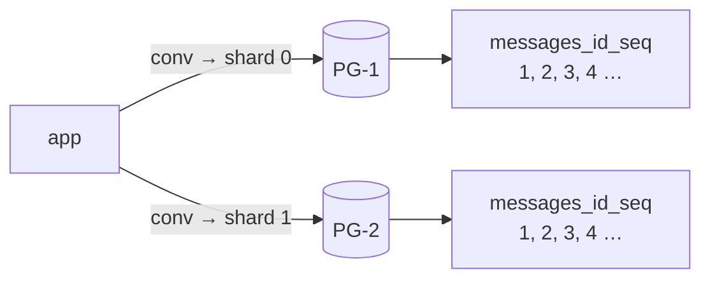
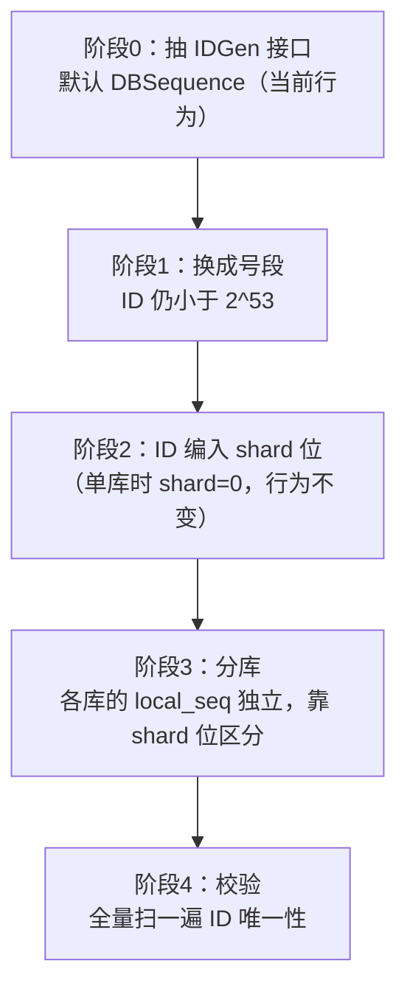

# 09 · 分库后消息 ID 会不会重复？怎么解决

> 承接 [08 · 为什么需要 seq](./性能优化/08-为什么需要seq-从next_seq到发号器.md) §5.1 的一句话："分库后 id 不再全局单调"。
> 本文把这个问题摊开：**会不会重复、重复了会怎样、五种解法各自适合谁、以及一个很多人踩过的 2^53 精度坑。**

---

## 〇、一句话结论

**会重复。** `BIGSERIAL` 是**每个数据库实例各自一条序列**，两个库都从 1 开始发，必然撞。

但"重复"不一定等于"出错"——**要看你把 `id` 当成什么**：

| 你把 id 当成 | 重复的后果 |
|---|---|
| 库内主键的一部分 | ✅ **没问题**（不同库是不同表，各自唯一即可） |
| 对外的"消息唯一标识" | ❌ 客户端回传时无法定位，日志/审计无法关联 |
| 跨库聚合时的排序键 | ❌ 顺序错乱 |

所以解题的第一步不是"选个 ID 算法"，而是**先确定 id 到底要承担哪个职责**。

---

## 一、先把"重复"这件事看清楚

### 1.1 现状：单库，一条序列

```sql
CREATE TABLE messages (
  id BIGSERIAL,                 -- 背后是一个 sequence 对象
  conversation_id VARCHAR(100),
  PRIMARY KEY (id, conversation_id)
);
```

```
库（唯一一个）：1, 2, 3, 4, 5, 6, ...
```

### 1.2 分库后：每个库各一条序列



```
PG-1：1, 2, 3, 4 ...
PG-2：1, 2, 3, 4 ...      ← 与 PG-1 完全重叠
```

**这是"两条独立的序列"，不是"一条序列被拆开"。** 序列的值只在**单个实例**内有意义。

### 1.3 主键会不会冲突？——不会

```sql
-- PG-1 的 messages 表
INSERT INTO messages (id, conversation_id) VALUES (5, 'single_1_2');

-- PG-2 的 messages 表
INSERT INTO messages (id, conversation_id) VALUES (5, 'single_3_4');
```

这是**两张不同实例上的不同表**，各自的主键约束独立，**不会报冲突**。

所以"分库后 id 重复"在数据库层面**不报错**——这也正是它危险的地方：**错误不会暴露，只会静默地产生歧义。**

### 1.4 真正会出问题的三个地方

#### ① 客户端把 `serverMsgId` 当全局唯一键

```json
// ack 返回
{ "type": "message.ack", "data": { "clientMsgId": "c-abc", "seq": 106, "serverMsgId": 5 } }
```

如果两个库都有 `serverMsgId = 5`：

- 客户端用 `serverMsgId` 做消息列表的 key → **React key 冲突、消息串台**；
- 客户端回传 `serverMsgId` 做"引用回复 / 编辑 / 撤回" → 服务端**不知道该去哪个库找**。

#### ② 跨库聚合时的排序错乱

`/user/lastMessages`、跨会话消息流这类查询，如果按 `id` 合并排序，会出现"库 A 的 5 排在库 B 的 3 后面"这种**与真实时间无关**的顺序。

#### ③ 日志 / 监控 / 审计

"消息 5 出问题了"——查哪个库？无法定位。

---

## 二、先分清三种"唯一性"

这是选型的前提，三者可以分开满足：

| 唯一性 | 范围 | 谁需要 | 必须全局唯一吗 |
|---|---|---|---|
| **A. 表内主键唯一** | 单库单表 | 数据库 | ❌ 库内唯一即可 |
| **B. 对外标识唯一** | 全系统 | 客户端、日志、审计 | ✅ 必须 |
| **C. 可路由**（从 ID 能定位到库） | 全系统 | 服务端按 ID 查消息时 | ⚠️ 取决于有没有"只凭 ID 查"的接口 |

**关键判断**：如果服务端所有消息查询都走 `(conversation_id, seq)`（会话路由），而**没有**"只凭 messageId 查消息"的接口，那么 C 不必须——只需要保证 B。

> 本项目目前的消息读取全部带 `conversationId`（`/user/messages?conversationId=`、`/user/sync?conv=`），**没有"按 messageId 单查"的接口**。所以"在 ID 里编码分片"是可选项，不是必选项——省掉它可以大幅简化。

---

## 三、五种解法

### 3.1 方案 A：号段（Segment）

**原理**：ID 不再由数据库自增，而是应用向一个"中心"**申请一段连续区间**，然后在内存里分配。

```sql
-- 中心（一张只有一行的表）
UPDATE id_segment SET next_max = next_max + 1000
WHERE name = 'messages'
RETURNING next_max - 1000 AS start, next_max AS end;
-- 返回 [1000, 1999]
```

```
应用内存：本次拿到 [1000, 1999]，本地依次发 1000, 1001, ... 1999
用完了再去申请下一段
```

| 维度 | 评价 |
|---|---|
| 唯一性 | ✅ 全局唯一（区间不重叠） |
| 单调性 | ✅ 整体递增（同一实例内严格递增，跨实例按段递增） |
| 性能 | ✅ 每 1000 个才一次 DB 交互 |
| 依赖 | ⚠️ 中心点（可以是 DB 表，也可以是 Redis） |
| 缺点 | ❌ **崩溃会丢段**（内存里没用完的号作废）；多实例各占一段 → 整体有序但**不连续** |
| ID 大小 | ✅ 可控（远小于 2^53，见 §四） |

**号段也可以放在 Redis**：`INCRBY msg:id:next 1000` 返回段末值，语义一样，但更快、且不再依赖 DB。

### 3.2 方案 B：雪花（Snowflake）

**原理**：64 位整数里塞三段信息，**完全不依赖任何中心**。

```
┌─1 bit─┬────41 bit 毫秒时间戳────┬─10 bit 机器号─┬─12 bit 序列─┐
│  0    │  当前时间 - 自定义纪元   │  0~1023      │ 0~4095     │
└───────┴─────────────────────────┴──────────────┴────────────┘
```

```go
id := (nowMs-epoch)<<22 | (machineID<<12) | seq
```

| 维度 | 评价 |
|---|---|
| 唯一性 | ✅ 机器号不重复 + 同毫秒内序列自增 |
| 单调性 | ⚠️ **趋势递增**（同一毫秒内严格递增；跨机器不保证） |
| 性能 | ✅ 纯本地，纳秒级 |
| 依赖 | ❌ 无中心 |
| 缺点 | ❌ **依赖时钟**（回拨会重号，必须检测并等待）；机器号要分配；**数值极大，JS 精度问题（见 §四）** |

### 3.3 方案 C：UUIDv7

**原理**：前 48 位放毫秒时间戳，其余随机。**无中心、可按时间排序**。

```
0190a3f2-7c1e-7a3b-9d4f-2e8b1c6a5d30
└─ 时间前缀 ─┘ └──── 随机 ────┘
```

| 维度 | 评价 |
|---|---|
| 唯一性 | ✅ 概率上唯一 |
| 单调性 | ⚠️ 时间前缀有序，但同毫秒内随机 |
| 性能 | ✅ 本地生成 |
| 缺点 | ❌ **16 字节**（是 bigint 的 2 倍），主键索引更大；不可读（需字符串化） |

### 3.4 方案 D：全局序列（一个 Redis key）

**原理**：所有库共用**一个**发号器。

```bash
INCR msg:id          # 全局唯一、严格递增
# 或按批
INCRBY msg:id 64
```

| 维度 | 评价 |
|---|---|
| 唯一性 | ✅ 全局唯一 |
| 单调性 | ✅ 严格递增 |
| 性能 | ✅ 10 万+/s（单实例） |
| 依赖 | ⚠️ Redis 单点 |
| 缺点 | ❌ **键丢失会导致 ID 重号**（需要"装载 max(id) + 余量"）；**ID 连续会暴露消息总量**；所有分片共享一个热点 key |

### 3.5 方案 E：复合 ID（分片位 + 本地号）

**原理**：把"哪个库"编进 ID，天然可路由。

```
ID = (shard_id << 40) | local_seq
     └─ 4 bit ─┘        └─ 40 bit ─┘
     最多 16 个库         每库 1 万亿条
```

```sql
-- 每个库仍然是 BIGSERIAL，但对外暴露的 id 加上 shard 前缀
INSERT INTO messages (id, shard_id, ...) VALUES (local_seq, 2, ...);
-- 对外：id_out = (2 << 40) | local_seq
```

| 维度 | 评价 |
|---|---|
| 唯一性 | ✅ 只要 shard_id 唯一 |
| 单调性 | ⚠️ 整体不单调（按库分段），库内单调 |
| 性能 | ✅ 仍然是本地自增 |
| 依赖 | ❌ 无 |
| 缺点 | ❌ 需要额外的 shard 位；迁移时历史 ID 要重算（或保持原样 + 新数据用新规则，见 §六） |

### 3.6 五种方案对比

| 方案 | 全局唯一 | 严格单调 | 无中心 | 可路由 | ID 大小 | 主要风险 |
|---|---|---|---|---|---|---|
| **A 号段** | ✅ | ✅ | ❌ | ❌ | 小 | 中心点；崩溃丢段 |
| **B 雪花** | ✅ | ⚠️ 趋势 | ✅ | 可选（机器号） | **大** | 时钟回拨；JS 精度 |
| **C UUIDv7** | ✅ | ⚠️ 时间前缀 | ✅ | ❌ | 大（16B） | 索引膨胀 |
| **D 全局 Redis 序列** | ✅ | ✅ | ❌ | ❌ | 小 | 键丢失重号；单点 |
| **E 复合 ID** | ✅ | ⚠️ 库内单调 | ✅ | ✅ | 小/中 | 历史数据迁移 |

---

## 四、一个绕不过去的坑：JavaScript 的 2^53

这一节单独讲，因为**它决定了你能不能用雪花**。

### 4.1 现状是安全的

```go
// biz/internal/repo/message.go:7
ID int64 `json:"id"`
```

`encoding/json` 会把 `int64` 输出成 **JSON number**，而 JS 的 `number` 是 IEEE-754 双精度：

```
最大安全整数 = 2^53 - 1 = 9,007,199,254,740,991 ≈ 9.0 × 10^15
```

当前 `BIGSERIAL` 是百万级（10^6 量级），**远小于 9×10^15，安全**。

### 4.2 雪花 ID 会直接越界

以"2024-01-01"为纪元，2026-11 的时间差约 `9.1 × 10^10` 毫秒：

```
9.1e10 << 22 ≈ 3.8 × 10^17
```

**比 2^53 大 40 倍。** 到了 JS 端会发生：

```js
JSON.parse('{"id": 380000000000000000}').id
// → 380000000000000000 看起来对，但
JSON.parse('{"id": 380000000000000001}').id === JSON.parse('{"id": 380000000000000000}').id
// → true  ← 两个不同的 ID 变成同一个值
```

**后果**：React key 冲突、消息串台、按 ID 更新/删除时改错对象。

### 4.3 本项目已经暴露了这个契约

```ts
// web/src/contracts/gen/ourchat/message/v1/message.ts:43
serverMsgId: number;
```

**TS 里就是 `number`。** 所以只要后端改成雪花且不做处理，前端一定出问题。

### 4.4 三种规避方式

| 方式 | 做法 | 影响 |
|---|---|---|
| **字符串化** | `ID int64 \`json:"id,string"\``（Go 标准 tag） | 前端契约从 number 变 string；所有用到的地方要改类型 |
| **选小 ID 方案** | 号段 / 复合 ID（数量级 10^12–10^13） | ✅ 无需改契约，推荐 |
| **缩短雪花位宽** | 时间戳用秒级 + 更少位 | 容量受限，不推荐 |

> **结论：如果不想动前端契约，就不要用标准雪花；用号段或复合 ID。**

---

## 五、本项目的推荐路径

### 5.1 第一步：先审计"到底需不需要全局唯一 ID"

最便宜的方案永远是"不改"。先确认三件事：

1. 有没有"只凭 messageId 查消息"的接口？（目前没有，读取都带 `conversationId`）
2. 客户端有没有把 `serverMsgId` 当**全局唯一键**用？（React key、本地缓存主键）
3. 有没有跨库按 `id` 聚合排序的查询？（`lastMessages` 用的是 `conversation_id` + `timestamp`）

**如果 1、3 都是"没有"，2 也只做"当前会话内的 key"** → 分库后 `id` 保持每库自增即可，**不需要全局唯一**，成本为零。

### 5.2 如果需要全局唯一：推荐"号段 + 分片位"

```
ID = (shard_id << 40) | local_seq
     shard_id: 4 bit（最多 16 个库）
     local_seq: 40 bit（每库 1 万亿条）
     最大 ≈ 1.76 × 10^13  ← 远小于 2^53，JS 安全
```

- 号段从 Redis 或 DB 申请（每 1000 个一次）；
- 天然带分片信息，将来"按 ID 定位库"也支持；
- **ID 保持在 2^53 以内，不用改前端契约**。

### 5.3 不推荐直接上雪花的原因

不是它不好，而是**它的收益（无中心）在本项目不成立**：我们已经强依赖 Redis（seq/幂等/限流/presence），多一个"向 Redis 要号段"不会增加依赖面；而雪花带来的 JS 精度问题要动整个前端契约。

### 5.4 迁移步骤



**为什么在单库时就做阶段 2**：编入 `shard=0` 后，ID 的**格式**已经定型，分库时只是把 `shard` 换成真实值，不需要再改一次。

### 5.5 历史数据怎么办

两种策略：

| 策略 | 做法 | 评价 |
|---|---|---|
| **不重排** | 历史 ID 保持不变，新 ID 从新规则开始 | ✅ 推荐：无数据迁移风险 |
| 重排 | 把历史 ID 按新规则重算 | ❌ 所有引用（`last_read_message_id`、客户端缓存、日志）都会失效 |

**只要保证"新规则的最小值 > 历史最大值"**，新老 ID 就不会冲突：

```
历史最大值 ≈ 7.5 × 10^6
新规则起点 = (shard<<40) | 0 = 0（shard=0 时会重叠！）
```

**所以 shard=0 时需要把 local_seq 的起点抬到"历史最大值 + 余量"**，或者让 shard 从 1 开始编。这是迁移时最容易漏的一步。

---

## 六、坑点

### 坑 1：以为"主键冲突"会报错

分库后两个库的 `id=5` **不会报任何错**——它们是不同的表。错误是**静默的歧义**，只有客户端或日志层面才暴露。

### 坑 2：忘了 `user_conversations.last_read_message_id`

这个字段是 `VARCHAR(50)`，存的是**消息 ID 的字符串形式**。改 ID 规则时它必须能容纳新格式（雪花 19 位数字、复合 ID 都放得下）；如果改成 UUID 也能放下。但**历史值是新旧混存的**，读取时要兼容两种解析。

### 坑 3：`serverMsgId: number` 的前端契约

见 §四。改 ID 方案前先 grep 一遍：

```bash
grep -rn "serverMsgId" web/src
```

### 坑 4：号段中心成为单点

号段方案的中心（DB 表或 Redis key）挂了，**所有实例都无法发新 ID**。缓解：

- 每个实例多预取几段（如一次 10000，够跑几分钟）；
- 中心不可用时**拒绝写入**而不是"本地随便发"（否则一定重号）。

### 坑 5：雪花的时钟回拨

NTP 校正、虚拟机迁移都可能让时钟倒退。标准做法：检测到 `now < lastTimestamp` 时**自旋等待**，或直接报错。绝不能用"回拨后继续发"。

### 坑 6：复合 ID 让"库内自增"与"对外 ID"分离

如果表和对外 ID 不一致（表里存 local_seq，对外返回带 shard 位的值），所有"用 ID 反查"的地方都要做转换。**建议表里直接存最终 ID**（带 shard 位），避免两套值。

### 坑 7：分片位宽定太小

`4 bit`（16 库）对当前够用，但如果将来要扩到 64 库就不够。**定 8 bit（256 库）更稳**，代价是 ID 再大 256 倍——`(8<<40) ≈ 8.8×10^12`，仍然远小于 2^53，安全。

### 坑 8：Redis 全局序列丢键 = 全库重号

如果选方案 D，必须像 `seq` 一样做"装载 `max(id)` + 安全余量 + 唯一索引兜底"。**比每会话 seq 更危险**，因为影响面是全局。

---

## 七、验证方法

| 项 | 方法 | 通过标准 |
|---|---|---|
| 全局唯一 | 各库并发写 100 万条后，汇总所有 ID 做 `distinct` | 数量 = 总数 |
| 单调性 | 同一库内按写入时间采样 ID | 递增（允许不连续） |
| JS 安全 | `SELECT max(id) FROM messages` | `max < 9007199254740991` |
| 路由正确 | 由 ID 反推 shard，对比实际所在库 | 100% 一致（若采用可路由方案） |
| 历史兼容 | 读一条旧消息（`last_read_message_id` 引用） | 能正常解析与展示 |
| 回滚 | 切回旧发号器 | 新 ID 不与存量冲突 |

---

## 八、小结

| 问题 | 答案 |
|---|---|
| 分库后 id 会重复吗 | **会**，每个库的 `BIGSERIAL` 各自从 1 开始 |
| 主键会冲突吗 | **不会**，不同库是不同表；危险的是"静默歧义" |
| 什么情况下必须解决 | 客户端把 `serverMsgId` 当全局唯一键、或跨库按 id 排序/聚合时 |
| 最便宜的方案 | 先审计：如果消息读取都带 `conversationId`、且没有"按 ID 单查"的接口，id 可以只保证库内唯一 |
| 要全局唯一选哪个 | **号段 + 分片位**（ID 小、JS 安全、可路由、无时钟依赖） |
| 为什么不直接上雪花 | 标准雪花 ID 约 10^17，**超过 JS 的 2^53**，要动整个前端契约 |
| 迁移最容易漏什么 | 新规则的起点要大于历史最大值，否则与存量撞号 |
