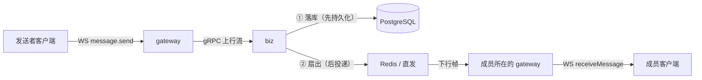
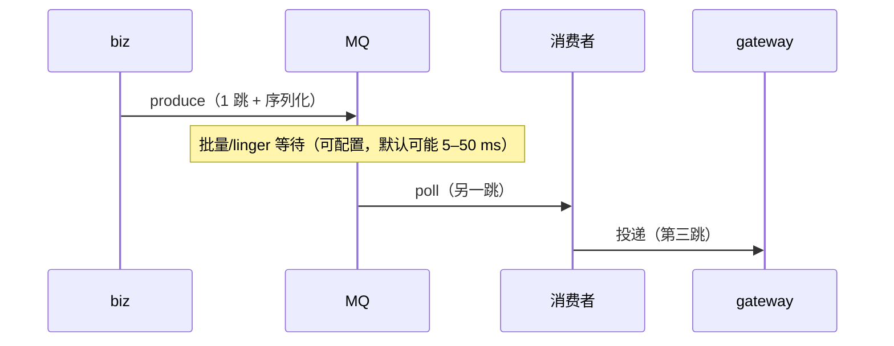

# 10 · Redis pub/sub 算不算 MQ？该不该引入消息队列

> 起因：看到"扇出用 `PUBLISH gw:downlink`"之后的一个自然联想——**Redis 是不是在这里充当了 MQ？换成 Kafka/Pulsar 会不会更好？**
> 结论先说：**它是"广播总线"，不是 MQ；而且在本项目里它已经不是主通道，只是 0.02% 流量的兜底。对实时链路引入 MQ 是负优化，对"旁路事件流"才是正优化。**

---

## 一、先把链路顺序纠正过来

你的描述是"用户发消息 → 通过 Redis 中转到 biz → 再分发给群成员"。实际的顺序是**反的**：



**Redis 在 biz 的下游，不在上游。** 它不参与"收消息"，只参与"把已经落库的消息投出去"。

这个顺序是整个架构的地基：

```
先落库 → 再投递
```

所以"投递失败"是**允许的**——消息已经在 PG 里，客户端下次 `/sync` 能补回来。

---

## 二、现在的下行有几条通道

定向下行（[分册 11](./11-定向下行原理-与pipeline的区别.md)）上线后，下行有两条路：

| 通道 | 走哪 | 谁收到 | 实测占比 |
|---|---|---|---|
| **direct（主）** | biz → gRPC 下行流 → **目标网关副本** | 只有持有该用户连接的那台网关 | **99.9998%** |
| **fallback（兜底）** | biz → `PUBLISH gw:downlink` → **所有网关副本** | 所有网关都收到，只有持有连接的投递 | 0.0002% |

也就是说：

> **"Redis 当 MQ"这件事，现在只覆盖 0.0002% 的流量。** 主通道是一条 gRPC 流，根本不经过 Redis。

这是本文最重要的前提——很多讨论"要不要换 MQ"的分析，是假设 Redis 是主通道，而在本项目已经不是了。

---

## 三、Redis pub/sub 到底是什么

### 3.1 实现机制（为什么它是"广播"而不是"队列"）

```
PUBLISH gw:downlink "payload"
  → Redis 在 server.pubsub_channels 字典里找到这个 channel
  → 遍历它的订阅者列表
  → 把 payload 追加到每个订阅者的输出缓冲
  → 事件循环把它们写进各自的 socket
  → 返回"投递给了几个订阅者"
```

关键性质：

| 性质 | 有吗 | 后果 |
|---|---|---|
| 持久化 | ❌ | 订阅者不在线 → **消息直接丢** |
| 消费确认（ack） | ❌ | 发布者只知道"发给了 N 个订阅者"，不知道谁处理了 |
| 消费组 / offset | ❌ | 无法"从上次位置继续"，无法多消费者分摊 |
| 重放（replay） | ❌ | 消息一旦发出，Redis 里没有任何记录 |
| 背压 | ⚠️ | 订阅者读得慢 → 输出缓冲涨 → 超过 `client-output-buffer-limit` 被断开 |
| 顺序 | ⚠️ | 单 channel 内基本有序，但无任何保证 |
| 事务/至少一次 | ❌ | 完全 fire-and-forget |

**这就是"广播总线"（broadcast bus）和"消息队列"（message queue）的分界线：**

```
总线：我喊一声，在场的人都听见；没在场的人永远不知道我喊过。
队列：我把信放进邮筒，收信人来取；取走要签收；没取走就一直在。
```

### 3.2 那 Redis 有没有真正的 MQ 能力？有——Stream

Redis 5.0 引入的 **Stream** 才是"接近 MQ"的结构：

```bash
XADD stream * type message.send conv single_1_2     # 生产
XREADGROUP GROUP g1 consumer-1 COUNT 10 BLOCK 2000 STREAMS stream >   # 消费
XACK stream g1 <id>                                  # 确认
XAUTOCLAIM stream g1 60000 0                         # 认领超时消息
```

| 能力 | pub/sub | Stream |
|---|---|---|
| 持久化 | ❌ | ✅（AOF/RDB） |
| 消费组 | ❌ | ✅ |
| ack + pending 列表 | ❌ | ✅ |
| 重放 | ❌ | ✅（按 ID 范围读） |
| 内存占用 | 瞬时 | **持续增长**（需 `MAXLEN` 裁剪） |

但即使是 Stream，它仍然是"内存里的日志"——**没有像 Kafka 那样的磁盘分段、保留策略、水平扩展**。

### 3.3 四种"消息中转"的定位对比

| 维度 | Redis pub/sub | Redis Stream | Kafka | Pulsar |
|---|---|---|---|---|
| 模型 | 广播 | 日志 + 消费组 | 分区日志 | 分区日志 + 订阅 |
| 持久化 | ❌ | ⚠️ 内存 + AOF | ✅ 磁盘 | ✅ 磁盘（BookKeeper） |
| 至少一次 | ❌ | ✅ | ✅ | ✅ |
| 重放 | ❌ | ✅ | ✅ | ✅ |
| 顺序 | ❌ | ✅（单 stream） | ✅（单分区） | ✅（单分区） |
| 典型端到端延迟 | **< 1 ms** | 1–5 ms | 5–50 ms | 5–50 ms |
| 吞吐 | 10 万+/s | 10 万+/s | 百万/s | 百万/s |
| 运维成本 | 已有 | 已有 | 高 | 中高 |

---

## 四、引入 MQ 会更好吗？分三种场景回答

### 4.1 场景一：实时下行（把消息推给在线成员）—— **不会更好，反而更差**

先看现在的数字：

| 指标 | 现状 |
|---|---|
| 群扇出 span p99（发布路径） | **2 ms** |
| 群扇出端到端 p99 | ~27 ms |
| direct 命中率 | 99.9998% |

换 MQ 会发生什么：



| 代价 | 说明 |
|---|---|
| **多一跳 + 一次序列化** | biz → MQ → 消费者 → gateway，比 direct 多两次网络 |
| **消费批间隔** | 为了吞吐，消费者通常按批拉（`fetch.min.bytes` / `linger`），默认会给延迟加 5–100 ms |
| **ack 语义被拆开** | "投递成功"变成"写进 MQ 成功"，与"客户端收到"更远 |
| **多一个要运维的组件** | 而它承载的只是一条"允许丢"的通道 |

**最根本的理由**：实时通道的语义是"**尽力而为**"——丢了有 `/sync` 兜底。用一个**为"可靠投递"设计的重型组件**去承载一个"允许丢"的通道，是典型的**用错工具**。

> 这就是 `docs/架构/消息同步架构分析-为什么不用消息队列-三段式同步与队列边界.md` 的核心结论：**队列是"把请求从同步链路上拆下来"的工具，而实时下行要的是"尽快送达"，两者设计意图相反。**

### 4.2 场景二：扇出规模化（万人大群）—— **可能有帮助，但有前提**

direct 的成本是"每个用户一次 `Send`"：

```
100 人群：100 次 Send（同一副本的话，RouteToUser 内部 100 次 enqueue）
1 万人群：10000 次 Send
```

这里 MQ 的价值不是"降低延迟"，而是**解耦与削峰**：

- biz 落库后只发一条"扇出任务"到 MQ，立刻返回 ack；
- 扇出消费者按自己的节奏展开成 N 条投递，失败可重试。

| 收益 | 代价 |
|---|---|
| biz 的 ack 不再受扇出耗时影响 | 扇出延迟从 2 ms 涨到 5–50 ms |
| 扇出可水平扩展（多消费者） | 需要处理"消费者挂了怎么办"（MQ 的 ack 解决了） |
| 大群突发流量被队列吸收 | 多一个组件、多一套监控 |

**触发条件（可验证）**：

1. 单条消息的扇出耗时 p99 > 50 ms；
2. 或者单条消息的扇出 Send 次数 > 1000，且 biz CPU 被扇出占掉 > 20%；
3. 或者需要"扇出失败重试"（当前是 best-effort）。

**在这三条同时成立之前，引入 MQ 是过度设计。**

### 4.3 场景三：旁路事件流（搜索 / 审计 / 推荐 / 风控）—— **MQ 是正解**

这类需求的特征：

- 消费者与主链路**无关**（搜索索引挂了不影响发消息）；
- 需要**重放**（重建索引要重放历史）；
- 需要**多消费者各自消费全量**（搜索、审计、推荐各读一遍）；
- 允许秒级延迟。

这正是 MQ 的强项。做法是 **outbox 模式**：

```
本地事务：INSERT messages + INSERT outbox(evt)   ← 同一个事务，原子
后台任务：读 outbox → 投 MQ → 标记已投
消费者：搜索 / 审计 / 推荐
```

**注意 outbox 必须在同一个本地事务里**，否则会出现"消息落库了但事件没发"（或反之）。

### 4.4 一张决策表

| 需求 | 该用什么 | 为什么 |
|---|---|---|
| 在线成员实时收到 | **direct（gRPC 流）** | 最低延迟、O(1)/副本 |
| 兜底投递（副本未知） | **Redis pub/sub** | 广播、无需寻址、可丢 |
| 离线补偿 | **PG + `/sync`** | 唯一真相源，可重放 |
| 万人大群扇出 | 先优化 direct（批量帧），**到阈值再上 MQ** | 延迟与复杂度 |
| 搜索/审计/推荐 | **MQ（Pulsar/Kafka）** | 需要重放、多消费者、可容忍延迟 |
| 削峰（写入尖峰） | **批量写入**优先，其次 MQ | 批量不改 ack 语义 |

---

## 五、如果真要引入，选什么

| 选项 | 适合 | 本项目的适配度 |
|---|---|---|
| **Pulsar** | 多消费者、分区有序、低延迟调优 | ⭐ 已有基建（agent-server 在用），可复用 |
| Kafka | 超高吞吐、生态成熟 | 吞吐过剩，运维更重 |
| Redis Stream | 轻量、已有 Redis | ✅ 但内存受限，且我们已有 PG 兜底 |
| NATS | 极低延迟、轻量 | 生态与运维经验少 |

**如果只是"想给扇出加个缓冲"，Redis Stream 是成本最低的选择**（不引入新组件，`XADD` + `XREADGROUP` 就能做消费组）。但要接受它的内存上限与 `MAXLEN` 裁剪。

---

## 六、为什么本项目"不需要 MQ"这件事如此确定

回到三段式的第一性原理：

```
实时通道：可以丢 → 只要"尽量快"
补偿通道：不能丢 → 只要"一定能补"
```

- 实时通道用 MQ，是在**为一条允许丢的路径付可靠性的成本**；
- 补偿通道已经是 PG（真相源），MQ 帮不上忙（它不能替代查询）；
- 所以 MQ 在本项目里**没有位置**，除非出现"扇出规模化"或"旁路消费者"。

再叠加一个当前事实：**direct 已经承担 99.9998% 的下行**，Redis pub/sub 只剩兜底。连"Redis 当 MQ"这个前提本身，都只对 0.0002% 的流量成立。

---

## 七、坑点（如果你还是决定上 MQ）

### 坑 1：把 MQ 放进同步链路 = ack 语义被拆开

"写 MQ 成功"不等于"落库成功"。要么引入 reply 通道重建关联，要么接受"客户端以为成功但消息可能没落库"——后者违反"落库即真相"。

### 坑 2：消费批间隔会悄悄加延迟

Kafka 的 `fetch.min.bytes` / `linger.ms`、Pulsar 的 `receiverQueueSize`、Redis Stream 的 `BLOCK`，默认值都为吞吐优化，**会给每次投递加 5–50 ms**。上线前必须按延迟目标重新调。

### 坑 3：顺序只在"单分区"内保证

要保证"同一会话有序"，分区键必须是 `conversation_id`。用随机分区会打乱顺序。

### 坑 4：消费者重复消费是常态

MQ 通常是"至少一次"，所以消费端必须幂等（用 `messageId`/`seq` 去重）。

### 坑 5：积压告警缺失

MQ 一积压，实时性就没了，但系统看起来"没报错"。必须有 lag 指标与告警。

### 坑 6：Redis pub/sub 的连接不能复用

进入订阅态的连接不能再执行普通命令（`backplane.go` 用独立的 `subRdb` 正是这个原因）。如果误用同一个 client，会报错或阻塞。

---

## 八、验证方法（判断"该不该上 MQ"）

| 指标 | 现状 | 阈值（超过才考虑） |
|---|---|---|
| 单条消息扇出耗时 p99 | ~2 ms | > 50 ms |
| 单条消息 Send 次数 | = 在线成员数 | > 1000 |
| biz 中扇出占用的 CPU | 低 | > 20% |
| 扇出失败率 | ~0.0002% | > 1% 且需要重试 |
| 旁路消费者数量 | 0 | ≥ 1（搜索/审计） |

```bash
# 群扇出基准：观察单条消息的扇出耗时与投递次数
node perf/gw-fanout-bench.mjs 100 20
```

---

## 九、小结

| 问题 | 答案 |
|---|---|
| Redis pub/sub 是 MQ 吗 | **不是**。它是广播总线：无持久化、无 ack、无消费组、无重放 |
| 它在本项目的角色 | 下行的**兜底通道**（0.0002%），主通道是 direct gRPC 流 |
| 换 MQ 会更快吗 | **不会**。多一跳 + 消费批间隔，延迟涨一个数量级 |
| 换 MQ 会更可靠吗 | 对"实时下行"没意义——它本来就允许丢，丢了有 `/sync` |
| MQ 什么时候才对 | 万人大群扇出（有阈值）、旁路事件流（搜索/审计/推荐） |
| 真要用选谁 | Pulsar（已有基建）；轻量场景可用 Redis Stream |
| 最关键的一句话 | **用队列去承载一条"允许丢"的通道，是拿可靠性成本买不到任何东西** |
