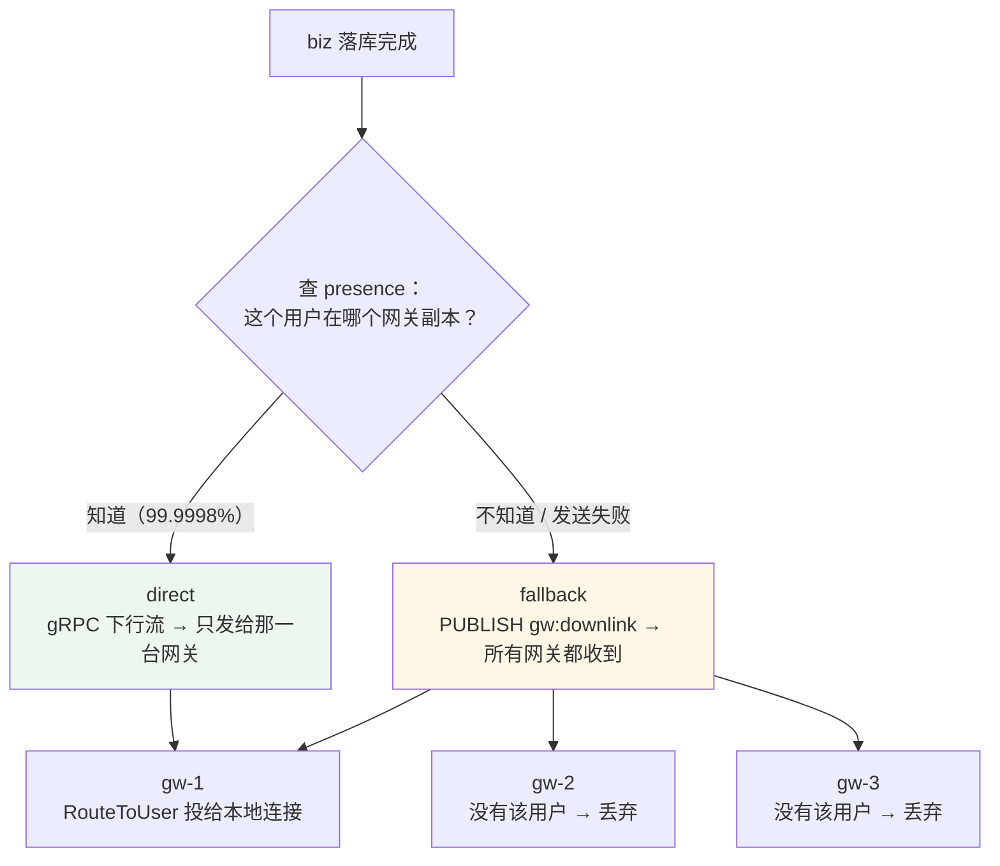
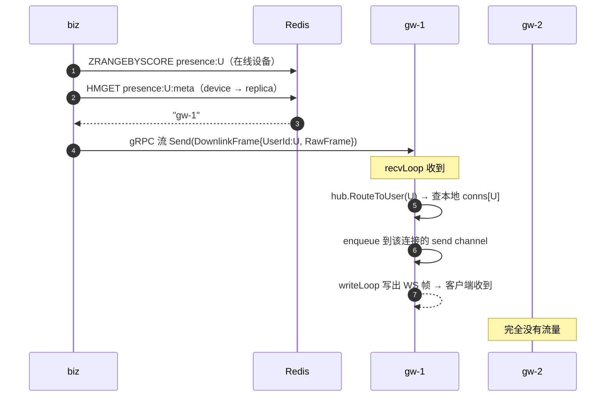
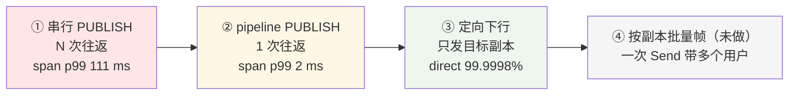

# 11 · 定向下行是什么？和 Redis pipeline 有什么区别

> 承接 [05 群扇出批量 PUBLISH](./性能优化/05-群扇出批量PUBLISH原理.md) 结尾的那句"pipeline 治往返，直发治放大"。
> 一句话：**pipeline 是"把 100 条命令装进一个快递箱寄一次"，定向下行是"直接送到收件人所在的那栋楼"——前者省的是往返次数，后者省的是"每栋楼都送一份"。**

---

## 一、先看下行有哪两条路

消息落库之后，要投给会话成员。本项目有两条通道：



| 通道 | 走什么 | 谁收到 | 成本 |
|---|---|---|---|
| **direct** | biz → gRPC 流 → 目标副本 | 只有持有连接的网关 | **O(1) / 副本** |
| **fallback** | biz → Redis PUBLISH → 所有副本 | 所有网关（只有一家能投） | **O(副本数)** |

**这就是"定向下行"要解决的唯一问题：把广播变成点对点。**

---

## 二、底层原理 A：gRPC 双向流是怎么"定向"的

### 2.1 连接拓扑

```
gateway 启动时 → 对每个 biz 副本建立 N 条 gRPC 双向流（EDGE_GRPC_STREAMS=4）
每条流在建立时，通过 metadata 自报家门：
   x-gateway-token: <内部令牌>
   x-replica-id:    gw-1
```

对应代码：

- gateway：`upstream.NewGrpc(addr, n, token, replica, ...)` 建 n 条流（`grpc.go:52-76`）；
- metadata 注入：`tokenAuth.GetRequestMetadata` 返回 `x-gateway-token` + `x-replica-id`（`grpc.go:45-47`）；
- biz：`Stream()` 从 `metadata.FromIncomingContext` 取出 `x-replica-id`，登记到注册表（`edge.go:116-124`）。

### 2.2 biz 侧的"副本 → 流"注册表

```go
var replicaStreams sync.Map   // replicaID → *replicaEntry

type replicaEntry struct {
    mu      sync.Mutex
    streams []edgev1.Realtime_StreamServer   // 该副本的 4 条流
    next    int                              // 轮询下标
}
```

发送时：

```go
e.mu.Lock()
stream := e.streams[e.next % len(e.streams)]   // 4 条流轮询
e.next++
e.mu.Unlock()
stream.Send(&EdgeFrame{Kind: Downlink{Downlink: frame}})
```

**"定向"的本质**：不是按用户路由，而是**按副本路由**——因为连接实体在网关，biz 只知道"这个用户连在 gw-1"，不知道具体是哪条 socket。

### 2.3 网关侧的本地索引

biz 把帧写到 gw-1 的流里，gw-1 的 `recvLoop` 收到后：

```go
case *edgev1.EdgeFrame_Downlink:
    s.onDownlink(k.Downlink)        // → hub.RouteToUser
```

`RouteToUser`（`hub.go:120-148`）：

```go
h.mu.RLock()
devices := h.conns[userID]          // 本副本的连接索引：userID → deviceID → *Conn
for _, c := range devices { ... }   // 按 target/except 过滤
h.mu.RUnlock()

for _, c := range targets {
    if c.enqueue(payload) { ... }   // 写进该连接的有界发送缓冲
    else { evictSlowConsumer(c) }   // 缓冲满 → 逐出慢消费者
}
```

**注意**：这里对"该用户在本副本的所有设备"都会投递。所以"定向"是**到副本**，副本内部仍是"到该用户的全部设备"。

---

## 三、底层原理 B：presence 怎么知道"在哪个副本"

### 3.1 两个 Redis 键

```
presence:{userId}        ZSET   member=deviceId, score=过期时刻(ms)
presence:{userId}:meta   HASH   field=deviceId, value="{replica}:{socketId}"
```

- 网关在连接建立时写入（`presence.Register`），心跳时刷新 score，断开时删除；
- biz 只读：`ReplicaOf`（单用户）或 `ReplicaOfBatch`（批量，2 条 pipeline）。

### 3.2 一次定向投递的完整时序



**对比 fallback**：同样的消息如果走 `PUBLISH`，gw-1、gw-2、gw-3……**每个副本都会收到一份**，然后各自查本地有没有这个用户，没有就丢弃。

---

## 四、定向下行 vs pipeline：本质区别

### 4.1 一张表

| 维度 | Redis pipeline | 定向下行（direct） |
|---|---|---|
| **优化对象** | N 条 Redis **命令** | N 个用户的**投递** |
| **解决的问题** | 网络往返（N → 1） | **广播放大**（N × 副本数 → N） |
| **是否经过 Redis** | ✅ 经过 | ❌ 不经过（走 gRPC 流） |
| **成本模型** | N × RTT → **1 × RTT**；但 Redis 内部仍执行 N 次、投递 N × 副本 | 1 次 presence 查询 + **N 次 Send**；投递次数 = N |
| **失败语义** | 命令级错误（可逐条检查） | 帧级失败 → 回退 pub/sub |
| **顺序保证** | pipeline 内按序执行 | 4 条流轮询 → **跨流无序** |
| **典型延迟** | 1 个 RTT + Redis 内部执行 | 1 个 RTT（gRPC 流复用） |
| **适用** | 兜底路径、批量命令 | **主路径**、点对点/小群 |

### 4.2 一个类比

```
串行 PUBLISH：   给 100 个人各寄一封信，每寄一封等一次回执      → 100 次往返
pipeline：       把 100 封信装进一个箱子，寄一次                 → 1 次往返
                 但邮局仍要拆箱、每封信仍要复印给 3 个分局        → 100 × 副本数 次投递
定向下行：       直接找到收件人所在的小区，把信交给门卫           → 1 次往返 + 100 次本地投递
```

**关键差别**：pipeline 优化的是"寄件方式"，direct 优化的是"要不要每个分局都送一份"。

### 4.3 成本随规模的曲线

```
设：成员数 N，网关副本数 R

串行 PUBLISH：   N × RTT
pipeline：       1 × RTT   + N × R（Redis 内部投递）
direct：         1 × RTT   + N（每个用户一次 Send，只到 1 个副本）
```

- 当 **R = 1**（单网关）时：pipeline 与 direct 的投递次数都是 N，差别只在"经过 Redis"还是"走 gRPC"；
- 当 **R = 4**（多副本）时：pipeline 的投递量是 **4N**，direct 是 **N**——**这才是定向下行的价值所在**。

> 所以"定向下行"不是一个"微优化"，它是**多副本架构下的必需品**。单副本时它几乎没有收益。

---

## 五、失败与回退：三条路径

```go
func PublishDownlink(ctx, userID, typ, data, opts) error {
    if tryDirect(ctx, userID, typ, data, opts) {   // ① 直发成功
        metrics.DownlinkDirectTotal.Inc()
        return nil
    }
    metrics.DownlinkFallbackTotal.Inc()            // ② 回退 pub/sub
    payload := ...
    return rdb.Publish(ctx, "gw:downlink", raw).Err()
}
```

`tryDirect` 返回 false 的三种情况：

| 情况 | 原因 | 后果 |
|---|---|---|
| `presence` 无记录 | 用户离线，或 TTL 已过期 | 走 pub/sub（订阅者为空也算成功） |
| `presence` 有记录但 replica 为空 | meta 数据异常 | 走 pub/sub |
| `stream.Send` 失败 | 流断开/重建中 | 走 pub/sub |

**还有第四种，最隐蔽**：`Send` 成功，但目标网关本地没有这个用户（presence 失真）→ 网关记 `dropped` 后静默丢弃，**业务层不知道**。这就是[问题 04](../问题分析/04-定向下行缺投递回执.md)。

---

## 六、什么时候 direct 反而更差

这是一个容易被忽略的反例：

| 场景 | direct | pub/sub |
|---|---|---|
| 点对点 / 小群（N 小、副本多） | ✅ N 次 Send | ❌ N × R 次投递 |
| **全员广播**（同一条内容给所有人，且副本很多） | ⚠️ 每个副本都要发（如果按用户发，仍是 N 次） | ✅ 1 次 PUBLISH 覆盖所有副本 |
| 用户高度分散在多个副本 | ⚠️ 需要按副本分组多次发送 | ✅ 一次广播 |

本项目的群消息是"每个成员一帧"（`DownlinkFrame` 带 `UserId`），所以 direct 天然是 N 次 Send；如果将来做"公告/系统消息"，**按副本分组、每个副本发一帧**会比逐用户发更划算——那需要协议支持"一帧多用户"。

---

## 七、演化路径（为什么最终是 direct）



| 阶段 | 解决的问题 | 遗留的问题 |
|---|---|---|
| ① → ② | 往返次数 | 广播放大（N × 副本） |
| ② → ③ | 广播放大 | 多设备跨网关（[问题 05](../问题分析/05-多设备跨网关漏投.md)）、无投递回执（[问题 04](../问题分析/04-定向下行缺投递回执.md)） |
| ③ → ④ | 大群 Send 次数 | 协议改动 |

---

## 八、坑点

### 坑 1：gRPC 的 `SendMsg` 不是并发安全的

grpc-go 明确：**同一 stream 上多个 goroutine 并发 `SendMsg` 不安全**。

当前代码在 `tryDirectDownlink` 里轮询选流后**无锁 Send**，两条 goroutine 完全可能选中同一条流。`gateway/upstream/grpc.go:174` 那句注释「grpc-go 保证 SendMsg 并发安全」是错的。修法见[分册 09](../09-边缘层背压与流写入串行化.md)。

### 坑 2：流控窗口会让 Send 阻塞

本项目 `InitialWindowSize = 1MB`。如果接收端消费慢、窗口耗尽，`Send` 会阻塞。**如果用一把锁包住 Send，阻塞会传染给同一流上的所有发送者**——所以正确做法是"每条流一个单写 goroutine + 有界队列"，而不是加锁。

### 坑 3：presence 失真 → 投错副本 → 静默丢弃

`presence` 是最终一致的（网关写、业务读、有 TTL）。用户刚换网关的窗口内，biz 可能把帧发给旧副本，而旧副本只会记 `dropped`，**不回执**。

### 坑 4：多设备跨网关只投一台

`ReplicaOfBatch` 用 `ZRangeByScore(Count: 1)` 只取一台设备，所以"PC 在 gw-1、手机在 gw-2"时只有一端收到（[问题 05](../问题分析/05-多设备跨网关漏投.md)）。

### 坑 5：4 条流轮询不保证顺序

同一条消息的多个下行帧可能走不同流、到达顺序不保证。当前业务不依赖下行顺序（客户端按 `seq` 排序），但如果将来有"先发 A 再发 B 必须有序"的需求，要改成按用户哈希固定流。

### 坑 6：流重建期间的 Send 失败

网关重启 → 流断开 → `unregisterReplicaStream` → biz 侧 `Send` 失败 → 走 pub/sub 兜底。**这条路径是设计好的**，但重连窗口内 fallback 比例会短暂飙升，不要误判为故障。

### 坑 7：`Register` 的 metadata 必须在建流时带上

`x-replica-id` 是通过 `PerRPCCredentials` 在**每次 RPC 调用**时注入的。如果流建立时没带（例如漏配 token），biz 侧 `replica` 为空 → 不登记 → **所有下行都走 fallback**，表现为"直发命中率 0"。

---

## 九、验证方法

| 项 | 方法 | 期望 |
|---|---|---|
| 直发命中率 | `server_downlink_direct_total / (direct+fallback)` | ≥ 99.5%（V3 实测 99.65%，V2 复测 99.9998%） |
| 目标副本唯一 | 双网关环境，向某用户发消息 | 只有其所在副本的网络/CPU 有变化 |
| 网关 dropped | `gateway_downlink_total{result="dropped"}` | 不异常上升（上升 = presence 失真） |
| 流注册 | biz 日志 / `replicaStreams` 长度 | 每个副本 4 条流 |
| 回退可用 | 手工杀掉目标网关 | 自动走 pub/sub，消息仍能到达（重连后） |

```bash
# 双网关 + 单用户双设备，验证"只投目标副本"与"多设备漏投"
node perf/gw-probe.mjs
```

---

## 十、小结

| 问题 | 答案 |
|---|---|
| 定向下行是什么 | biz **按 presence 记录的副本**，把帧直接写进那台网关的 gRPC 下行流 |
| 和 pipeline 的区别 | pipeline 省**往返次数**（N→1），direct 省**广播放大**（N×副本→N） |
| 为什么不都用 pipeline | 副本多时，pipeline 仍要把消息投给每个副本，成本 O(副本数) |
| 定向到什么粒度 | **到副本**，不是到 socket；副本内部由 `RouteToUser` 投给该用户全部设备 |
| 失败怎么办 | 回退 Redis pub/sub（全副本广播），保证不丢帧 |
| 什么时候 direct 更差 | 全员广播、且副本多时，一次 PUBLISH 反而更省 |
| 最大的隐患 | `Send` 成功 ≠ 用户收到（无回执），以及多设备跨网关漏投 |
