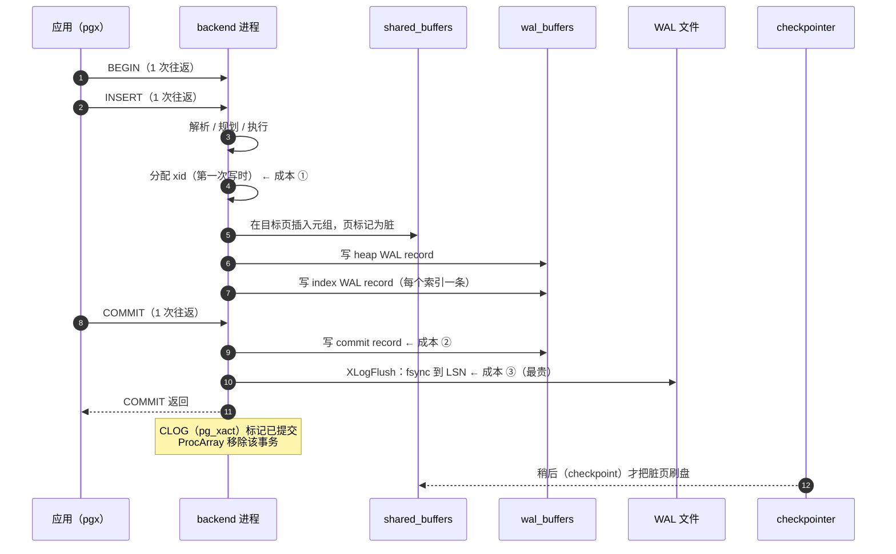
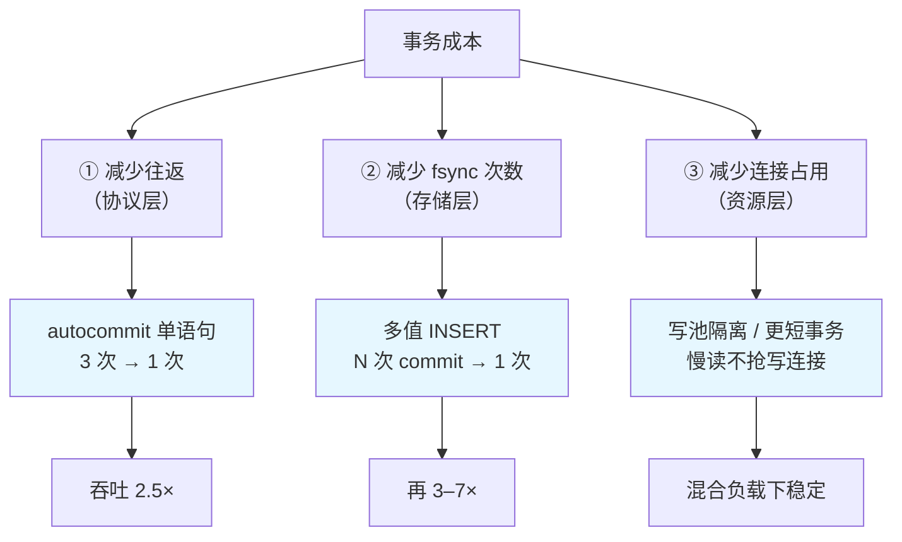

# 01 · 事务对性能的影响：从 fsync 到连接池

> 本文是 [`../02-落库去显式事务.md`](../../02-落库去显式事务.md) 的原理篇：那篇讲"怎么改"，这篇讲"**为什么事务贵、贵在哪一层、哪一层可以省、哪一层不能省**"。
> 一句话：**事务的成本不在"BEGIN 这个词"，而在它背后的四件事——一次 xid、一条 commit record、一次 WAL fsync、一段连接占用。** 前三个是数据库内部的，省不掉（只能合并）；第四个是应用侧的，可以靠改写法直接省掉。

---

## 一、先把事务拆开：一条 INSERT 到底发生了什么

### 1.1 完整生命周期



**最关键的一点在最后一行**：`COMMIT` **不等数据页落盘**，只等 WAL 落盘。数据页由 checkpointer 在几十秒到几分钟后异步刷。这就是为什么"提交"的成本几乎等于"一次 fsync 的成本"，而与插入多少行关系不大。

> 这叫做 **WAL 规则（Write-Ahead Logging）**：先写日志并落盘，数据页可以慢慢来；崩溃后用日志重放。它把"随机写数据页"换成了"顺序写日志"，是数据库能扛住高并发的根本原因。

### 1.2 四类成本

| # | 成本 | 位置 | 量级 | 能否省 |
|---|---|---|---|---|
| ① | **xid 分配** | 进程内存 + 部分写 WAL | 亚微秒 | ❌ 不能（除非不写） |
| ② | **commit record** | WAL buffer | 微秒 | ⚠️ 只能**合并**（N 条一个事务） |
| ③ | **WAL fsync** | 磁盘 / 存储 | **0.1–10 ms** | ⚠️ 只能**合并**（组提交） |
| ④ | **连接占用 + 网络往返** | 应用 ↔ 数据库 | 每条语句 0.3–3 ms | ✅ **可以完全省掉**（改写法） |

**①②③ 是"事务的物理成本"，④ 是"协议与资源的成本"。** 我们的优化只动 ④，外加把 ②③ 通过批量合并摊薄——这已经是能动的全部。

---

## 二、成本 ③：fsync 为什么是吞吐的硬天花板

### 2.1 fsync 到底在等什么

`fsync` 要把"写到操作系统页缓存里的数据"真正落到持久介质。它等的是**存储设备的确认**：

| 介质 | 典型 fsync 延迟 |
|---|---|
| NVMe SSD（企业级） | 0.05–0.3 ms |
| 消费级 SSD | 0.2–1 ms |
| 云盘（网络存储） | 0.5–3 ms |
| 容器 + overlayfs / virtiofs | 1–10 ms（多层转发） |

本项目 PG 跑在 colima 虚拟机里，属于最后一行。实测单语句 3.1 ms 里，**相当一部分就是 fsync 的等待**。

### 2.2 单连接下的吞吐上限

```
每条消息一个事务：
  吞吐上限 = 1 / (t_cpu + t_fsync)
           ≈ 1 / (0.2 ms + 3 ms) ≈ 312 条/秒/连接
```

这也是为什么"一个连接一条一条提交"永远快不起来——**不是 CPU 不够，是在等磁盘点头**。

### 2.3 组提交：数据库自己也在合并

PG 的 backend 在 `COMMIT` 时并不是各自 fsync 一次。它把 commit record 写进 WAL buffer，然后调用 `XLogFlush(targetLSN)` 等待"**至少刷到我这个 LSN**"。此时：

```
backend A 要刷到 LSN 1000
backend B 要刷到 LSN 1005
backend C 要刷到 LSN 1010
→ 一次 fsync 刷到 1010，三个 backend 同时返回
```

这就是**组提交（group commit）**。它让"并发提交"比"串行提交"更划算：并发越高，每次 fsync 摊到的提交越多。

PG 还提供了两个显式旋钮（默认关闭）：

| 参数 | 作用 |
|---|---|
| `commit_delay` | 提交前主动睡若干微秒，等其他事务一起提交 |
| `commit_siblings` | 至少有几个并发事务时才启用上面的延迟 |

> 默认 `commit_delay=0`，因为现代存储的 fsync 已经够快，主动延迟反而增加尾延迟。**但它的存在说明：组提交是数据库层面的既有能力，应用层要做的只是"给数据库更多可合并的机会"。**

### 2.4 批量写入为什么能"线性"提升

设一次 fsync 的固定成本为 `F`，单条插入的变动成本为 `c`：

```
每条一提交：单条成本 = F + c
每批 N 条：  单条成本 = (F + N·c) / N = F/N + c
```

`F` 约 3 ms、`c` 约 0.05–0.2 ms 时：

| 批大小 N | 单条成本 | 相对 1 条 |
|---|---|---|
| 1 | 3.2 ms | 1× |
| 8 | 0.6 ms | 5.3× |
| 32 | 0.3 ms | 10.7× |
| 64 | 0.25 ms | 12.8× |

理论上是 10× 以上，实际因为索引维护、WAL 字节数、CPU 会打折，落在 **3–7×**（这与[分册 05](../../05-组提交批量写入.md) 的估计一致）。

> **注意**：这里的"合并"必须是**同一个事务**（一条多值 INSERT）。如果只是"每条消息一个事务，但同时发 32 条"，那是数据库的组提交在帮忙，收益远小于应用层合并——因为 32 个事务仍然是 32 条 commit record、32 次 CLOG 更新、32 次 xid 分配。

---

## 三、成本 ④：为什么"连接占用"比 fsync 更致命

### 3.1 两种上限，别混

```
上限 A（数据库侧）：每秒能做多少次提交  ← fsync / CPU
上限 B（应用侧）：池里同时在途多少条消息  ← 连接数 ÷ 单条持有时间
```

**当前系统的瓶颈是 B，不是 A。** 证据：2800 msg/s 时服务端 CPU 只用 1.89/18 核，但 `pg_conn` 恒定为 33（池满）。

### 3.2 持有时间的构成

一条消息在显式事务里，从 `Begin()` 到 `Commit()` 结束，连接被独占：

```
持有时间 = t_BEGIN + t_INSERT + t_COMMIT
         ≈ 1 ms + 1–3 ms + 1–3 ms       ← 三个往返，每个都含网络 + 排队
```

而池容量只有 32：

```
吞吐上限 = 32 / 持有时间
```

| 写法 | 持有时间 | 理论上限 |
|---|---|---|
| BEGIN + INSERT + COMMIT | ~7.75 ms | 4,129 msg/s |
| 单条 INSERT（autocommit） | ~3.1 ms | 10,323 msg/s |
| 批量（每批 32 条） | ~4 ms / 32 条 = 0.125 ms | 256,000 msg/s（模型失效） |

**这就是"去显式事务"能拿到 2.5× 的全部原因**：不是 SQL 变快了，是连接被占用的时间缩短了 2/3。

### 3.3 为什么"占着连接"比"占着 CPU"更糟

- CPU 是**可抢占**的：32 个核可以同时跑 32 个查询；
- 连接是**不可抢占**的：池里 32 条连接被占满后，第 33 个请求只能**排队**，哪怕 CPU 全空闲。

所以"池满"是一种**人为的串行化**——它把"并发处理"退化成了"排队等连接"。这也是为什么 goroutine 会从 91 暴涨到 1445 又瞬间回落（V3 报告 §五）：它们不是在算，是在等。

---

## 四、事务的隐藏成本：不只吞吐，还有膨胀

### 4.1 MVCC 垃圾

PG 的 `UPDATE`/`DELETE` **不覆盖原行**，而是在页里写一个新版本，旧版本靠 `xmax` 标记"已删除"。旧版本要等 vacuum 才能回收。

```
一个长事务（或一个长期未提交的快照）会阻止 vacuum 回收比它更晚的所有死元组
→ 表持续膨胀 → 扫描更多页 → 变慢
```

**所以"事务开得久"不只是锁的问题，还会让整张表变胖。**

### 4.2 我们代码里的具体风险

| 写法 | 事务长度 | 风险 |
|---|---|---|
| `Begin → INSERT → Commit` | 3 个 RTT | 短，可控 |
| 若把 `user_conversations` 插入也包进来 | 4–5 个 RTT | 稍长，且写两张表 → 锁更多 |
| 若未来把 fanout / Redis 调用放进事务 | 可能几十 ms | **灾难**：长事务 + 长锁 + vacuum 受阻 |

**原则：事务里只放"必须原子"的数据库写，任何网络调用（Redis、gRPC、S3）都不能进事务。** 当前代码是符合的（`NextSeq` 在事务外，`MarkIdempotent` 在提交后），改造时要保持。

### 4.3 xid 消耗

每个写事务消耗一个 xid（32 位，约 42 亿）。消耗速度 = 提交速率：

```
30,000 msg/s × 3600 s = 每小时 1.08 亿个 xid
42 亿 ÷ 1.08 亿 ≈ 39 小时耗尽一轮
```

耗尽前必须 vacuum freeze，否则数据库会**拒绝写入**（`database is not accepting commands to avoid wraparound`）。

**批量写入会显著降低 xid 消耗速度**（每 32 条一个 xid），这是它除了吞吐之外的第二个收益。

### 4.4 隔离级别的影响

| 级别 | PG 默认 | 快照范围 | 成本 |
|---|---|---|---|
| READ COMMITTED | ✅ | 每条语句一个新快照 | 低，但同事务内可能读到不同版本 |
| REPEATABLE READ | | 整个事务一个快照 | 快照存活更久 → vacuum 受阻 |
| SERIALIZABLE | | SSI（可串行化快照隔离） | 需要检测冲突，最贵 |

**高并发写入场景，RC 是最划算的**：快照短、不死锁（PG 的 RC 没有 gap lock）。我们用的就是默认 RC。

---

## 五、三种优化手段的原理与边界



### 5.1 手段一：减往返（autocommit）

- **原理**：单条语句在 PG 里自动包在隐式事务里，`BEGIN`/`COMMIT` 两条协议消息纯属多余；
- **收益**：持有时间 3 RTT → 1 RTT；
- **边界**：**不减少 fsync**。每条语句仍然有 commit record + 一次 flush（可能与其他事务合并）。所以单靠这个手段，上限是 `q_per_msg` 的比值（2.5×），不会更高。
- **代价**：**原子性范围从"多条语句"缩到"一条语句"**，且多语句拆成多条 autocommit 会让 commit/fsync 次数翻倍。完整的利弊、四种写法的决策矩阵、以及"先写关系行再写消息"的顺序论证，见 **[分册 06](./06-显式事务与隐式事务的取舍.md)**——本文只讲收益，那篇补代价。

### 5.2 手段二：合并提交（批量）

- **原理**：把 N 条 INSERT 放进一个事务，只产生一条 commit record、一次 fsync；
- **收益**：fsync 与 commit record 被摊薄（§2.4）；
- **边界**：批窗口会抬高 p50（≤2 ms），且失败时整批回滚 → 需要"毒丸防护"（见[问题 03](../../问题分析/03-消息正文长度未校验.md)）。

### 5.3 手段三：缩短占用（池隔离 + 更短事务）

- **原理**：连接是独占资源，占用时间决定并发度；
- **收益**：混合负载下不让慢查询（1.8 s 的 `/user/messages`）吃掉写连接；
- **边界**：不改变单条消息的成本，只是"防止被别人的慢拖累"。

### 5.4 不能做的手段

| 手段 | 为什么不能 |
|---|---|
| `synchronous_commit=off` | commit 不等 fsync，崩溃时丢最近 ~3×`wal_writer_delay`（默认约 600 ms）。**已 ack 的消息会丢**，违反"落库即真相"红线 |
| 先 ack 再落库 | 同上，且引入"消息可能永远不落库"的窗口 |
| 把 Redis/gRPC 调用放进事务 | 事务时长从 3 ms 涨到几十 ms，锁与快照全被拉长 |
| 用 `UNLOGGED TABLE` 存消息 | 崩溃后数据直接丢失（unlogged 表不写 WAL，truncate on crash） |

---

## 六、量化：我们这条路径的真实账本

| 项 | 数值 | 来源 |
|---|---|---|
| 池大小 | 32 | `db.go:67` |
| 单语句耗时 | 3.1 ms | `db_query_duration_seconds` 均值 |
| 每消息 PG 语句数 | 2.5（1 条 INSERT + 1.56 条事务开销） | `messages` 2734/s + `raw` 4267/s @ 2800 msg/s |
| 每消息池占用 | 7.75 ms | 2.5 × 3.1 |
| 理论吞吐 | 4,129 msg/s | 32 ÷ 0.00775 |
| 实测拐点 | 2,800 msg/s | S8 |
| 反推工程系数 | 0.68 | 2800 ÷ 4129 |

**改造后的账**：

| 阶段 | q_per_msg | 持有时间 | 预期吞吐 |
|---|---|---|---|
| 现状 | 2.5 | 7.75 ms | 2,800 |
| autocommit | 1.0 | 3.1 ms | ~7,000（含 η） |
| 批量 32 | ~0.03 | 0.125 ms | 1.2 万–2 万（CPU 受限） |

---

## 七、怎么测量（不要凭感觉）

```sql
-- 1) 提交速率（全局）
SELECT xact_commit, xact_rollback FROM pg_stat_database WHERE datname = current_database();

-- 2) 单语句平均耗时（用 Prometheus，别在库里算）
--    rate(db_query_duration_seconds_sum{model="messages"}[1m])
--    / rate(db_query_duration_seconds_count{model="messages"}[1m])

-- 3) 存储的 fsync 能力（独立工具，需停机窗口或空载）
-- pg_test_fsync -s 2

-- 4) 事务年龄（xid 消耗速度，防回卷）
SELECT datname, age(datfrozenxid) FROM pg_database;
```

**判定"是不是 fsync 瓶颈"**：把 `synchronous_commit` 临时设为 `off`，如果吞吐暴涨 3× 以上，说明瓶颈在 fsync；若几乎不变，说明瓶颈在别处（连接、CPU、锁）。

> 这个实验只用于**定位**，不要用于生产。

---

## 八、坑点

### 坑 1：把"autocommit"理解成"没有事务"

单条语句**仍然是一个事务**（有 xid、有 commit record、有 fsync）。省的是两条协议消息与连接占用，不是事务本身。

> 反过来的坑同样常见：**以为去事务没有代价**。代价是原子性范围缩小（多表写入不再原子），以及多语句场景下 commit 次数翻倍。见[分册 06](./06-显式事务与隐式事务的取舍.md)。

### 坑 2：以为批量能无限提速

批越大，单批的 WAL 字节越多、锁持有越久、失败影响面越大。而且 `F/N + c` 在 N 超过 32 后收益已经很平（3.2/32=0.1，3.2/64=0.05，差 0.05 ms）。**64 是合理的上限。**

### 坑 3：把网络调用写进事务

`tx` 里调用 Redis / gRPC / S3，会把事务从毫秒级拉到几十毫秒：锁不释放、快照不结束、vacuum 被挡住。**这是最常见的生产事故来源之一。**

### 坑 4：长事务 + 大表 = 膨胀雪崩

一个跑 10 分钟的事务，会让 vacuum 无法回收这 10 分钟内产生的所有死元组。在高写入表上，这意味着表大小可能翻倍。**监控 `pg_stat_activity` 里的 `xact_start`，超过阈值的要告警。**

### 坑 5：`synchronous_commit=off` 的"性能提升"是借来的

它把"持久性"换成了"吞吐"。在压测里看起来很爽（3×），但线上崩溃时会丢已经 ack 的消息。**这笔账不能借。**

---

## 九、小结

| 问题 | 答案 |
|---|---|
| 事务贵在哪 | 一次 xid、一条 commit record、一次 WAL fsync、一段连接占用 |
| 哪一项最贵 | 在容器存储上，fsync（1–10 ms）通常最贵；但**我们的瓶颈是连接占用** |
| 为什么"每条一提交"慢 | 持有时间 7.75 ms × 32 连接 → 4,129 上限，实测 2,800 就排队 |
| 去掉显式事务省了什么 | 两个往返 + 2/3 的连接占用（**不省 fsync**） |
| 批量省了什么 | commit record 与 fsync 的次数（**这才是 3–7× 的来源**） |
| 为什么不能关 sync commit | 已 ack 的消息会丢，违反可靠性红线 |
| 还有什么隐藏成本 | MVCC 垃圾、xid 消耗、长事务阻塞 vacuum |
