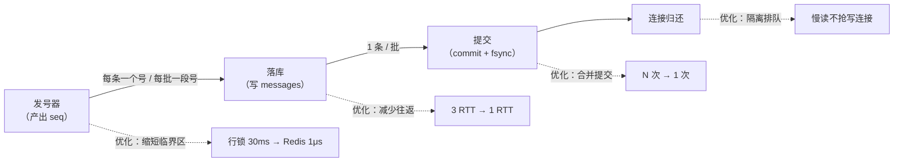
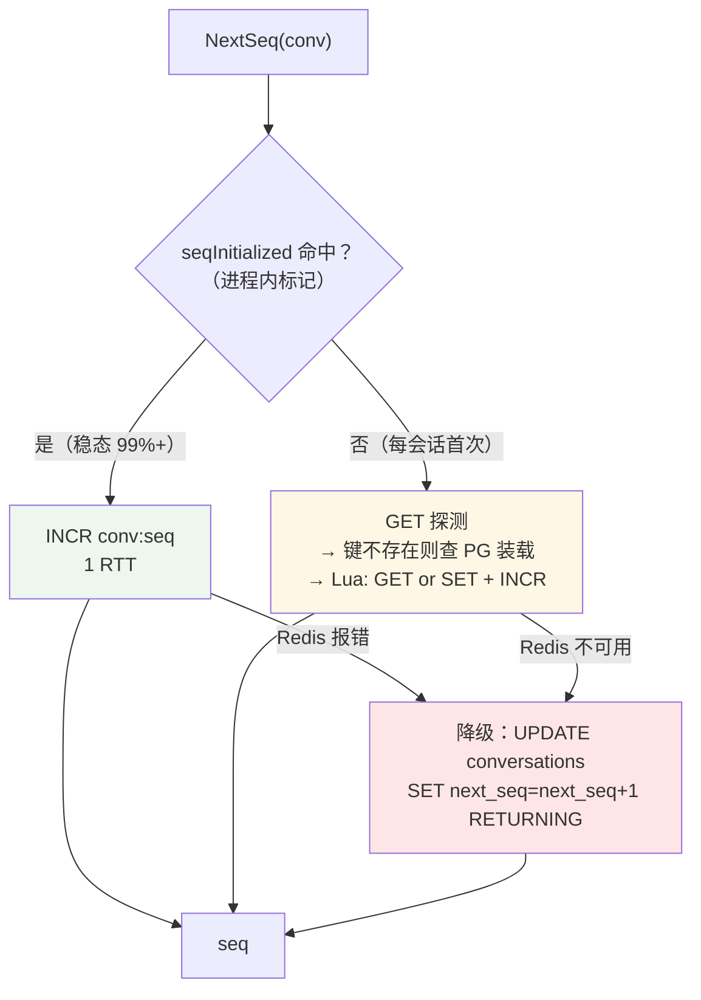

# 02 · 发号器的性能原理：临界区长度决定一切

> 本文回答三个问题：
> ① 发号器为什么能比数据库行锁快两个数量级？（**临界区长度**）
> ② 它和我们做的"去事务、批量提交、池隔离"是同一个原理吗？（**是同一个公式的四次代入，但只有一种手段能减少 fsync**）
> ③ 我们代码里的三条路径分别贵在哪、怎么把请求压在最快那条上？
>
> 读法：§1 先分清三个概念 → §2 立不变量 → §3 用"临界区"串起五种方案（含两端的底层机制）→ §4 我们代码的三条路径 → §5 统一模型 → §6 与批量的关系。
> **如果"会话 / seq / 事务 / 行锁 / 连接池"这些词还不熟，先看[前置术语表](./00-前置术语表.md)**，否则后文的推导会跟不上。

---

## 一、先纠正三个常见混淆

在讲原理之前，先把容易混在一起的三件事分开——**混在一起就会得出"发号器负责批量写库"这种错误结论**。

| 常见说法 | 实际情况 |
|---|---|
| "Redis 维护一组消息 ID" | ❌ Redis 为**每个会话**维护**一个递增计数器**（`conv:seq:{conv}`）。每次 `INCR` 返回**一个**号；批量场景用 `INCRBY n` 返回**一段号**的末值。它不是"ID 池"，也没有预生成一批 ID。 |
| "发号器把几十条消息包成一个事务提交" | ❌ 发号器**只管发号**，一次调用产出一个号（或一段号）。"把几十条写进一次提交"是**批量写入**（另一个方向），两者靠 `INCRBY` 结合，但职责不同。 |
| "发号器改造省掉了多次 fsync" | ❌ **一次 fsync 都没省**。改造前后都是"每条消息一个事务、一次提交、一次 fsync"。它省的是**行锁等待**。真正减少 fsync 的是**批量把 N 条合并成一条语句**。 |

三者的正确关系：



**四个箭头是四个不同的杠杆，作用在四个不同的环节上。** 它们共用一个公式（§5），但机制完全不同。

---

## 二、发号器要满足什么（自由度从哪来）

| # | 不变量 | 是否必须 | 为什么 |
|---|---|---|---|
| 1 | 会话内**单调递增** | ✅ | `/user/sync?since=seq` 用游标补拉，回退会漏消息 |
| 2 | 会话内**唯一** | ✅ | 同 seq 对应多条 → 客户端按 seq 去重会丢 |
| 3 | 连续无洞 | ❌ | 补拉是 `seq > since`，洞不影响正确性 |
| 4 | 跨会话全局唯一 | ❌ | seq 只在会话内被消费 |
| 5 | 与发送时间严格一致 | ❌ | 并发下"谁先发"本就无定义 |
| 6 | 崩溃后不回退 | ⚠️ | 回退会重号 → 靠"装载 + 余量 + 唯一索引"兜 |

**这张表是全部优化的自由度来源。** 只要守住 1、2、6，3/4/5 都可以放弃——而放弃它们，才允许"跳号""多副本各发各的""号段预取"这些手段存在。

> 反例：如果业务要求"严格连续"，那发号就必须串行 + 不能失败，吞吐必然被卡死。**发号器的性能上限，首先由业务不变量决定，其次才是技术选型。**

---

## 三、五种方案，一条主线：临界区有多长

不要按"用了什么存储"去记这五种方案，按**"同一会话的并发被串行在多长的临界区上"**去记，就一目了然：

| 方案 | 临界区（同会话串行的范围） | 临界区长度 | 单会话上限 | 有 fsync 在关键路径吗 | 有行锁吗 |
|---|---|---|---|---|---|
| **DB 行锁** `UPDATE ... RETURNING` | 整个事务（含提交） | **~30 ms** | **~33/s** | ✅ 有 | ✅ 有 |
| **DB 序列** `nextval` | 一次序列页更新 | ~10 μs | 很高 | ❌ 无（预写批量） | ❌ 无（页锁） |
| **号段预取** | 每 N 个一次事务 | 30 ms / N | 很高 | ✅ 每段一次 | ✅ 每段一次 |
| **Redis INCR** | 一条命令的执行 | **~1 μs** | **数十万/s** | ❌ 无（AOF 在后台） | ❌ 无（单线程） |
| **雪花 / UUIDv7** | 无（单机本地生成） | ~100 ns | 极高 | ❌ 无 | ❌ 无 |

**同一列"临界区长度"从 30 ms 到 1 μs，跨了四个数量级——这就是全部性能差异的来源。**

### 3.1 为什么行锁的临界区必然长（PG 内部机制）

> 想看"两个并发请求逐时刻的时间线、锁藏在元组头哪个字段、B 到底在等什么"，见[分册 07](./07-从行锁到Redis-消息写入全流程对比.md)——那篇用两张完整的时序图把流程走了一遍。

这一条必须讲到底层，否则会误以为"行锁慢是因为 SQL 写得不好"。

```
UPDATE conversations SET next_seq = next_seq + 1 WHERE id = $1 RETURNING next_seq
```

PG 执行它时发生的事：

1. **定位元组**：通过主键索引找到 `conversations` 里那一行；
2. **加行锁**：在元组头部的 `xmax` 字段写入当前事务 ID，并置 `HEAP_XMAX_LOCK_ONLY` 标记。**行锁不存在独立的锁表里，它就是元组头的一个字段**；
3. **排队**：后来的同会话更新发现 `xmax` 已被占用 → 进入**等待队列**，等前一个事务提交或回滚；
4. **改值**：MVCC 下 `UPDATE` 不覆盖原行，而是**写一个新版本元组**（旧版本留给 vacuum）；
5. **持锁到事务结束**：行锁的生命周期 = **事务**，不是语句。哪怕后面还有 `INSERT messages`，锁也不释放；
6. **提交**：写 commit record → **等 WAL fsync** → 唤醒等待队列里的下一个。

于是：

```
锁持有时间 ⊇ 事务时长 ⊇ 提交时的 fsync 时间
```

**这是一个包含关系：锁的临界区天然把"磁盘刷盘"包了进去。** 所以只要发号在事务里，临界区就不可能短于一次 fsync（毫秒级）。

### 3.2 数值验证：为什么拐点正好在"每会话 33 条/秒"

```
单条消息事务耗时 ≈ 30 ms（Node 时代实测）
单会话串行写容量 = 1000 ms ÷ 30 ms ≈ 33 条/秒
```

Node 基线实测：

| 场景 | 每会话速率 | 相对 33/s | 结果 |
|---|---|---|---|
| r15 | 30/s | 91% | ✅ 零错误，RTT p99 58 ms |
| r20 | 40/s | 121% | ❌ 7.6% 失败，RTT p99 **2041 ms** |
| r30 | 60/s | 182% | ❌ 79.9% 失败 |

**公式与实测严丝合缝**：拐点不是玄学，是"1 秒 ÷ 事务时长 × 会话数"。

### 3.3 为什么 Redis INCR 的临界区只有 1 μs（Redis 内部机制）

Redis 的执行模型：

```
epoll_wait 返回可读 → read() 读到输入缓冲 → 解析 RESP 协议
→ 查命令表 dispatch（"INCR" → incrDecrCommand）
→ 在 dict 里查 key → 取 robj → 转成 long long → +1 → 写回 robj
→ 把回复写进输出缓冲 → 事件循环继续处理下一个客户端
```

关键性质：

| 性质 | 效果 |
|---|---|
| **单线程执行命令**（Redis 7 的 IO 线程只做网络读写，命令仍串行） | **不需要锁**——串行本身就是互斥 |
| **纯内存操作** | 没有磁盘 IO，没有 fsync |
| **O(1)** | 哈希表查找 + 整数加法，与数据量无关 |
| **AOF 在后台**（默认 `everysec`） | 持久化不在命令的关键路径上 |

所以：

```
临界区 = 一条命令的执行时间 ≈ 1 μs
```

对比行锁的 30 ms，**差 4 个数量级**。

### 3.4 但要小心：临界区缩到 1 μs 后，瓶颈换了

发号器自己变快了，不代表端到端变快。因为**你要等 Redis 的回复**：

```
INCR 的端到端耗时 = 网络往返（0.2–0.5 ms） + 命令执行（1 μs）
                   ≈ RTT（命令执行可忽略）
```

**所以 Redis 发号的真实成本是"一次 RTT"，不是"1 μs"。** 这也解释了为什么后面还要用 `INCRBY`（§6）——不是让单条更快，而是**减少往返次数**。

> 这是本文最容易被跳过的一步：**临界区长度决定"能并发多少"，RTT 决定"每条要等多久"。两者是不同的瓶颈，优化手段也不同。**

---

## 四、我们代码的三条路径：成本差 3 倍

`biz/internal/service/seq.go` 里有三条路径，性能设计的目标就是"把 100% 的请求压在最快那条上"。



| 路径 | 代价 | 触发条件 | 稳态占比 |
|---|---|---|---|
| **快路径** | **1 RTT**（1 条命令） | `seqInitialized` 命中 | 99%+ |
| **冷路径** | **3 RTT**（GET + PG 查询 + Lua） | 每会话首次；Redis 丢键后 | 每会话 1 次 |
| **降级** | **1 RTT + 行锁 + 事务** | Redis 不可用 | 0（故障时 100%） |

### 4.1 快路径为什么能省掉 GET

`seqInitialized` 是**进程内**的"这个会话的键已经存在"标记（`seq.go:90`）。

- 命中 → 直接 `INCR`，省掉"先 `GET` 判断键是否存在"的那一跳；
- 不命中 → `nextSeqWith` 里先 `GET`，键不存在才去 PG 装载初值，再走 Lua 原子「SET + INCR」。

**代价**：多副本各存一份，所以每个副本对该会话的第一次都会走一次冷路径（可接受）；且这个 `sync.Map` **无容量护栏**，会随会话数增长（见[问题清单](../../问题分析/00-问题清单与索引.md)候选）。

### 4.2 冷路径为什么需要 3 跳

因为"键不存在时该从哪个值开始"必须问 PG：

```sql
SELECT GREATEST(c.next_seq, COALESCE(max(m.seq), 0)) FROM conversations c ...
```

这一步**不能省**：省了就会从 1 开始发号，与已入库的 seq 重叠。它只在键缺失时发生，所以频率极低。

### 4.3 降级路径为什么危险

Redis 故障时，所有请求回落到 `UPDATE conversations ... RETURNING`——**每会话重新变成 33/s、且每条占一个事务**。在 2800 msg/s 下这是灾难性降级。

**所以降级必须配熔断/限流**：故障时优先保"一部分消息能发"，而不是"所有消息都排队等行锁"。

---

## 五、统一模型：四种优化是同一个公式的四次代入

现在回答"它们是不是共通的原理"。

### 5.1 一个公式

系统里任何一个**串行点**（一次只能服务一个请求的资源），吞吐上限都是：

```
吞吐上限 = 该资源的并行度 / 每条消息占用该资源的时间
```

不同优化，就是把公式里的不同变量改小，或者把 N 条合并成 1 次：

| 串行点 | 并行度 | 每条消息占用 | 优化手段 | 结果 |
|---|---|---|---|---|
| **会话行锁** | 1 | 事务全程 **30 ms** | **发号器改造**（把临界区换成 Redis 的 1 μs） | 单会话 33/s → 数千/s |
| **连接池** | 32 | **3 个 RTT ≈ 9 ms** | **去显式事务**（3 RTT → 1 RTT） | 理论上限 4,129 → 10,323 |
| **WAL fsync** | 1（单盘队列） | 1 次提交 ≈ 3 ms | **批量提交**（N 次 → 1 次） | 单条成本 F/N + c |
| **写连接被慢读占用** | 32 | 1.8 s（无 limit 的读） | **池隔离 / 读端点分页** | 慢读不再抢写连接 |
| **Redis 单线程** | 1 | 1 μs 命令执行 | 目前不需要优化 | 上限 ~10 万 ops/s |

### 5.2 四种手段，作用点不同

| 手段 | 作用点 | 减少 fsync 吗 | 减少往返吗 | 缩短连接占用吗 |
|---|---|---|---|---|
| **缩短临界区**（发号器） | 行锁等待 | ❌ 完全不变 | ⚠️ 少一条 UPDATE 语句 | ✅ 间接（不再等锁） |
| **减少往返**（去事务） | 协议消息 | ❌ 不变 | ✅ 3 → 1 | ✅ 2/3 |
| **合并提交**（批量） | commit 次数 | ✅ **N → 1** | ✅ 1 条语句 | ✅ 1/N |
| **隔离排队**（池） | 资源分配 | ❌ | ❌ | ✅（不让慢的占住） |

**所以你的判断"共通原理"是对的，但"省掉多次 fsync"这一条只属于批量，不属于发号器。**

一句话记忆：

> **发号器治"锁"，去事务治"往返"，批量治"fsync"，池隔离治"抢"。四者共用 `吞吐 = 并行度 / 占用时间` 这一个公式。**

### 5.3 为什么它们不能互相替代

| 只做这个 | 会发生什么 |
|---|---|
| 只改发号器 | 行锁没了，但每条消息仍是 3 RTT + 1 次 fsync → 瓶颈变成连接池（**这正是我们经历的 2961 ms**） |
| 只去事务 | 往返少了，但每条仍占用一次 fsync + 池 → 2.5× 后就到顶 |
| 只做批量 | 提交少了，但如果还有行锁，批内仍会被串行化；如果没有唯一索引，批量会放大重号 |
| 只做池隔离 | 慢读不抢了，但写入本身的成本没变 |

**它们是串联的：上一环的瓶颈解除后，下一环才会暴露。** 这就是[收益排名](./03-性能优化收益排名.md)里"倍率不能相乘"的物理原因。

---

## 六、与批量写入的关系：`INCRBY` 是"接口"，不是"批量"

这是用户最容易误解的一处，单独讲。

### 6.1 发号器不负责批量，只负责"一次给一段"

批量写入（[分册 05](../../05-组提交批量写入.md)）的实现方式是：

```go
// writer 每攒一批（64 条或 2 ms），对每个会话调一次：
end := INCRBY conv:seq:{conv} 64        // 返回号段末值
// 该会话这一批的 n 条消息，按到达序依次拿 end-n+1 … end
```

- 号段内**按到达顺序分配**，天然保序；
- Redis 往返从"每消息 1 次"降到"每批每会话 1 次"；
- 但**发号仍然是"分配序号"这件事**，写库、提交、fsync 都是批量层的事。

### 6.2 批量不是"显式事务包 N 条语句"

| 写法 | 语句数 | commit 数 | 往返 | 原子性 |
|---|---|---|---|---|
| 显式事务包 32 条 INSERT | 32 | 1 | 2+32 | ✅ |
| **一条多值 INSERT（unnest）** | **1** | **1** | **1** | ✅（单语句原子） |

批量写入选的是后者：**把 32 条变成 1 条语句**。它不需要显式事务，因为单条语句本身就是原子的。

> 这也是"去事务"能成立的前提：**能合并成一条语句时，事务就没有存在的必要**；只有"多条语句必须原子"时才需要事务。

### 6.3 三者的正确组合

```
发号器：     INCRBY n（一次给一段号）           ← 治锁 + 少往返
批量写入：   一条多值 INSERT（N 条合成 1 条）    ← 治 fsync
去事务：     不为这批开 BEGIN/COMMIT            ← 治往返
池隔离：     writer 专属小池                     ← 治抢
```

四件事在**同一个 batch flush 里同时发生**，但它们各自解决不同的问题，缺一不可。

---

## 七、那个 bug：为什么它既是正确性问题、又是性能问题

`seq.go:69-76` 的误判链条：

```
INCR 得到 101 → 与进程内共享的 last(102) 比较 → 101 > 102 为假
→ 判定"键被重建" → DEL 键 → seqInitialized 删除
→ 回冷路径：GET → 查 PG 的 GREATEST(...) → 从偏小的值重新装载
```

**性能代价**（每次误判）：

| 额外动作 | 成本 |
|---|---|
| `DEL` | 1 RTT |
| `GET`（冷路径探测） | 1 RTT |
| `SELECT GREATEST(next_seq, max(seq))` | **1 次 PG 查询（占池！）** |
| 后续该会话请求退回双 RTT 慢路径 | 每次 +1 RTT |

V3 实测误判 **170,415 次** → 17 万次额外的池占用查询，在 2800 msg/s 的临界点上足以压垮连接池。

**正确性代价**：一次误判会让号段回退到"已入库最大值"，与在途消息重叠，**一次误判产生一整串重号**（不是一对一）。这解释了为什么 17 万次误判会造成 19.9 万组重复。

> 修复方式见[分册 01](../../01-seq发号器并发缺陷修复.md)。这里只强调：**它把 100% 的请求从"1 RTT"打回"3 RTT + 1 次 PG 查询"，是"性能优化前的必须先修的正确性缺陷"。**

---

## 八、还能怎么优化（按收益归属排序）

| 手段 | 省什么 | 归属 | 建议 |
|---|---|---|---|
| **`INCRBY n`** | 批内 n 次 Redis 往返 → 1 次 | 发号器 + 批量 | ✅ 批量上线时一起做 |
| **合并 Lua**（限流+幂等+发号） | 2 次 Redis 往返（限流、幂等） | 发号器旁路 | ✅ 但不省发号本身 |
| **本地号段缓存**（每次取 100 个在内存发） | 99% 的 Redis 往返 | 发号器 | ❌ 不推荐：破坏顺序、崩溃丢段、多副本浪费；且 1 RTT 只占全链路 1/9 |
| **AOF** | ——（不是性能） | 可靠性 | 需要时开，`everysec` 对性能影响小 |
| **降级熔断** | 防止 Redis 故障时打爆 PG | 稳定性 | ✅ 必须有 |

**为什么"本地号段"不推荐**：它省的是 RTT，但 1 RTT 在 9 次总往返里只占 1/9；代价是"同会话顺序不再由 Redis 保证"，而顺序是 `/sync` 契约的基础。**收益小、风险大。**

---

## 九、坑点

### 坑 1：把"原子"当成"事务"

`INCR` 是原子命令，不是事务。它保证这一条不被打断，但不保证"取号 + 落库"的原子性。所以取号后落库失败会**跳号**——这是设计上接受的（不变量 3 允许洞）。

### 坑 2：多副本的进程内标记不一致

`seqInitialized` 每个副本一份。A 认为键存在、B 认为不存在 → B 会多走一次冷路径（多 2 RTT + 1 次 PG 查询），**不会取错号**（Lua 原子）。这是性能抖动，不是正确性问题。

### 坑 3：`max(seq)` 看不到在途事务

键丢失时按 `max(seq)` 装载会偏小——因为只统计已提交的行。这就是"装载 + 安全余量"存在的理由（[方向 A](../../01-seq发号器并发缺陷修复.md)）。

### 坑 4：降级路径没有熔断

Redis 一挂，全部请求走行锁，等于把系统打回 Node 时代的 33/s。必须配熔断/限流。

### 坑 5：`INCRBY` 返回的是末值

`INCRBY key n` 返回**自增后的值**（号段末尾），不是起始值。分配时要倒推 `end-n+1 … end`，写错就整体偏移 n。

### 坑 6：Lua 里的 `SET init` 不能省

省掉后 Redis 重启会从 1 开始发号——**静默重号**。初值必须来自"装载 + 余量"。

---

## 十、怎么测量

```bash
# 1) 单命令往返（含网络）
redis-cli --latency -h 127.0.0.1 -p 6379

# 2) 无 pipeline 吞吐
redis-benchmark -t incr -n 100000 -c 50 -q

# 3) 应用侧：按路径分桶的直方图（建议新增）
#    seq_alloc_duration_seconds{path="fast|slow|degraded"}
```

```sql
-- 4) 降级路径是否被触发：conversations 的 UPDATE 应只有 checkpoint
SELECT query, calls FROM pg_stat_statements
WHERE query LIKE 'UPDATE conversations SET next_seq%' ORDER BY calls DESC;
```

| 指标 | 健康值 | 异常含义 |
|---|---|---|
| 快路径占比 | > 99.9% | 低 → 误判/键丢失仍在发生 |
| `seq_alloc_duration` p99 | < 1 ms | 高 → Redis 抖动或走了降级 |
| 降级路径 QPS | 0 | > 0 → Redis 不可用 |
| `conversations` UPDATE | ≈ 0（只有 checkpoint） | 激增 → 降级 |

---

## 十一、小结

| 问题 | 答案 |
|---|---|
| 发号器为什么快 | 临界区从"整个事务（30 ms，含 fsync）"缩到"一条命令（1 μs）" |
| 快多少 | 临界区差 4 个数量级；端到端受 RTT 限制，差 2–5 倍 |
| 它和去事务/批量是同一原理吗 | 是同一个公式（吞吐 = 并行度 ÷ 占用时间），但作用在**四个不同的串行点**上 |
| 它减少 fsync 吗 | **不减少**。减少 fsync 的是批量合并提交 |
| Redis 存的是一组 id 吗 | 不是。每会话一个计数器，`INCR` 给一个号，`INCRBY n` 给一段号 |
| 批量是怎么和发号器配合的 | writer 每批对每个会话调一次 `INCRBY n`，号段内按到达序分配 |
| 我们最该做什么 | 先修误判 `Del`（它把请求打回冷路径），再在批量里用 `INCRBY` |
