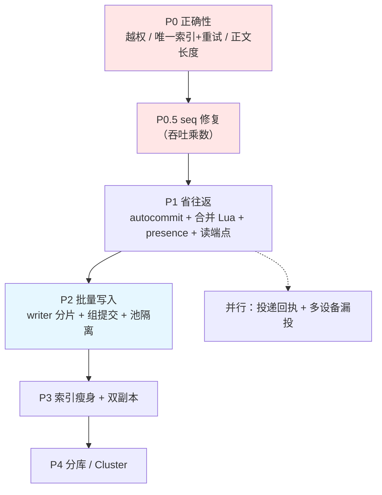
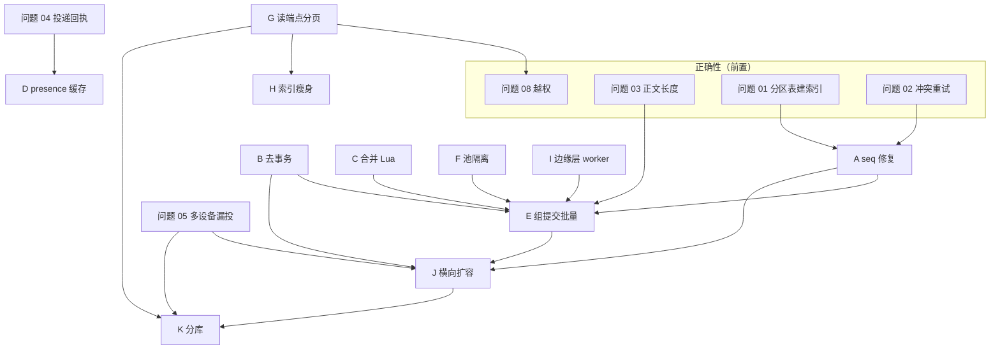

# 03 · 性能优化收益排名：从已完成的 10 项到待实施的 11 项

> 本文做两件事：**① 盘点这个项目历史上真正生效的性能优化，按实测幅度排名；② 把待实施的优化按预期幅度排名。**
> 排名口径很重要——**吞吐、延迟、稳定性是三种不同的"幅度"**，混在一起排会得出错误结论。

---

## 一、先说口径：三种幅度不能混排

| 口径 | 单位 | 能互相比较吗 | 典型代表 |
|---|---|---|---|
| **吞吐** | msg/s（倍率） | ✅ 可以 | 批量写入、去事务 |
| **延迟** | p50/p99（ms） | ✅ 可以 | 合并 Lua、presence |
| **稳定性/正确性** | 是否可用（0/1） | ❌ 不能用倍率 | 唯一索引、越权修复、投递回执 |
| **作用域** | 系统级 / 端点级 / 单操作 | ⚠️ **不能跨作用域比** | 558× 是端点级，不是系统级 |

> 最容易犯的错：拿"`/user/messages` 提升 558 倍"去和"批量写入提升 5 倍"比。前者只影响一个端点，后者影响整条写入链路。**本文的排名统一用"系统级单副本吞吐倍率"，其他维度单列。**

---

## 二、已完成的优化：按实测幅度排名

数据来自当时的同轮 A/B 与提交信息，**跨轮不可直接比较**（环境曾从 4 vCPU 变成 12 vCPU，见[压测环境说明](../../../../../监测设施/测试报告/压测环境与机器资源.md)）。

| 排名 | 优化 | 实测幅度 | 作用域 | 证据 |
|---|---|---|---|---|
| **1** | **[热路径四级进程内缓存](./04-四级进程内缓存原理.md)**（会话 / 关系行 / 幂等 / seq 初始化） | **PG 写入压力 ↓4×**；tp_r25 p99 **2961→156 ms（19×）**；tp_r30 错误率 **79.9%→0%** | 系统级 | 提交 `b7da24b` |
| **2** | **发号器：DB 行锁 → Redis INCR** | **单会话上限 33/s → 数千/s（约 100×）**；系统级 1500–2000 → 2800+（**混因，不可单独归因**） | 单会话结构 + 系统 | 提交 `f2d4a2e`；Node 时代分析见 `docs/性能优化/DB/DB性能瓶颈分析与优化方案.md` §三 |
| **3** | **[群扇出批量 PUBLISH](./05-群扇出批量PUBLISH原理.md)** | 扇出 span p99 **111→2 ms（55×）** | 单操作 | 提交 `6ee24d2` |
| **4** | **`messages` 哈希 64 分区** | `lastMessages` **11×**；等值查询裁剪到单分区 | 端点级 + 系统级（索引更矮） | 提交 `9de18bc`、`618e435` |
| **5** | **定向下行替代 pub/sub 广播** | fallback 占比 **99.65%→0.0002%**；下行成本从 O(网关副本数) 降到 O(1) | 系统级（下行） | 提交 `3306cf4`、`39a5499` |
| **6** | **`/user/messages` 游标分页** | 同端点 **7→3,964 rps（558×）** | **端点级**（不影响 WS 链路） | V3 报告 §七 |
| **7** | **读写分离（RO 池）** | 25 处纯读切池；未单独量化（作用是"读不挤占写池"） | 混合负载 | 提交 `7d95bf6` |
| **8** | **会话热点限流** | 防雪崩（非吞吐）：单会话超 500/s 直接拒绝 | 稳定性 | 提交 `45a10af` |
| **9** | **`json.Valid` 替代全量解析 + 1 MB 流控窗口** | 每帧省一次 `any` 树分配 | 单操作（CPU） | 提交 `47f6736` |
| **10** | **Node → Go 重写** | **未带来吞吐提升**（当时的结论就是"Go 优化完仍不比纯 Node 强"） | — | 提交 `524d043` 的报告标题 |

> **第 2 名为什么排在这里、又为什么只能给"混因"的倍数**：它不是"某条 SQL 变快"，而是**移除了一个结构性上限**（详见 §2.2）。单会话维度能干净归因（33 → 数千），系统维度不能——因为瓶颈被搬到了连接池，后续吞吐由池决定，任何系统级数字都混入了 Go 重写、缓存、gRPC 的贡献。

### 2.1 这张表里最重要的三件事

**① 最大的收益来自"减少数据库交互次数"，不是"换更快的语言"。**

第 1 名（四级缓存）和第 10 名（Go 重写）是绝妙对照：

```
Go 重写：单次交互更快（语言层），但交互次数没变 → 吞吐没变
四级缓存：单次交互不变，但交互次数减少 4 倍 → 吞吐大幅提升
```

这与当前的结论完全一致：**`q_per_msg`（每消息的数据库语句数）才是核心变量**。

**② 端点级优化不能当系统级收益。**

第 6 名的 558× 很亮眼，但它只影响 `/user/messages` 一个端点。在纯 WS 压测里，这个优化**贡献为 0**。它的真正价值是"混合负载下不再吃 41% 的池"。

**③ 分区不是性能优化，是维护性优化。**

第 4 名的 "lastMessages 11×" 来自"查询能裁剪到单分区"，而**不是**"写入变快了"。V3 数据也印证：2800 msg/s 的拐点没有因为分区而右移。分区真正买的是：DDL 粒度、vacuum 粒度、冷热分层能力。

### 2.2 补记：发号器改造为什么是"解除上限"，而不是"提高速度"

这一项之前被并进"Go 重写"里没单列，但它其实是**历史上唯一一次"把结构性瓶颈搬走"的改造**，值得单独讲清楚。

**改造前（Node 时代）**：`UPDATE conversations SET next_seq = next_seq + 1 RETURNING` 放在消息事务里。

```
临界区 = BEGIN ... UPDATE ... INSERT ... COMMIT
       = 整个事务（含 fsync）≈ 30 ms
→ 同一会话的写被强制串行：单会话上限 ≈ 1000 / 30 ≈ 33 条/秒
→ 拐点 = 33 × 会话数，且是"断崖"形态（一到就排队）
```

Node 基线实测完全吻合：r15（每会话 30/s）零错误，r20（每会话 40/s）直接 7.6% 失败、RTT 从 58 ms 跳到 2041 ms。

**改造后（Redis INCR）**：临界区变成"Redis 事件循环里处理一条命令"（~1 μs）。

```
单会话上限：33/s → 数千/s（两个数量级）
系统形态：从"每会话断崖"变成"全局池排队"（软排队，不是断崖）
```

**为什么系统级只能给"混因"的倍数**：因为它把瓶颈从"会话行锁"搬到了"连接池"。

```
改造前：瓶颈 = 会话行锁（1500–2000 msg/s 断崖）
改造后：瓶颈 = 连接池 32（2800 msg/s 软排队）   ← 换了瓶颈，不是消失了
```

所以系统级从 1500–2000 涨到 2800（约 1.4–1.9×），但这一截里混着 Go 重写、四级缓存、gRPC 流三项改动，**无法把功劳单独切给发号器**。能干净归因的只有"单会话维度"那两个数量级。

> **这也是本文最重要的一个区分**：**解除瓶颈 ≠ 提高吞吐**。解除一个瓶颈后，吞吐只会涨到"下一个瓶颈"为止。发号器的价值在于它把"每会话 33/s 的硬顶"和"断崖式失败"去掉了——至于系统最终能跑多少，取决于下一个瓶颈（池）有多宽。

### 2.3 补记：另外三项被并入其他条目的已完成优化

这三项当时都算在"Go 重写/改造"那一批里，没单列，但**每一项都有独立的实测证据**，按幅度其实能进前三：

| # | 优化 | 实测幅度 | 性质 | 证据 |
|---|---|---|---|---|
| **补 1** | **gRPC 双向流 + 并发上行**（替代 HTTP-per-message） | S1 错误率 **12.8%→0**；RTT p99 **209→63 ms**；`upstream_error` **10,341→0**；TIME_WAIT 峰值 **14,922→785**；网关 CPU **−40~55%** | **能力建设**：把"每消息一次 POST + 每连接串行"变成"流上并发" | 提交 `194fee2`；`26-9-16-grpc流改造/优化项与归因.md` §2 |
| **补 2** | **驱动从 Prisma 换成 pgx** | Prisma 每语句约 **1 ms** 引擎开销 → pgx 为薄驱动（无 ORM 层） | 单语句固定成本 | `26-9-17` 轮 §1.2、`docs/性能优化/DB/` §二 根因 C |
| **补 3** | **gRPC keepalive 匹配修复** | 消除 **90 s 周期 GOAWAY 断连**；`kill` 演练零失败 | 稳定性（长稳吞吐的前提） | 提交 `3306cf4` |

**为什么它们没进主表**：

- 补 1 的收益主要在**错误率与延迟**，不在稳态吞吐（稳态吞吐仍被 DB 卡住）；
- 补 2 是"Go 重写"的一部分，单列会把功劳重复计算；
- 补 3 是纯稳定性，没有"倍率"。

> 但它们都是**后面所有优化的前提**：没有并发上行，网关根本喂不到 2800 msg/s；没有 keepalive 修复，1 万连接长稳跑不到结束。**这类"能力建设"型优化的特点是：不给倍率，但不做就上不了量级。**

---

## 三、待实施的优化：按系统级单副本吞吐排名

| 排名 | 优化 | 预期倍率 | 依据（模型） | 见 |
|---|---|---|---|---|
| **1** | **组提交批量写入（E）** | **相对 P1 后 2.1–2.9×**；相对现状累计 **5–7×** | 池占用 3.1 ms → 0.125 ms/条，瓶颈迁到 CPU | [分册 05](../../05-组提交批量写入.md) |
| **2** | **去显式事务（B）** | **2.5×** | `q_per_msg` 2.5 → 1.0 | [分册 02](../../02-落库去显式事务.md) |
| **3** | **读端点止血（G）** | **混合负载 1.4–1.7×**；纯 WS 场景 **1.0×** | 释放被无 limit 请求吃掉的 41% 池 | [分册 07](../../07-读端点分页与慢查询治理.md) |
| **4** | **索引瘦身（H）** | **1.1–1.2×** | 单语句 3.1 → 2.6 ms（少 2 个索引） | [分册 08](../../08-索引瘦身与序列优化.md) |
| **5** | **seq 修复（A）** | **1.1–1.2×** + 正确性 | 去掉误判带来的 `max(seq)` 查询与慢路径 | [分册 01](../../01-seq发号器并发缺陷修复.md) |

> **别把"seq 修复（A）"和 §2.2 的"发号器改造"混淆**：
> - **发号器改造（已完成）**＝把发号从数据库行锁搬到 Redis（架构层，一次性的两个数量级）；
> - **seq 修复（待实施）**＝修掉 Redis 版实现里那个 `seq > last → Del(key)` 的并发误判（正确性 + 1.1×）。
> 前者解决"每次取号要多久"，后者解决"取号会不会重"。**两个都要做，但不是同一件事。**
| **6** | **合并 Lua（C）** | 吞吐 **≈1.0×**；p50 **-1~2 ms** | 省 2 次 Redis RTT，不占 PG 池 | [分册 03](../../03-发号幂等限流合并Lua.md) |
| **7** | **presence 优化（D）** | 吞吐 **≈1.0×**；p50 **-1 ms** | 同上 | [分册 04](../../04-presence定向下行定位优化.md) |
| **8** | **池隔离（F）** | 吞吐 **1.0×**（混合负载稳定性） | 隔离排队结构，不增加容量 | [分册 06](../../06-读写连接池隔离.md) |
| **9** | **边缘层（I）** | 吞吐 **1.0×**（CPU/稳定性） | 有界 worker + 流写入串行化 | [分册 09](../../09-边缘层背压与流写入串行化.md) |
| **10** | **横向扩容（J）** | **× 副本数**（当前配置最多 2 副本 ≈ 1.85×） | 无状态横向扩，受 `max_connections=100` 限制 | [分册 10](../../10-横向扩容与连接池代理.md) |
| **11** | **分库（K）** | **× 实例数**（结构性） | 突破单实例 WAL 上限 | [分册 11](../../11-分库分片与Redis集群.md) |

### 3.1 为什么 C/D/F/I 排得这么低

因为它们**不改变系统的容量上限**，只改变"使用体验"：

| 优化 | 真实收益 | 为什么不是吞吐 |
|---|---|---|
| C 合并 Lua | p50 少 1–2 ms | Redis 往返不占用 PG 连接池，池的上限没变 |
| D presence | p50 少 1 ms | 同上 |
| F 池隔离 | 慢读不再拖累写 | 总容量不变，只是"分配得更合理" |
| I 边缘层 | goroutine 不再暴涨 | CPU 略降，但不改变 DB 瓶颈 |

**这不是说它们不重要**——在高负载下，p50 从 25 ms 降到 15 ms 对用户体验是实打实的。只是**不能拿它们当"扩容手段"**。

### 3.2 为什么 A（seq 修复）不是第一名

它不直接提升容量，但它是**其他优化的前提**：

```
不修 A → 误判持续 → 17 万次额外 PG 查询 → 池更容易满
      → 批量写入会把乱序窗口放大 → 重号更多
```

所以它是"**乘数**"而不是"**加数**"：单独看 1.1×，但它决定其他优化能不能安全叠加。

---

## 四、叠加曲线：为什么倍率不能相乘

这是最容易出错的地方。

### 4.1 B 与 E 是"替换"，不是"叠加"

```
B（去事务）：  BEGIN + INSERT + COMMIT  →  INSERT
E（批量）  ：  N × INSERT               →  1 × 多值 INSERT
```

**E 的多值 INSERT 本身就要求 B 的单语句写法**。所以：

- ✅ 正确理解：现状 → B（2.5×）→ E（在 B 基础上再 2.1–2.9×）
- ❌ 错误理解：2.5 × 5 = 12.5×（把 E 的"相对 B 的 3–7×"当成"相对现状"）

### 4.2 阶段曲线（单副本）

| 阶段 | 组成 | `q_per_msg` | 预期 msg/s | 相对现状 |
|---|---|---|---|---|
| 现状 | — | 2.5 | **2,800** | 1× |
| P0 | A | 2.2 | ~3,100 | 1.1× |
| P1 | A + B + C + D + G | 1.0 | **~7,000** | 2.5× |
| P2 | + E（批量） | ~0.03 | **15,000–20,000** | 5.4–7.1× |
| P3 | + H + J（2 副本） | ~0.03 | **30,000–40,000** | 10–14× |


### 4.3 三个"不能相乘"的原因

| 原因 | 例子 |
|---|---|
| **包含关系** | E 包含 B 的效果（批量的多值 INSERT 也是单语句） |
| **负载形态依赖** | G 只在混合负载生效（纯 WS 压测里为 0） |
| **资源换位** | P1 之后瓶颈从"池"变成"CPU"，再用"减池占用"的手段就没用了，必须换手段（加副本/降 CPU） |

---

## 五、按延迟排名（另一条轴）

| 排名 | 优化 | p50 改善 | 机制 |
|---|---|---|---|
| 1 | B 去事务 | **-2 个 RTT（约 -6 ms）** | 少 BEGIN/COMMIT 两次往返 |
| 2 | E 批量 | **从 25 ms 降到 5–7 ms** | 排队消失（但引入 ≤2 ms 批窗口） |
| 3 | C 合并 Lua | -1~2 ms | 3 次 Redis → 1 次 |
| 4 | D presence | -1 ms | 2 次 Redis → 1 次 |
| 5 | A seq 修复 | 消除偶发秒级抖动 | 误判导致的慢路径消失 |

> 注意：**E 的 p50 是"降"的，但 p999 可能因为批窗口略升**。这是吞吐与尾延迟的经典取舍，要按业务容忍度选窗口大小。

---

## 六、按稳定性/正确性排名（不能用倍率）

这几项没有"提升百分比"，但风险等级最高：

| 优先级 | 项 | 不做的后果 |
|---|---|---|
| **P0** | **越权读取修复**（[问题 08](../../问题分析/08-读接口缺成员授权.md)） | 任意登录用户可读任意会话（隐私事故） |
| **P0** | **唯一索引 + 冲突重试**（[问题 02](../../问题分析/02-唯一索引缺冲突重试.md)） | 重号无法拦截；加了索引不重试则丢消息 |
| **P0** | **正文长度校验**（[问题 03](../../问题分析/03-消息正文长度未校验.md)） | 1 MB 消息 × 群扇出 = 资源放大 |
| **P1** | **投递回执**（[问题 04](../../问题分析/04-定向下行缺投递回执.md)） | 漏投无法感知 |
| **P1** | **多设备跨网关漏投**（[问题 05](../../问题分析/05-多设备跨网关漏投.md)） | 多端不同步 |
| **P1** | **边缘层并发 `SendMsg`**（[分册 09](../../09-边缘层背压与流写入串行化.md)） | 偶发写流失败 → 昂贵的 pub/sub 兜底 |

---

## 七、三个反直觉结论

### 7.1 "换语言"不是性能优化

历史数据：Node → Go 重写后，吞吐**没有本质提升**（当时的报告标题就是"为什么 Go 优化完仍不比纯 Node 强"）。真正让 tp_r30 从 79.9% 错误变成 0% 的，是"四级进程内缓存"——**减少数据库交互次数**。

**推论**：任何"换框架/换语言/换序列化库"的方案，如果不同时减少 IO 次数，收益都不会超过 20%。

### 7.2 "加索引"和"减索引"都可能提升性能

- 加索引（唯一索引）是为了**正确性**，代价是写入慢 5–10%；
- 减索引（删冗余）是为了**写入快 10–20%**，前提是确认无消费方。

**索引不是越多越好，也不是越少越好，而是"每个索引都要有明确的消费方"。**

### 7.3 "加副本"在天花板前是万能的，在天花板后是无用的

- P2 之前：加副本线性（无状态 + 状态外置）；
- P2 之后：PG 成为共享瓶颈，加 biz 副本不再线性；
- 此时必须"分库"，而不是"继续加副本"。

**判断方法**：加一个副本后，单副本吞吐是否下降？如果下降，说明共享资源（PG）已经饱和。

---

## 八、建议执行顺序



理由：

1. **正确性先于性能**：越权与重号会掩盖性能数据（脏数据影响统计）；
2. **seq 修复是乘数**：不修它，后面的优化会被误判放大；
3. **P1 最便宜**（3–4 人日换 2.5×），先拿到确定收益；
4. **P2 是最大的一步**，但需要 P1 的地基（单语句 + 合并 Lua + 池隔离）；
5. **P3 起进入"资源换位"**：瓶颈变成 CPU/PG WAL，靠瘦身与副本。

---

## 九、依赖关系审查

> 这一节回答"**还有没有类似的依赖**"——即哪些优化单独看有效，但**跳过某个前置就会失效、甚至反向**。

### 9.1 依赖图（待实施项）



### 9.2 逐条依赖清单

| 优化 | 强前置 | 跳过前置会怎样 |
|---|---|---|
| **A seq 修复** | 问题 01（能在分区表上建唯一索引）、问题 02（冲突重试） | 没有索引 → 重号无法拦截；有索引不重试 → 撞 23505 变 500，重发再撞 → **丢消息** |
| **E 批量写入** | B（单语句）、A（唯一索引+重试）、C（每批一次 Redis）、F（writer 专属池）、I（同向背压）、**问题 03（正文长度）** | 缺 B → 每批仍要事务，收益腰斩；缺 A → 批量放大乱序，重号成倍；缺 问题 03 → 64×1 MB 毒丸批 → 整批失败 → 重发雪崩 |
| **D presence 缓存** | **问题 04（投递回执）**、问题 05（多设备） | 缓存指向旧副本 → 直发"成功"但网关查不到 → **静默丢帧且不走兜底**；没有回执你甚至不知道丢了 |
| **J 横向扩容** | E/B（把每副本连接数降下来）、**问题 05（多设备漏投）** | 3 副本 × 32 连接 > `max_connections=100` → 直接连不上；未修漏投 → 多副本一上线，多设备用户随机只收到一半 |
| **H 索引瘦身** | **G（读端点分页）** | `idx_messages_conv_ts` 唯一的消费方是 `AllMessages`；G 没做就删 → 无 limit 请求退化成全表扫 + 排序 |
| **K 分库** | G（分页）、J（扩容经验）、全局 ID 改造、问题 05 | 无分页 → 跨片全量拼接；无全局 ID → 主键冲突；无 问题 05 → 跨网关漏投更严重 |
| **问题 08 授权** | **G（分页）同批、且同一 PR 内先落分页** | 优先级上 08 是 P0（安全问题不等），但实现顺序反了会叠加两个慢查询：无 limit 的 1.8 s 上再加一次成员校验 |
| **C 合并 Lua** | A（seq 脚本的冷路径逻辑） | 先合并后修 A → 冷路径逻辑要改两遍 |

### 9.3 三类"隐藏前置"（不是优化项，但缺了没法验收）

| 隐藏前置 | 为什么是前置 | 缺了会怎样 |
|---|---|---|
| **连接池等待指标**（`db_pool_wait_seconds`） | 所有吞吐结论都在验证"池是不是瓶颈" | 只能靠外部 `pg_stat_activity` 侧证（V3 轮就是这么干的，多花了两天） |
| **Redis 命令级指标** | 验证"合并 Lua 是否生效""`DEL` 是否归零" | 优化是否生效无法归因，只能看总量 |
| **A/A 底噪与停止判据 export** | 判定"改善是否可信" | p99 底噪 32%，小于 20% 的改善会被当成收益；`STOP_*` 未 export 会静默失效 |

### 9.4 可并行 / 必须串行

| 可以并行 | 必须串行 |
|---|---|
| 问题 08（越权）与 问题 03（长度）——互不相干 | A → E（唯一索引是批量的安全网） |
| C（合并 Lua）与 B（去事务）——都在"省往返"层 | G → H（分页下线后才能真正删索引） |
| 问题 04（回执）与 问题 05（漏投）——同一批改 | G → 问题 08（先降成本再校验，避免慢上加慢） |
| D（presence）与 E（批量）——一个降延迟一个提吞吐 | B/E → J（先降连接需求再扩副本） |
| 文档与压测口径建设 | P01/P02 → A → E（正确性链） |

### 9.5 一句话结论

**排在最前面的不是"收益最大的"，而是"被最多项依赖的"**：

```
问题 01 / 02（建索引 + 重试）  ← 只被 A 依赖，但 A 被 E/J 依赖
A（seq 修复）                 ← 被 E、J 依赖
B（去事务）                   ← 被 E、J 依赖
G（读端点分页）               ← 被 08、H、K 依赖
问题 04 / 05（回执 + 漏投）    ← 被 D、J、K 依赖
```

这五项是**依赖树的根**，它们的收益不一定最大，但**跳过它们的代价最大**。

---

## 十、数据来源

| 数据 | 来源 |
|---|---|
| 四级缓存 4× / p99 2961→156 ms / 错误率 79.9%→0 | 提交 `b7da24b` |
| 发号器改造（行锁 → Redis INCR） | 提交 `f2d4a2e`；单会话 33/s 的推导见 `docs/性能优化/DB/DB性能瓶颈分析与优化方案.md` §三；实测 tp_r25 40.4%→0%、tp_r30 79.9%→0% 见 `26-9-17` 轮《优化项与归因.md》§0 |
| gRPC 流改造 12.8%→0 / p99 209→63 ms / TIME_WAIT 14922→785 | 提交 `194fee2`；`26-9-16-grpc流改造/优化项与归因.md` §2 |
| keepalive 90 s 周期 GOAWAY 修复 | 提交 `3306cf4` |
| 扇出 span p99 111→2 ms | 提交 `6ee24d2` |
| 分区后 lastMessages 11× | 提交 `618e435` |
| 定向下行 fallback 99.65%→0.0002% | `26-11-15` 报告 §九、提交 `39a5499` |
| `/user/messages` 7 → 3,964 rps | `26-11-15` 报告 §七 |
| 吞吐拐点 2,800 / 池 33 恒定 / 10.9% 重号 | `26-11-15` 报告 §四、§五、§8.1 |
| Go 重写未提升吞吐 | 提交 `524d043` 的报告 |
| 容量模型（4,129 理论 / 2,800 实测 / η=0.68） | [00 §4](../../00-消息吞吐上限分析与提升技术方案.md) |

---

## 十一、小结

| 问题 | 答案 |
|---|---|
| 历史最大的一次提升是什么 | **发号器改造**解除了"每会话 33/s + 断崖"的结构上限（单会话两个数量级）；**四级缓存**带来系统级最干净的 4× |
| 为什么发号器只能给"混因"的系统倍数 | 它把瓶颈从行锁搬到连接池——**解除瓶颈 ≠ 提高吞吐**，吞吐只涨到下一个瓶颈为止 |
| 待实施里最大的是什么 | **组提交批量写入**（累计 5–7×），其次是去显式事务（2.5×） |
| 为什么不能把倍率相乘 | B 与 E 是包含关系；G 依赖负载形态；瓶颈会迁移 |
| 哪些优化不提升吞吐 | 合并 Lua、presence、池隔离、边缘层——它们降延迟或提稳定性 |
| 还有哪些"被埋没"的已完成项 | gRPC 流改造（12.8%→0 错误）、pgx 换 Prisma、keepalive 修复——都是能力建设，不给倍率但撑起了量级 |
| 最该先做的是什么 | 不是收益最大的，而是**被最多项依赖的**：问题 01/02 → A → B → E；G → 08/H/K；问题 04/05 → D/J |
| 什么时候该加副本 | 单副本 CPU 未满但池已满时；加完要验证单副本吞吐是否下降 |
| 什么时候该分库 | 加副本不再线性、PG WAL 成为瓶颈时 |
