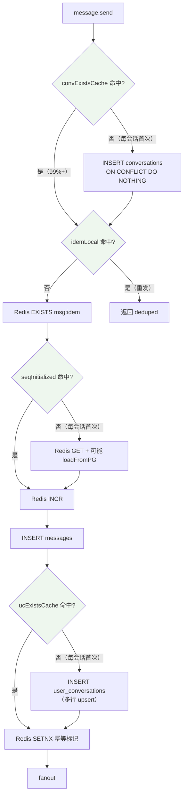

# 04 · 热路径四级进程内缓存：为什么"少写两次"能换回 19 倍

> 这是[收益排名](./03-性能优化收益排名.md)第 1 名的原理篇：它带来**PG 写入压力 ↓4×**、tp_r25 p99 **2961→156 ms**、tp_r30 错误率 **79.9%→0%**。
> 一句话：**这四级缓存缓存的不是"查询结果"，而是"已经做过的一次性事实"**——会话已建、关系行已建、幂等键已处理、seq 键已装载。它们把三类"每消息一次"的写，降成了"每会话一次"。

---

## 一、先看问题：行锁消除之后，为什么还是 2961 ms

时间线很关键，很多人以为"发号改 Redis 就完事了"：

| 阶段 | tp_r25 表现 | 瓶颈 |
|---|---|---|
| Node 时代（DB 行锁） | 40.4% 错误 / p99 2075 ms | **会话行锁**：同一会话写入被串行化 |
| 改 Redis INCR 之后 | **0% 错误**，但 p99 **2961 ms** | **换了瓶颈**：写放大 + Redis RTT |
| 加四级缓存之后 | 0% 错误 / p99 **156 ms** | 池仍有压力，但不再排队 |

第二行是最容易被忽略的：**行锁没了，错误率归零，但延迟反而更高了**（2075→2961）。原因是行锁一旦解除，请求不再被"按会话限速"，全部涌向数据库，**每消息 3 次写**的放大效应立刻显形：

```
每条消息：
  INSERT conversations ... ON CONFLICT DO NOTHING      ← 1 次写（其实只需首次）
  INSERT messages ...                                   ← 1 次写（必要）
  INSERT user_conversations ... ON CONFLICT DO NOTHING  ← 1 次写（其实只需首次）
  Redis GET conv:seq（判断键是否存在）                   ← 1 RTT（其实只需首次）
  Redis EXISTS msg:idem（幂等查询）                      ← 1 RTT（重发才需要）
```

而 tp_r25 的压测模型是"50 个会话、每会话每秒 50 条"——**消息数远大于会话数**，所以后三类写的"必要性"极低，却按消息数在放大。

---

## 二、四个缓存分别省了什么

| 缓存 | 位置 | 内容 | 省掉的动作 | 为什么能省 |
|---|---|---|---|---|
| `convExistsCache` | `message.go:52` | `convID → struct{}` | `INSERT conversations ... ON CONFLICT DO NOTHING` | 会话创建后**永不删除**，存在性是单调的 |
| `ucExistsCache` | `message.go:53` | `"uid:convID" → struct{}` | `INSERT user_conversations ... ON CONFLICT DO NOTHING` | 关系行同样是**只增不删** |
| `idemLocal` | `seq.go:155` | `幂等键 → struct{}` | `EXISTS msg:idem:...`（1 RTT） | 同一个 `clientMsgId` 处理过一次就不会再"第一次" |
| `seqInitialized` | `seq.go:90` | `convID → struct{}` | `GET conv:seq:{id}`（1 RTT） | 键装载过一次，本进程就不必再探测 |

**共同点：它们都不是"查询缓存"，而是"一次性事实的记账"。**

> 这两者差别很大：
> - **查询缓存**（如"用户 5 的昵称"）会**过期**，需要 TTL 或失效通知；
> - **一次性事实**（"这个会话我已经建过了"）**不会变回去**，所以可以永久缓存。

---

## 三、底层原理 A：为什么"幂等 upsert"可以只写一次

### 3.1 `ON CONFLICT DO NOTHING` 的语义

```sql
INSERT INTO conversations (id, conv_type) VALUES ($1, $2)
ON CONFLICT (id) DO NOTHING;
```

这条语句的语义是：

- 行不存在 → **插入**（一次真实的堆写 + 索引写 + WAL）；
- 行已存在 → **什么都不做**，但**仍然要执行一次语句**：解析、规划、唯一索引探测、事务提交（含 fsync）。

也就是说，"不做事"不等于"不花钱"。在 2800 msg/s 下，即使全部冲突，也有 2800 次"白跑"的 INSERT：

```
2800 次/秒 × (1 条 INSERT 的 WAL + 索引探测 + 事务提交) ≈ 可观的池占用与 WAL 字节
```

### 3.2 为什么"写一次"与"写 N 次"在业务上等价

因为这两类写是**状态无关的幂等操作**：

```
目标状态 = "会话存在" / "关系行存在"
写 1 次 → 达成
写 N 次 → 仍然只是"达成"
```

它们不携带任何"增量信息"（不像 `UPDATE ... SET count = count + 1`）。所以只要**第一次之后记住了结果**，后续完全可以跳过。

这正是缓存能成立的前提：**被跳过的那次写，不产生任何状态变化。**

> 反例：如果某条 SQL 是 `UPDATE conversations SET last_active = now()`，那它每次都改变状态，**不能缓存**。判断标准是"这条语句第二次执行会改变任何东西吗"。

### 3.3 命中率决定收益

设会话数为 `C`、消息数为 `M`、每会话平均消息数 `k = M / C`：

```
未缓存：写次数 = 3M
缓存后：写次数 = M（消息）+ C（会话首次）+ C（关系行首次）
         ≈ M + 2C
收益比 = 3M / (M + 2C) = 3 / (1 + 2/k)
```

`k` 越大（同一会话消息越多），收益越接近 **3×**；`k=1`（每条消息一个新会话）时收益为 0。

压测模型里 k = 每秒 50 条 × 持续数十秒，`k` 是几百量级 → 收益接近 3×，加上省掉的两类 Redis RTT，实测就是"PG 写入压力降 4 倍"。

---

## 四、底层原理 B：否定缓存为什么是安全的

四个缓存都是**只记录"已存在/已处理"**，从不记录"不存在"。这个不对称非常关键：

| 缓存类型 | 记录什么 | 命中后的动作 | 风险 |
|---|---|---|---|
| **肯定缓存**（positive） | "存在" | 跳过写 | 若实际被删 → **数据丢失** |
| **否定缓存**（negative） | "不存在" | 直接返回空 | 若实际已创建 → **读不到数据** |

当前四个都是**肯定缓存**：命中意味着"我之前确实做成过这件事"，所以跳过是安全的。

### 4.1 唯一的失效风险：删除路径

肯定缓存的正确性依赖一个前提：**这些行不会被删除**。

| 行 | 有删除路径吗 | 结论 |
|---|---|---|
| `conversations` | 无（会话不删） | 缓存永久有效 |
| `user_conversations` | 无（**当前没有退群/删会话**） | 缓存永久有效 |
| `msg:idem` | 有 TTL（5 分钟），但过期只会让"重发"重新走一次 DB 唯一约束 | 安全 |
| `conv:seq` 键 | 有（Redis 重启/误删） | `seqInitialized` 会因 `INCR` 报错而失效，安全 |

**一旦将来实现"退群 / 删除会话 / 移除成员"，`ucExistsCache` 必须同步失效**，否则会把已被移除的成员当成"关系行还在"，导致越权或消息投给错误的人。

> 这应该写成代码注释，并在加删除功能时作为 checklist 项。**缓存正确性最脆弱的时刻，永远是"新增了一条删除路径"的时候。**

---

## 五、底层原理 C：为什么用 `sync.Map` 而不是 `map + RWMutex`

四处的访问模式高度一致：

| 特征 | 值 |
|---|---|
| 读:写 | 极高（每消息都读，每会话才写一次） |
| key 基数 | 大（会话数 / 关系行数 / 幂等键数） |
| 是否需要遍历 | 否 |
| 是否需要原子复合操作 | 否（只 Load / Store） |

`sync.Map` 针对的正是这种 "**read-mostly、key 分散、无复合操作**" 的场景：

- 读走 `read` 字段（原子读，不加锁）；
- 写只在"新 key"时加锁，并写入 `dirty`；
- 避免了 `RWMutex` 在高并发读时的 cacheline 争用。

**反例**：如果需要"读-改-写"或"按前缀遍历清理"，`sync.Map` 就不合适，应该用 `map + RWMutex` 或分片锁。

---

## 六、作用机制：一条消息现在跳过哪几步



对比改造前后（单聊稳态）：

| 步骤 | 改造前 | 改造后 |
|---|---|---|
| conversations upsert | 每消息 1 次 | 每会话 1 次 |
| messages INSERT | 1 次 | 1 次（必要） |
| user_conversations upsert | 每消息 1 次 | 每会话 1 次 |
| Redis EXISTS（幂等） | 每消息 1 次 | 仅重发时 |
| Redis GET（seq 探测） | 每消息 1 次 | 每会话 1 次 |
| Redis INCR | 1 次 | 1 次 |
| **PG 语句数** | **3** | **1** |
| **热路径 Redis RTT** | **2** | **0**（只剩 INCR 与 SETNX） |

---

## 七、量化：为什么是 19 倍

| 指标 | 改造前 | 改造后 | 说明 |
|---|---|---|---|
| PG 每消息写次数 | 3 | 1 | 提交信息记为"写入压力降 4 倍"，量级一致（含 Redis RTT 减少） |
| 每消息池占用 | ~9.3 ms | ~3.1 ms | 单语句 3.1 ms × 语句数 |
| 理论吞吐 | ~1,376 msg/s | ~4,129 msg/s | 32 ÷ 池占用 |
| tp_r25 p99 | 2961 ms | **156 ms** | 19× |
| tp_r30 错误率 | 79.9% | **0%** | 从"排队超时"变成"能处理完" |

注意 p99 的改善（19×）**远大于**吞吐的改善（3×）：因为 p99 是**排队尾部**，在 89% 利用率下，池占用降 3 倍会让排队长度指数级下降。这是 M/M/c 队列的典型性质——**尾部延迟对利用率极其敏感**。

---

## 八、坑点

### 坑 1：把"肯定缓存"用成了"数据源"

```go
if _, ok := convExistsCache.Load(convID); ok {
    return nil           // ✅ 只是"跳过写"
}
// ❌ 错误用法：if ok { return conversation } —— 缓存里只有 struct{}，没有数据
```

缓存只存"是否存在"，**不存数据本身**。任何需要真实数据的读路径，仍然必须查库（或另建缓存）。

### 坑 2：`ucExistsCache` 的基数是"用户 × 会话"

key 是 `"uid:convID"`，基数 = 用户数 × 参与会话数。100 万用户 × 平均 20 个会话 = 2000 万个条目，每个 sync.Map entry 约 48–100 字节 → **GB 级内存**。

而当前 `convExistsCache` / `ucExistsCache` / `seqInitialized` **都没有容量护栏**（只有 `idemLocal` 有 `idemCount > 1_000_000` 清空）。

**建议**：给这三处加同样的容量护栏，或改用带 LRU 的分片缓存。清空是安全的——缓存只是"跳过优化"，清空后回落到 DB 的幂等写。

### 坑 3：多副本各存一份 → 写入次数 = 副本数

每个 biz 副本独立缓存，会话首次创建时 N 个副本各写一次。影响可忽略（首次只发生一次），但要知道"PG 写入不是严格的一次"。

### 坑 4：进程重启的冷启动抖动

重启后所有缓存为空 → 每个会话的第一条消息都走完整路径（3 次写 + 2 次 Redis RTT）。在滚动发布时，如果大量连接同时重连并发送，会出现**短暂的写放大尖峰**。

**缓解**：发布时逐副本滚动；或预热（按活跃会话列表提前填充）。

### 坑 5：缓存与事务的原子性无关

缓存是**在事务提交之后**才写（`ucExistsCache.Store` 在 `tx.Commit` 之后，`message.go:170-173`）。如果提交成功但进程在写缓存前崩溃，下次会重复执行一次 upsert——**幂等，无害**。

反过来，如果在提交前写缓存，一旦事务回滚，缓存就会"撒谎"，导致**该写的不写**。**顺序必须是"先提交、后记账"。**

### 坑 6：`idemLocal` 的清空是"整体清空"

`idemCount > 1_000_000` 时 `idemLocal.Clear()`。清空瞬间，所有幂等判断回落到 Redis `EXISTS`（正确性不受影响，只是多一次 RTT）。这是"用轻微的性能抖动换内存上限"的取舍。

### 坑 7：不要缓存"否定结果"

"用户不在群里"这类结果会变（可能刚被拉进群），缓存它会导致**越权或漏消息**。当前的四个缓存都避开了这一点，改动时要守住。

---

## 九、验证方法

| 项 | 方法 | 期望 |
|---|---|---|
| 写放大下降 | `db_query_duration_seconds{model="conversations"}` 与 `{model="user_conversations"}` QPS | 从 ≈1 次/消息降到 ≈1 次/会话 |
| 热路径 RTT | `redis_cmd_duration_seconds{cmd="get"}` / `{cmd="exists"}` | 稳态趋近 0 |
| 内存 | 进程 RSS + 自建 `cache_entries{cache="uc"}` | 随会话数增长，需有上限 |
| 冷启动 | 重启后立刻压测 | 前几秒写放大，随后恢复 |
| 正确性 | 新会话首条消息、重发消息、群新成员 | 关系行只写一次、幂等只落一条 |

```bash
# 观察"每会话写一次"是否成立：会话数 vs conversations 表写入次数
# 压测期间两者应接近 1:1，而不是与消息数 1:1
```

---

## 十、与后续优化的关系

| 方向 | 影响 |
|---|---|
| [批量写入](../../05-组提交批量写入.md) | 批量后 `convExists` / `ucExists` 的收益**不变**（仍是每会话一次）；但 `idemLocal` 的价值上升（批内要判断重发） |
| [合并 Lua](../../03-发号幂等限流合并Lua.md) | `seqInitialized` 与合并脚本的 `need_init` 分支要统一，别出现"缓存说已装载、脚本说键不存在"的分歧 |
| [索引瘦身](../../08-索引瘦身与序列优化.md) | 缓存减少的是"语句次数"，索引瘦身减少的是"单语句成本"，两者可叠加 |
| [问题清单 · 内存无界](../../问题分析/00-问题清单与索引.md) | 本文坑 2 的详细登记 |

---

## 十一、小结

| 问题 | 答案 |
|---|---|
| 为什么行锁没了还慢 | 每消息 3 次写（2 次是不必要的幂等 upsert）+ 2 次 Redis 探测 |
| 缓存的是什么 | **一次性事实**（已建会话、已建关系、已处理幂等键、已装载 seq），不是查询结果 |
| 为什么安全 | 只缓存"已存在"，且这些行没有删除路径 |
| 为什么用 `sync.Map` | 读极多、写极少、无复合操作、key 分散 |
| 收益 | PG 写 3→1、热路径 Redis RTT −2；p99 2961→156 ms（19×） |
| 最大的隐患 | **三个缓存没有容量护栏**；将来加"退群/删会话"必须同步失效 |
