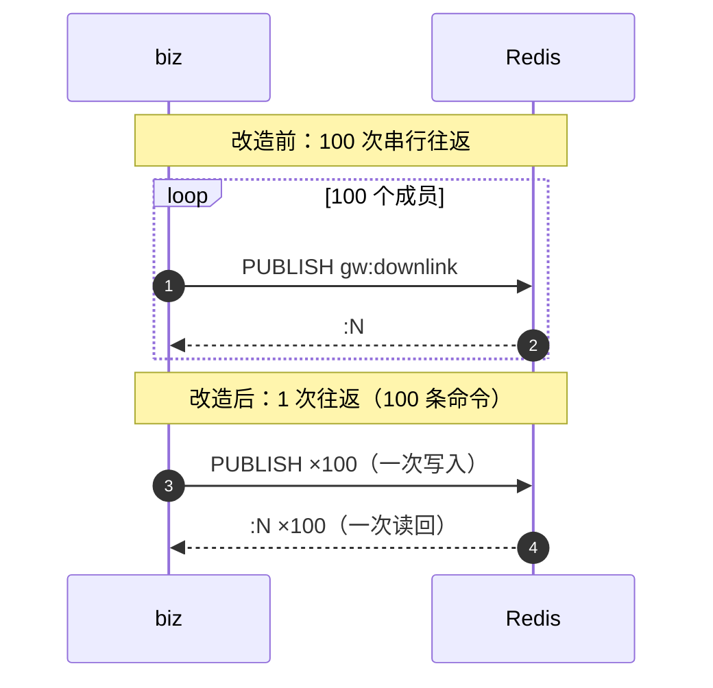

# 05 · 群扇出批量 PUBLISH：把 100 次往返压成 1 次

> 这是[收益排名](./03-性能优化收益排名.md)第 3 名的原理篇：群扇出 span p99 **111→2 ms（55×）**。
> 一句话：**串行 `PUBLISH` 的成本是"成员数 × 网络往返"，而扇出只需要"投递"、不需要"逐个确认"**——把 100 条命令塞进一次往返，延迟从 O(N) 降到 O(1)。
> 但它只解决了"往返"，没解决"广播放大"——那要等定向下行。

---

## 一、先看问题：100 个成员 = 100 次往返

改造前的扇出逻辑（简化）：

```go
for _, uid := range userIDs {                 // 100 个群成员
    payload := downlinkPayload{UserID: uid, Frame: ...}
    raw, _ := json.Marshal(payload)
    db.Redis().Publish(ctx, "gw:downlink", raw)   // ← 每条一次往返，且串行等待
}
```

Redis 的普通命令是**请求-响应模型**：

```
客户端 ──── PUBLISH ────► Redis
客户端 ◄──── :1 ─────────  Redis      ← 必须等这条的回复，才能发下一条
客户端 ──── PUBLISH ────► Redis
客户端 ◄──── :1 ─────────  Redis
...（重复 100 次）
```

一次往返按 0.3–1 ms 算（同机容器网络），100 次就是 **30–100 ms**——这与实测的 **span p99 111 ms** 吻合。

**关键点：这 100 次往返里的绝大部分时间是"等"，不是"算"。** CPU 全程空闲，但每次都要等一个 RTT。

---

## 二、底层原理 A：pipeline 到底做了什么

### 2.1 Redis 协议的请求-响应模型

Redis 用的是文本协议（RESP）：

```
*3\r\n$7\r\nPUBLISH\r\n$11\r\ngw:downlink\r\n$42\r\n{...}\r\n
```

一次命令 = 一次完整的写 + 一次完整的读。**如果客户端串行执行，就必须"写-读-写-读"**，每个读都在等网络。

### 2.2 pipeline 的改变

pipeline 把"写-读-写-读"变成"**写×N - 读×N**"：

```
客户端 ──── PUBLISH ×100（一次性写入 socket 缓冲）────► Redis
客户端 ◄──── :1 ×100（一次性读回）────────────────── Redis
```

实现上（go-redis）：

1. `pipe := rdb.Pipeline()` 得到一个**缓冲器**；
2. `pipe.Publish(...)` 只是把命令**追加到内存里的 slices**，不发送；
3. `pipe.Exec(ctx)` 时：
   - 把所有命令一次性编码进 `bufio.Writer`，**一次 flush**；
   - 再循环读回 N 个回复。

**RTT 从 N 次降到 1 次。** 这是唯一的变化——Redis 内部仍然要执行 100 条命令。

### 2.3 为什么不用 `MULTI/EXEC`

| 方式 | 往返 | 原子性 | 适用 |
|---|---|---|---|
| 串行 | N | 无 | 不关心延迟 |
| **pipeline** | **1** | **无** | **扇出：不需要原子** |
| `MULTI/EXEC` | 1（+1 EXEC） | 有 | 需要"要么全成功" |
| Lua 脚本 | 1 | 有 | 需要"读-改-写"逻辑 |

扇出的语义是"**尽力把这条消息发给尽可能多的人**"：

- 中间某一条失败，不影响其他条（每条的订阅者数各自返回）；
- 不存在"要么全发要么全不发"的需求；
- 反而**不能**用 MULTI——事务里 `PUBLISH` 的语义、错误处理都更复杂（Redis 的事务不支持回滚，出错也只是继续执行）。

**所以 pipeline 是这里唯一正确的选择。**

---

## 三、底层原理 B：pipeline 省的是 RTT，不是 Redis 的工作

这是最容易被误解的一点。

### 3.1 `PUBLISH` 的成本结构

```
PUBLISH gw:downlink payload
  ├─ 查找频道的订阅者列表
  ├─ 对每个订阅者：把 payload 写入它的输出缓冲（内存拷贝）
  └─ 返回订阅者数量
```

也就是说，`PUBLISH` 的成本是 **O(订阅者数)**。本项目里**每个网关副本都订阅了 `gw:downlink`**，所以：

```
一次 PUBLISH 的实际投递数 = 网关副本数
一条群消息的总投递 = 100 成员 × 网关副本数
```

**pipeline 不会减少这个数字**——它只把"100 次网络往返"变成"1 次网络往返"，Redis 内部仍然要做 100 次频道查找和 `100 × 副本数` 次内存拷贝。

### 3.2 一个具体的账

| 项 | 串行 | pipeline |
|---|---|---|
| 应用↔Redis 往返 | 100 | **1** |
| Redis 内部 PUBLISH 执行 | 100 | 100（不变） |
| 内存拷贝次数 | 100 × 副本数 | 100 × 副本数（不变） |
| 应用侧 CPU（JSON 编码） | 100 次 | 100 次（不变） |

所以 pipeline 的收益**只体现在延迟**（尤其是低负载下的固定开销），在 Redis 成为瓶颈时它帮不上忙。

### 3.3 这解释了为什么后来还要做"定向下行"

```
串行 PUBLISH：  100 次往返 + 100×副本数 次投递
pipeline：      1 次往返  + 100×副本数 次投递      ← 本轮的优化
定向下行：      1 次往返  + 100 次直发（O(1)/人）  ← 下一轮的优化
```

**pipeline 治"往返"，定向下行治"放大"。** 两者是接力关系，不是替代关系。

---

## 四、作用机制

### 4.1 当前代码的三层结构

`biz/internal/service/downlink.go:93-133`：

```go
// ① 批量查 presence（2 条 pipeline，一次往返拿到所有用户的 replica）
replicas, _ := ReplicaOfBatch(ctx, userIDs)

// ② 能直发的逐个直发（内存操作 + gRPC 写流，不占 Redis）
for _, uid := range userIDs {
    if rep, ok := replicas[uid]; ok && rep != "" {
        if directDownlink(ctx, rep, frame) { continue }
    }
    fallback = append(fallback, uid)      // 直发失败的进兜底列表
}

// ③ 兜底的批量 PUBLISH（一条 pipeline）
pipe := rdb.Pipeline()
for _, uid := range fallback {
    pipe.Publish(ctx, DownlinkChannel, marshalFor(uid))
}
_, err := pipe.Exec(ctx)                  // ← 一次往返
```

### 4.2 时序对比



### 4.3 为什么 JSON 还是要逐条 marshal

`downlinkPayload` 里带 `userId`，所以每个用户的 payload 都不同：

```go
payload := downlinkPayload{UserID: uid, Frame: DownlinkFrame{Type: typ, Data: data}}
raw, _ := json.Marshal(payload)
```

**帧体（`Frame.Data`）只 marshal 一次**（`frameData` 复用，`downlink.go:104-106`），但外层包装要逐条生成。这部分是 O(N) 的 CPU，无法用 pipeline 消除。

> 优化空间（未做）：把 `userId` 移出 payload，改成"一条广播帧 + 网关自己按连接过滤"，可省掉 N 次 JSON 编码。但这会改变频道协议，收益有限（JSON 编码 100 次约几百微秒），暂不值得。

---

## 五、量化：111 ms → 2 ms 是怎么来的

| 负载 | 改造前 | 改造后 | 说明 |
|---|---|---|---|
| 群扇出（100 成员 × 20 轮） | span p99 **111 ms** | **2 ms** | 提交 `6ee24d2` |
| V3 复测 | — | span p99 **2 ms** | 与纯 Node 基线持平 |
| 定向下行命中率 | — | **99.65%**（V3）/ **99.9998%**（9-20） | 后续优化 |

**为什么是 55 倍而不是 100 倍**：因为 pipeline 之后剩下的 2 ms 里，包含 Redis 内部 100 次 PUBLISH 的执行时间与网络单程延迟；而 111 ms 里，100 次往返中有相当一部分是**客户端与 Redis 之间的调度抖动**（容器网络 + 事件循环），不是纯 RTT。

> **指标口径提醒**：这里的 "span" 只覆盖"发布路径入队"（`downlink.go` 中 fanout 的耗时），**不含客户端真正收到帧的时间**。V3 报告 §七明确写了这一点——不能把它当端到端扇出延迟。

---

## 六、坑点

### 坑 1：pipeline 不是事务

`pipe.Exec()` 只保证"把命令发出去并读回回复"，**不保证原子性**：

- 其他客户端的命令可能穿插在执行序列中；
- 中途某条命令报错，后面的命令**仍然会执行**。

扇出场景不需要原子性，但如果将来要在 pipeline 里混入"计数 + 判断"的逻辑，就必须换成 Lua。

### 坑 2：`Exec` 的错误是"第一个错误"，不是"全部错误"

```go
if _, err := pipe.Exec(ctx); err != nil && !isRedisNil(err) {
    logDownlinkError(err)     // 只记录了第一条
}
```

要逐条检查，需要遍历 `cmds` 并对每个 `cmd.Err()` 判断。当前代码只记日志、不重试——因为**下行本来就是 best-effort**（丢了靠 `/sync` 补）。

### 坑 3：pipeline 太大反而伤害 Redis

pipeline 的命令在 Redis 侧是**一次性读入并连续执行**的。如果一次塞 10 万条：

- Redis 单线程会被这一批占住，其他客户端的命令排队；
- 客户端要一次性分配大缓冲；
- 网络层的 socket buffer 可能溢出。

**经验值**：单批 ≤ 1000 条，或按字节数（如 ≤ 1 MB）切批。群成员上限通常远小于此。

### 坑 4：`PUBLISH` 在无订阅者时返回 0，不是错误

```go
pipe.Publish(ctx, "gw:downlink", raw)   // 返回订阅者数，可能为 0
```

返回 0 意味着"当前没有网关订阅"（比如所有副本刚重启）。这**不是错误**，但也意味着这条消息走实时通道丢了——只能靠 `/sync` 补。**不要把 0 当失败去重试**（重试也没有订阅者）。

### 坑 5：没有订阅者时的"静默丢失"是设计允许的

架构上 pub/sub 是 best-effort：

```
实时通道可以丢任何东西，最终一致性由 PG + seq + /sync 保证
```

所以 pipeline 里的失败不需要重试、不需要告警（除非比例异常）。**但要有指标**：`server_downlink_fallback_total` 的突增通常意味着"直发大面积失败"。

### 坑 6：pipeline 不能跨连接复用

`rdb.Pipeline()` 绑定一次 `Exec`。并发调用各自的 pipeline 是独立的；**不要把同一个 `Pipeliner` 跨 goroutine 共享**（它不是并发安全的）。

### 坑 7：与 presence 查询的顺序

当前是"先批量查 replica（2 条 pipeline）→ 再直发 → 剩下的批量 PUBLISH（1 条 pipeline）"，总共 **3 次 Redis 往返**。

可以合并成 2 次（把 presence 查询与降级判断放进一个 Lua），但收益有限（1 个 RTT），且会增加脚本复杂度。**优先级低于"合并限流/幂等/发号"那一次**——因为扇出不在消息 ack 的关键路径上。

---

## 七、验证方法

| 项 | 方法 | 期望 |
|---|---|---|
| 扇出延迟 | `perf/gw-fanout-bench.mjs`（100 成员 × 20 轮） | span p99 ≤ 5 ms |
| 往返次数 | `redis_cmd_duration_seconds{cmd="publish"}` 的调用次数 ÷ 群消息数 | 从 N 降到 1（每个 fallback 批次） |
| 命令批大小 | 自建指标 `fanout_batch_size` | 等于 fallback 用户数 |
| 兜底比例 | `server_downlink_direct_total` / (`direct`+`fallback`) | ≥ 99.5% |
| 无订阅者 | 停掉所有网关副本后发群消息 | PUBLISH 返回 0，无报错，消息靠 `/sync` 可达 |

```bash
# 复现：100 成员群扇出
node perf/gw-fanout-bench.mjs 100 20
```

---

## 八、与后续优化的关系

| 方向 | 关系 |
|---|---|
| [定向下行](../../04-presence定向下行定位优化.md) | pipeline 治往返、直发治放大；直发命中后，**pipeline 只在兜底路径生效**（占比 0.35% → 0.0002%） |
| [presence 定位优化](../../04-presence定向下行定位优化.md) | 扇出前的 `ReplicaOfBatch` 也是 2 条 pipeline，可与之合并成一次 Lua |
| [批量写入](../../05-组提交批量写入.md) | 批量后 fanout 仍是"每消息一次"，本优化独立成立；但要把 fanout 移出 ack 关键路径（当前已在 ack 之后） |
| [问题 04 投递回执](../../问题分析/04-定向下行缺投递回执.md) | pipeline 的返回只有"订阅者数"，没有"谁收到了"——这正是需要回执的原因 |

---

## 九、小结

| 问题 | 答案 |
|---|---|
| 为什么慢 | 100 个成员 = 100 次串行 `PUBLISH`，每次等一个 RTT |
| pipeline 做了什么 | 把 N 次"写-读"合并成 1 次"写×N - 读×N" |
| 省了什么 | **只省 RTT**；Redis 内部的 100 次执行与"副本数 × 成员数"次投递一次都没少 |
| 为什么不用 MULTI | 扇出不需要原子性，事务反而增加复杂度 |
| 为什么后来还要定向下行 | 因为 pipeline 治不了"广播放大"（O(副本数)），直发才把它降到 O(1) |
| 收益 | span p99 111→2 ms（55×）；与 Node 基线持平 |
| 最大坑 | 把"返回 0 个订阅者"当失败重试；以及 pipeline 塞太大阻塞 Redis |
