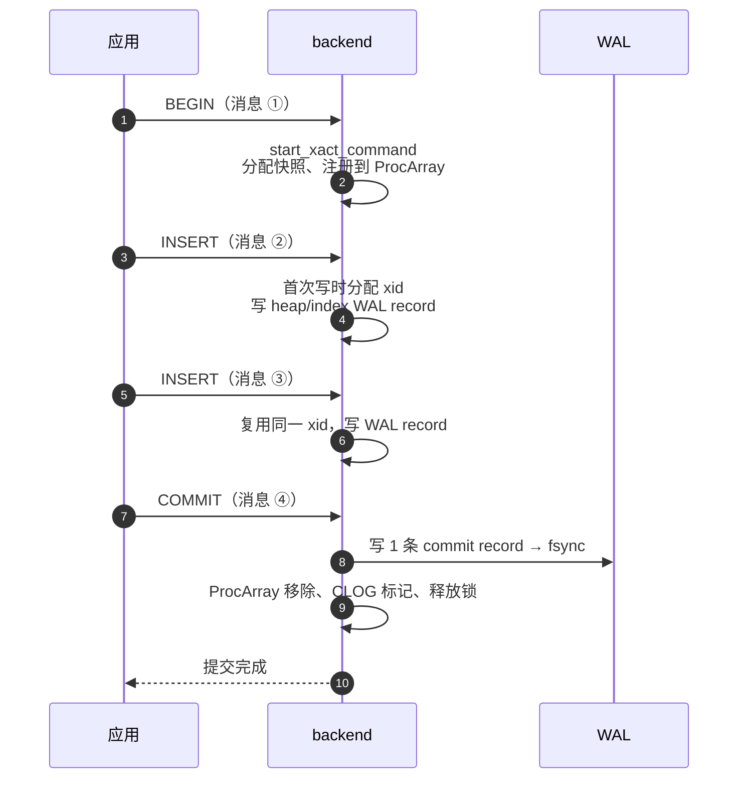
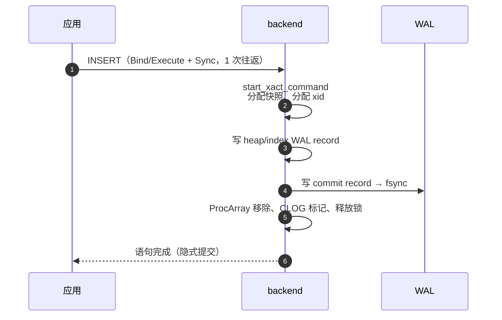

# 06 · 显式事务 vs 隐式事务：代价到底在哪

> 这是 [`01-事务对性能的影响`](./01-事务对性能的影响-从fsync到连接池.md) 的补充篇。
> 上一篇给了"去事务能换 2.5×"的收益，但**没有把代价摊开讲**——这是它的缺陷。
> 一句话：**把显式事务改成隐式事务不是免费的，它用"原子性范围"换"往返次数"。只有当事务里本来就只有一条写语句时，这笔交易才是纯赚。**

---

## 一、先破一个说法：PG 里不存在"没有事务"

很多人把 autocommit 理解成"不开事务"。准确的说法是：

> **PG 里每条语句都在一个事务里执行，区别只在于"这个事务是你显式开的，还是数据库替你隐式开的"。**

| 说法 | 实际含义 |
|---|---|
| `BEGIN; ...; COMMIT;` | **显式事务块**，可包多条语句，一个提交点 |
| 单条 `INSERT`（无 BEGIN） | **隐式事务**，语句开始即事务开始，语句结束即提交 |
| `autocommit=off`（MySQL 概念） | PG 没有这个开关；PG 的"自动提交"是协议层行为，不是会话变量 |

所以在 PG 里讨论"去事务"，真正讨论的是：**把"一个事务包 N 条语句"改成"N 个事务各包 1 条语句"**。

---

## 二、两种模式的底层执行路径

### 2.1 显式事务



关键点：

| 项 | 值 |
|---|---|
| 协议往返 | **2 + N**（BEGIN、N 条语句、COMMIT） |
| xid | **1 个**（第一次写时分配，后续复用） |
| commit record | **1 条** |
| WAL fsync | **1 次**（并发时可被组提交合并） |
| 快照 | **1 个**（事务级，RR 下全程可见一致） |
| 锁持有 | **到 COMMIT 才释放**（跨所有语句） |

### 2.2 隐式事务（单条语句）



关键点：

| 项 | 值 |
|---|---|
| 协议往返 | **1**（extended protocol 下 Bind/Execute/Sync 可合并为一次写入） |
| xid | **1 个**（和显式事务一样） |
| commit record | **1 条**（和显式事务一样） |
| WAL fsync | **1 次**（和显式事务一样） |
| 快照 | **1 个**（语句级） |
| 锁持有 | **语句结束即释放** |

### 2.3 一张表看清"省了什么、没省什么"

| 成本项 | 显式事务（1 条语句） | 隐式事务（1 条语句） | 差异 |
|---|---|---|---|
| xid 分配 | 1 次 | 1 次 | **无差异** |
| commit record | 1 条 | 1 条 | **无差异** |
| WAL fsync | 1 次 | 1 次 | **无差异** |
| CLOG / ProcArray 更新 | 1 次 | 1 次 | **无差异** |
| 协议往返 | **3**（BEGIN + INSERT + COMMIT） | **1** | ✅ 省 2 次 |
| 连接持有时间 | ~9 ms | ~3 ms | ✅ 省 2/3 |
| **原子性范围** | 可包多条 | **只有一条** | ❌ **退化** |

**结论：省下的只有"协议往返"和"连接持有"，物理成本（xid / commit / fsync）一分没少。**

> 这也解释了为什么单靠"去事务"只能拿到 2.5×，而不是数量级——它缩短的是**持有时间**，不是**提交次数**。

---

## 三、四个真实的代价

### 3.1 代价一：原子性范围从"多条"缩到"一条"（最重要）

这是去事务**唯一不可避免**的代价。

改造前：

```sql
BEGIN;
  INSERT INTO messages ...;               -- ①
  INSERT INTO user_conversations ...;     -- ②（首条消息/新成员时）
COMMIT;
-- ① 和 ② 要么都成功，要么都不成功
```

改造后（稳态单语句）：

```sql
INSERT INTO messages ...;                 -- 只有这一条，原子
INSERT INTO user_conversations ...;       -- 独立事务，可能单独失败
```

#### 具体故障链（这不是理论）

```
① 消息插入成功
② 关系行插入失败（连接抖动 / 锁超时 / 唯一冲突）
③ MarkIdempotent 成功（它在消息插入之后）
→ 客户端 5 s 超时重发
→ 幂等键命中 → 返回 deduped，不再插入
→ 关系行永远缺失
→ 该用户调 /user/sync 时 IsConversationMember 返回 false → 403
→ 用户永久读不到这个会话
```

**这是"去事务"能引入的最严重的一类 bug：一次失败 + 一次重发 = 永久数据缺失。**

#### 三条缓解措施（必须选一条）

| 措施 | 做法 | 评价 |
|---|---|---|
| **A. 调整顺序** | **先写关系行，再写消息** | ✅ 最便宜。失败时留下"多余的关系行"（无害），不会留下"消息无关系行"（有害） |
| **B. 读路径兜底** | `IsConversationMember` 在 miss 时，单聊从 `conversation_id` 前缀推导 | ✅ 单聊可完全推导，群聊仍需查表 |
| **C. 保留事务** | `missing` 非空时才 `BEGIN`（首条消息/新成员） | ✅ 低频路径付事务成本，可接受 |

**推荐 A + C**：稳态单语句（快），首条消息走事务（稳），且顺序保证"失败只留冗余、不留缺失"。

### 3.2 代价二：多条语句时，fsync 次数反而翻倍

这是最容易被忽略的**反向成本**。

```
显式事务包 3 条写：
  BEGIN → INSERT ×3 → COMMIT
  = 1 条 commit record → 1 次 fsync

拆成 3 条 autocommit：
  INSERT → commit
  INSERT → commit
  INSERT → commit
  = 3 条 commit record → 3 次 fsync
```

**关键机制**：PG 的**组提交只能合并"并发提交"**（多个 backend 同时等 fsync 时，一次 fsync 覆盖更大的 LSN）。**同一个连接上串行执行的 N 条语句，无法被合并**——前一条提交完成之前，后一条还没开始。

所以：

| 场景 | fsync 次数 | 结论 |
|---|---|---|
| 事务里只有 1 条写 → autocommit | 1 → 1 | ✅ 不变，纯赚 2 个 RTT |
| 事务里有 2 条写 → 2 条 autocommit | 1 → 2 | ⚠️ 往返省了，fsync 翻倍 |
| 事务里有 3 条写 → 3 条 autocommit | 1 → 3 | ❌ 可能净亏 |

**这直接给出一个判据：**

> **只有当显式事务里恰好包含 1 条写语句时，"去事务"才是纯收益。**
> 我们的稳态路径正好满足（`user_conversations` 被缓存命中后不再写），所以赚；首条消息不满足，所以那里要保留事务。

### 3.3 代价三：先查后写的一致性变弱（TOCTOU）

显式事务（REPEATABLE READ）里，整个事务共用一个快照，"先查后写"看到的是同一时刻的数据。

autocommit 下每条语句一个新快照（READ COMMITTED），于是：

```
语句 1：SELECT ... WHERE conversation_id = 'x'   → 不存在
（此时另一个事务插入了 'x' 并提交）
语句 2：INSERT ... WHERE conversation_id = 'x'   → 撞唯一约束
```

即经典的 **TOCTOU（Time-of-check to time-of-use）**。

- 我们的写路径用的是 `ON CONFLICT DO NOTHING`，天然免疫这类竞态（冲突即忽略）；
- 但**读路径**（如 `IsConversationMember` 后紧接着 `AdvanceLastRead`）在两语句之间可能数据已变——影响很小（已读位点是单调的），但要意识到语义变弱了。

**判据**：如果两步之间依赖"读到的结果仍然成立"，就必须用显式事务或单条原子语句（CTE / `ON CONFLICT` / `UPDATE ... WHERE`）。

### 3.4 代价四：会话级状态失效

显式事务里可以用的东西，autocommit 下会在语句结束时立即失效：

| 特性 | 显式事务内 | autocommit 下 |
|---|---|---|
| `SET LOCAL statement_timeout = '5s'` | 事务内有效 | **语句结束即失效** |
| `pg_advisory_xact_lock()` | 持到事务结束 | **语句结束即释放** |
| 临时表 / `ON COMMIT DROP` | 事务内可见 | 每条语句独立 |
| 游标 `DECLARE ... CURSOR`（非 HOLD） | 事务内可用 | 不可跨语句 |
| `PREPARE TRANSACTION`（2PC） | 可用 | 不可能 |

**如果代码里用了上述任一特性，就不能简单地去掉事务。** 当前项目的写路径没有用（`SET LOCAL` 只在迁移/运维脚本里出现），所以安全；但这是"改动前必须检查"的一项。

---

## 四、收益侧也摊开讲（避免只讲好话）

| 收益 | 机制 | 量级 |
|---|---|---|
| **省 2 次协议往返** | BEGIN/COMMIT 各一条消息 | p50 −2 RTT（约 −6 ms @ 3 ms/RTT） |
| **连接持有时间 ↓2/3** | 3 RTT → 1 RTT | 吞吐 2.5×（池容量不变） |
| **消除"事务泄漏"风险** | 忘记 Commit/Rollback 会一直占连接直到 ctx 取消 | 少一类生产事故 |
| **消除 "aborted 事务"状态** | 显式事务中一条语句失败后，后续语句全部报 `current transaction is aborted` | 错误处理更简单 |
| **锁持有时间缩短** | 语句结束即释放，不会跨语句持有 | 减少锁等待与死锁面 |

> 最后两条经常被忽略，但它们在**故障场景**下价值很大：显式事务里"一条语句报错 → 整个事务中毒 → 必须回滚重来"，而 autocommit 下"这条失败就这条失败"，其余请求不受影响。

---

## 五、决策矩阵：四种写法，各自适合什么

| 写法 | 往返 | commit 数 | 原子性 | 适用场景 |
|---|---|---|---|---|
| **显式事务包 N 条** | 2 + N | **1** | ✅ 强 | N 条必须原子（消息 + 关系行） |
| **N 条 autocommit** | N | N | ❌ 无 | 各语句独立、且都只有一条 |
| **pipeline N 条（非事务）** | **1** | N | ❌ 无 | 独立语句但想省往返（注意：**不要依赖它原子**） |
| **批量多值 INSERT** | **1** | **1** | ✅ 强（单语句） | **同构**写入（N 条消息同一张表） |

**这张表的最后一行是关键**：批量多值 `INSERT` 是唯一"既原子、又只提交一次、又只一次往返"的写法。

```
显式事务包 32 条：1 往返 + 1 commit + 强原子（但是 32 条语句）
批量多值 INSERT： 1 往返 + 1 commit + 强原子（1 条语句）
                  ↑ 少了解析/规划 32 次，也少了 32 次 Sync
```

这就是[批量写入](../../05-组提交批量写入.md)比"事务批量"更优的原因——**不是省了 fsync，而是把"多条语句"变成了"一条语句"**。

---

## 六、本项目的具体取舍（混合模式）

### 6.1 稳态：单语句 autocommit

```
事件：同一会话的第 2 条及以后的消息（99%+）
路径：INSERT messages ... ON CONFLICT DO NOTHING RETURNING
代价：无（事务里本来就只有 1 条写，因为关系行已被 ucExistsCache 命中）
收益：省 2 个 RTT、连接持有 ↓2/3
```

### 6.2 冷路径：保留事务

```
事件：会话首条消息 / 新增成员（每会话 1~2 次）
路径：BEGIN → 先写 user_conversations → 再写 messages → COMMIT
代价：3 个 RTT（低频，可忽略）
收益：关系行与消息原子，不会出现"消息无关系行"的永久 403
```

### 6.3 为什么"先写关系行"而不是"先写消息"

```
先写消息：消息成功、关系行失败 → 永久 403（有害）
先写关系行：关系行成功、消息失败 → 多一行冗余关系（无害，客户端重发会复用）
```

**顺序决定了失败模式的"毒性"。** 这是一个几乎零成本的加固。

### 6.4 判断代码是否"可以安全去事务"的三问

1. 这个事务里**稳态**有几次写？（>1 就不能简单拆）
2. 这几条写之间是否**必须原子**？（必须 → 保留事务或改成单条 CTE）
3. 代码是否用了 `SET LOCAL` / advisory lock / 临时表？（用了 → 不能拆）

三问全过，才是"去事务"的安全区。

---

## 七、坑点

### 坑 1：以为"去事务"会减少 fsync

不会。单语句事务与单语句 autocommit 的 fsync 次数**完全相同**。只有"批量合并成一条语句"才减少 fsync。

### 坑 2：把一个多语句事务拆成 N 条 autocommit，还以为变快了

这会让 commit 数从 1 变 N，**fsync 次数翻倍**，而串行执行的 autocommit 无法被组提交合并。除非 N 条之间没有依赖、且能用 pipeline 合并往返，否则很可能净亏。

### 坑 3：忘记 `defer tx.Rollback` 在 autocommit 下会 panic

去掉事务后，若还留着 `defer tx.Rollback(ctx)`，`tx` 为 nil → panic。改写时要把 `defer` 一并删掉。

### 坑 4：连接泄漏在显式事务里更隐蔽

`pool.Begin()` = Acquire 一条连接。如果没有 Commit/Rollback，连接**不会归还**，直到 ctx 取消。池只有 32 条，泄漏 32 次就全站不可用。autocommit 没有这个风险（`pool.Exec` 内部自动 Release）。

### 坑 5：`ON CONFLICT` 不能替代事务做"多表原子"

`ON CONFLICT` 只处理**同一张表**的冲突。跨两张表（消息 + 关系行）的原子性，只能靠事务或"调整顺序 + 幂等"。

### 坑 6：以为 pipeline 是事务

`pgx.Batch` / pipeline 减少的是**往返**，不是提交次数；而且**不要依赖它原子**。需要原子就显式 `BEGIN`。

### 坑 7：把 `SET LOCAL` 放进 autocommit

`SET LOCAL` 的作用域是"当前事务"。autocommit 下语句结束即失效，下一句拿到的还是默认值。要设会话级参数请用 `SET`（并注意连接被池复用时的残留）。

---

## 八、怎么验证（改造前后都要跑）

| 项 | 方法 | 期望 |
|---|---|---|
| 提交次数 | `pg_stat_database.xact_commit` 增量 ÷ 消息数 | 稳态 ≈ 1/条（若 >1 说明还有多余事务） |
| 一致性 | 构造"关系行插入失败"，再重发 | 关系行最终存在；`/user/sync` 不返回 403 |
| fsync 压力 | `pg_stat_wal.wal_records` 增速 | 与 commit 数同阶；拆分后不应显著上升 |
| 锁等待 | `pg_stat_activity` 的 `wait_event_type='Lock'` | 不应上升 |
| 会话状态 | 检查代码里是否残留 `SET LOCAL` / advisory lock | 为 0 |
| 连接泄漏 | `pg_stat_activity` 连接数在高负载后回落 | 回落到基线（无 `idle in transaction`） |

```sql
-- 关键：`idle in transaction` 是连接泄漏与长事务的信号
SELECT state, count(*) FROM pg_stat_activity
WHERE datname = current_database() GROUP BY 1;
```

---

## 九、小结

| 问题 | 答案 |
|---|---|
| 改成隐式事务有代价吗 | 有，**用原子性范围换往返** |
| 省了什么 | 2 次协议往返 + 2/3 连接持有时间 |
| 没省什么 | xid、commit record、fsync（单语句场景下三者完全相同） |
| 最大的代价 | 多条写不再原子 → 可能留下"消息无关系行"的永久不一致 |
| 第二个代价 | 多语句拆成多条 autocommit，**commit 与 fsync 次数翻倍** |
| 什么时候是纯赚 | **事务里恰好只有 1 条写语句**时 |
| 多语句想又快又原子怎么办 | 用**批量多值 INSERT**（一条语句，1 commit，强原子） |
| 我们项目怎么用的 | 稳态单语句；首条消息走事务，且**先写关系行再写消息** |
