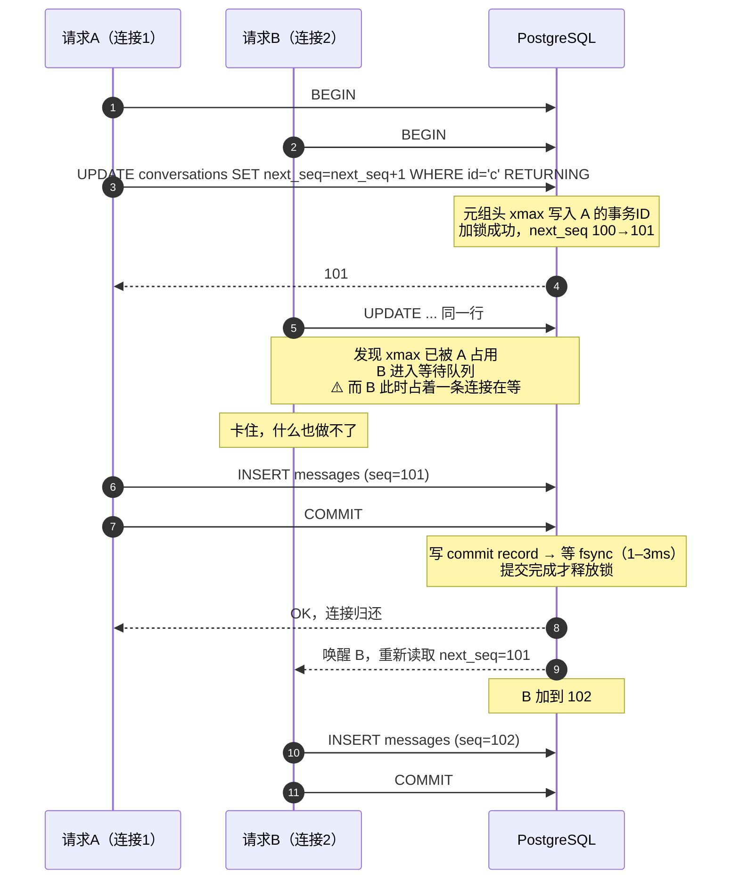
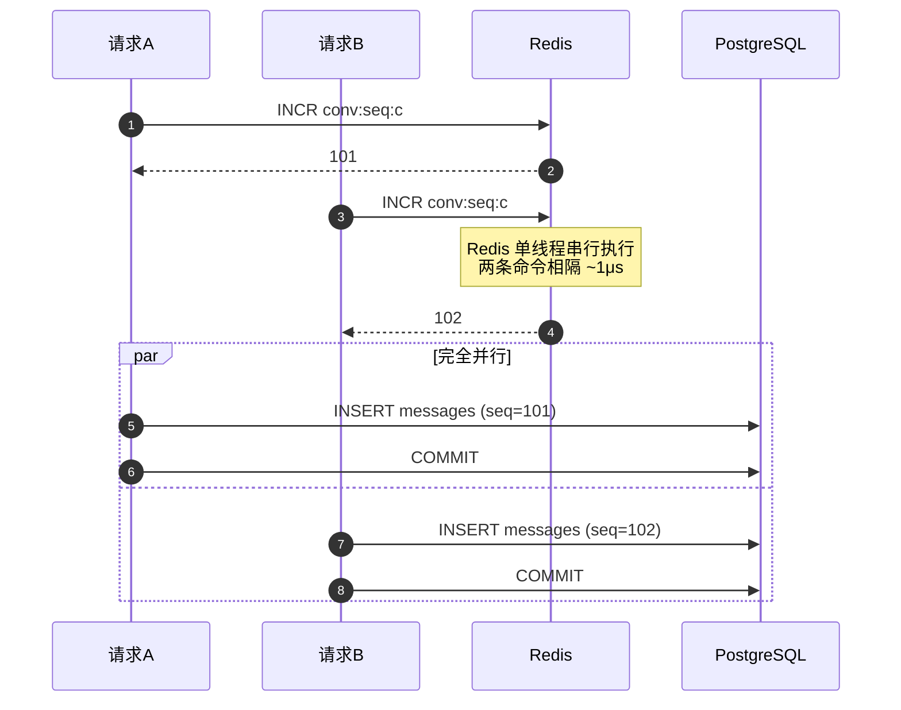
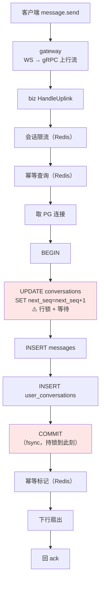
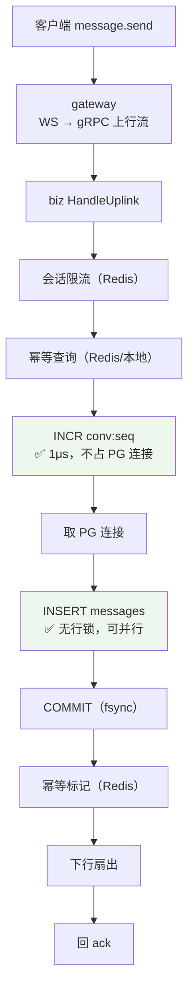

# 07 · 从行锁到 Redis：一条消息的完整写入流程对比

> 本文回答一个具体问题：**"没有 Redis 发号器，只靠 DB 时，消息写入到底是怎么走的？加了 Redis 之后又变成什么样？"**
> 先说结论：**互斥并没有消失，它只是搬家了**——从"数据库事务里的行锁（30 ms）"搬到"Redis 单线程里的一条命令（1 μs）"。理解这一点，就理解了发号器优化的全部。

---

## 〇、先补齐五个词（读本文只需要这五个）

如果你对"会话、seq、事务、锁、连接池"还不熟，先看这一节。完整的 50 个术语见[前置术语表](./00-前置术语表.md)。

### 1. 会话（conversation）= 一个聊天窗口

| 类型 | ID 怎么拼 | 例子 |
|---|---|---|
| 单聊 | `single_<用户A>_<用户B>` | `single_1_2` |
| 群聊 | `group_<群ID>` | `group_9000002` |

**消息都属于某个会话，`seq` 是"会话内"的序号，不是全局的。** 不同会话之间互不影响。

### 2. seq = 这条消息在它所属会话里的编号

```
single_1_2： 1, 2, 3, ... 105, 106    ← 每个会话各自从 1 开始
single_3_4： 1, 2, 3, ...             ← 另一个会话，也从头开始
```

必须满足两条：**单调递增**（后发的号更大）、**不重复**。

它的用途：客户端断线重连时说"我最后看到 105 号，把之后的给我"，服务端用 `seq > 105` 补拉漏掉的消息。所以 **seq 一旦回退或重复，客户端就会漏消息**。

它**不是**数据库主键 `id`（全局自增、跨会话交错），也**不是**时间戳（可能相同）。

> **发号器就是"产生 seq 的组件"**。本系列所有性能问题，都来自"怎么让两个并发请求拿到不同的号，且后发的更大"。

### 3. 事务 = 一组数据库操作，要么全成、要么全败

```sql
BEGIN;                                                  -- 开始
  UPDATE conversations SET next_seq = next_seq + 1;     -- 拿号（并锁住这一行）
  INSERT INTO messages (..., seq, ...) VALUES (..., 106, ...);
COMMIT;                                                 -- 提交：一起生效
```

**关键**：`COMMIT` 不是"告诉数据库我做完了"，而是要让日志**真的落到磁盘**（WAL + fsync），这一步要花 1–10 ms。**这是"每条消息一个事务"慢的根本原因。**

> `next_seq` 是会话表里的一个**发号计数器**（存"最后发出的号"）；`conversations` 主要是会话元数据表，`next_seq` 只是借用它"每会话一行"的粒度。为什么不能改表消除竞争、为什么不能直接用 `messages.id` 排序，见 **[分册 08](./08-为什么需要seq-从next_seq到发号器.md)**。

### 4. 行锁 = 锁住某一行，别人改不了，直到事务结束

```
请求A：UPDATE conversations SET next_seq=next_seq+1 WHERE id='single_1_2'
       → 这一行被锁住

请求B：UPDATE ... 同一行 → 排队等 A 结束
```

**PG 的行锁不是一张锁表，而是写在这一行数据头部的 `xmax` 字段里。** 它跟着数据走，**跨进程、跨机器都有效**——所以加再多业务副本也绕不开。

锁的生命周期是**事务**，不是语句：从 `UPDATE` 开始，一直到 `COMMIT`（含 fsync）结束才释放。

### 5. 连接池 = 一组可复用的数据库连接，借完要还

PG 里一条连接 = 一个操作系统进程，很贵，所以不能每次查询都新建。池子容量只有 **32**：

```
同时最多 32 个请求在用数据库
第 33 个 → 排队等别人还回来
```

**连接是独占的**：借出去的那段时间，别人用不了。所以"每条消息占连接多久"直接决定系统能同时处理多少消息。

### 把这五个词串成一句话

> 两个人在一个**会话**里发消息，服务端要给每条消息分配一个**序号（seq）**，同一会话的并发请求必须**排队（互斥）**。如果排队的地方是数据库的一行（**行锁**），那排队时长 = 一整个**事务**（含 `COMMIT` 的刷盘），而且排队的人**还占着数据库连接**（**连接池**只有 32 条）——等的人一多，池就满了，全站都拿不到连接。**本文讲的就是：把排队从"行锁"搬到"Redis 的 1 微秒命令"之后，流程变成了什么样。**

---

## 一、我们要保证什么

同一会话内，`seq` 必须：**单调递增 + 不重复**。

而"两个并发请求同时到达同一会话"是常态（两个人同时发、一个人连发、重发）。所以必须有一个**互斥点**，让两个请求拿到不同的号。

```
互斥点 = 那个"同一时刻只能有一个请求通过"的地方
```

**优化发号器，本质是选择"这个互斥点放在哪、持续多久"。** 你无法消除它，只能搬它。

---

## 二、方案 A：只有数据库（行锁发号）

### 2.1 表结构与语句

```sql
-- conversations 表上有一行"发号器"
CREATE TABLE conversations (
  id        text PRIMARY KEY,
  next_seq  bigint NOT NULL DEFAULT 0,
  ...
);

-- 每条消息的事务
BEGIN;
  UPDATE conversations SET next_seq = next_seq + 1
  WHERE id = 'single_1_2'
  RETURNING next_seq;                       -- 拿到新号，同时持有行锁

  INSERT INTO messages (conversation_id, sender_id, seq, ...)
  VALUES ('single_1_2', 1, $seq, ...);

  INSERT INTO user_conversations (...) VALUES (...) ON CONFLICT DO NOTHING;  -- 首条消息时
COMMIT;
```

### 2.2 单条消息的完整步骤

| # | 步骤 | 是否持有连接 | 是否持有行锁 |
|---|---|---|---|
| 1 | 从连接池取一条连接 | ✅ 开始持有 | ❌ |
| 2 | `BEGIN` | ✅ | ❌ |
| 3 | `UPDATE conversations ... RETURNING` | ✅ | ✅ **开始持锁** |
| 4 | `INSERT messages` | ✅ | ✅ |
| 5 | `INSERT user_conversations`（首条消息时） | ✅ | ✅ |
| 6 | `COMMIT`：写 commit record → **等 WAL fsync** | ✅ | ✅ |
| 7 | 释放锁、连接归还池 | ❌ | ❌ |

注意第 6 步：**锁要等到 fsync 完成、事务真正提交后才释放**。所以：

```
行锁持有时间 ⊇ 整个事务时长 ⊇ 一次 fsync（1–3 ms）
```

### 2.3 两条并发消息的真实时间线

A 和 B 同时给同一个会话发消息：



**B 从第 5 步一直等到 A 提交完成**——等的是 A 的**整个事务**，不是 A 的那一条 `UPDATE`。

### 2.4 行锁到底是什么（底层机制）

PG 的行锁**不是一张锁表**，它就藏在数据页的元组头里：

```
元组头 = [xmin][xmax][infomask...][数据...]
                   ↑
              这里记录"谁锁住了我 / 谁删了我"
```

`UPDATE ... WHERE id='c'` 的执行过程：

1. 通过主键索引找到那一行；
2. 检查元组头 `xmax`：如果是 0 或已提交的事务 → 可以锁；
3. 把 `xmax` 写成当前事务 ID，并置 `HEAP_XMAX_LOCK_ONLY` 标记 → **这就是"持锁"**；
4. 后来的事务看到 `xmax` 是个未提交的事务 → 调用 `XactLockTableWait(xid)` **进入等待队列**，进程休眠；
5. 前一个事务提交/回滚时，**唤醒等待者**，重新检查；
6. 锁的生命周期 = **事务**（不是语句）——直到 COMMIT/ROLLBACK 才清除 `xmax` 标记。

**关键点：第 3 步到第 6 步之间，锁一直有效，而第 6 步要等 fsync。**

### 2.5 为什么单会话上限是 33 条/秒

```
单条消息事务耗时 ≈ 30 ms（Node 时代实测）
单会话吞吐 = 1000 ms ÷ 30 ms ≈ 33 条/秒
```

实测完全吻合：每会话 30/s（r15）零错误，40/s（r20）直接 7.6% 失败、p99 从 58 ms 跳到 2041 ms。

### 2.6 更致命的一层：等锁的请求**占着连接**

这是最容易被忽略、但决定"为什么是全站断崖而不是单会话变慢"的一环：

```
50 个会话，每个都超过 33/s
→ 每个会话都有请求在等锁
→ 每个等待者都占着一条连接
→ 32 条连接很快被"等待者"占满
→ 其他会话的请求连连接都拿不到 → 直接超时
```

所以行锁的危害是**双重**的：

| 层 | 后果 |
|---|---|
| 会话内 | 串行化 → 单会话 33/s |
| 全站 | 等待者占连接 → 池耗尽 → **所有会话一起失败**（断崖） |

### 2.7 多副本下更糟

行锁是 PG 里的一把锁，**跨进程、跨机器**都生效。所以即便起 10 个 biz 副本，同一会话的写入仍然被串行在同一把锁上——**加副本对这个瓶颈完全无效**。

> 这就是当时说"Go 重写救不了这个拐点"的原因：换语言只改变每条 SQL 多快，不改变"同一会话必须排队 30 ms"这件事。

---

## 三、方案 B：Redis 发号

### 3.1 语句与命令

```bash
# 发号（Redis，单条命令）
INCR conv:seq:{conv}          # 返回新号
# 或批量：INCRBY conv:seq:{conv} 64   # 一次取一段号
```

```sql
-- 落库（PG，不再碰 conversations 表）
INSERT INTO messages (conversation_id, sender_id, seq, ...)
VALUES ($1, $2, $3, ...)
ON CONFLICT (conversation_id, sender_id, client_msg_id) DO NOTHING
RETURNING id, seq;
```

**注意：`conversations` 表彻底退出了热路径**——没有 UPDATE，就没有行锁。

### 3.2 单条消息的完整步骤

| # | 步骤 | 组件 | 是否持有 PG 连接 | 是否持有 PG 行锁 |
|---|---|---|---|---|
| 1 | 会话限流（Lua INCR） | Redis | ❌ | ❌ |
| 2 | 幂等查询（EXISTS / 本地缓存） | Redis/内存 | ❌ | ❌ |
| 3 | **发号（INCR）** | **Redis** | ❌ | ❌ |
| 4 | 从连接池取连接 | PG | ✅ 开始 | ❌ |
| 5 | `INSERT messages` | PG | ✅ | ❌ **没有行锁** |
| 6 | `COMMIT`（fsync） | PG | ✅ | ❌ |
| 7 | 幂等标记（SETNX） | Redis | ❌ | ❌ |
| 8 | 下行定位 + 投递 | Redis/gRPC | ❌ | ❌ |

**关键差别在第 3 步和第 5 步之间**：取号发生在**拿到 PG 连接之前**，而且 PG 里没有任何"会话级"的共享行需要更新。

### 3.3 两条并发消息的时间线



**A 和 B 在 PG 侧完全独立**：两条 INSERT 写的是不同的行、不同的索引条目，谁也不等谁。它们的提交甚至可以共享一次 fsync（组提交）。

### 3.4 "互斥"去哪了

它去了 Redis：**Redis 是单线程执行命令的**，A 的 `INCR` 和 B 的 `INCR` 在 Redis 内部天然串行。

但这次串行的代价是：

```
临界区 = 一条命令的执行时间 ≈ 1 μs
```

对比数据库行锁的 **30 ms**——**差 4 个数量级**。

更重要的是**排队的位置变了**：

| | 行锁方案 | Redis 方案 |
|---|---|---|
| 在哪里排队 | PG 里，**占着一条连接** | Redis 里，**不占 PG 连接** |
| 排多久 | 一个事务（含 fsync），~30 ms | 一条命令，~1 μs |
| 排队会拖累谁 | 池被占满 → **全站** | 只有 Redis 单线程的吞吐上限 |

---

## 四、两张时间轴放在一起看

```
方案 A（DB 行锁）：

  取连接 ├──────────────── 事务 ≈ 30 ms ────────────────┤ 归还
         BEGIN   UPDATE(持锁)   INSERT   COMMIT(fsync)
                 └──────── 同会话其他请求全在这排队 ────────┘
                 而且它们同样占着连接在排

方案 B（Redis INCR）：

  Redis   INCR(1μs)  ← 同会话请求只在这一瞬排队，不占 PG 连接
  取连接  ├──── INSERT ≈ 3 ms ────┤ 归还
          COMMIT(fsync)
          ↑ 同会话其他请求不需要在这里排队（它们的号已经拿到了）
```

**一句话：缩短的不是"锁"本身，而是"持有互斥的时间"，同时还改变了"排队时是否占用关键资源"。**

---

## 五、完整链路：从客户端到 ack，两种方案各长什么样

### 5.1 方案 A（DB 行锁）



### 5.2 方案 B（Redis 发号）



### 5.3 对照表

| 维度 | 方案 A（DB 行锁） | 方案 B（Redis INCR） |
|---|---|---|
| 互斥点在哪 | PG 的行锁（元组头 `xmax`） | Redis 单线程执行 |
| 临界区长度 | **~30 ms**（含 fsync） | **~1 μs** |
| 排队时是否占 PG 连接 | **是** | **否** |
| 单会话上限 | ~33 条/秒 | 数千条/秒（受 RTT 限制） |
| 多副本能否同时处理同一会话 | **不能**（行锁跨副本） | **能**（Redis 全局串行 1μs） |
| 失败模式 | 等锁 → 占连接 → 池耗尽 → **全站断崖** | 池排队（软排队） |
| 新增依赖 | 无 | **Redis**（要有装载/降级/持久化设计） |
| 崩溃后 | 无状态丢失 | 可能丢键 → 需"装载 + 余量" |

---

## 六、为什么它仍然会重号（一句话）

Redis 方案的正确性依赖"键还在"。如果键丢了（Redis 重启）或**被代码误删**，号会从 `max(seq)` 重新开始——而 `max(seq)` 只包含已提交的行，看不到在途事务，于是与在途号重叠。

`seq.go:69-76` 那个 `seq > last → Del(key)` 的判据，就是在并发下**误判"键被重建"并主动删键**，实测触发了 17 万次。详见[分册 01](../../01-seq发号器并发缺陷修复.md)。

---

## 七、五个常见误解

### 误解 1："Redis 没锁，所以不串行"

错。Redis **仍然串行**——单线程执行命令就是串行。只是这个串行的粒度是"一条命令"，不是"一个事务"。

### 误解 2："去掉行锁就完全并行了"

错。同一会话的两种写入在 Redis 里仍有一瞬间的先后。真正的并行发生在 **PG 侧**（拿到号之后）。

### 误解 3："加副本就能解决行锁瓶颈"

错。行锁在 PG 里，**跨副本生效**。加 10 个 biz 副本，同一会话仍被串行在同一把锁上。

### 误解 4："发号器快，所以整体就快"

错。发号器只是把互斥点缩短了。**之后瓶颈会转移到连接池**——这正是我们经历的"行锁没了，p99 反而从 2075 涨到 2961"。发号器降低的是上限约束，不是端到端延迟的全部。

### 误解 5："Redis 挂了降级回 DB 就没事了"

错。降级会把行锁**请回来**：所有请求重新变成"一个事务 + 30 ms 串行"。所以降级必须配**熔断/限流**，否则比不可用更糟。

---

## 八、小结

| 问题 | 答案 |
|---|---|
| 行锁方案的核心瓶颈是什么 | 同一会话的写入被串行在**一个事务（含 fsync）**上，约 30 ms |
| 为什么全站会断崖，而不只是单会话变慢 | 等锁的请求**占着连接**，32 条连接被等待者占满，其他会话也拿不到连接 |
| Redis 方案改了什么 | 把互斥点从"PG 行锁"搬到"Redis 单线程命令"，临界区 30 ms → 1 μs |
| 还改了什么（更容易忽略） | 排队位置从"占着 PG 连接等"变成"在 Redis 里等，不占连接" |
| 互斥消失了吗 | **没有，只是搬家了**。这是优化锁类问题的通用思维 |
| 代价是什么 | 新增 Redis 依赖；键丢失需装载+余量；故障时降级会把行锁请回来 |
| 为什么还有重号 | 键被误删（`Del` bug）后从偏小的 `max(seq)` 重装，与在途号重叠 |
