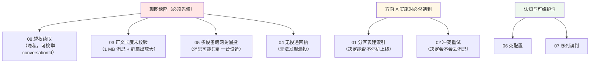

# 消息链路问题清单与索引

> 本文登记**在吞吐排查过程中发现、但不属于"优化方向"的独立问题**：有的是现网缺陷，有的是实施某个优化时必然踩到的坑，有的是需要纠正的认知偏差。
> 每个问题一篇独立文档（`01`–`08`），格式与 V3 压测报告的 `问题分析/` 一致：现象 → 证据链 → 根因 → 影响 → 方案 → 坑点 → 验证。
>
> 优化方向本身（A–K）见上级目录 [`00-消息吞吐上限分析与提升技术方案.md`](../00-消息吞吐上限分析与提升技术方案.md)。

---

## 一、清单

| # | 问题 | 类型 | 严重度 | 是否是现网缺陷 | 关联 |
|---|---|---|---|---|---|
| [01](./01-分区表无法并发建唯一索引.md) | 分区表不支持 `CREATE INDEX CONCURRENTLY`，唯一索引无法零阻塞上线 | 实施障碍 | P0（阻塞） | 否（实施时踩） | 方向 A |
| [02](./02-唯一索引缺冲突重试.md) | 唯一索引上线后若不做冲突重试，重号会变成**死循环丢消息** | 正确性 | P0 | 否（改动引入） | 方向 A |
| [03](./03-消息正文长度未校验.md) | `content` 长度完全不校验，单条可达 1 MB；群扇出与批量写入会被放大 | 稳定性 + 资源 | P1 | **是** | 方向 E |
| [04](./04-定向下行缺投递回执.md) | 直发成功 ≠ 用户收到；网关查不到用户只记 `dropped`，无回执 | 架构缺口 | P1 | **是**（概率低） | 方向 D |
| [05](./05-多设备跨网关漏投.md) | `presence` 只取一台设备，多设备跨网关时另一网关收不到 | 正确性 | P1 | **是** | 方向 D |
| [06](./06-biz副本标识是死配置.md) | biz 的 `REPLICA_ID` 定义了但从未使用，易误导部署 | 可维护性 | P3 | **是**（无害但误导） | 方向 J |
| [07](./07-序列CACHE与WAL误判.md) | "`CACHE 1` 每次 `nextval` 都写 WAL"是错的，据此调参是伪优化 | 认知纠偏 | P3 | 否 | 方向 H |
| [08](./08-读接口缺成员授权.md) | 读消息接口只认证不授权，任意登录用户可读任意会话（IDOR） | **安全** | **P0** | **是** | 方向 G |

---

## 二、优先级建议

| 阶段 | 应修问题 | 理由 |
|---|---|---|
| **立即** | 08、03 | 一个是隐私泄露，一个是一条消息能放大成 100 MB 扇出。都不依赖任何架构改造 |
| **与方向 A 同批** | 01、02 | 唯一索引若不能安全上线，方向 A 就落不了地；落地了不重试就等于丢消息 |
| **与方向 D 同批** | 05、04 | 05 是现存漏投，04 是"无法感知漏投"。做 presence 缓存前必须先有 04，否则缓存会把漏投放大 |
| **顺手** | 06、07 | 不改行为，只避免误判 |

---

## 三、判定口径（为什么这些问题不在主方案里）

主方案（`00`）回答的是"**吞吐上限在哪、怎么突破**"。本文这些问题有两个共同特征，所以单列：

1. **不改变吞吐量级**：修完不会让 2800 变成 7000（08/03/05/04/06），或者本来就不是性能问题（01/02/07）；
2. **有独立的正确性/安全后果**：如果混在性能方案里，容易被"优化收益"掩盖优先级——08 的越权不会因为吞吐提升而消失，03 的 1 MB 消息也不会。

---

## 四、未展开的候选问题（已发现，待登记）

以下问题在排查中遇到，但**尚未独立成文**，先登记避免丢失：

| 候选 | 现象 | 为什么值得单独写 |
|---|---|---|
| `read.report` 写放大 | 每条已读上报 = 1 次 `IsConversationMember`（RO 查询）+ 1 次 `UPDATE user_conversations`（`read.go:15-34`），即使位点未推进也走完整 UPDATE | 客户端滚动即上报，写量可能与消息同量级；且 `user_conversations` 行锁会与其他写路径争用 |
| 内存映射无界 | `seqInitialized`、`convLastSeq`、`ucExistsCache`、`idemLocal` 都是按业务实体增长、无 TTL（`seq.go:90-93`、`message.go:51-54`、`seq.go:154-157`） | 长跑进程的内存单调增长；`convLastSeq` 在方向 A 修复后可直接删除 |
| 群消息两次成员查询 | `handleUplink.go:123`（`GetConversationMembers`）+ `message.go:82-90`（`IsMember`） | 群消息多 2 次 PG 查询，且结果可互推 |
| backplane 单 goroutine | 每个网关副本只有 1 个 goroutine 消费 `gw:downlink`（`backplane.go:34-62`） | fallback 比例升高时成为单点；与方向 D/04 相关 |
| HTTP 上行双路径 | `/internal/gateway/uplink` 与 gRPC 流两套写入口（`api/internal_routes.go`） | 批量写入后会让"同会话顺序保证"失效（见方向 E 坑 9） |

> 这五条建议在下一轮排查里各成一篇，或在对应方向落地时一并处理。
