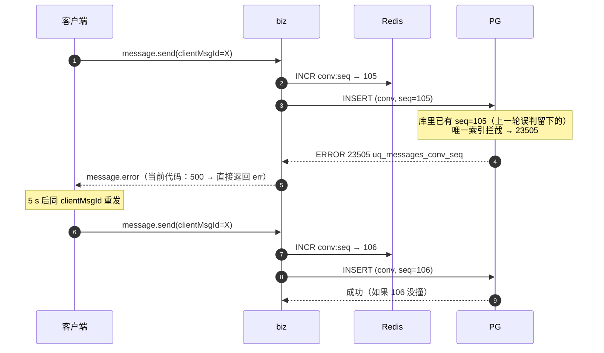

# 问题 02：唯一索引上线后若不做冲突重试，重号会变成"死循环丢消息"

> 严重度：**P0（改动引入的正确性缺陷）**
> 状态：已确证（现有代码只处理幂等冲突，不处理 seq 冲突）
> 关联：[方向 A · seq 修复](../01-seq发号器并发缺陷修复.md)、[问题 01](./01-分区表无法并发建唯一索引.md)

---

## 一、一句话结论

加 `UNIQUE(conversation_id, seq)` 只是把"**静默写脏**"变成了"**显式失败**"，而当前代码对这类失败的处理是**直接返回 500**。客户端收到 500 后按协议重发同一个 `clientMsgId`，重发会重新取号——**如果新号又撞上，就再次 500**。轻则大量失败，重则某条消息永远发不出去。

**唯一索引和冲突重试必须同批上线，缺一不可。**

---

## 二、现象推演

### 2.1 触发链条



单次碰撞通常能靠"新号不同"自愈。但两种情况会变成死循环：

| 情况 | 为什么会循环 |
|---|---|
| Redis 键丢失后按 `max(seq)` 装载（不含在途），号段整体落在已占用区间 | 每次重试都取到"已被别人占用的号"，连撞 N 次 |
| 批量写入（方向 E）整批失败后整批重试 | 整批重新取号，但批内顺序变化，可能持续互撞 |

### 2.2 当前代码只认一种冲突

`biz/internal/service/message.go:138-151`：

```go
if errors.Is(err, pgx.ErrNoRows) {
    // 撞唯一约束：重发命中幂等键，取首次结果返回
    tx.Rollback(ctx)
    MarkIdempotent(...)
    existed := findByIdemKey(...)
    if existed != nil { return ... Deduped: true }
    return nil, errUnexpectedIdemMiss
}
if err != nil {
    tx.Rollback(ctx)
    return nil, err       // ← seq 冲突走到这里：直接 500
}
```

**为什么 `ErrNoRows` 抓不到 seq 冲突**：

| 冲突类型 | SQL 行为 | 驱动表现 |
|---|---|---|
| 撞 `uniq_msg_idem`（幂等键） | `ON CONFLICT (conversation_id, sender_id, client_msg_id) DO NOTHING` **命中了冲突仲裁目标** → 不插入 → 无返回行 | `pgx.ErrNoRows` |
| 撞 `uq_messages_conv_seq`（seq） | **不在** `ON CONFLICT` 的目标列里 → 冲突不被 `DO NOTHING` 吸收 → 抛唯一性违反 | `*pgconn.PgError`，`Code = 23505` |

也就是说：**两种冲突的 SQLSTATE 相同（23505），但这一条走的是 `ErrNoRows`，另一条直接抛错**。

---

## 三、根因

### 3.1 `ON CONFLICT` 只对声明过的仲裁目标生效

PostgreSQL 的 `ON CONFLICT (col_a, col_b) DO NOTHING` 只处理**该唯一索引**上的冲突。表上其他唯一索引（这里是 `uq_messages_conv_seq`）冲突时，语句**照常报错**。

这是设计使然——否则 `ON CONFLICT` 会变成"吞掉所有约束错误"，语义就不可控了。

### 3.2 缺一层"冲突分类 → 处置"的映射

当前代码把"任何非 `ErrNoRows` 的错误"都当成系统错误（500）。缺的是一张映射表：

| 错误 | 语义 | 应做 |
|---|---|---|
| `ErrNoRows` | 幂等键冲突 | 查首次结果，返回 `Deduped` |
| `23505` + `uq_messages_conv_seq` | seq 冲突（发号回退/并发） | **换号重试** |
| `23505` + `uniq_msg_idem` | 幂等键冲突（`ON CONFLICT` 未覆盖的写法下） | 查首次结果 |
| 其他 | 系统错误 | 500 |

---

## 四、方案

### 4.1 重试循环

```go
const maxSeqRetry = 3

var m Message
for attempt := 0; ; attempt++ {
    seq, err := NextSeq(ctx, convID)
    if err != nil { return nil, err }

    err = db.PG().QueryRow(ctx, insertMsgSQL, convID, senderID, seq, clientMsgID, ...).Scan(...)

    switch {
    case err == nil:
        // 正常路径
    case errors.Is(err, pgx.ErrNoRows):
        // 幂等命中
        MarkIdempotent(ctx, ...)
        return &PersistMessageResult{Message: findByIdemKey(...), Deduped: true}, nil
    case isPGError(err, "23505", "uq_messages_conv_seq"):
        // seq 冲突：换号重试（旧号作废，产生洞，可接受）
        metrics.SeqConflictTotal.Inc()
        if attempt+1 >= maxSeqRetry {
            return nil, fmt.Errorf("seq 冲突重试 %d 次仍失败: %w", maxSeqRetry, err)
        }
        continue
    default:
        return nil, err
    }
    break
}
```

### 4.2 错误分类的写法

**必须按 `ConstraintName` 判断，不能只看 SQLSTATE**：

```go
func isPGError(err error, code, constraint string) bool {
    var pgErr *pgconn.PgError
    if !errors.As(err, &pgErr) { return false }
    if pgErr.Code != code { return false }
    return constraint == "" || pgErr.ConstraintName == constraint
}
```

`pgErr.Message` 是给人看的（含中文/英文措辞），**不要用字符串匹配**。

### 4.3 批量写入（方向 E）下的特殊处理

批量的多值 `INSERT` 一旦有任意一行冲突，**整条语句失败**（`ON CONFLICT` 无法吸收非目标索引的冲突）。此时不能"整批重试"，否则会雪崩。

| 策略 | 做法 | 评价 |
|---|---|---|
| A. 整批回 error，客户端重发 | 简单，但 N 个客户端同时重发 | 可接受（客户端有退避），但会放大 |
| B. 冲突后**降级为逐条插入** | 整批失败 → 拆成单条逐条执行，冲突的那条单独重试 | **推荐**：失败路径才付这个成本 |
| C. 预检查（先 `SELECT` 已占用号） | 额外一次查询，且有竞态 | 不推荐 |

选 B：正常路径是一条批量语句，**只有异常时才退化**，性能不受影响。

### 4.4 指标

```go
metrics.SeqConflictTotal      // 冲突次数（应为 0；> 0 说明发号仍有回退）
metrics.SeqRetryExhausted     // 重试耗尽（真正的故障信号）
metrics.BatchFallbackToSingle // 批量降级为逐条的次数
```

`SeqConflictTotal` 的**存在本身就是发号器还有问题的证据**。稳态应该是 0；一旦非 0，说明[问题 01/方向 A](../01-seq发号器并发缺陷修复.md) 的修复不彻底（或 Redis 又丢了键）。

---

## 五、坑点

### 坑 1：重试必须重新取号，不能复用旧号

重试用同一个 seq 重试**永远失败**（冲突是确定性的）。必须重新 `NextSeq`，旧号作废——这就是文档里说的"跳号无害"。

### 坑 2：不要在重试里重复写幂等标记

`MarkIdempotent` 必须在**插入成功之后**。如果在重试前就写，客户端真正重发时会被误判为"已处理"，导致消息永久丢失。

### 坑 3：重试次数要有界，且要计数

无界重试在系统性故障下会把一个错误放大成 N 倍的 DB 压力。`maxSeqRetry = 3` 足够——因为正常情况（发号器正确）冲突概率接近 0，连撞 3 次基本只可能是发号器坏了，此时快速失败比继续重试更负责。

### 坑 4：`ErrNoRows` 不一定都是幂等冲突

如果 SQL 用了 `RETURNING` 但某些分支不返回行（如 `WHERE` 条件不满足），也会是 `ErrNoRows`。当前语句只有"`ON CONFLICT DO NOTHING` 命中"这一种可能，但改写 SQL 时要重新确认，不要盲目复用这个分支。

### 坑 5：与事务的关系

若仍在显式事务里（分册 02 改造前），**一次唯一性违反会让整个事务进入 aborted 状态**，后续语句全部报 `current transaction is aborted`。所以：

- 要么在重试前 `Rollback` 并重新 `Begin`；
- 要么先做[方向 B](../02-落库去显式事务.md)（autocommit），每次重试天然是独立事务。

**推荐后者**：这也是为什么建议 B 与 A 一起做。

### 坑 6：重试不能吞掉"磁盘满 / 连接断"这类错误

`isPGError` 严格匹配 `Code + ConstraintName`，不要写成 `strings.Contains(err.Error(), "duplicate")`——不同 PG 版本/语言环境下措辞不同，而且会把无关错误误判成冲突。

### 坑 7：批量降级路径的性能陷阱

"整批失败 → 逐条重试"里，如果冲突行占比很高（例如发号器整体回退），会退化成 N 次单条 INSERT，比批量慢 10 倍以上。所以要监控 `BatchFallbackToSingle` 的**频次**，而不是"只要有降级就告警"。

---

## 六、验证

| 项 | 方法 | 通过标准 |
|---|---|---|
| 冲突可重试 | 手工把 Redis 的 `seq:{conv}` 改小，制造冲突后发消息 | 消息最终落库成功，`SeqConflictTotal` +1，无 500 |
| 幂等不被误判 | 同 `clientMsgId` 重发 1000 次 | 只落库 1 条，其余返回 `Deduped` |
| 重试有界 | 构造持续冲突（把发号器打回旧值） | 3 次后返回明确错误，`SeqRetryExhausted` +1，不无限循环 |
| 批量降级 | 批次中人为植入一条冲突 | 其余 63 条正常落库；`BatchFallbackToSingle` +1 |
| 无副作用 | 全量压测 30 分钟 | `SeqConflictTotal` = 0（发号器健康时应为 0） |

---

## 七、关联

| 文档 | 关系 |
|---|---|
| [问题 01 · 分区表建索引](./01-分区表无法并发建唯一索引.md) | 前置：索引建不出来，就没有冲突可重试 |
| [方向 A · seq 修复](../01-seq发号器并发缺陷修复.md) | 根治：冲突重试是兜底，发号器正确才是根本 |
| [方向 B · 去显式事务](../02-落库去显式事务.md) | 重试需要在 autocommit 下做，否则每次冲突都要重建事务 |
| [方向 E · 批量写入](../05-组提交批量写入.md) | 批量失败要降级逐条，不能整批重试 |
