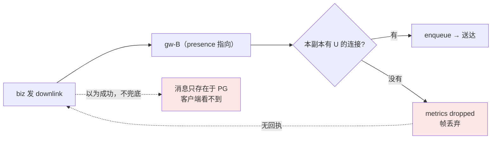

# 问题 04：定向下行"写流成功"被当成"投递成功"，缺回执

> 严重度：**P1（架构缺口）**——当前触发概率低，但它是"实时消息静默丢失"的唯一成因
> 状态：已确证（两侧代码都没有投递结果回传）
> 关联：[方向 D · presence 定位](../04-presence定向下行定位优化.md)、[问题 05 · 多设备漏投](./05-多设备跨网关漏投.md)

---

## 一、一句话结论

定向下行（direct）的返回值为 `true` 只代表 **gRPC 流写入成功**，不代表**目标网关持有该用户的连接**。如果 `presence` 指向的副本上并没有这个用户（用户刚换了网关、或缓存过期），网关会静默丢弃该帧并只记一个 `dropped` 计数——**业务层完全不知道**，于是"直接投递"这条路把消息弄丢了，且不会回退到 pub/sub 兜底。

---

## 二、证据

### 2.1 业务层：发送成功即返回 true

`biz/internal/realtime/directdownlink.go:51-72`：

```go
func tryDirectDownlink(ctx context.Context, replica string, frame *edgev1.DownlinkFrame) bool {
    ...
    if err := stream.Send(&edgev1.EdgeFrame{
        Kind: &edgev1.EdgeFrame_Downlink{Downlink: frame},
    }); err != nil {
        return false          // ← 只有"写流失败"才返回 false
    }
    return true               // ← 写进去了就算成功
}
```

### 2.2 业务层：true 就不走兜底

`biz/internal/service/downlink.go:73-89`：

```go
func PublishDownlink(ctx, userID, typ, data, opts) error {
    if tryDirect(ctx, userID, typ, data, opts) {
        metrics.DownlinkDirectTotal.Inc()
        return nil            // ← 直接返回，pub/sub 兜底被跳过
    }
    metrics.DownlinkFallbackTotal.Inc()
    ... // publish gw:downlink
}
```

### 2.3 网关层：查不到用户就丢，且不回话

`gateway/internal/hub/hub.go:120-148`：

```go
func (h *Hub) RouteToUser(userID int64, targetDeviceID, exceptDeviceID string, payload []byte) {
    h.mu.RLock()
    devices := h.conns[userID]          // 本副本的连接索引
    ...
    h.mu.RUnlock()

    if len(targets) == 0 {
        metrics.Downlink.WithLabelValues("dropped").Inc()   // ← 只记指标
        return                                              // ← 没有回执
    }
    ...
}
```

`RouteToUser` 没有返回值；`upstream.GrpcClient.recvLoop` 收到 downlink 帧后直接调用它（`grpc.go:245-248`），**不会回任何东西给业务层**。

### 2.4 唯一的补偿是 `/sync`，但客户端没用起来

架构上是三段式：实时投递可以丢，靠 `seq` 断档 → `/sync since` 补拉兜底。

但 web 端目前**只做全量拉取**（`lastSyncedSeq` 恒 0，见 `web/src/globalComponents/friendModal/index.tsx:92` 的初始化），没有实现"按 seq 断档增量补拉"。所以一次实时丢帧的用户体验是：**这条消息直到用户刷新页面/重连拉全量才出现**。

---

## 三、根因

### 3.1 presence 是"最终一致"的缓存，不是"实时真相"

```
网关 A：用户 U 连接建立 → ZADD presence:U (device, now+ttl) + HSET meta=A:socket
        ↓ 网络抖动 / 客户端主动重连
网关 B：用户 U 重新连接 → 覆盖 meta=B:socket
```

在覆盖的那一瞬间，`presence:U` 已经指向 B，但 A 上的旧连接可能还没被 `Remove`（`conn.close` 里有 `presence.Remove`，但异常断连要等 TTL 惰性过期）。反过来，**presence 指向 A 而 U 已经在 B** 的窗口同样存在（写 meta 与旧连接的清理不是原子的）。

### 3.2 直发链路把"两段确认"压成"一段"

| 段 | 现在能确认吗 |
|---|---|
| biz → 网关（gRPC 流写入） | ✅ |
| 网关 → 用户连接（本地 hub 查找 + enqueue） | ❌ **无回执** |
| 用户 → 客户端（WS 写出） | ❌ 永远无法确认（TCP 层） |

中间那段恰恰是"用户到底在不在这台网关上"的判定点，而它没有返回值。

### 3.3 结果：失败被伪装成成功



---

## 四、影响

| 场景 | 发生概率 | 后果 |
|---|---|---|
| 用户在一台设备上换网关（断线重连到另一副本） | 中（网络切换、滚动发布时常见） | 该用户在这段窗口内收不到实时消息，需刷新才可见 |
| presence 缓存（方向 D）引入后 | 上升 | 缓存 TTL 内所有消息都投给旧副本 → 全部丢 |
| 网关滚动发布 | 高（短时间集中） | 一批用户漏收 |
| 监控 | — | 只有网关侧 `downlink{result="dropped"}` 计数，**无法关联到具体用户/消息**，也无法触发告警阈值（它同时包含"用户确实离线"的正常情况） |

> 注意：`dropped` 指标**混装了两种完全不同的情况**——"用户离线（正常）"与"用户在线但在别的副本（异常）"。这使它无法直接当告警信号。

---

## 五、方案

### 5.1 方案 A：网关回 NACK（推荐）

只对"查不到用户"这一种情况回一个**负回执帧**，业务层收到后清缓存并改走 pub/sub。

**协议扩展**（`ourchat.edge.v1`）：

```proto
message EdgeFrame {
  oneof kind {
    UplinkFrame   uplink   = 1;
    UplinkAck     ack      = 2;
    DownlinkFrame downlink = 3;
    ConnClosed    closed   = 4;
    DownlinkMiss  miss     = 5;   // 新增
  }
}

message DownlinkMiss {
  int64  user_id        = 1;
  string trace_id       = 2;   // 关联 biz 的这次投递（如 serverMsgId）
}
```

**网关侧**：`RouteToUser` 返回 `bool`；`recvLoop` 在 false 时 `stream.Send(miss)`。

**业务层**：

```go
// 登记 pending：traceID → 是否已 miss
// Send 成功后不立刻判定成功，而是在本批 flush 结束时检查 miss 集合
if missed[msgID] {
    PublishDownlinkFallback(ctx, userID, ...)   // 强制走 pub/sub
}
```

**代价**：每帧多一次 map 查询；miss 帧只在异常时发出，流量可忽略。

### 5.2 方案 B：网关定期上报"本地连接摘要"

网关每 N 秒把自己持有的 `userId` 集合（或布隆过滤器）上报，业务层用它校正 presence。

- 优点：一次解决所有"presence 与真实状态不一致"的问题；
- 缺点：万级用户 × 多副本的摘要传输开销大；布隆过滤器有假阳性，不能用于强一致判定。

**不推荐作为首选**，可作为方案 A 的补充（用于修正缓存）。

### 5.3 方案 C：直发与 pub/sub 双写

同时走两条路，任一条到达即可。

- 优点：零协议改动，一天可上线；
- 缺点：**流量翻倍**，且 pub/sub 是全副本广播（O(副本数)），在 2800 msg/s 下不可接受。

**只适合作为灰度期的临时兜底**（例如只对 `call:*` 这类低频高价值信令双写）。

### 5.4 方案 D：先不做，强化客户端补偿

把 `/sync` 的 seq 断档检测在客户端实现（web + iOS），让"实时丢帧"能在 1 个心跳周期内被补齐。

- 优点：不改服务端；
- 缺点：补偿延迟（秒级）+ 服务端仍然"不知道自己丢了"。

**建议 A + D 一起做**：A 解决"服务端能感知"，D 解决"客户端能自愈"。

---

## 六、坑点

### 坑 1：NACK 到达时消息已经 ack 给发送方了

`handleMessageSend` 先落库、再 fanout、最后返回 ack。NACK 是异步回来的，此时**发送方已经收到"发送成功"**。所以 NACK 的语义只能是"**补投**"，绝不能是"回滚"或"给发送方报错"。

### 坑 2：必须带 traceId，否则无法关联

`DownlinkFrame` 目前只有 `UserId / TargetDeviceId / ExceptDeviceId / RawFrame`（`contracts/.../edge.proto`）。NACK 只带 `userId` 的话，业务层无法知道是哪条消息 miss 了（同一个用户可能同时有多条在途）。

**在 `DownlinkFrame` 上加 `trace_id`**（可直接用 `serverMsgId`），NACK 原样带回。

### 坑 3：pending 表要有超时清理

业务层为每次直发登记一个 pending 项，等 NACK。若网关崩溃没回 NACK，pending 会泄漏。

**建议**：不做"等待"，而是"发完就检查一次 miss 集合 + 5 s 后清理"。或者更简单：**收到 NACK 才处理，没收到就当成功**（NACK 是纯优化信号，不承担可靠性）。

### 坑 4：不要用 NACK 做"在线判定"

`dropped` 也会发生在"用户确实离线"时。收到 NACK 后如果去 pub/sub 广播，对所有离线用户都会多一次广播——**这是当前 `FanoutDownlink` 已有的行为**（离线用户进 fallback 列表），成本一致，不会额外恶化。但不要据此更新 presence（离线判定仍以 TTL 为准）。

### 坑 5：多副本下 NACK 回到哪个 biz

NACK 沿 gRPC 流回到**发起投递的那个 biz 副本**（同一条流），所以 pending 表放在该副本的进程内即可，无需跨副本共享。

### 坑 6：灰度与开关

协议加字段是**向后兼容**的（proto3 未知字段会被忽略），但老网关不认识 `DownlinkMiss`，会走 `default` 分支丢弃。所以：

- 先升级全部网关，再开业务层开关 `DOWNLINK_NACK_ENABLED`；
- 或让业务层在收到未知帧时忽略（当前 `switch` 已有 default 兜底）。

---

## 七、验证

| 项 | 方法 | 通过标准 |
|---|---|---|
| 复现漏投 | 手工把 `presence:{uid}:meta` 改成错误副本（如 `gw-not-exist`），再发消息 | 客户端收不到（复现成功） |
| 修复后 | 同上，开启 NACK | 网关回 miss → 业务层走 pub/sub → 客户端收到 |
| 指标可区分 | `gateway_downlink_total{result="dropped"}` 与 `server_downlink_miss_total` | 后者只在"在线但投错副本"时增长 |
| 无额外开销 | 正常压测 30 分钟 | `server_downlink_miss_total` ≈ 0，p99 无变化 |
| 滚动发布 | 滚动重启网关副本 | 发布期间的漏投次数显著低于现状 |

---

## 八、关联

| 文档 | 关系 |
|---|---|
| [方向 D · presence 优化](../04-presence定向下行定位优化.md) | 缓存会放大本问题，**必须先把回执做出来再上缓存** |
| [问题 05 · 多设备漏投](./05-多设备跨网关漏投.md) | 另一个"直发不完整"的成因 |
| [问题 03 · 正文长度](./03-消息正文长度未校验.md) | 大帧让 miss 的代价更高 |
