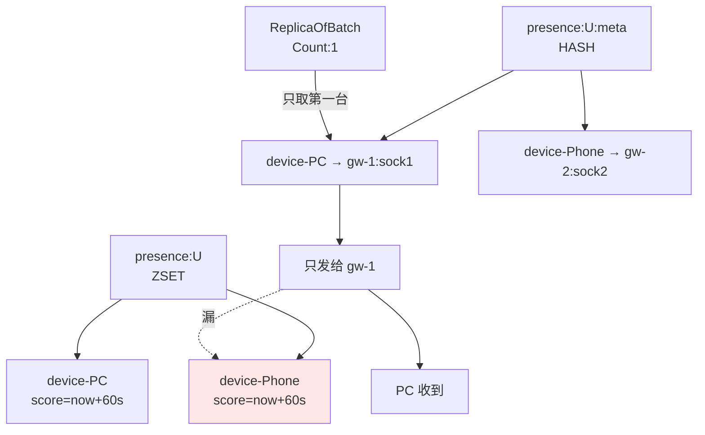

# 问题 05：多设备跨网关时，定向下行只投其中一台

> 严重度：**P1（现网正确性缺陷）**
> 状态：已确证（`presence` 查询把"用户"折叠成"一台设备 + 一个副本"）
> 关联：[方向 D · presence 定位](../04-presence定向下行定位优化.md)、[问题 04 · 缺投递回执](./04-定向下行缺投递回执.md)

---

## 一、一句话结论

`presence:{userId}` 是 **ZSET（成员=deviceId）**，天然按设备粒度记录在线状态；但下行定位把它当成了"用户级"属性——`ZRangeByScore(..., Count: 1)` 只取**一台**设备，然后把这台设备所在的**一个**副本当作投递目标。于是：

> 用户在 PC（连 gw-1）和手机（连 gw-2）同时在线时，**只有一台设备能收到实时消息**。

单网关部署不会暴露（所有设备在同一副本，`RouteToUser` 会投给该用户在本副本的全部连接）；**多网关副本一上就会发生**。

---

## 二、证据

### 2.1 查询只取一台设备

`biz/internal/service/presence.go:107-123`（单用户版）：

```go
alive, err := rdb.ZRangeByScore(ctx, presenceZKey(userID),
    &redis.ZRangeBy{Min: now, Max: "+inf", Count: 1}).Result()   // ← Count: 1
...
metas, err := rdb.HMGet(ctx, presenceZKey(userID)+":meta", alive[0]).Result()
```

`biz/internal/service/presence.go:127-150`（批量版，扇出用的就是这个）：

```go
for i, uid := range userIDs {
    cmds[i] = pipe.ZRangeByScore(ctx, presenceZKey(uid),
        &redis.ZRangeBy{Min: now, Max: "+inf", Count: 1})        // ← 同样是 1
}
...
aliveDevices = append(aliveDevices, rows[0])                     // ← 只保留第一台
```

### 2.2 每个用户只发一次

`biz/internal/service/downlink.go:93-113`：

```go
replicas, _ := ReplicaOfBatch(ctx, userIDs)      // uid → 一个 replica 字符串
for _, uid := range userIDs {
    rep, ok := replicas[uid]
    if ok && rep != "" {
        if directDownlink != nil && directDownlink(ctx, rep, &edgev1.DownlinkFrame{UserId: uid, RawFrame: frameData}) {
            metrics.DownlinkDirectTotal.Inc()
            continue
        }
    }
    fallback = append(fallback, uid)
}
```

`ReplicaOfBatch` 返回的是 `map[int64]string`——**一个用户只能映射到一个副本**，数据结构层面就限定了"一条消息只投一个网关"。

### 2.3 网关侧其实是"用户级"投递

`gateway/internal/hub/hub.go:120-133`：

```go
h.mu.RLock()
devices := h.conns[userID]          // 该用户在本副本的全部设备
for _, c := range devices { ... targets = append(targets, c) }
h.mu.RUnlock()
```

**只要帧到了"对的副本"，该用户在这个副本上的所有设备都会收到。** 所以缺口只在"副本选择"这一步——选了一个副本，就漏了其他副本上的设备。

---

## 三、根因

### 3.1 把"设备级状态"折叠成了"用户级属性"

数据结构本身是对的（ZSET 按 deviceId 存、meta 按 deviceId 存副本），错在读取时只取第一个成员：



### 3.2 为什么早期没暴露

| 条件 | 单网关 | 多网关 |
|---|---|---|
| 用户只有一台设备 | ✅ 正常 | ✅ 正常（该设备在唯一副本上） |
| 用户多设备、**都在同一副本** | ✅ 正常 | ✅ 正常（`RouteToUser` 覆盖全设备） |
| 用户多设备、**分布在不同副本** | 不可能发生 | ❌ **漏投** |

压测环境长期单副本（V3 报告明确 L9 多副本分流"未覆盖"），所以这个缺陷一直没被数据暴露。

### 3.3 与问题 04 的区别

| 问题 | 现象 | 成因 |
|---|---|---|
| 04 | 帧投到了**没有该用户**的副本 | presence 与真实连接状态不一致 |
| 05 | 帧投到了**有该用户、但不全**的副本 | 只取了一台设备的副本 |

两者都会表现为"某台设备收不到"，但修复方向不同：04 要回执，05 要按副本分组多投。

---

## 四、影响

| 维度 | 影响 |
|---|---|
| 多端同步 | PC 与手机不同步；用户以为"对方没回消息"，实际是自己另一台设备没收到 |
| 可靠性错觉 | 业务层记 `DownlinkDirectTotal`（成功），监控上看不出异常 |
| 补偿依赖 | 只能靠客户端重新拉全量（web 目前不做 seq 增量补拉，见问题 04 §2.4） |
| 多副本上线阻塞 | 在修好之前上线多副本，会把"单副本正常"变成"多设备用户随机漏一半" |

**这条缺陷实际构成"多副本扩容"的前置条件**——不修就上多副本，等于用稳定性换吞吐。

---

## 五、方案

### 5.1 改成"按副本分组，每个副本投一次"

```go
// 1) 取全部在线设备（不设 Count）
alive, _ := rdb.ZRangeByScore(ctx, zkey, &redis.ZRangeBy{Min: now, Max: "+inf"}).Result()

// 2) 批量解析 meta，得到 device → replica
metas, _ := rdb.HMGet(ctx, mkey, alive...).Result()

// 3) 按 replica 去重（同一副本只发一次）
replicas := map[string]struct{}{}
for _, m := range metas {
    if s, ok := m.(string); ok {
        if i := strings.Index(s, ":"); i > 0 { replicas[s[:i]] = struct{}{} }
    }
}

// 4) 每个副本各发一次同一个 DownlinkFrame
for rep := range replicas {
    directDownlink(ctx, rep, frame)   // 网关侧 RouteToUser 会覆盖该副本上的所有设备
}
```

### 5.2 合并进一次 Lua（与方向 D 一起做）

既然要一次取全设备，就顺手把"取设备 + 解析 meta + 按副本去重"放进一个 Lua，返回 replica 列表：

```lua
-- KEYS[1]=presence:{uid}  KEYS[2]=presence:{uid}:meta
local now = redis.call('TIME')
local ts  = tostring(tonumber(now[1]) * 1000 + math.floor(tonumber(now[2]) / 1000))
local devs = redis.call('ZRANGEBYSCORE', KEYS[1], ts, '+inf')
if #devs == 0 then return {} end
local metas = redis.call('HMGET', KEYS[2], unpack(devs))
local seen, out = {}, {}
for i = 1, #metas do
  local v = metas[i]
  if v then
    local p = string.find(v, ':')          -- 必须先判空：nil-1 在 Lua 里会抛错
    if p and p > 1 then
      local rep = string.sub(v, 1, p - 1)
      if not seen[rep] then seen[rep] = true; out[#out+1] = rep end
    end
  end
end
return out
```

**收益**：一次往返拿到副本集合，不再需要"取一台再解析"。

### 5.3 定向场景可以只查一台

`call:rejoin` 这类"发给指定设备"的帧（`DownlinkOpts.TargetDeviceID` 非空），只需要查该设备的副本：

```
HGET presence:{uid}:meta {targetDeviceID}   →  一个 replica
```

不必走全量分组。建议在 `PublishDownlink` 里按 `opts.TargetDeviceID` 分两条路径。

### 5.4 设备数上限

异常客户端可能注册大量 deviceId（每次连接用新的 `deviceId` query 参数，`ws/server.go:100`）。ZSET 会因此膨胀。

**建议**：`ZRANGEBYSCORE` 加 `LIMIT 0 8`，并在网关侧限制单用户设备数（例如 8 台，超出时踢最早的）。这既是性能保护，也是安全保护。

---

## 六、坑点

### 坑 1：同一副本内多设备不能重复投

`RouteToUser` 已经把帧投给该用户在本副本的**全部**连接。所以分组时**按 replica 去重**，不能按 device 循环（否则同一副本会被投 N 次，客户端收到重复帧）。

### 坑 2：`ZRANGEBYSCORE` 不带 LIMIT 在大用户上会变慢

正常情况下每用户 1–3 台设备，返回很小。但恶意/异常客户端可能积累几十上百个 deviceId（ZSET 成员不会自动清理，只靠 TTL 惰性摘除）。**必须加 LIMIT**。

### 坑 3：`HMGET` 的参数个数

`HMGET key field1 field2 ...` 是变长参数。设备数很多时会构造一个大命令。加 LIMIT 后自然受控。

### 坑 4：过期的设备仍会出现在 ZSET 里

`ZRangeByScore(Min: now)` 会过滤掉已过期的 score，所以不会把消息发给"已下线"的设备。但**如果客户端不走优雅断开**（直接断网），score 还没到期，仍会被认为在线——此时投过去是"网关查不到 → dropped"，属于问题 04 的范畴。

### 坑 5：多投会放大问题 04

每个"副本"多一次 Send，就多一次可能 miss。所以**建议先做问题 04（回执），再做本项**；否则修好漏投的同时会把"静默丢弃"的概率乘以设备副本数。

### 坑 6：与 `exceptDeviceID` 的交互

`read.sync` 会带 `exceptDeviceID`（排除本端）。分组投递时该字段照常透传，由网关过滤——**不要在业务层按设备过滤**，否则又把粒度搞混了。

---

## 七、验证

| 项 | 方法 | 通过标准 |
|---|---|---|
| 双网关双设备 | 起 2 个 gateway 副本，同一用户用 2 个 deviceId 分别连两个副本，向该用户发消息 | **两端都收到**（修复前只有一端收到） |
| 同副本多设备 | 2 个 deviceId 连同一副本 | 两端都收到，且**不重复** |
| 定向投递 | `TargetDeviceID` 指定其中一台 | 只有该设备收到 |
| 性能 | 多设备用户占比 10% 的混合负载 | 单条消息的下行 Send 次数 = 涉及副本数（通常 1–2），p99 无显著变化 |
| 大用户防护 | 构造 100 个 deviceId 的用户 | ZSET 查询受 LIMIT 限制，不出现慢查询 |

---

## 八、关联

| 文档 | 关系 |
|---|---|
| [方向 D · presence 优化](../04-presence定向下行定位优化.md) | 本项是它的"正确性版本"：合并 Lua 时应一并改成返回副本集合 |
| [问题 04 · 缺投递回执](./04-定向下行缺投递回执.md) | 先做 04 再做本项，否则漏投会变成"丢了也没人知道" |
| [方向 J · 横向扩容](../10-横向扩容与连接池代理.md) | 本项是多副本上线的前置条件 |
