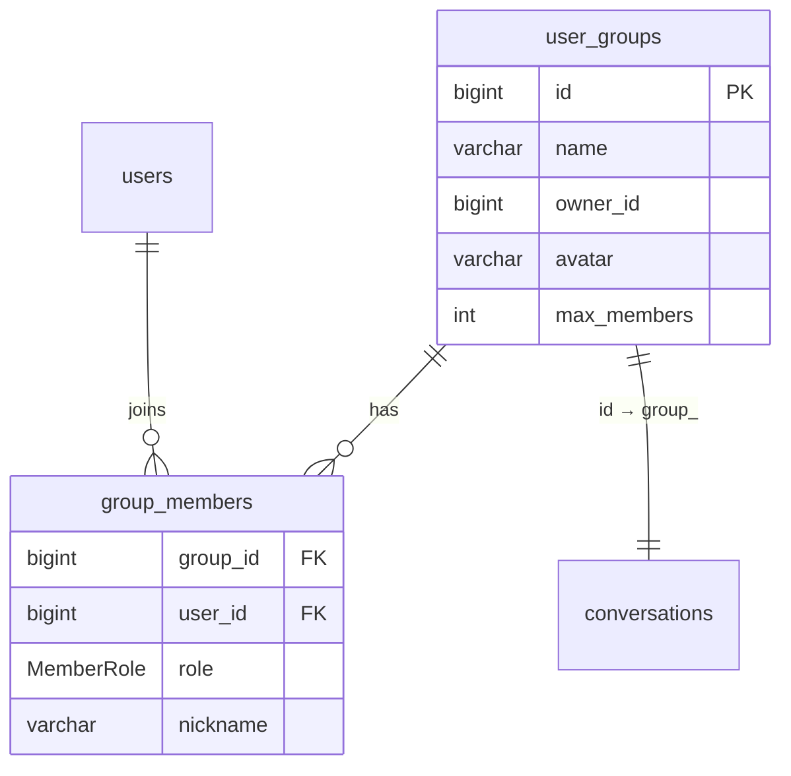

# 群聊功能设计方案(参照微信客户端)

> 现状:数据模型与**下行扇出**已具备(`group_members` 权威花名册 + `FanoutDownlink`),但**没有建群/管理 API**,Web 端也只认 `single_` 会话。
> 本方案补齐「建群 → 列表展示 → 群内收发 → 群资料」这一条最小可用链路,UI 对齐微信。

## 1. 范围

| 做 | 不做(明确排除) |
|---|---|
| 发起群聊(选好友建群) | 群公告、@所有人、群待办 |
| 群会话在列表/头部的展示(群名/群头像/成员数) | 二维码进群、邀请链接 |
| 群消息收发(复用现有扇出) | 群成员权限细分(管理员/禁言) |
| 群资料面板(成员网格、改群名) | 移出成员、退群转让群主 |
| 发送者昵称显示(群内必需) | 群红包/群接龙等业务消息 |

## 2. 数据模型(已存在,无需迁移)



会话 id 约定:`group_<groupId>`(与 `single_<小id>_<大id>` 并列),`service.GetConversationMembers` 已按此前缀分流。

## 3. 接口

| 方法 | 路径 | 入参 | 返回 |
|---|---|---|---|
| POST | `/group/create` | `{name?, userId, memberIds[]}` | `{groupId, conversationId, name}` |
| GET | `/group/info` | `?groupId=` | `{id,name,ownerId,memberCount,members[]}` |
| PUT | `/group/rename` | `{groupId,name,userId}` | `{success}` |
| POST | `/group/addMembers` | `{groupId,userId,memberIds[]}` | `{success}` |

约束:仅群主可改名/加人;成员上限取 `user_groups.max_members`(默认 500);建群时一次性写入 `group_members`(owner 的 role=owner)、`conversations(conv_type='group')`、每个成员的 `user_conversations`。

## 4. 建群时序

```mermaid
sequenceDiagram
    participant W as Web
    participant B as biz/api
    participant S as service
    participant DB as PG
    W->>B: POST /group/create {name, memberIds}
    B->>S: CreateGroup(owner, memberIds, name)
    S->>DB: BEGIN; INSERT user_groups RETURNING id
    S->>DB: INSERT group_members (owner + members, 去重)
    S->>DB: INSERT conversations (id='group_<id>', conv_type='group', title)
    S->>DB: INSERT user_conversations (每个成员)
    S->>DB: COMMIT
    S-->>W: {groupId, conversationId}
    S->>W: 广播 groupCreated(在线成员列表刷新)
```

## 5. UI/UX(对齐微信)

| 位置 | 微信行为 | 我们的实现 |
|---|---|---|
| 入口 | 通讯录页右上「+」→ 发起群聊 | 通讯录页工具栏加「发起群聊」按钮,复用弹层多选 |
| 建群 | 勾选好友 → 完成,直接进入群会话 | 多选 + 群名(可空,默认「群聊(N)」),完成后跳 `/chat/group_<id>` |
| 列表项 | 群头像为九宫格拼图,标题=群名,预览前缀「昵称: 内容」 | 头像暂用默认群图标;预览加 `发送者名: ` 前缀 |
| 头部 | 群名(成员数) 居中/左对齐,右侧 ⋯ | 标题 `群名(N)`;⋯ 打开群资料面板 |
| 群内消息 | 他人消息显示昵称(灰,小字),自己消息无昵称 | 复用消息行,群聊时在气泡上方渲染昵称 |
| 群资料 | 成员九宫格 + 「+」,群名可点改 | 右侧面板:群名输入 + 成员网格 |
