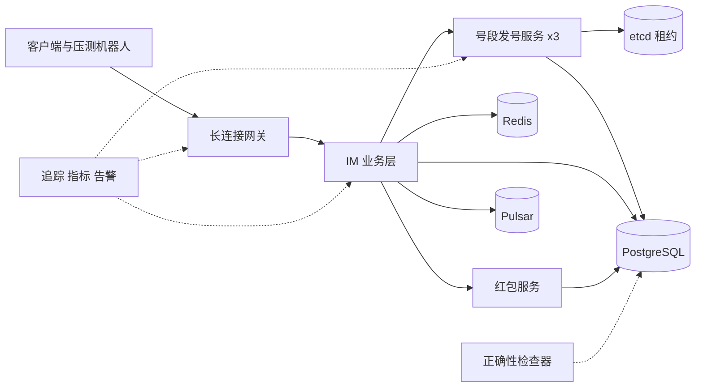

# 后端就业项目再评估：什么样的项目最能证明后端能力

> 输入：
> - 简历差距：[岗位拆解与方向定位](./01-岗位拆解与方向定位.md)；
> - 项目论证：[能力证明项目](./03-能力证明项目-做不做与具体怎么做.md) 与 [our-chat 演进还是新建 LiveArena](./04-基于our-chat演进还是新建LiveArena.md)；
> - 招聘数据：五家大厂校招数据（[大厂校招数据分析报告](../招聘数据分析/大厂校招数据分析报告.md)、[技术方向全景](../招聘数据分析/技术方向全景分析与方向选择.md)、[综合规划](../招聘数据分析/综合规划-技术方向与项目计划.md)）；
> - 项目候选：「就业方向」目录、TeamPilot 方案、[LLM NPC 仿真世界](./05-LLM-NPC仿真世界项目-分析与开发计划.md) 与 [万邦文档集](../../项目规划/万邦-智能文明世界/README.md) 里出现过的方案。
>
> 本文不新增数据，只重新推理。
>
> 本文目标：读完能回答三个问题。
> 1. 万邦为什么不适合当求职项目，哪些部分还用得上？
> 2. 判断一个后端求职项目好不好的标准是什么？你考虑过的九个项目各得几分？
> 3. 最终做什么、做到什么程度、每周做什么、怎么展示，以及怎样避免中途再换方向？

**先说结论。**

- **你的判断是对的：万邦是好的兴趣项目，但不是好的求职项目。** 原因有三：
  - 它按 10–14 人的后端团队设计，单人 4 个月只能做出很小一片；
  - 时间会大量流向 Unity、玩法和 NPC 人格这些后端面试不考的东西；
  - 五家大厂的游戏服务端岗位合计只有 8 条，通用后端有 677 条。
- **好的后端求职项目可以用一句话定义**：一个面试官一分钟能听懂的在线业务系统，加上三四个在高并发和故障下必须解决的真问题；每个问题配一组带对照组、可复现的实验，并且你讲得出取舍和踩过的坑。组件用得多不多，不在这个定义里。
- **按这个标准给你考虑过的九个项目打分：our-chat 有状态化演进排第一（4.65 分），新建 LiveArena 第二（4.10），万邦最后（2.35）。** 结论与 04 篇一致，这次把计划收紧为只服务后端求职：
  - 砍掉 Agent 效果评测、数仓，以及一切游戏和客户端工作；
  - 把红包（资金一致性）提前到 3 月前；
  - 12 月中旬投日常实习之前，先拿出第一批后端证据。
- **比选错项目更伤的，是反复换项目。** 两个多月里先后出现过的主项目方案有：TeamPilot、InferGate、实时协同编辑器、LiveArena、our-chat v3（及其加 Agent、加数仓的变体）、LLM NPC 小镇和万邦。每换一次，前一个方案里还没变成实验数据的投入就作废一次。离 12 月中旬开始投日常实习只剩约 4 周，离 3 月的暑期实习约 16 周，再换一次的代价会直接体现在简历上。所以第七节给出锁定规则：事先写死在什么情况下可以重新评估、可以调整什么。

---

## 一、万邦为什么不适合当求职项目

### 1.1 做不完的项目等于没有证据

万邦后端的规模：

- 按 14 个服务、10–14 人的团队设计，到商用约 24–34 个月；
- 客户端还要 Unity 与美术。

你到 3 月 7 日能给项目的时间约 180 小时，按这个规模只够做出一个区域的模拟，加上几个服务桩。面试深挖时会被问到：

- 跑起来了吗？
- 压测数据呢？
- 这个服务挂了你测过吗？

这三个问题的答案都会是「还没做到」。

03 篇的关键理解点在这里依然成立：校招面试评估的不是项目愿景有多大，而是三件事——你说的每个机制是不是自己做的，每个数字是不是自己测的，遇到过什么坑。一个做完、测过的中型项目，远胜一个只有设计文档的巨型项目。

### 1.2 时间会流向面试不考的技能

| 万邦的主要工作 | 占工作量 | 后端面试是否考察 |
|---|---|---|
| Unity 客户端、地图渲染、UI | 大 | 不考 |
| 玩法规则：战争、经济、文明演化的数值与平衡 | 大 | 不考 |
| NPC 记忆、决策、人格与对话质量 | 大 | 后端岗基本不考，AI 应用岗部分考 |
| 大模型推理调度与成本 | 中 | AI 应用后端岗考 |
| 分区模拟、租约与隔离、持久化与一致性 | 中 | **考，而且是加分项** |

后端面试会深挖的只有最后两行。它们在万邦里占不到一半，而且要先把前面几行做出来才有意义——没有玩法，分区模拟就没有负载可测。

### 1.3 领域太远，面试官难以评估

岗位数量上，五家大厂当前的游戏开发岗（引擎、客户端、服务端）合计 56 条，其中服务端只有 8 条；通用后端 677 条，AI 应用 432 条（[技术方向全景](../招聘数据分析/技术方向全景分析与方向选择.md) 第二节）。

面试过程上，绝大多数面试官做的是电商、广告、直播、IM 或基础设施：

- 面对万邦，他们要先花十分钟理解「区域状态机」「征服并入」，才能开始问技术；
- 面对 IM、交易这类题材，他们一分钟就能进入深挖。

游戏公司（网易、米哈游等）不在这份数据里，但 01 篇拆过的游戏服务端 JD 同样没有要求任何游戏专属技术。

### 1.4 它不是白做的

万邦的后端设计有三处可以直接用上。

- **设计模式可以搬进求职项目。**
  - 「租约 + epoch 两层隔离」就是 our-chat 号段发号服务的防脑裂方案；
  - 「决定表靠主键只写一次」就是红包领取靠唯一索引防重；
  - 「确定性回放与对账」就是第四节的正确性检查器。
- **它是系统设计题的练习材料。** 「设计一个 5000 人同时在线的持久世界」「跨分片转账怎么做到不丢不重」这类题，万邦文档几乎是现成的参考答案，面试遇到系统设计题时用得上。
- **它是兴趣的出口。** 拿到实习 offer 之后，可以把它当长期兴趣项目来做（第七节）。

**但不要把万邦写进简历的项目栏。** 没有实现的设计文档写上去，面试官一追问实现细节就会露底，反而拉低整份简历的可信度。

---

## 二、好项目的标准：从招聘数据和面试方式倒推

### 2.1 JD 里的能力分两类，项目只负责其中一类

下表的统计范围是与你高或中匹配的后端类与全栈、AI 工程岗位，共 1,499 条（[综合规划](../招聘数据分析/综合规划-技术方向与项目计划.md) 1.3 节）：

| 能力 | 写在职责里 | 写在要求里 | 由谁证明 |
|---|---|---|---|
| 架构 / 系统设计 | 54.4% | 26.1% | 项目 |
| 性能优化 | 54.4% | 15.5% | 项目 |
| 高并发 | 33.5% | 4.5% | 项目 |
| 稳定性 / 监控 | 33.3% | 5.7% | 项目 |
| 高可用 / 容灾 | 10.7% | 2.7% | 项目 |
| 分布式 | 7.6% | 17.0% | 项目 + 学习 |
| 数据库 | 3.6% | 24.8% | 学习 + 项目 |
| 缓存 / Redis | 1.9% | 17.9% | 学习 + 项目 |
| 消息队列 | 0.7% | 14.7% | 学习 + 项目 |
| 操作系统 | 1.4% | 38.5% | 学习 |
| 数据结构与算法 | 0.1% | 58.4% | 学习 |

职责里的能力是入职后要做的事，面试官靠项目深挖判断你做没做过；要求里的知识是笔试和八股直接考的，项目替代不了。**所以项目要瞄准上半张表：架构设计、性能、高并发、稳定性、高可用与分布式。**

只看后端类岗位（不含全栈、AI 工程），五家等权平均的出现率依次是：架构设计 70%、稳定性与监控 50%、高性能 49%、分布式 48%、云原生 25%、高可用 23%、高并发 22%（[大厂校招数据分析报告](../招聘数据分析/大厂校招数据分析报告.md) 3.4 节）。

### 2.2 面试怎么考项目：六类追问

| 追问类型 | 典型问题 | 项目必须准备好的证据 |
|---|---|---|
| 架构 | 画一下数据流；为什么拆成这几个服务 | 设计文档、架构决策记录（ADR，记下每个关键决定、被否方案与理由的短文档） |
| 数字 | QPS 多少、p99 多少、怎么测的、压测机什么配置 | 可重跑的压测脚本与原始数据 |
| 故障 | 这个节点挂了会怎样；两个节点都以为自己是主怎么办 | 故障注入实验与报告 |
| 一致性 | 消息会不会丢、会不会重、会不会乱序；钱会不会扣两次 | 对账与不变式检查的结果 |
| 扩展 | 量涨 10 倍先坏哪里 | 容量模型：瓶颈在哪、每核能扛多少 |
| 取舍与复盘 | 为什么不用 X；踩过什么坑 | ADR 里的被否方案；开发日志与事故复盘 |

前两类几乎所有学生项目都能答上一些；后四类才拉开差距。它们恰好对应 01 篇校准出的缺口：有状态容灾、共识与租约、SLO 与容量。

### 2.3 六条标准与权重

| 标准 | 权重 | 含义 |
|---|---|---|
| A 职责侧能力覆盖 | 25% | 能否自然地覆盖架构、性能、高并发、稳定性、高可用、分布式与一致性，而不是硬塞组件 |
| B 深挖耐受与区分度 | 20% | 有没有真正难、能讲 40 分钟的问题；在同类候选人里是否少见，或者做得更深 |
| C 证据可信度 | 20% | 动机是否来自真实问题，数字能否复现，有没有对照组 |
| D 按期完成概率 | 15% | 单人、约 180 小时、低成本能否做到可展示的程度 |
| E 业务可理解度 | 10% | 面试官能否一分钟听懂场景，把时间花在技术上 |
| F 叙事连贯 | 10% | 能否和你的实习与已有项目连成「实时在线服务稳定性后端」这一条线（01 篇第三节） |

### 2.4 四种常见的坏项目

- **组件堆砌型**：Kafka、ES、K8s、Redis Cluster 全用上，却说不出每个组件解决了什么问题、不用会怎样。面试官问一句「为什么这里要用 Kafka」，回答就停住了。
- **数字不可复现型**：简历写「QPS 10 万」，被问压测机配置、开环还是闭环、p99 是客户端口径还是服务端口径时答不上来。答不上来的数字比没有数字更扣分。
- **照教程型**：黑马点评、仿 12306、6.824 Raft，题材和代码与几千份简历重合，而且没有「我遇到的问题」。
- **愿景过大或分散型**：一个做不完的平台，或者三个各做一点的小项目，面试官挑任何一个深挖都会露底。万邦属于前者；03 篇否掉的「秒杀 + Raft KV + 监控平台」组合属于后者。

---

## 三、九个候选项目逐一评估

评分是判断，不是统计。每项 1–5 分，越高越好；每一行的理由写在最后一列。

| 项目 | 出处 | A | B | C | D | E | F | 加权 | 一句话 |
|---|---|---|---|---|---|---|---|---|---|
| **our-chat v3 有状态化演进** | 04 篇方案 C | 5 | 4 | 5 | 4 | 5 | 5 | **4.65** | 对照组是你真实用过的 v2 设计；IM 题材常见，靠深度区分 |
| LiveArena 直播 PK 房间（新建） | 03 篇 | 5 | 5 | 3 | 3 | 4 | 4 | 4.10 | 题材天然逼出有状态、钱、扇出、排空；但要从零开始，对照开关像是为演示而做 |
| 实时协同编辑器（CRDT 同步） | 就业方向目录 28 号 | 3 | 4 | 3 | 3 | 5 | 2 | 3.30 | 深核是客户端的冲突合并算法，偏前端与全栈，后端只是同步服务 |
| 高并发秒杀、电商交易 | — | 3 | 2 | 3 | 5 | 5 | 2 | 3.20 | 好做好懂，但最烂大街；只逼出高并发，高可用要硬加 |
| TeamPilot 企业 AI 工作流平台 | [TeamPilot 方案](../TeamPilot_企业级AI工作流知识库运维平台_项目方案.md) | 3 | 3 | 3 | 3 | 3 | 4 | 3.10 | 应用层 RAG 平台供给过剩，范围容易失控，原方案自己也已标注废弃 |
| InferGate 自托管推理与深度 RAG | [就业方向 07 号](../就业方向/07-项目开发方案-自托管推理与深度RAG平台.md) | 3 | 4 | 3 | 2 | 3 | 3 | 3.05 | 瞄准 AI Infra，但五家的 AI Infra 岗 48% 属于研究型专项；而且需要 GPU |
| Raft KV 或自研中间件 | — | 2 | 3 | 4 | 4 | 3 | 2 | 3.00 | 原理深，但容易被看成课程作业，缺业务与稳定性 |
| 可视化低代码平台 | 就业方向目录 19、[26 号](../就业方向/26-低代码搭建平台-完整技术方案与开源标杆分析.md) | 2 | 3 | 3 | 3 | 4 | 2 | 2.75 | 深核是编辑器与 Schema 渲染，偏前端；出码这块正在被 AI 工具吃掉 |
| 万邦 / LLM NPC 仿真世界 | 05 篇、项目规划目录 | 4 | 3 | 1 | 1 | 2 | 2 | 2.35 | 设计覆盖面广，但 4 个月拿不出可验证的证据 |

评分维度比 04 篇多了「业务可理解度」与「叙事连贯」两项，所以前两名的分差比 04 篇的 4.25 对 4.00 大。

### 3.1 前两名为什么拉开差距

LiveArena 和 our-chat v3 的能力覆盖相同，差在证据可信度和按期完成：

- **对照组的可信度不同。** our-chat v3 的对照组，是 v2 里真实运行过的 Redis INCR 发号。「我当时这么设计，后来实验发现它在主从切换时会出错，于是演进成现在的设计」，是工程师真实的成长路径。LiveArena 的对照组是「关掉 fencing 开关」，面试官可能怀疑这个开关是为演示而做的。
- **起点不同。** our-chat 已部署在 tujiang.tech，网关、鉴权、前端、压测、看板都能复用；LiveArena 要从零搭起这些。

**敏感性。** 把「区分度」权重从 20% 提到 30%，「可信度」相应降到 10%，LiveArena 升到 4.30，our-chat v3 是 4.55，排名不变。只有在你明确主投 TikTok 直播这类团队，并且认定题材贴近比演进深度更重要时，才该选 LiveArena（04 篇 3.4 节）。

### 3.2 其他候选差在哪

- **协同编辑器和低代码平台**是 9 月按「前端/全栈 + AI 抗性」推出来的旗舰，深核在客户端。你现在的目标是后端，它们的后端部分太薄：协同编辑器的服务端主要是转发与持久化更新，低代码平台的服务端基本是增删改查。
- **TeamPilot 与 InferGate** 的问题在岗位面：应用层 RAG 平台供给过剩；AI Infra 在这五家门槛很高，常规难度只占 5%，现在能投又与你匹配的只有 10 条（技术方向全景 3.3 节与第二节）。
- **秒杀和 Raft KV** 更适合当练习。秒杀的库存扣减、Raft 的选主与日志复制都应该作为知识学会，但不适合当主项目。
- **万邦**的问题不在设计，而在做不完（第一节）。

---

## 四、推荐方案：our-chat v3，一个可证明的实时通讯后端

### 4.1 一句话定义

> 在已上线的 our-chat 上，围绕「消息不重不乱、扛得住、看得见能恢复、钱不出错」四个真问题做有状态化演进，每个问题都用带对照组的实验和自动化的正确性检查来证明。

它沿着你已有的证据往深处走。our-chat 已经有三项可量化的成果（01 篇第六节）：

- 发号行锁瓶颈的优化，p99 从 2075ms 降到 65ms；
- 1 万连接爬坡；
- PG 64 分区与 359 万行回填。

缺的正是有状态容灾、共识与租约、SLO 与容量，下面四条证据线分别补上它们。

### 4.2 系统全景

| 组件 | 现状 | v3 要做的 | 对应证据线 |
|---|---|---|---|
| 长连接网关 | 已有 WebSocket、JWT 握手、gRPC 双向流、背压 | 扇出优化、排空发布 | 二、交付 |
| IM 业务层 | 已有无状态多副本、Redis INCR 发号、分区表、读写分离 | 接入号段发号、写入时校验 epoch | 一 |
| 号段发号服务 | 新增 | 有状态发号、etcd 租约接管、两层 fencing | 一 |
| 红包服务 | 新增 | 资金一致性 | 四 |
| 正确性检查器 | 新增 | 每次实验后自动检查不变式与对账 | 三 |
| 可观测 | 已有 Prometheus、Grafana | 链路追踪、SLO、燃烧率告警 | 三 |
| 部署 | 已有 Docker Compose | k3s、Helm、滚动发布 | 交付 |
| Agent 与 RAG | 已有 | 冻结，3 月前不改动 | — |

### 4.3 四条证据线

#### 证据线一：消息不重、不乱（分布式一致性与有状态高可用）

**真问题。** v2 用 Redis INCR 为每个会话发号。Redis 主从复制是异步的：主库确认了 INCR、还没复制到从库就宕机，切换后新主库上的计数会小于已经发出去的号，之后就会发出重复的号。

所以第一步是在 v2 上复现：主从切换 20 次，统计重复号与回退的次数。

- 测出了重复或回退：这就是 v3 最有力的动机。
- 没测出来（checkpoint 防住了）：动机改为「热点会话的发号吞吐」和「Redis 不可用时发号随之不可用」，并如实写进报告（04 篇 5.3 节）。

**做什么。** 设计与 SQL 见 04 篇 5.3 节，要点如下：

- 会话哈希到 1024 个号段，每个号段在 PG 只持久化一个按步长 10000 推进的上限，发号几乎全在内存里完成；
- 由 etcd 租约决定每个号段的属主；
- 新属主接管时，把上限推进一个步长，从旧上限之后开始发号——号会跳，但仍严格递增；
- 两层 fencing：发号前检查租约是否过期；写消息时，在同一条 SQL 里校验号段当前的 epoch；
- 客户端同步改为「拉取 seq 大于本地最大值的消息」。

**实验。**

- v2 主从切换对照实验；
- E4：kill -9 号段属主，恢复 p99 ≤ 5 秒、零重复号；
- E5：暂停属主，分三组对照——两层都关；只开第一层，并用故障点强制命中窗口；两层都开。两层都开时，重复号与增量同步漏掉的消息都应为 0。

**能讲的取舍。**

- 为什么不用 Redlock：它没有 fencing 语义（来源：Martin Kleppmann《How to do distributed locking》，2016）。
- 为什么不用 Snowflake：会话内要求严格递增，而时钟回拨会出错。
- 为什么允许跳号：接管因此只需每个号段一次数据库更新；代价是客户端不能再靠号是否连续来判断丢消息。
- 租约时长调大、调小各有什么代价。
- etcd 整体不可用时怎么办。

**对应能力。** 分布式（职责 7.6%、要求 17%，后端 JD 48%）、高可用（后端 JD 23%）、数据库条件写入、Redis 复制原理。

#### 证据线二：扛得住（高并发与性能）

**真问题。** 现有证据是 1 万连接、100 人群扇出 p99 2ms。还缺四样：

- 5 万级连接；
- 大群洪峰；
- 服务端 profiling 的前后对照；
- 从压测结果推出机器数的容量模型（03 篇第一节）。

**做什么。**

- 写一个开环压测机器人：按计划时刻发送，不等上一个请求返回，用能精确计算高分位数的直方图记录延迟；
- 优化群消息扇出：每条消息在每个网关只序列化一次、批量写、对象复用；
- 慢连接只能限流或断开重连，不能像状态帧那样丢弃，因为 IM 消息是可靠消息（04 篇 1.2 节）。

**实验。**

- E1：单网关 5 万连接，内存 ≤ 2GB；
- E2：2000 人群每秒 200 条、持续 60 秒，测投递 p99，要求零丢失；
- pprof 定位并优化至少一个热点，给出火焰图与 CPU 的前后对比；
- E3：容量模型，得出每核能承载多少连接与消息。

**能讲的取舍。**

- 开环与闭环压测的区别：闭环压测会让测出的延迟偏乐观；
- 大群该用写扩散还是读扩散；
- 5 万连接时，瓶颈先出现在内存、文件描述符、临时端口，还是 accept 队列。

**对应能力。** 高并发（职责 33.5%）、性能优化（职责 54.4%）；计算机网络与 Go 运行时属于要求侧，靠实验加深理解。

#### 证据线三：看得见、能恢复（稳定性工程）

**真问题。** 你在智源做过监控与告警，但没有 SLO、没有演练，也没在故障下验证过防护是否有效（03 篇第一节）。

**做什么。**

- 链路追踪从网关贯穿到数据库：任意一条消息凭请求 ID 1 分钟内能查到完整链路。
- SLO 定为 99.9% 的消息发送成功，用 1 小时与 5 分钟两个窗口的燃烧率告警，每个告警配一份处置手册。
- 正确性检查器：一个独立程序，每次实验后读取数据库与客户端日志，自动检查四条不变式。E4、E5、E8 和红包实验都用它判定结果。
  1. 同一会话的 seq 严格递增且唯一；
  2. 每条已确认的消息恰好持久化一次；
  3. 每个在线成员都能同步到它；
  4. 红包做完后增加一条：账本借贷之和为零。
- 至少一次完整的故障演练与复盘，写清时间线、影响、根因、改进项。

**实验。**

- E7：注入 10% 错误后，燃烧率告警按推算约 8.6 分钟触发，恢复后约 4.3 分钟解除；
- E8：100 万条消息期间随机注入 20 次故障（进程崩溃、网络分区、Redis 主从切换），检查器报告的差异为 0；「先推送后落库」的对照组不为 0。

**能讲的取舍。**

- 为什么用燃烧率而不是固定阈值告警；
- 「至少一次投递 + 幂等写入」为什么等价于恰好一次的效果；
- 对账为什么是最后一道防线。

**对应能力。** 稳定性与监控（后端 JD 50%，职责 33.3%）、故障定位与处置。

★ **正确性检查器是这个项目里区分度最高的一件东西。** 多数学生项目说「消息不丢」只是口头保证；你能拿出「100 万条、20 次故障、检查器报告差异为 0」。这接近 Jepsen 一类正确性测试的思路，只是规模小得多。想再进一步，可以用 Go 写的线性一致性检查器 Porcupine（来源：GitHub anishathalye/porcupine）检查发号服务的操作历史。

#### 证据线四：钱不出错（资金一致性）

**真问题。** 交易、电商、支付是 Agent 之外最大的业务方向，占技术岗约 9%（综合规划 1.1 节）；「钱会不会扣两次」是后端面试的经典追问。IM 里最自然的资金场景就是红包。

**做什么。** 详见 04 篇 5.5 节：

- 发红包：在一个事务里完成插入红包、预先算好每份金额、扣发送者余额、记账、写 outbox；
- 抢红包：用 `FOR UPDATE SKIP LOCKED` 让并发的领取者各取一份，不在同一行上排队；用 (packet_id, grabbed_by) 唯一索引保证一人只抢一次；
- 过期退款：带状态条件的更新，保证只退一次，任务重跑无害；
- 对账：明细之和等于总额，已领加退款等于总额，账本借贷之和为零。

**实验。** 10 万次并发抢红包期间注入故障，资金对账差异为 0；「抢到后另起一次调用给领取者入账」的双写对照组差异不为 0。

**能讲的取舍。**

- 为什么不用 Redis 预扣加异步落库：快，但故障时账实不符的窗口更大；
- 为什么不用 2PC 或 TCC：单库事务能解决的，就不要引入分布式事务；
- 热点大群红包的行锁怎么缓解。

**对应能力。** 数据库事务与隔离级别、幂等、outbox、对账，以及交易领域的业务理解。

#### 交付：k3s 与滚动发布

用 Helm 部署到 k3s：

- 网关和发号服务配置就绪探针与 preStop 排空：网关通知客户端带随机延迟重连，发号服务主动交出号段；
- 用 PodDisruptionBudget 限制同时被驱逐的副本数。

验收标准：逐个滚动发布网关、业务层、发号服务，期间消息零丢失、重连成功率 ≥ 99.9%。这块对应云原生能力，后端 JD 出现率 25%，腾讯达 65%。

### 4.4 能力覆盖矩阵

| 能力（后端 JD 出现率） | 由什么证明 |
|---|---|
| 架构设计（70%） | v3 设计文档与至少 3 篇 ADR；一个系统的演进全过程 |
| 稳定性与监控（50%） | 证据线三；智源的熔断与告警闭环 |
| 高性能（49%） | 证据线二；v2 发号瓶颈优化（p99 2075ms → 65ms） |
| 分布式（48%） | 证据线一：租约、fencing、跳号；E8 的投递语义 |
| 云原生（25%） | 交付模块 |
| 高可用（23%） | 证据线一的 E4、E5；交付模块的排空发布 |
| 高并发（22%） | 证据线二的 E1、E2 |
| MySQL / 数据库（20%） | 条件写入、SKIP LOCKED、唯一索引幂等、分区表 |
| Redis（15%） | v2 主从切换实验：异步复制为什么会丢已确认的写入 |
| 消息队列（14%） | outbox、至少一次投递加幂等；已有 Pulsar 摄入管线 |
| AI / 大模型（后端岗要求中 46%–77% 提到） | 腾讯诊断 Agent、our-chat 的 Agent 与 RAG（已有）；面试季可选「Agent 可靠执行」 |
| 交易一致性（业务方向 9%） | 证据线四 |

### 4.5 刻意不做的事

| 不做 | 理由 |
|---|---|
| Unity、游戏玩法、NPC | 后端面试不考（第一节） |
| 数仓（对口占坑篇的 M8） | 只在主投数仓岗时才值得；本文以后端为主 |
| Agent 效果评测（综合规划的 M1） | 对 AI 全栈岗有价值，但不服务后端主线；AI 证据已有腾讯经历打底 |
| 自研 Raft、MQ | 原理靠读论文和 etcd 源码补；项目里把 etcd 用对，比重写一个更像真实工作 |
| 为拆而拆的微服务 | 只新增两个服务：发号（有独立的状态与故障域）和红包（有独立的资金边界） |
| 大规模集群 | 3 台小云主机加 1 台压测机，就能复现全部实验 |

### 4.6 与之前计划的差别

| 项 | 综合规划 / 对口占坑 | 本文 | 原因 |
|---|---|---|---|
| Agent 效果评测（36 小时） | 第一个做 | 移出 3 月前主线 | 目标改为后端 |
| 数仓与数据飞轮（40 小时） | 新增 | 删除 | 同上 |
| 红包 | 面试季 | 2 月完成 | 交易是第二大业务方向，3 月投暑期实习前要有 |
| 12 月中旬前的证据 | Agent 评测数字 | v2 发号对照、单节点号段、E2 与 pprof | 投后端日常实习时要有后端证据 |
| 正确性检查器 | E8 里的一次对账 | 独立成件，所有实验共用 | 区分度最高 |
| k3s | 3 月前或面试季 | 3 月前，压缩到 8 小时 | 腾讯后端 JD 65% 提到云原生 |
| 锁定规则 | 无 | 新增（第七节） | 防止再次换方向 |

---

## 五、时间计划（11 月 16 日至 3 月 7 日，约 180 小时）

### 5.1 模块与小时

| 模块 | 小时 | 内容 |
|---|---|---|
| M0 体检、设计、实验环境 | 14 | 04 篇第四节的六项代码体检；v3 设计文档与 3 篇 ADR；一条命令拉起实验环境 |
| 证据线一：消息不重不乱 | 60 | v2 对照 8；单节点号段与业务层接入 14；多节点租约 14；接管、两层 fencing 与 E4 14；E5 10 |
| 证据线二：扛得住 | 26 | 压测机器人 6；E2 与 pprof 14；E1 与容量模型 6 |
| 证据线三：看得见能恢复 | 28 | 链路追踪与 SLO 8；正确性检查器 6；E8 8；E7 与演练复盘 6 |
| 证据线四：钱不出错 | 26 | 发与抢 12；退款、对账与故障注入实验 14 |
| 交付：k3s 与滚动发布 | 8 | Helm、探针、排空、PodDisruptionBudget、滚动发布实验 |
| 证据整理与面试准备 | 18 | README 能力证明索引、3 篇博客、演示视频、简历定稿、3 次模拟面试 |
| **合计** | **180** | |

算法与八股的时间不动（综合规划第五节）：项目证明职责侧，学习覆盖要求侧，两者都不能少。机器学习基础可以从 12 小时降到 6 小时，省下的时间补操作系统、网络、数据库与 Go 运行时的原理，即 01 篇第六节指出的门槛缺口。

### 5.2 周计划

| 周次 | 日期 | 任务 | 小时 |
|---|---|---|---|
| W1 | 11/16–11/22 | 六项代码体检；v3 设计文档与 3 篇 ADR；一条命令拉起实验环境 | 14 |
| W2 | 11/23–11/29 | v2 发号在 Redis 主从切换下的对照实验与报告；开环压测机器人 | 14 |
| W3 | 11/30–12/06 | 号段发号单节点、业务层接入、`seq.mode` 开关、客户端增量同步改造 | 14 |
| W4 | 12/07–12/13 | E2 第一轮与一处 pprof 优化；简历后端版 v1 | 14 |
| — | 12 月中旬 | 投字节日常实习，优先后端岗里的实时互动、IM、直播团队 | — |
| W5 | 12/14–12/20 | 号段多节点：etcd 租约、抢占、续约失败时自我隔离 | 14 |
| W6 | 12/21–12/27 | 接管跳号、两层 fencing、E4 | 14 |
| W7 | 12/28–01/03 | E5 三组对照与报告；第一篇博客 | 14 |
| W8 | 01/04–01/10 | 链路追踪与 SLO 看板；正确性检查器 | 14 |
| W9–W10 | 01/11–01/24 | 期末，不做项目 | 0 |
| W11 | 01/25–01/31 | E8 正式运行；E7 燃烧率告警实验 | 14 |
| W12–W13 | 02/01–02/14 | 红包：发、抢、幂等（春节减量） | 12 |
| W14 | 02/15–02/21 | 红包：过期退款、对账、双写对照组与故障注入实验 | 14 |
| W15 | 02/22–02/28 | k3s 与滚动发布实验；E1 与容量模型 | 14 |
| W16 | 03/01–03/07 | 证据整理、演示视频、简历定稿、模拟面试 | 14 |

12 月中旬投递时，简历上已经有三条新的后端证据：v2 发号缺陷的复现、单节点号段服务、E2 群消息洪峰与 pprof 前后对比。2 月底投暑期实习时，四条证据线全部完成。

### 5.3 面试季（3 月 8 日至 5 月 30 日，每周约 8 小时）

| 内容 | 小时 | 价值 |
|---|---|---|
| 直播聊天室：5 万人、每秒 5000 条弹幕，可见延迟 p99 ≤ 400ms，高优先级消息零丢失 | 22 | 热点扇出与「可覆盖」语义，贴近直播团队 |
| Agent 可靠执行：进程被杀后从步骤日志恢复，有副作用的工具调用恰好执行一次 | 18 | 把 AI 与分布式结合起来，投 AI 应用后端时的亮点 |
| 把号段租约库抽成开源库 | 12 | 后端 JD 的加分项里，开源出现得最多（约 40%） |
| 排空发布 E6 完整版 | 8 | 补全高可用的发布侧证据 |
| 机动 | 36 | 按面试反馈补短板 |

### 5.4 裁剪顺序

进度落后时按顺序砍：

1. E1 从 5 万连接降到 2 万，并写明硬件限制；
2. k3s 只写设计，不实际部署；
3. E7 移到面试季；
4. 红包的过期退款移到面试季。

**绝不砍**：v2 对照实验、E4、E5、E8、红包对账、每周的算法时间。

---

## 六、怎么展示：让面试官相信

### 6.1 仓库首页的能力证明索引

README 第一屏放一张表，列出能力、机制、实验、结果（实测）、报告链接，让面试官打开仓库 30 秒内就能看到你证明了什么。示例行如下，结果栏在实验后填写：

| 能力 | 机制 | 实验 | 结果（实测） | 报告 |
|---|---|---|---|---|
| 防脑裂 | etcd 租约 + 两层 fencing | E5 三组对照 | 两层开启时重复号 __、漏同步 __；关闭时 __ | reports/E5.md |

### 6.2 每份实验报告的五个要素

1. 假设；
2. 环境：机器配置、软件版本，压测机与服务端分离；
3. 方法：负载模型、故障注入方式、统计窗口；
4. 结果：含对照组，附原始数据；
5. 结论与局限。

### 6.3 简历怎么写

先做零成本的叙事调整（01 篇第六节）：

- 求职意向改为「后台开发（实时服务与稳定性方向）」；
- 技术栈第一行换成 Go、PostgreSQL / Redis、etcd、Linux、Prometheus；
- 客户端相关的经历压缩成一行。

our-chat 条目示例如下。下划线处填实测值，没测过的数字一个都不要写：

- 复现 v2 发号方案的缺陷：Redis 主从切换 20 次，产生重复 seq __ 次；设计号段发号服务（etcd 租约 + 两层 fencing），kill -9 属主后恢复 p99 __ 秒，暂停属主的脑裂实验中重复号为 0（关闭 fencing 的对照组为 __）。
- 2000 人群每秒 200 条消息、持续 60 秒，投递 p99 __ ms、零丢失；用 pprof 定位 ____ 热点，CPU 下降 __%。
- 自研正确性检查器：100 万条消息期间注入 20 次故障，确认每条已确认的消息恰好持久化一次（「先推送后落库」对照组差异 __ 条）。
- 红包：10 万次并发抢红包加故障注入，资金对账差异为 0（双写对照组差异 __ 笔）。SLO 99.9% 配双窗口燃烧率告警，任意消息凭请求 ID 1 分钟内可定位全链路。

### 6.4 深挖问题清单

下面按证据线列出最可能被问的问题，答案都要能落到你自己的实验数据上。

- **证据线一**：Redis 异步复制为什么会丢已确认的写入？租约过期但进程还在跑会怎样？两层 fencing 各挡住什么、挡不住什么？允许跳号对客户端同步有什么影响？etcd 不可用时发号怎么办？
- **证据线二**：开环和闭环压测测出的延迟为什么不同？5 万连接时瓶颈先出现在哪里？慢连接为什么不能丢消息？大群用写扩散还是读扩散？
- **证据线三**：燃烧率怎么算，为什么用两个窗口？至少一次加幂等为什么等价于恰好一次？检查器怎么判断「漏同步」？
- **证据线四**：SKIP LOCKED 解决了什么问题？唯一索引冲突时返回什么？退款任务重跑为什么无害？为什么不用 TCC？
- **IM 通用问题**：写扩散与读扩散、可靠投递、多端同步、离线消息、已读回执（04 篇 5.9 节）。

### 6.5 博客与开源

博客写三篇，直接由实验报告改写，发在掘金：

- 《Redis 主从切换会让 IM 发号重复吗：一次复现实验》
- 《号段发号服务的接管与两层 fencing》
- 《100 万条消息、20 次故障：怎么证明一条不丢》

面试季再把号段租约库抽成独立的开源库。这两样都有数据支撑：腾讯 AI 全栈岗的 JD 点名了技术博客；在后端 JD 的加分项里，开源出现得最多（大厂校招数据分析报告 3.7 节）。

---

## 七、锁定规则：怎样不再中途换方向

1. **3 月 7 日前，our-chat v3 是唯一的主项目。** 新想法（万邦、协同编辑器、InferGate……）一律写进「以后再做」清单，拿到实习 offer 之前不写代码。
2. **只在三个节点重新评估，而且只调范围，不换题材：**
   - W1 代码体检结束时：不通过就按 04 篇第六节切到 LiveArena，模块与实验不变；
   - 1 月 10 日（期末前）：按进度裁剪；
   - 投递后累计 10 场面试时：按反馈集中暴露的缺口补短板。
3. **每周至少一个可见产出**：一份实验报告、一个合并的功能，或一篇博客草稿。连续两周没有产出，先砍范围，而不是换项目。
4. **兴趣时间每周不超过 2 小时**，只读、只想，不写代码。这段时间可以拿万邦的文档练系统设计题。
5. **换方向需要新的外部信息**，例如面试反馈集中指向某个缺口，而不是「另一个题材更酷」。

---

## 八、风险与应对

| 风险 | 应对 |
|---|---|
| 代码体检不通过 | 按 04 篇第六节新建 LiveArena，复用 our-chat 的网关代码，模块与实验不变 |
| v2 实验没测出重复号 | 动机改为热点会话吞吐与 Redis 可用性耦合，如实写进报告；E5 的另两组对照照做 |
| 进度落后 | 按 5.4 节的顺序裁剪 |
| 拿到日常实习 | 项目降到每周 8–10 小时，只保留证据线一与 E8 |
| 觉得 IM 题材平淡 | 区分度来自对照组、正确性检查器和演练复盘，而不是题材；题材新颖只在简历筛选那一眼有用（04 篇 3.2 节） |
| 面试官怀疑代码是 AI 写的 | 保留开发日志与原始实验数据；能现场改参数重跑实验；ADR 里写清被否方案 |

---

## ★ 关键理解点

**★ 正向：后端求职项目的价值 = 真问题 × 可复现证据 × 讲得出的取舍。** 组件数量、题材大小都不在这个式子里。our-chat v3 的每个模块都从一个真问题出发，比如 v2 发号在主从切换下会重号，再用带对照组的实验证明它被解决了。

**★ 反向：三类项目会在深挖里失分。** 做不完的宏大项目、照教程的项目、数字不可复现的项目都是如此。而每换一次项目，已经积累的证据就清零一次——这对你现在的威胁，比选错题材更大。

**★ 边界：项目只能证明职责侧的能力。** 算法、八股和原理这些要求侧的门槛，项目替代不了；真实生产流量的经验，只能靠实习补上。项目的任务，是把你送进一个能补上这些经验的团队。

**★ 对比：兴趣项目与求职项目优化的目标不同。** 兴趣项目优化「我想做什么」，求职项目优化「面试官能验证什么」。万邦属于前者，our-chat v3 属于后者。两者都有价值，只是不该在同一段时间里抢同一份精力。
