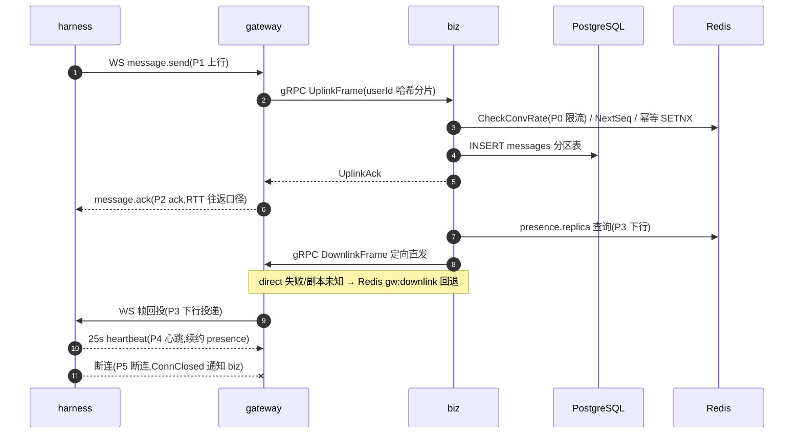

# 监测设施 · 压测分析 SOP V3(全 Go 体系)

> **用法**：开新会话后把本文档完整贴给 AI(或让其先读本文档再开工)。
> 承接 SOP V1(Node vs Go 双跑)→ SOP V2(全 Go 单边深度)→ V3(修正事实、补齐统计口径与实验设计)。
> 本文档全部事实锚定源码与实测,**禁止凭记忆脑补**——开工前先按 §2 读源码核实。
>
> V2 保留不动作历史记录;**新一期一律按 V3 执行**。V2 中已被 V3 推翻的条目见下方修订记录。

### 修订记录(V3 相对 V2)

| 类别 | 变更 | 原因 |
|---|---|---|
| **事实失效** | 删除全部 `server/`(Node 业务层)表述;`REALTIME_MODE` 开关已不存在 | Node 业务层已整体删除,仓库里任何提到 `server/` 的内容都是历史资料 |
| **事实失效** | MinIO → LocalStack,容器名 `our-chat-minio` → `our-chat-s3` | MinIO 官方镜像已从 Docker Hub 下架、quay.io 需登录,dev 编排改用 LocalStack 的 S3 |
| **事实失效** | 网关副本号 `REPLICA_ID` → **`GATEWAY_REPLICA_ID`** | 原来两个服务共用 `REPLICA_ID`,dev 下网关会误用 biz 的副本号,多网关时 presence 互相覆盖 |
| **事实失效** | `gen-report.mjs` 已删除;`harness.mjs`/`node-run.mjs`/`ramp-probe.mjs`/`storm-reconnect.mjs`/`fanout-bench.mjs`/`err-probe.mjs` 已删除 | 随 Node/socket.io 时代清理 |
| **公式错误** | **RTT 分解改写**(§9.1-2):`gateway_uplink_duration` 已含 biz 处理与落库;`gateway_downlink_duration` 只到"入队",且是**另一条消息链路**,不能与上行相加 | V2 的 "RTT ≈ uplink + downlink" 在概念上把发送方延迟与接收方链路相加,结论会系统性偏大 |
| **判据失效** | S6 拐点判据重写(§9.1-4):原依赖 `nodejs_eventloop_lag`,该指标随 Node 退役已不存在 | `gw-ramp-probe.mjs`/`gw-storm-reconnect.mjs` 里仍在查该指标(返回空),`LAG_THRESHOLD_MS` 恒不触发,探针实际只剩"建连成功率"一个判据 |
| **工具缺陷** | `http-bench.mjs` 改为按 `OUT_SUBDIR` 落盘 | 原实现硬编码 `26-9-14`,新一期会静默写进旧目录、污染归档;V2 让人"跑完拷回 + `git show` 还原",不如直接修 |
| **新增** | §2.1 环境指纹、§3 开环压测声明、§8 实验设计原则(单变量/样本量门槛/轮次离散度/压测机饱和)、§6 阶段 4 正确性校验、§6 阶段 3 扩充 D5–D7 降级演练、§9.1 拐点判据的 CPU 口径、§9.2 必答清单 14 条 | 详见各节"为什么" |
| **V3.1 新增** | ① §2.1 升级为**独立的 `环境说明.md`**(不再是报告里一张表),并要求写"与上期差异";② §5.1 **核心链路覆盖矩阵**(功能 × 场景 × 证据,含未覆盖项);③ §5.2 **音视频专项**:分开"信令可测"与"媒体面不可测",给出 TURN 容量估算口径,禁止把信令 QPS 换算成"支持 N 路通话";④ §6 新增**阶段 2 后置:极限测试(S8 拐点搜索)**,区分"性能拐点"与"崩溃点";⑤ 阶段 5 强化**原始数据与 Grafana 截图留存规范** | 原 S6 只到固定 1 万连接、只判建连成功率,回答不了"瓶颈在哪";链路覆盖与音视频长期是空白;截图/原始数据只有原则没有规范 |

---

## 一、角色与硬性要求(红线,逐条执行)

你是性能测试工程师,负责对 `our-chat`(仓库根 `/Users/jaytu/talqora`)的全 Go 实时消息链路做系统压测与对比分析。硬性要求:

1. **全程不改产品代码**(biz/gateway/web/mobile-swift 一律不动)。只允许改 `docker/monitoring/`(监测设施)、`docs/监测设施/`、`perf/`、`biz/scripts/`(工具)。
2. **报告必须兼容深色模式**。交付前自检三样齐全:①`<meta name="color-scheme" content="light dark">`;②`@media (prefers-color-scheme:dark)` 覆盖;③SVG 图表内无硬编码浅色(颜色用 `var(--grid)/var(--muted)/var(--text)` 与 `series-a/b/leg` 类)。
3. **每个阶段完成后 git commit(perf/ 与 docs/ 的改动),不推远端**。
4. **结论必须有证据**:每个性能判断锚定实测数据文件、指标查询或源码 `file:line`;禁止脑补;禁止锚定首个代码命中就下结论(涉及概念务必同时核对 gateway 与 biz 两侧源码)。
5. **公平性(parity)**:压测客户端必须实现与生产客户端等价的特性(ack 匹配 / 5s 超时同键重发×3 / 25s 心跳 / 断线重连),**不许用"少干活"的假快路径**;同环境、同参数、同 payload;每场景 ≥3 轮;RTT 用往返口径(clientMsgId 关联),不信单向延迟。
6. **压测端与被测服务同机**:绝对毫秒数有噪声,报告价值在**同机同负载下的相对对比与定性失败模式**,报告必须声明此前提;并必须同时记录压测端自身资源占用(§8.4),否则无法排除"测的是压测机"。
7. **不确定的差异不下结论**:低于本期噪声底噪(见 §6「阶段 2 前置:A/A 复跑」)的差异,一律写"在噪声范围内,不构成结论"。

## 二、架构速览(全 Go 拓扑,先读源码再动手)

```mermaid
flowchart TD
    subgraph client["压测客户端 perf/harness-gw.mjs(等价 web/src/ws/wsClient.ts)"]
        C1[ack 匹配/5s 超时同键重发×3/25s 心跳/断线重连]
        C1b[开环:定时器固定速率发送,不等 ack]
    end
    subgraph gw["gateway Go :8090 /ws + /healthz + /metrics"]
        G1[WS 握手鉴权 JWT + 连接配额 MaxConns]
        G2[上行:gRPC 双向流,userId 哈希分片,每后端 4 流]
        G3[多后端 failover:目标不健康降级首个健康后端]
        G4[下行:接收 gRPC DownlinkFrame 或订阅 gw:downlink → RouteToUser]
        G5[慢消费者逐出 SendBuffer 满即踢]
    end
    subgraph biz["biz Go 副本 ×N(3007/3008, 3009/30081)"]
        B1[EdgeServer:gRPC Stream,health.v1,keepalive MinTime=20s]
        B2[会话热点限流 CONV_RATE_LIMIT_MAX=500/s/会话]
        B3[发号:Redis INCR + Lua 装载 + checkpoint 60s + 防回卷]
        B4[幂等:Redis SETNX 5min + DB 唯一约束兜底]
        B5[定向下行:presence.replica → gRPC 下行流直发]
        B6[回退:Redis gw:downlink pub/sub]
    end
    subgraph infra["中间件 colima"]
        M1[(PostgreSQL: messages 哈希 64 分区 + 只读池 store.RO)]
        M2[(Redis: seq/幂等/限流/presence/gw:downlink)]
        M3[(S3: 本地为 LocalStack,容器名 our-chat-s3)]
    end
    subgraph mon["监测栈 docker compose monitoring"]
        P1[Prometheus :9090 job=server/biz2/gateway]
        P2[Grafana :3001 面板 realtime-system-authority]
    end

    C1 -->|WS 握手| G1
    G1 --> G2
    G2 -->|UplinkFrame| B1
    B1 -->|CheckConvRate| B2
    B2 -->|拒绝| B2r[429 message.error 带 clientMsgId]
    B1 --> B3
    B3 -->|快路径 INCR| M2
    B3 -->|Redis 故障降级 DB 行锁| M1
    B1 --> B4
    B1 -->|PersistMessage 分区表写入| M1
    B1 --> B5
    B5 -->|presence.replica 命中| G4
    B5 -.失败/未知副本.-> B6
    B6 -->|pub/sub 全副本广播| G4
    G4 -->|WS 帧回投| C1
    G2 -.流中断重建(退避 0.1→3.2s).-> G2
    P1 -.5s 抓取.-> gw
    P1 -.5s 抓取.-> biz
    P2 --> P1
```

- 连接实体在 gateway;biz 是模块化单体(HTTP gin + gRPC edge 双面),多副本无状态,**任何副本可处理任意用户消息**(状态全外置:seq/幂等/限流/通话态在 Redis/PG)。
- **Node 业务层(`server/`)已整体删除**,`REALTIME_MODE` 等回滚开关不复存在。仓库里任何提到 `server/` 的文档都是历史资料。
- 必读源码(协议与指标权威):

| 对象 | 路径 |
|---|---|
| 客户端协议权威 | `web/src/ws/wsClient.ts` |
| 网关链路 | `gateway/internal/{ws,hub,upstream(grpc.go/multi.go),backplane}/` |
| biz 实时入口 | `biz/internal/realtime/{edge.go,handleUplink.go,edge_util.go,directdownlink.go}` |
| 发号/幂等/限流 | `biz/internal/service/{seq.go,message.go,ratelimit.go,presence.go,downlink.go}` |
| 指标全集 | `biz/internal/metrics/metrics.go`、`gateway/internal/metrics/metrics.go` |
| 监测配置 | `docker/monitoring/{prometheus.yml,grafana/dashboards/,grafana/provisioning/}` |
| 压测工具 | `perf/{harness-gw,gw-probe,gw-ramp-probe,gw-storm-reconnect,gw-fanout-bench,http-bench,ab-run,gen-report-v2}.mjs`、`perf/run-gw-ab.sh`、`perf/s8-limit.sh`（S8 阶梯+判据）、`biz/scripts/run-gw-special-go.sh` |

### 2.1 环境说明文档(每期一个独立文件 `环境说明.md`)

**不是"报告里的一张表",而是归档目录下的独立文件** `docs/监测设施/测试报告/<日期>-<本次优化/改进简述>/环境说明.md`。报告正文只引用它,不重复内容。测完即写,不补写——补写的环境信息一定是猜的。

必填内容:

| 分类 | 项 | 取值方式 |
|---|---|---|
| 硬件 | 机器型号 / CPU 核数 / 内存 / 磁盘可用 | `sysctl -n machdep.cpu.brand_string`、`sysctl -n hw.ncpu`、`sysctl -n hw.memsize`、`df -h` |
| 系统 | macOS 版本、是否接电源、是否开启低电量模式 | `sw_vers`、`pmset -g batt` |
| 容器 | colima 版本与资源(CPU/内存/磁盘) | `colima version`、`colima status`、`colima list` |
| 代码 | biz/gateway 的 commit SHA;工作区是否干净 | `git rev-parse --short HEAD`、`git status --porcelain` |
| 中间件 | PG / Redis / S3(LocalStack) 版本与镜像 digest | `docker exec our-chat-postgres postgres --version`、`docker exec our-chat-redis redis-server --version`、`docker images --digests` |
| 监测栈 | Prometheus / Grafana 版本 | `docker exec our-chat-prometheus prometheus --version` |
| 拓扑 | 压测端位置(同机/另一台)、被压服务副本数、是否经过 nginx | 人工填写 |
| 配置 | `CONV_RATE_LIMIT_MAX`、`AUTH_RATE_LIMIT_MAX`、`GATEWAY_MAX_CONNS`、`GATEWAY_SEND_BUFFER`、DB 连接池上限(当前硬编码 32) | 从 `docker/.env.debug` 读取 (不要凭记忆) |
| 压测参数 | 本期全部场景的 CONNS/RATE/DURATION/RAMP | 直接贴 `perf/run-gw-ab.sh` 与 `biz/scripts/run-gw-special-go.sh` 的参数段 + 其 commit |
| **与上期差异** | 逐项列出相对上一期的变化(机器、commit、配置);无变化写"无" | 人工比对上一期 `环境说明.md` |

> **为什么**:①没有 commit SHA 与机器配置,"这期比上期快 12%"无法归因——可能是代码变了,也可能只是换了台机器或 colima 分到了更多核。②"与上期差异"这一栏是**跨期可比的开关**:差异大就必须在报告里声明"两期不可直接比较",只做同轮内对比。③独立文件而非报告内嵌,是为了让下一期有东西可 diff——报告会改写,环境说明不会。


## 三、客户端协议契约(压测客户端必须实现的语义)

对齐 `web/src/ws/wsClient.ts`,缺一不可:

| 项 | 语义 |
|---|---|
| 信封 | `{type, data}`;上行 `{type:'message.send', data:{clientMsgId, conversationId, content, type:'text'}}` |
| 可靠上行 | 等 `message.ack`(按 `data.clientMsgId` 匹配)计 RTT;**5s 超时同键重发、上限 3 次**(服务端幂等);`message.error` 按 clientMsgId 收敛 |
| 心跳 | 每 **25s** 发 `{type:'heartbeat'}` 续约 presence(网关 TTL 60s,否则连接被判离线) |
| 重连 | 指数退避 1s×2^n 封顶 30s,重连成功继续收发;重连次数单列统计,不混入消息错误 |
| 握手 | `ws://localhost:8090/ws?deviceId=<每连接唯一>&token=<JWT>`(无 cookie 环境用 query) |
| 会话规则 | 相邻用户配对 `single_<minId>_<maxId>`;奇数落单自聊 `single_<id>_<id>`;无需建会话/好友 API |
| 统计口径 | 与 `perf/harness-gw.mjs` 完全一致:RTT p50/p95/p99/p999、发送数、ack 数、重发帧数、错误分类计数(`connect_error:*`/`connect_timeout`/`message.ack_timeout`/`message.error`/`send_not_connected`/`message.conn_lost`/`message.error_unmatched`) |

**发送模型是开环(open-loop),这一点必须保持。** `harness-gw.mjs` 用 `setInterval(sendOne, 1000/RATE)` 按固定节拍发帧,**不等上一条的 ack**(`harness-gw.mjs:459-473`)。这是刻意设计:闭环压测(发一条等一条)会在服务端变慢时自动降低发压,系统性低估高负载下的延迟——即 coordinated omission。**任何"优化" harness 让它等 ack 再发,都会让历史数据失去可比性,禁止。**

登录契约:`POST /api/login {username,password}` → `{success, data:{...userInfo, token, id}}`;`POST /api/register {username,email,password}`。bench 用户 `bench_user_<i>` / `bench_pw_123456` 已批量存在,先登录、失败再注册。

## 四、测试对象与指标全集(全 Go,双侧 metrics.go 实测)

**注意**:Node 时代指标已全部退役——`nodejs_eventloop_lag_seconds`、`nodejs_gc_pause_seconds` **不存在**,Prometheus 里查这些表达式会返回空,`null` 不等于 0。goroutine/GC/内存/CPU 用 Go runtime 默认指标,采样务必带 `job` 标签区分(`gateway` / `server`(=biz 副本 1)/ `biz2`(副本 2))。

| 面 | 指标(来源) | 观测意义 |
|---|---|---|
| 连接面 | `gateway_connections`、`gateway_handshakes_total{result}`、`gateway_evicted_total`(gateway) | 配额水位/被刷/背压逐出 |
| 连接面 | `server_ws_connections`(=本副本 gRPC 流数)、`server_online_users`(恒 0 占位,**不可用于在线人数**)(biz) | 流数水位 |
| 上行链路 | `gateway_uplink_total{result}`、`gateway_uplink_duration_seconds`(gateway) | 上行成败;**该直方图是"收帧→拿到 ack",已含 biz 处理与落库** |
| 消息处理 | `server_message_in_total`、`server_message_out_total{result}`、`server_message_duration_seconds`(biz) | 收发速率与 biz 内部处理延迟 |
| **下行双通道** | `server_downlink_direct_total`、`server_downlink_fallback_total`(biz);`gateway_downlink_total{result=delivered\|dropped}`、`gateway_downlink_duration_seconds`(gateway) | direct/fallback 比例是定向下行健康度的核心证据;**downlink 直方图只到"写入发送缓冲",不含真正写 socket 与客户端接收** |
| 保护面 | `server_conversation_rate_limited_total`(biz) | 会话热点限流拒绝计数 |
| 通话面 | `server_call_events_total{event}`、`server_active_calls`(biz) | 通话信令与活跃通话 |
| HTTP 面 | `http_request_duration_seconds{method,route,status}`、`server_rum_web_vitals`(biz) | HTTP 吞吐延迟与前端 RUM |
| DB 面 | `db_query_duration_seconds{model,operation}`(biz,pgx 埋点) | 按 model 分线的查询速率与延迟 |
| Go 运行时 | `go_goroutines`、`go_gc_duration_seconds`(Summary,无 bucket)、`process_resident_memory_bytes`、`process_cpu_seconds_total`(macOS 无 /proc 时缺失,以 ps 采样为准) | 并发水位/GC 墙钟/内存/CPU |
| 副本面 | `rate(server_message_in_total[1m]) by (job)` | 多副本分流均衡性、kill 演练断崖 |

### 4.1 三个口径陷阱(报告里最容易写错的地方)

1. **`gateway_uplink_duration_seconds` 不是"网关转发耗时",是"端到端到 ack"**。测量区间是 `dispatchConcurrent` 里 `Forward()` 的整个调用(`gateway/internal/hub/conn.go`),包含 gRPC 传输 + biz 限流 + 发号 + 落库 + 回 ack。它与客户端 RTT 是同一量级、可对照;**不能**用它说"网关转发只花 X ms"。
2. **`gateway_downlink_duration_seconds` 只到"入队"**。终点是 `Conn.send` channel(`gateway/internal/hub/hub.go` 的 `RouteToUser` → `enqueue`),不含 `writeLoop` 真正写 socket、不含客户端网络与解析。它能证明的只有"网关内部路由+入队不是瓶颈",不能证明"客户端收得快"。
3. **`server_online_users` 恒 0**。biz 没有本地连接表,该 gauge 是占位。任何"在线用户数"结论都不能引用它;在线数应查 Redis `presence:*` 的 ZSET 基数,或直接用 `gateway_connections`。

### 4.2 已退役 / 已删除,不要再引用

| 对象 | 状态 | 替代 |
|---|---|---|
| `nodejs_*` 系列指标 | 随 Node 退役,不存在 | `go_goroutines` / `go_gc_duration_seconds` |
| `perf/gen-report.mjs`(A/B 版) | **文件已删除** | `gen-report-v2.mjs`(单边深度) |
| `perf/harness.mjs`、`node-run.mjs`、`ramp-probe.mjs`、`storm-reconnect.mjs`、`fanout-bench.mjs`、`err-probe.mjs` | **已删除**(socket.io 时代) | `harness-gw.mjs` / `gw-*.mjs` |
| `server/` 目录、`REALTIME_MODE` | **已删除** | 无(全 Go) |

Grafana 权威面板 `docker/monitoring/grafana/dashboards/realtime-system-authority.json`(「Realtime: 系统权威监测」)已按上表组织 row;旧面板 `realtime-node-vs-go.json` 保留作历史归档,其中 Node 侧序列已无数据源、显示为空图,属预期。

## 五、关键业务流程监测点(异常形态长什么样)



| 流程 | 看哪块面板 | 正常形态 | 异常形态与排查方向 |
|---|---|---|---|
| P0 限流 | 保护面 | `rate_limited` 平坦 0 | 计数突增=热点会话在打爆发号/扇出;单会话压测 >500/s 会被 429,需调高 `CONV_RATE_LIMIT_MAX`(坑 7.2) |
| P1 上行 | 上行链路 | `gateway_uplink_total{result=ok}` 与 in 一致 | `upstream_error` 陡增=上行流不可用(流建立窗口/biz 重启);先查 gateway 日志"上行流重建"频率 |
| P2 ack | 消息处理 | `message_out{ok}`≈`message_in`;处理延迟 p99 稳定 | ok 与 in 差值放大=限流拒绝/系统错误;延迟 p99 走高结合 DB 面分线定位 |
| P3 下行双通道 | 下行双通道 row(核心) | direct 占比 ≈100%,fallback≈0 | **fallback 陡增=定向下行异常**(副本失联/presence 无记录/流未建立);`gateway_downlink_total{dropped}` 走高=本网关无此用户连接 |
| P4 心跳 | 连接面 | 连接数平稳、无周期波动 | 连接数 90s 周期锯齿=keepalive 失配回归(客户端 ping 30s vs server MinTime 20s,坑 7.1-5)。**`nodejs_eventloop_lag` 已不存在,心跳健康度只能用"连接数曲线 + `gateway_handshakes_total` 增速"判断** |
| P5 断连 | 连接面+上行链路 | `evicted_total` 仅慢消费者计数 | 断连激增区分:慢消费者逐出 vs 客户端主动断开 vs 流中断 |
| P6 HTTP | HTTP 面 | /health 高 rps、login 低 rps(bcrypt) | 消息类端点对比受 DB 数据累积漂移影响,环境一致性以无状态端点(/health/login/mentions)为准 |
| P7 读路径 | DB 面 | messages/lastMessages 分线延迟低(分区裁剪) | 分线走高=分区裁剪失效或读库竞争;messages 全量兼容路径仍在(无 limit 调用) |

### 5.1 核心链路覆盖矩阵(每期对照,缺口必须显式认领)

"核心链路都要覆盖"不是口号,要能逐行对账。下表是**当前**的覆盖状态,每期开压前先看一遍,缺口要么补场景,要么在报告里明写"本期未覆盖 + 原因"——**不允许假装覆盖**。

| # | 核心链路 | 由哪个场景覆盖 | 证据 | 状态 |
|---|---|---|---|---|
| L1 | WS 握手 / JWT 鉴权 / 连接配额 | S0–S7 全部 | `gateway_handshakes_total{result}`、`gateway_connections` | ✅ |
| L2 | 上行 `message.send` → `message.ack` | S0–S5、tp_r10~r30 | `gateway_uplink_total/duration`、`server_message_in/out` | ✅ |
| L3 | 落库 + 分区裁剪 | S3/S5 + HTTP 的 messages 端点 | `db_query_duration_seconds{model}` | ✅ |
| L4 | 发号 + 幂等(不重号/不重复落库) | 全场景 + 阶段 4 校验 | seq 唯一性 SQL、幂等重发 5 次 | ✅(手工校验) |
| L5 | 定向下行 + fallback 回退 | 阶段 1 冒烟、S1–S5、D4 | `server_downlink_direct/fallback_total` | ✅ |
| L6 | 群扇出 | 扇出专项(`gw-fanout-bench`) | 扇出 span、`BroadcastRecipients` | ✅ |
| L7 | 心跳 / presence 续约(60s TTL) | S5 长稳态(120s) | 连接数曲线无锯齿 | ✅ |
| L8 | 惊群重连 | S7(`gw-storm-reconnect`) | `handshakes` 增速、重连成功率 | ✅ |
| L9 | 多副本分流 / 单副本故障 | D1–D3(**需双副本**) | `rate(...) by (job)` | ⚠️ 需手工起 biz2 |
| L10 | 会话热点限流(429 路径) | **无** | `server_conversation_rate_limited_total` | ❌ 需单会话 500+/s 专门场景 |
| L11 | Redis 不可用降级(发号→DB 行锁) | **无**(V3 新增 D5) | ack 成功率 + 下行缺失 | ❌ 待做 |
| L12 | 慢消费者逐出 | **无**(V3 新增 D7) | `gateway_evicted_total` | ❌ 待做 |
| L13 | HTTP 业务面(login / 会话 / 消息 / 同步) | `http-bench` | `http_request_duration_seconds` | ⚠️ 端点不全 |
| L14 | OAuth / OIDC 发现 / JWKS | **无** | 无 | ❌ 下游验签强依赖 |
| L15 | 上传(→S3,含大小限制) | **无** | 无 | ❌ |
| L16 | 增量同步补拉(seq gap 回补) | **无**(只有 sync 的 HTTP 压测) | 无 | ❌ 断线后正确性关键 |
| L17 | 通话信令(call:start/accept/reject/rejoin) | **无** | `server_call_events_total`、`server_active_calls` | ❌ 见 §5.2 |
| L18 | 媒体面(WebRTC / TURN 中继) | **不在可测范围** | 无 | ⛔ 见 §5.2 |

新增场景的命名规约:`s8_limit`(拐点)、`s9_call`(通话信令)、`s10_hotspot`(单会话热点),数据文件名同 `<key>_gateway.json`。

### 5.2 音视频专项:能测什么、不能测什么、容量怎么给

**先明确一件事:媒体流不走 biz/gateway。** 音视频是 WebRTC 点对点,数据面在两端之间(或经 coturn 中继),biz/gateway 只承担**信令**(`call:start/accept/reject/rejoin`,走 `PublishDownlink`)。所以:

| 层 | 里面有什么 | 能不能压 | 用什么 |
|---|---|---|---|
| **信令面** | 通话建立/接听/拒绝/重连的事件转发、忙线裁决(Lua 原子)、通话态 Redis 写入 | ✅ 能,且应该压 | 新写 `perf/call-bench.mjs`(S9),复用 harness 的登录与 WS 连接,按"发起→接听→挂断"成对循环;看 `server_call_events_total{event}` 速率、`server_active_calls` 水位、信令 RTT |
| **媒体面(P2P)** | 真实的音视频 RTP 流,直接两端互发 | ❌ 服务器侧无流量,压服务器没意义 | 只能做**客户端侧**验证(2–4 台真机),不属于本 SOP 范围 |
| **中继面(TURN)** | coturn 转发 RTP/RTCP,吃服务器带宽与 relay 端口 | ⚠️ 只能**估算**,真压需要大量真实媒体端 | 见下方容量口径;或用 `turnutils_uclient` 做几十路的小规模真实性验证 |

**TURN 容量估算口径(不是实测,报告必须写明是估算)**

已知配置(`docker/coturn/turnserver.conf`):`min-port=49160`、`max-port=50159` → **1000 个 relay 端口**;`realm=tujiang.tech`;密钥走 `static-auth-secret`。

| 约束 | 公式 | 代入 |
|---|---|---|
| 端口数上限 | 端口数 ÷ 每路占用端口 | 按 rtcp-mux 每 allocation 占 1 端口 → **约 1000 个 allocation** |
| 纯中继并发通话(双边) | allocation 上限 ÷ 2 | **约 500 路**(两端都需要中继的最坏情况) |
| 带宽上限 | 路数 × 单路码率 × 2(收发) | 视频按 1.5 Mbps/方向 → 500 路 ≈ **1.5 Gbps**;**带宽通常先于端口成为瓶颈** |
| CPU 上限 | 单线程 relay | coturn 未显式调 `relay-threads`,单核转发能力可能先打满 |

**结论口径(强制)**

- 只允许写:"信令层在 X msg/s 下 p99 = Y ms,`active_calls` 稳定在 Z"——这是实测。
- 允许写:"按当前 coturn 端口与带宽配置估算,纯中继场景上限约 N 路,本估算**未经真实媒体流验证**"——必须带这句限定。
- **禁止**写:"系统支持 N 人同时视频通话""单机支持 N 路"这类把信令 QPS 或端口数直接换算成产品容量的结论。原因:P2P 成功时根本不占服务器资源,实际并发取决于 NAT 类型分布、客户端上下行带宽、码率协商——这三项在本环境无法复现。

**S9 通话信令场景的参数建议**:`CALLERS=50`(成对发起)、`DURATION=30`、`RAMP=10`;先只测"发起→接听→挂断"的正常路径,忙线(`call:busy`)单独一轮(同一被叫被多人同时呼叫)。判据:信令 RTT p99 与 `active_calls` 回落是否干净(挂断后应归零,不归零说明通话态泄漏)。

## 六、标准测试流程(runbook)

### 阶段 0:环境启动

```bash
# 0. 环境指纹(§2.1)——先记录,再开压
git rev-parse --short HEAD; sysctl -n hw.ncpu; sysctl -n hw.memsize; colima status

# 1. 中间件(容器名:our-chat-postgres / our-chat-redis / our-chat-s3)
make middleware          # 等价 docker-compose -f docker/docker-compose.dev.yml up -d
docker ps | grep our-chat   # 三个都 healthy

# 2. biz + gateway + web:用 Makefile 的统一入口(env 单源,见坑 7.1-2)
make dev                 # biz:3007/:3008 · gateway:8090 · web:5173
#    需要双副本做分布式演练时,再补一个 biz2:
#    ( set -a; . docker/.env.debug; set +a; PORT=3009 EDGE_GRPC_ADDR=127.0.0.1:30081 REPLICA_ID=biz-2 \
#      OAUTH_PRIVATE_KEY_FILE=$PWD/keys/oauth-private-dev.pem /tmp/biz-server & )
#    注意:gateway 的副本号是 GATEWAY_REPLICA_ID(不再是 REPLICA_ID),多网关时不要与 biz 撞值。

# 3. 监测栈
docker-compose -f docker/monitoring/docker-compose.monitoring.yml up -d   # :9090/:3001
# 下文统一写 docker-compose(独立二进制);若环境装的是 compose 插件,换成 docker compose。
# 改了 prometheus.yml 后:
docker restart our-chat-prometheus
curl -s http://localhost:9090/api/v1/targets | grep -o '"job":"[^"]*"\|"health":"[^"]*"' | head -20

# 4. 等 ~10s(gRPC 流建立窗口,坑 7.1-4)→ 冒烟
cd perf && node gw-probe.mjs
```

> **为什么不把 20 个 env 内联写在命令行**:坑 7.1-2 记录过"shell env 残留把主实例限流打成 3"的事故。env 必须有单一来源(`docker/.env.debug`),**只有与默认不同的项**才在命令行显式覆盖,并写进环境指纹。

### 阶段 1:冒烟(交付红线)

```bash
# ① probe 通(uplink→downlink→ack 全链路)
node perf/gw-probe.mjs
# ② 定向下行指标:direct>0 且 fallback≈0(查两侧累计)
curl -s localhost:3007/metrics | grep -E '^server_downlink_(direct|fallback)_total'
curl -s localhost:3009/metrics | grep -E '^server_downlink_(direct|fallback)_total'
# ③ 小参数零错误
cd perf && CONNS=20 RATE=5 DURATION=10 node harness-gw.mjs   # 980 全 ack,零错误
```

### 阶段 2 前置:噪声底噪(A/A 复跑,开压前必做)

用**同一个场景**(建议 S1:100×10×20)连跑 2 次,比较两次的 p50/p99:

- 两次 p99 差异 < 10% → 本期底噪小,> 10% 的差异可讨论;
- 差异 ≥ 10% → 本期噪声大,报告必须写明"小于该比例的差异不构成结论",并优先用**同轮内 A/B**(同一轮里两种实现交替跑)而不是跨轮比较。

> **为什么**:机器、colima、GC、后台进程都会带来抖动。没有底噪数字,"优化后快了 8%"可能只是这次运气好。

### 阶段 2:主跑批 + 专项

```bash
cd perf
OUT_SUBDIR=<当天日期> ./run-gw-ab.sh   # 11 场景 ×3 轮取中位(S3/tp_r30 过载档可能压挂 colima,挂则按 §7.1-1 恢复断点续跑)
OUT_SUBDIR=<当天日期> bash ../biz/scripts/run-gw-special-go.sh   # S6 爬坡/S7 惊群/群扇出/HTTP
```

场景参数(沿用历史约定,保证各期同口径):S0 50×2×15 / S1 100×10×20 / S2 300×2×15 / S3 150×20×15 / S4 500×1×15 / S5 100×5×120 / tp_r10~r30 100×{10..30}×20;S6 `START=2000 STEP=2000 MAX=10000 HOLD_MS=5000`(env);S7 `gw-storm-reconnect.mjs 300 50` ×3;扇出 `gw-fanout-bench.mjs 100 20 9000002` ×3;HTTP `http-bench.mjs 20 10`。

### 阶段 2 后置:极限测试 S8(爬到拐点,回答"瓶颈在哪")

**为什么单独一阶段**:S6 是固定阶梯(2k→10k)且只判建连成功率——它只能证明"1 万连接没崩",回答不了"余量还有多少、先撑不住的是哪一环"。S8 是**自适应搜索**:一路加到一个维度先失效为止,并用多个判据定位是哪个子系统先到顶。

**方法是单变量 + 阶梯 + 二分细化**

1. **一次只抬一个维度**:①连接数扫描(固定 `RATE=5`)或 ②消息率扫描(固定 `CONNS=100`)。两者同时抬,出来的拐点无法归因(§8.1)。
2. **起步**:从已知稳定的最高档开始(如连接数 S6 已验证的 1 万,消息率 tp_r30 的 30 msg/s)。
3. **每级**:ramp 上量 → **hold ≥ 60s 待稳态** → 观察窗 30s。**不要用瞬时值判拐点**,连接建立期的抖动会骗人。
4. **级间增幅**:1.5×(保守)或 +2000 连接(激进);消息率用 +10 msg/s。
5. **触发条件(任一即停)**,并**记录是哪一条先触发**——这就是瓶颈的指向:

   | 触发 | 指向 |
   |---|---|
   | 建连成功率 < 95% | 网关配额/文件描述符/accept 队列 |
   | p99 > 上一级的 2× | 排队开始(软饱和) |
   | 错误率 > 1%(ack_timeout / upstream_error) | 硬失败 |
   | 服务端 CPU > 85% 核数上限 | CPU 打满 |
   | `gateway_evicted_total` 非慢消费者场景下增长 | 发送缓冲被压满 |
   | `go_goroutines` 陡增且不回落 | 泄漏或每连接成本失控 |
   | **压测机自身 CPU > 70% 单核** | **该级作废,不算拐点**(§8.4) |

6. **二分细化**:在触发级与其上一级之间做 2–3 次二分,把拐点收到 ±10% 精度内。
7. **每级结束记一次 RSS / goroutine / CPU**,用来判断是"稳态承载"还是"在泄漏中硬扛"。

**必须区分两个点,不许只给一个数**

| 点 | 定义 | 报告用途 |
|---|---|---|
| **性能拐点(Knee)** | p99 开始超线性上升,但错误率仍 ≈0 | "推荐容量",容量规划用这个 |
| **崩溃点(Cliff)** | 开始出现错误、断连雪崩或进程 OOM | "绝对上限",只作参考 |

两者之间是"能跑但延迟不可接受"的区间。报告的结论必须是**区间 + 先失效的环节**,例如:"连接数在 6k–8k 之间进入拐点,先失效的是 DB 连接池(32)而非 CPU;10k 时建连成功率跌到 92%"。写"上限 10k"这种单点结论视为未完成。

**安全护栏**

- 跑到崩溃点会拖垮 colima(坑 7.1-1)。**崩了就停,按 7.1-1 恢复,该级数据作废重跑**;恢复后必须**重启 biz/gateway 再继续**——否则后面测到的是资源碎片化的退化状态。
- 建议把 S8 放在当天的**最后一项**:它天然会把环境打到不稳定,放在它之后的任何测量都不可信。
- 单级等待期间不要同时跑其它压测或执行重操作(登录批量注册、`docker build`)。

**产出**:拐点表(级次 / CONNS / RATE / 实测吞吐 / p50 / p99 / 错误率 / 服务端 CPU / RSS / goroutine / 触发判据)+ 吞吐-p99 曲线。数据落 `s8_limit_gateway.json`。

### 阶段 3:分布式与降级演练(必做)

| # | 演练 | 操作 | 通过判据 |
|---|---|---|---|
| D1 | 双副本分流 | 压测期间查 `rate(server_message_in_total[1m]) by (job)` | 两个 job 均增长,比例接近 1:1(哈希分片,允许 ±15% 波动) |
| D2 | biz 副本宕机 | 按 `${PORT}` 定位 pid 后 `kill`(**禁端口匹配 kill**,坑 7.2) | 短压测**最终确认率 100%**(允许首次失败,见下方口径),`gateway` 日志出现降级路径 |
| D3 | 副本恢复 | 重启 biz2 | 自动回归分流,零错误 |
| D4 | 下行比例 | direct/fallback 累计值 | fallback 不因演练持续抬升 |
| **D5** | **Redis 短时不可用** | `docker stop our-chat-redis` 10s → `docker start` | 分三段看:①发号降级到 DB 行锁(`biz/internal/service/seq.go` 的 `bumpSeqDB`),**发送路径仍能返回 ack、消息落库成功**;②但下行回退通道也是 Redis pub/sub,所以**在线端收不到实时推送**,只能靠客户端 seq 增量补拉——这是必须如实记录的可用性缺口;③Redis 恢复后自动回快路径。判据是"不雪崩、不丢数据、可自愈",不是"零影响" |
| **D6** | **gateway 单副本重启** | `kill` gateway 进程,观察客户端重连 | 重连成功率 ≈100%,`gateway_evicted_total` 不异常增长;期间消息不丢(配合阶段 4 正确性校验) |
| **D7** | **慢消费者逐出** | 起一个故意不读 socket 的连接,持续给它发下行 | 该连接被逐出且 `gateway_evicted_total` +1,**不影响同用户其它连接**与其它客户端 |

> **D2/D6 的判据口径**:客户端有 5s 超时同键重发(≤3 次)机制,所以"首次尝试失败"是预期行为,不是缺陷。报告必须区分 **首次成功率** 与 **最终确认率**,红线看后者。写"零失败"时必须说明是哪个口径。

### 阶段 4:正确性校验(性能之外,必做)

性能"零错误"只证明协议层没报错,不证明数据对。每轮主跑批后至少做一次:

| 检查 | 方法 | 期望 |
|---|---|---|
| seq 唯一且严格递增 | `SELECT conversation_id, seq, count(*) FROM messages GROUP BY 1,2 HAVING count(*)>1;` | 0 行 |
| ack 数与落库数一致 | 客户端统计的已 ack `clientMsgId` 集合 vs `SELECT count(*) FROM messages WHERE client_msg_id = ANY(...)` | 完全一致,无孤儿 |
| 幂等生效 | 同一 `clientMsgId` 强制重发 5 次 | 库里只有 1 行 |
| 下行覆盖 | `direct + fallback` ≈ 应投递次数 | 差值为 0 或可解释(离线用户) |

> **为什么**:本仓库已知存在"多副本下 Redis 键重建时发号可能重复"的风险点(`biz/internal/service/seq.go` 防回卷分支)。纯延迟/错误率压测**永远发现不了**这类问题,必须靠不变式校验。完整检查器尚未实现,当前用上面的 SQL + 客户端 ack 集合手工比对;这是每期"后续优化"的固定条目。

### 阶段 5:归档与报告(单边深度口径,禁止 Node 对比)

```bash
cd perf && REPORT_SUBDIR=<日期> node gen-report-v2.mjs   # 单边深度 HTML(只含本期数据)
# 深色模式自检三样(§1 第 2 条红线)
```

**归档目录(固定结构,不许散放)**

```
docs/监测设施/测试报告/<日期>-<本次优化/改进简述>/
├── 环境说明.md                      # §2.1,独立文件,测完即写
├── data/                            # 原始数据,只增不改
│   ├── s1_gateway.json              # 中位轮(供 gen-report-v2 读取)
│   ├── s1_gateway_r1.json … _r3.json # 三轮原始,必须全部保留
│   ├── s8_limit_gateway.json
│   └── http_bench.json
├── shots/                           # Grafana 截图,见下方规范
│   ├── s1_1432.png
│   └── s8_knee_1508.png
├── 性能对比报告.html                 # gen-report-v2 产物
└── XXXX压测报告.md                   # 主报告
```

- **原始数据留存(强制)**
  - `*_rN.json` 三轮全部保留。**只留中位轮 = 无法复核离散度**,§8.3 的轮间表就变成了无源之数。
  - 原始文件**只增不改**:跑完即定,不许事后编辑、不许"重跑覆盖"。要追加实验就加新文件(`_r4`、`_rerun`)。
  - 作废的轮次**保留并重命名加 `_void` 后缀**(如 `s3_gateway_r2_void.json`),不要删除——"为什么作废"本身就是结论的一部分。
  - 报告里出现的每个数字必须能追溯到具体文件;报告不写"约 X ms"却不给来源。
- **Grafana 截图留存(强制)**
  - **时机**:场景进入稳态后的中段(不要截连接建立期),时间轴与 `data` 里该轮的时间窗对齐。
  - **必截清单**(至少这些,缺一张视为归档不全):S1(基准)、S3(高吞吐)、S5(长稳态)、S8 拐点级与崩溃级、D2/D5/D6 三项演练。
  - **必须包含的面板行**:连接面、上行链路、**下行双通道**(direct/fallback 是核心证据)、Go 运行时资源。
  - **命名**:`<key>_<HHMM>.png`;演练截图前缀 `d5_`/`d6_`;拐点截图 `s8_knee_`/`s8_cliff_`。
  - **截图不能替代数据**:图只作"监测闭环"的证据,任何数值结论必须来自 `data/*.json` 或 Prometheus 查询值,禁止从图上目测读数。
- 工具 env:输出数据用 `OUT_SUBDIR`,生成报告用 `REPORT_SUBDIR`(默认均为旧日期,新一期必须显式指定)。
- **文件命名规约**(强制):日期只出现在**目录名**(且目录名必须带本次优化/改进主题,如 `26-11-15-全Go体系V3基线`),md 文件名与一级标题都不再写日期;凡"对某个点优化/改进后做的压测与分析",文件名严格为 `XXXX优化压测报告.md` 或 `XXXX改进压测报告.md`(如 `定向下行优化压测报告.md`);基线轮命名 `XXXX压测报告.md`;纯复测/无代码改动轮命名 `XXXX压测分析报告.md`;同轮的过程档案用角色名(`优化项与归因.md`、`开发踩坑记录.md`、`后续优化项分析.md`)。
- **后续优化标注**(强制):每篇报告设 `## 后续优化` 章节,条目一律以 `后续优化:` 开头(格式 `后续优化:XXXX —— 说明`),禁止再用"遗留问题/建议"等无统一前缀的写法。
- 数据命名约定:`<key>_gateway.json`(新测);key ∈ {s0..s5, tp_r10..r30, s6_ramp, s7_storm, **s8_limit, s9_call, s10_hotspot**, fanout, http}。**不再引用任何 `*_socketio.json` 历史基线**。
- 报告要求见 §9.2「深度报告必答清单」,逐条覆盖后才算完成。

## 七、已知坑

### 7.1 必背 5 条(每条都可能毁掉一整轮)

1. **colima 宿主守护进程频繁崩溃**(历史累计 15 次,9-18 当天 8 次):`docker` 报 daemon 不可达 / `colima status` 报 empty value。**SOP**:`colima stop && colima start` → sleep 24s → `docker start our-chat-s3`(S3 容器不一定自动拉起;名字已从 `our-chat-minio` 改为 `our-chat-s3`)→ 重启 biz/gateway → 探针 → 压测**断点续跑**。减压:停掉非本任务容器(agent-* 系列是内存大户);压测期间避免频繁重启业务进程。
2. **shell env 残留污染**:工具 shell 环境持久化,临时实例的 `CONV_RATE_LIMIT_MAX=3` 曾残留污染主实例(980 条消息 680 条被限流拒绝)。**env 一律从 `docker/.env.debug` 单一来源加载**;行为与配置不符时,第一步查进程实际 env:`ps eww <pid> | tr ' ' '\n' | grep -E '^(PORT|EDGE|CONV|AUTH|REPLICA|GATEWAY)'`。
3. **迁移 embed 进二进制**:biz 新增/改迁移后必须重新 `go build -o /tmp/biz-server ./cmd/biz`;迁移版本号先 `ls biz/migrations/` 避免重复;dirty 修复先确认事务回滚完整。
4. **gRPC 流建立窗口**:biz/gateway 重启后 5~10s 内消息会"上行流不可用"失败——重启后**等 ~10s、先 gw-probe 再压测**。
5. **keepalive 匹配**:gateway 客户端 ping `Time=30s`,biz server `MinTime=20s`;若调参破坏匹配会重现 90s 周期 GOAWAY 断连。回归时留意 gateway 日志"上行流重建"频率与连接数 90s 锯齿。

### 7.2 其余常踩坑

- **限流阈值**:`CONV_RATE_LIMIT_MAX=500`/s/会话——主场景每会话 ≤45/s 不受影响;要测热点限流需专门场景(单会话 500+ msg/s),或临时调高阈值。
- **bcrypt 12 轮登录慢**(1 万用户 ~12-15 分钟):S6 爬坡提前批量注册复用账号;`REG_CONCURRENCY=20` 勿调高。
- **群扇出需要 `GROUP_ID=9000002`**(直写 DB 建群)。
- **messages 分区表已上线**(schema_migrations version=7):新环境从零建库由 biz 启动自动跑全量迁移;旧数据 359 万行已回填,**勿重复执行分区迁移**。
- **报告生成**:只用 `gen-report-v2.mjs`(单边深度,只读 `*_gateway.json`)。旧 `gen-report.mjs` 已删除,不要去找。
- **杀进程**:`lsof -ti :端口` 会返回多个 PID(含客户端连接),有误杀面——按二进制路径 `pkill -f "/tmp/biz-server"`;kill 单副本按 env(PORT)定位 pid。
- **慢消费者逐出**(`gateway_evicted_total`)报告里单列归因,不混进"消息失败"。
- **zsh 只读变量**:脚本变量避开 `UID`/`EUID`。
- **warm-up**:每场景登录+建连阶段不计入稳态;开压后**丢弃前 10s** 数据;停发后宽限期 3s 收尾 ack,未收敛计入 ack_timeout(各期同口径)。
- **counter 重置**:kill/重启 biz 会让该副本 counter 归零,`rate()` 在重置点会给出尖峰甚至负值。演练分析用 `increase()` 并分段查询,或 `sum(rate(...)) by (job)` 但避开重置窗口。
- **S6/S7 探针里的 `nodejs_eventloop_lag` 查询已失效**(指标不存在),`LAG_THRESHOLD_MS` 恒不触发,探针实际只剩"建连成功率 < 90%"一个判据;S6 拐点的正确判据见 §9.1 第 4 条。
- **`http-bench.mjs` 已支持 `OUT_SUBDIR`**(V3 修复)。V2 里"输出落到 26-9-14、跑完拷回"的绕行说明作废;但仍需显式传 `OUT_SUBDIR`,否则默认仍是老日期。

## 八、实验设计原则(怎么让数据能归因)

> 这一节是 V3 新增。它解决的是"数据看起来完整,但推不出因果"的问题。

### 8.1 单变量原则

现有 11 个场景里,CONNS 与 RATE 是**同时变化**的(S0 50×2 → S3 150×20),所以场景间差异**无法归因**到"连接数"或"消息率"中的哪一个。要得出"每核能扛多少连接"这类结论,必须补两组单变量扫描:

| 扫描 | 固定 | 变化 | 能回答 |
|---|---|---|---|
| 连接扫描 | RATE=5 | CONNS ∈ {200, 500, 1000, 2000, 5000} | 每连接成本(内存/goroutine)、连接数上限拐点 |
| 速率扫描 | CONNS=100 | RATE ∈ {5,10,20,30,50} | 吞吐上限、p99 随速率的超线性拐点 |

原有 11 场景保留作"混合负载的稳定性回归",新结论一律从单变量扫描推。**具体执行见 §6「阶段 2 后置:极限测试 S8」**——那里把单变量扫描做成了阶梯+二分流程,并给出了停止判据。

> 注意:S6(固定阶梯 2k→10k)不是极限测试。它是**回归哨兵**(每期跑一次,确认 1 万连接仍不掉),回答"有没有退化";S8 才回答"还能撑多少、先撑不住的是谁"。

### 8.2 分位数可报告性门槛

分位数尾部样本不足时数字没有意义。经验规则:**要报 p,样本量至少 10/(1-p)**。

| 分位 | 最小样本量 | 现有场景达标情况 |
|---|---|---|
| p50 / p95 | ≥ 100 | 全部达标 |
| p99 | ≥ 1,000 | S0(1,500)勉强;其余达标 |
| p999 | ≥ 10,000 | 仅 S1/S3/S5/tp_* 达标;**S0(1,500)、S4(7,500) 报告里必须标注"p999 样本不足,仅作参考"** |

场景样本量(近似 = CONNS × RATE × DURATION):

| 场景 | 样本量 | 可报分位 |
|---|---|---|
| S0 50×2×15 | ~1,500 | p50/p95/p99(勉强) |
| S1 100×10×20 | ~20,000 | 全部 |
| S2 300×2×15 | ~9,000 | p50~p99;p999 存疑 |
| S3 150×20×15 | ~45,000 | 全部 |
| S4 500×1×15 | ~7,500 | p50~p99;p999 不报 |
| S5 100×5×120 | ~60,000 | 全部 |
| tp_r10..r30 | ~20,000 每个 | 全部 |

### 8.3 轮次与离散度

"3 轮取中位"本身没错,但**只报中位会掩盖双峰**。要求:分位表都要给出 `min / 中位 / max` 与相对离散度 `(max-min)/中位`。

- 离散度 ≤ 10%:数据稳定,中位可代表;
- 10%~30%:可报中位,但需在报告里说明波动来源(GC/后台进程/温度);
- \> 30%:该场景作废重跑;若重跑仍如此,如实报"该负载档在本环境不可稳定复现",不要硬给一个数。

### 8.4 压测机饱和检查(同机压测的硬约束)

压测客户端与 biz/gateway 跑在同一台机器上。若压测进程自己跑满一个核,测到的 RTT 里就混入了**压测机调度延迟**,数字不可解释。

要求:从 `ab-run.mjs` 的采样里读取压测 node 进程的 CPU 占比,或压测期间另开终端 `top -pid <harness_pid>`;若**任一时刻压测进程 CPU > 70% 单核**,该轮标记为"受压测机限制",只能用于相对比较,不能用于"服务端容量上限"结论。

## 九、分析方法(V3:本期自洽诊断,不做跨技术栈对比)

**Node 已完全退出体系,分析报告(md 与 HTML)只专注本次压测数据本身做详细分析与诊断,禁止与 Node/socket.io 时代数据对比。**

### 9.1 分析框架

1. **本期自洽诊断**:所有结论从本期数据内部推导——分位分布形态、场景间交叉、轮间稳定性、尖峰定位。历史期数据仅在"同架构上期对照"时可选引用,不构成报告主体,且必须同时给出两期的环境指纹差异(§2.1)。
2. **RTT 构成分解(修正版)**:
   - 发送方看到的 RTT ≈ `gateway_uplink_duration_seconds`(收帧→ack,含 gRPC + biz 限流 + 发号 + 落库)。两者差值即"客户端↔网关"的网络与调度开销。
   - **下行是另一条链路,不能与上行相加**。收方感知的延迟 ≈ `gateway_uplink_duration` + `gateway_downlink_duration`(到入队)+ socket 写出 + 网络;其中后两段**没有指标覆盖**,只能用客户端侧实测的收帧时间差补。
   - 结论必须写清"这是发送方 RTT"还是"接收方可见延迟",两者不是一回事。
3. **延迟-速率反相关检查**:低消息率场景(如 S2 2 msg/s、S4 1 msg/s)若 RTT 高于高吞吐场景,诊断为**空闲唤醒/冷缓存主导**(Go 调度 park/unpark、连接空闲后首帧唤醒、presence/成员查询冷 Redis/DB);高吞吐场景为**流水线饱和主导**。两种形态必须分开定性。
4. **拐点定位**:以 S8 的阶梯/二分数据为主(而非 tp_r10→r30 的固定档),找 p99 超线性增长点,结合 `db_query_duration_seconds` 按 model 分线、`go_goroutines` 峰值、**服务端 CPU(process_cpu_seconds_total 派生,或 ps 采样)** 确认饱和面。判据:
   - 拐点档 p99 相对前一档增长 > 2×,且错误率仍为 0 → 定性"软排队而非拒绝";
   - 同时 CPU 达到核数上限的 80% → 才可称"CPU 打满";
   - CPU 未饱和但 p99 飙升 → 查连接池(当前硬编码 32)、Redis 单线程、DB 锁等待。
   - **不要再用 eventloop lag 作为判据**(指标已不存在)。
5. **内存剖面**:RSS 基线→峰值差、跨场景累积与 GC 回落(S6 结束档 vs 登录期峰值)、每连接成本(峰值增量/连接数)、goroutine/连接比。
6. **双副本视角**:`rate(server_message_in_total[1m]) by (job)` 分流均衡性;kill/failover 演练作为分布式健壮性证据(比性能数据更重要)。
7. **下行双通道视角**:direct/fallback 比例是定向下行健康度的核心证据;`gateway_downlink_duration` 只能支撑"网关内部路由+入队不是瓶颈",**不能**支撑"下行链路整体不是瓶颈"。
8. **优化归因(仅当有代码改动时)**:单独一节,针对改动点做"改动前行为假设 → 本期实测证据 → 影响面与收益/回归"的归因;无改动则明确声明"本轮无代码改动,为纯复测/监测闭环"。收益必须超过本期噪声底噪(见 §6「阶段 2 前置:A/A 复跑」)才算收益。

### 9.2 深度报告必答清单(验收标准,逐条覆盖)

1. **环境指纹表**(§2.1):机器/核数/内存、colima 配置、commit SHA、中间件版本、关键 env。
2. 每场景完整分位:p50/p95/p99/p999/min/max/n、发送/ack、错误分类(逐类)、重发帧数、重连次数;**p999 必须标注样本量是否达标**(§8.2)。
3. 3 轮原始数据 + 中位选择依据 + **轮间离散度表**(min/中位/max 与相对离散度,§8.3)。
4. **噪声底噪**:本期 A/A 复跑结果,以及"哪些差异不构成结论"的声明。
5. 场景间交叉诊断:①吞吐-RTT 曲线与拐点;②连接规模-RSS/goroutine 曲线与每连接成本;③延迟-速率反相关检查与定性。
6. RTT 构成分解表(客户端 RTT vs `gateway_uplink_duration` 对照),**并明确写出这是发送方口径**;若给了接收方延迟,说明其构成与不可测部分。
7. 资源深度:双侧 RSS 基线→峰值、CPU Δ、goroutine、GC;S6 逐级爬坡表(建连分位/持有数/RSS/goroutine)与拐点判据(按 §9.1-4,不引用 eventloop)。
8. DB 面证据:`db_query_duration_seconds` 按 model 分线(尖峰与 bucket 封顶注明);HTTP 端点逐一分位与最慢端点根因。
9. 监测面板证据:压测期间全面板截图 + Prometheus 查询值(downlink direct/fallback 比例、分流速率快照)。
10. **正确性校验结果**(阶段 4):seq 唯一性、ack 与落库一致性、幂等、下行覆盖。
11. 分布式/降级演练记录(D1–D7,含首次成功率与最终确认率两个口径)。
12. **压测机饱和情况**(§8.4):压测进程 CPU 峰值,以及是否存在"受压测机限制"的轮次。
13. 遗留问题与下一批建议(统一用 `后续优化:` 前缀)。
14. 测量诚实性声明:同机噪声前提、口径说明(counter 重启清零、rate() 尖峰)、样本量不足的分位、未覆盖的链路。
15. **极限测试结论**(S8):Knee 与 Cliff 两个点必须分开给,附拐点表与吞吐-p99 曲线,并写明**先失效的是哪一环**(CPU / DB 连接池 / Redis / 发送缓冲 / 压测机)。只给一个"上限 N"视为未完成。
16. **核心链路覆盖矩阵**(§5.1)逐行对账:每条链路标 ✅/⚠️/❌/⛔,未覆盖的必须写清原因与后续补法。
17. **音视频边界声明**(§5.2):只允许给"信令层实测值"与"TURN 中继容量估算(带未经真实媒体验证的限定)";**禁止**把信令 QPS 或 relay 端口数换算成"支持 N 人/路通话"。

### 9.3 归因素材源

`db_query_duration_seconds`(按 model)、`server_message_duration_seconds`、`gateway_uplink/downlink_duration_seconds`、`go_goroutines`/`go_gc_duration_seconds`、两侧 RSS/CPU(ps 采样,`ab-run.mjs` 自动落盘)、轮间 `*_rN.json`。

## 十、验收清单(交付前逐项打勾)

- [ ] **`环境说明.md` 独立成文**(§2.1),含硬件/系统/colima/commit/中间件版本/关键 env/压测参数,以及**"与上期差异"**一栏
- [ ] 新 Grafana 面板 `realtime-system-authority.json` provision 成功,旧面板一字未动;压测期间全面板截图存档
- [ ] `prometheus.yml` 三 target(server/biz2/gateway)全 up;单副本轮次已说明 biz2 down 属预期
- [ ] 冒烟:probe 通 + direct>0/fallback≈0 + harness 20×5×10 零错误
- [ ] **噪声底噪 A/A 复跑已做**,底噪比例写进报告
- [ ] 主跑批 11 场景 ×3 轮 + 专项(S6/S7/扇出/HTTP)全落盘(`<key>_gateway.json` + `_rN`)
- [ ] **单变量扫描**(连接扫描 / 速率扫描)至少各做 1 组,用于容量归因
- [ ] **S8 极限测试**已做:Knee / Cliff 两点 + 拐点表 + 先失效环节;崩溃后已重启服务再继续
- [ ] `data/` 内**三轮原始 `_rN.json` 全在**、无事后编辑、作废轮已标 `_void`
- [ ] `shots/` 必截清单齐全(S1/S3/S5/S8 拐点与崩溃/D2/D5/D6),命名与时间窗对齐
- [ ] **核心链路覆盖矩阵**(§5.1)逐行对账,未覆盖项已在报告里认领原因
- [ ] 分布式/降级演练 D1–D7(至少完成 D1–D4;**D5 Redis 降级为强烈建议**),两个成功率口径都记录
- [ ] **正确性校验**(seq 唯一/ack 一致/幂等/下行覆盖)已执行并记录结果
- [ ] 每个场景标注了 sample size 与可报分位;p999 未达标的已注明"仅作参考"
- [ ] 音视频:若做了 S9 信令场景,结论只落在信令层;TURN 容量若给,必带"估算/未验证"限定;无"支持 N 路"式结论
- [ ] md 报告:**只分析本期数据、无 Node 对比**;§9.2 必答清单 17 条逐条覆盖
- [ ] HTML 由 `gen-report-v2.mjs` 生成(单边深度),深色自检三样通过、图表有数据
- [ ] 如有代码改动:单独一节优化归因(改动假设→实测证据→影响面),且收益超过底噪;无改动则明确声明纯复测
- [ ] 全部 commit,不推远端;旧期目录未被本期工具污染(`git status` 干净)

## 十一、常用命令速查

```bash
# 单场景直跑(不落盘采样)
CONNS=100 RATE=10 DURATION=20 RAMP=25 node perf/harness-gw.mjs
# 单场景 + 资源采样落盘(推荐)
OUT_SUBDIR=<日期> node perf/ab-run.mjs gateway <label> [CONNS RATE DURATION RAMP]
# 指标速查
curl -s localhost:8090/metrics | grep -E '^gateway_(connections|uplink_total|downlink_total|evicted_total)'
curl -s localhost:3007/metrics | grep -E '^server_(message_in|message_out|downlink_(direct|fallback)|conversation_rate_limited)'
curl -s 'http://localhost:9090/api/v1/query?query=rate(server_message_in_total[1m])'   # Prometheus 查询
# 进程资源(macOS)
ps -o rss=,time= -p <pid>
# 查进程 env(行为与配置不符第一步)
ps eww <pid> | tr ' ' '\n' | grep -E '^(PORT|EDGE|CONV|AUTH|REPLICA|GATEWAY)'
# 正确性校验(阶段 4)
docker exec our-chat-postgres psql -U postgres -d our_chat -c \
  "SELECT conversation_id, seq, count(*) FROM messages GROUP BY 1,2 HAVING count(*)>1 LIMIT 10;"
```

---

## 附:上期同架构数据(仅内部参照,不作为报告对比口径)

- 26-9-18(双副本+全优化,全 Go 同架构上期):11 场景全零错误;tp_r30 p99 61ms;S6 1 万连接 100%;kill 演练零失败。
- 分析报告只呈现本期数据;如需同架构上期参照,仅作一句提及,不构成对比主体,且须同时列出两期环境指纹差异。
