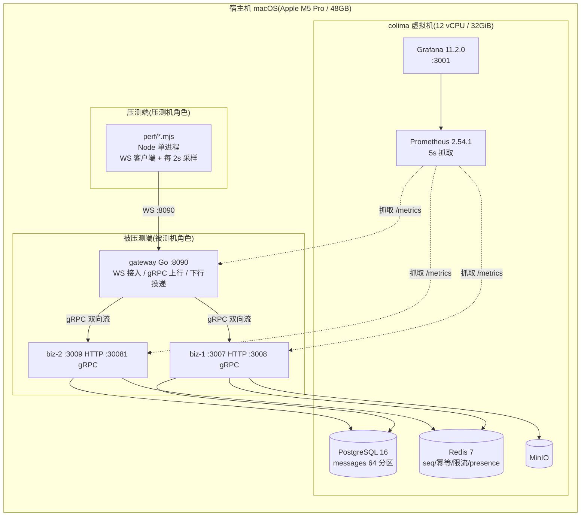

# 压测环境与机器资源条件

> 用途:说明「压测机」与「被压测机」的硬件、系统、中间件版本、进程拓扑与资源约束,
> 解释各轮报告里"绝对毫秒数有噪声、只做同轮相对对比"这句话的具体来源。
> 所有数值均为**本机命令实测**(采集时点 2026-11-15),采集命令见 §8;历史轮次的记录值单列在 §7 并标注差异。

---

## 0. 一句话结论

**这不是"两台机器之间的压测",而是一台 MacBook Pro 上的单机闭环**:压测端(Node harness)、gateway、biz×2、PostgreSQL/Redis/MinIO(colima 虚拟机)、Prometheus/Grafana 全部挤在同一颗 CPU 与同一块内存上。
因此:`CPU 争抢`(压测端与业务进程互抢)、`macOS 临时端口池 16383`、`colima 资源配额`是三道硬约束,报告里的绝对值是"争抢后的观测值",只用于同轮相对对比与形态判断。

---

## 1. 角色与拓扑



| 角色 | 说明 |
|---|---|
| 压测机 | 宿主机上的 Node 压测进程(`perf/harness-gw.mjs` 或 `ab-run.mjs`)+ 少量脚本编排 |
| 被压测机 | 同一宿主上的 gateway 与 biz×2 进程;中间件在 colima 虚拟机内 |
| 监测栈 | 同机 colima 内的 Prometheus/Grafana,抓取宿主机 `:3007/:3009/:8090` 的 `/metrics` |

> 关键含义:**没有真实网络延迟**。所有链路都在 loopback 上,RTT 少掉了生产环境必然存在的网络往返;
> 报告中的 RTT 只能横向比较"同一台机器上不同实现/不同版本的差",不能当作生产 SLA。

---

## 2. 宿主机(压测机 = 被压测机)

| 项 | 实测值 | 采集方式 |
|---|---|---|
| 机型 | MacBook Pro(Mac17,8) | `system_profiler SPHardwareDataType` |
| 芯片 | Apple M5 Pro | 同上 |
| CPU 核数 | **18 核(6 Super 核 + 12 Performance 核)** | 同上(原文 `18 (6 Super and 12 Performance)`) |
| 内存 | **48 GB** | `hw.memsize` = 51,539,607,552 B |
| 操作系统 | macOS 26.4(build 25E246) | `sw_vers` |
| 系统盘 | APFS 容器 926 GiB(994.6 GB),采集时可用 176 GiB(数据卷已用 678 GiB) | `df -h / /System/Volumes/Data`、`diskutil info /` |
| 文件描述符上限 | 1,048,575(已放开,非瓶颈) | `ulimit -n` |
| macOS 临时端口池 | `49152~65535` = **16,383 个** | `sysctl net.inet.ip.portrange.*` |

---

## 3. 虚拟化与中间件(colima)

| 项 | 实测值 | 说明 |
|---|---|---|
| colima profile | `default`,Running,aarch64 | `colima list` |
| VM 规格 | **12 vCPU / 32 GiB / 100 GiB 磁盘** | `colima list` / `~/.colima/default/colima.yaml` |
| 虚拟化 | `vmType: vz`,挂载 `virtiofs` | 同上 |
| 容器运行时 | Docker 29.5.2 | `docker version` |
| PostgreSQL | `postgres:16-alpine`,容器 `our-chat-postgres`,`shm_size: 512mb` | `docker/docker-compose.dev.yml` |
| Redis | `redis:7-alpine`,`--appendonly no --save ''`(**无持久化**) | 同上 |
| MinIO | `minio/minio:latest` | 同上 |
| Prometheus | `prom/prometheus:v2.54.1`,`scrape_interval: 5s` | `docker/monitoring/docker-compose.monitoring.yml` |
| Grafana | `grafana/grafana:11.2.0`,面板 `Realtime: 系统权威监测` | 同上 |

> 中间件全部跑在**同一个 PG 单实例 + Redis 单实例**上,没有只读副本、没有 PG/Redis exporter(见监测指标文档的缺口清单)。

---

## 4. 被压测进程与资源参数

### 4.1 进程与端口

| 进程 | 监听 | 关键 env | 说明 |
|---|---|---|---|
| gateway | `:8090`(`/ws`、`/healthz`、`/metrics`,反代模式另接 `/api /user /oauth`) | `GATEWAY_MAX_CONNS=50000`(默认)、`GATEWAY_SEND_BUFFER=256`、`GATEWAY_HEARTBEAT_TIMEOUT_SEC=60`、`EDGE_GRPC_STREAMS=4`(每后端流数) | 连接实体只在这里;慢消费者缓冲打满即逐出 |
| biz-1 | HTTP `:3007`、gRPC `:3008` | `REPLICA_ID=biz-1`、`CONV_RATE_LIMIT_MAX=500`、`AUTH_RATE_LIMIT_MAX` 压测时放开到 1e6 | 模块化单体,无状态,任一副本可处理任意用户消息 |
| biz-2(双副本轮次) | HTTP `:3009`、gRPC `:30081` | `REPLICA_ID=biz-2` | 与 biz-1 同库同 Redis |
| PostgreSQL | `:5432` | `messages` 哈希 64 分区 | 单写实例,是吞吐上限所在 |
| Redis | `:6379` | seq INCR / 幂等 / 限流 / presence / `gw:downlink` | 无持久化 |
| Prometheus / Grafana | `:9090` / `:3001` | jobs:`server`(biz-1)、`biz2`、`gateway` | 5s 抓取 |

### 4.2 连接池与缓存等隐含资源上限

| 资源 | 值 | 出处 |
|---|---|---|
| biz 写库连接池 | `MaxConns = 32`(每副本) | `biz/internal/store/store.go:67` |
| biz 只读池 | 与写池同配置;`PG_READONLY_URL` 未配置时走写库 | `biz/internal/store/store.go:38-49`、`biz/internal/config/config.go:91` |
| gateway 连接配额 | 50,000 / 进程 | `gateway/internal/config/config.go:65` |
| gateway 每连接发送缓冲 | 256 帧 | `gateway/internal/config/config.go:66` |
| gateway 每后端 gRPC 流 | 4 条(userId 哈希分片) | `gateway/internal/config/config.go:62` |
| 会话热点限流 | 500 msg/s/会话 | `CONV_RATE_LIMIT_MAX` |

### 4.3 被压测进程的实测资源占用(参考值,来自 `26-9-20` 轮)

| 观测 | 值 |
|---|---|
| 主场景 biz RSS | 53~139 MB(基线随场景累积爬升) |
| 主场景 gateway RSS | 36~68 MB |
| 1 万连接爬坡 gateway RSS | 343.3 MB ≈ **31.5 KB/连接**,goroutine 严格 **2/连接** |
| 1 万连接爬坡 biz RSS | 登录期峰值 256~265 MB,结束档 147.6 MB(GC 回落) |
| CPUΔ | biz 远高于 gateway(biz 1~96 s/场景 vs gateway 0.3~9.8 s) |

---

## 5. 压测端(harness)的资源条件

| 项 | 值 / 说明 |
|---|---|
| 运行时 | Node **v26.5.0**,单进程事件循环 |
| 客户端语义 | 与 `web/src/ws/wsClient.ts` 对齐:ack 按 clientMsgId 匹配、5s 超时同键重发×3、25s 心跳、指数退避重连 |
| 并发模型 | 每个虚拟用户 1 条 WS 连接 + 定时发送;1 万连接 ≈ 1 万 socket + 1 万定时器,全部压在单个 Node 进程 |
| 资源采样 | 编排器每 2s 采一次:`ps` 取双侧 RSS/CPU、Prometheus 取 eventloop/goroutine/GC 与业务直方图 |
| 登录成本 | bcrypt 12 轮,1 万用户登录约 12~15 分钟(压测成本的主要来源) |
| 端口消耗 | 每条出站连接占 1 个临时端口 → 单源 IP 最多约 1.6 万连接(见 §6) |

---

## 6. 硬约束与噪声来源

| # | 约束 | 量化 | 影响 |
|---|---|---|---|
| 1 | macOS 临时端口池 | 16,383 个(49152~65535) | 5 万连接物理建不起来;调 `portrange.first=32768` 后约 3.2 万封顶;gateway 自身出站也占端口 |
| 2 | 压测端与被测端同机抢 CPU | 18 核被 harness + gateway + biz×2 + 5 个容器共享 | 1 万爬坡建连 p50 已 120~190ms(回环正常应 <10ms),其中大部分是压测端事件循环排队 |
| 3 | colima 资源与稳定性 | 12 vCPU / 32 GiB | 历史多次在 ≈3000 msg/s 时 PG/Redis 失联(`26-9-17` 轮 2 次 + 更早 3 次,后续轮次零星复现),需 `colima stop && colima start` 恢复 |
| 4 | PG 单实例写吞吐 | 单库单写实例 | 3000 msg/s 附近出现软排队(p99 抬升、错误率仍为 0),是当前吞吐拐点的物理来源 |
| 5 | 数据累积漂移 | `messages` 表 359 万行起持续增长 | 读类端点(messages/lastMessages)跨轮不可比;环境一致性以无状态端点(/health、/login、/mentions)为准 |
| 6 | 无 `/proc` | macOS 无 | `process_cpu_seconds_total` 可能缺失,CPU 以 `ps` 采样为准(报告里 CPUΔ 均来自 ps) |

---

## 7. 环境变更与可比性声明(重要)

本机在系列压测期间**配置发生过变化**,因此跨轮绝对值不可直接对比:

| 项 | 历史轮次记录(2026-09-17 采集) | 当前实测(2026-11-15 采集) |
|---|---|---|
| 宿主机 CPU | 48 GB / **10 核**(Apple Silicon) | 48 GB / **18 核**(M5 Pro,6 Super + 12 Performance) |
| colima VM | **4 vCPU / 8 GiB** | **12 vCPU / 32 GiB** |
| 磁盘 | — | 100 GiB(VM);宿主 APFS 容器 926 GiB,可用 176 GiB |

> 历史值出处:`26-9-17-gobiz/V3P5容量复测本机可行性分析.md` §1.2。
> 处理原则:报告只做**同轮内 A/B**(同轮两侧共享同一环境)与**同架构相邻轮**的趋势判断;
> 跨轮数字(尤其 3000 msg/s 档的 p99)不作为"优化收益"的唯一证据,必须结合归因(代码/架构变化)一起看。

---

## 8. 采集命令(可复现)

```bash
# 硬件与系统
system_profiler SPHardwareDataType | sed -n '1,20p'
sysctl -n hw.ncpu hw.physicalcpu hw.memsize
sw_vers
df -h /

# 虚拟化与容器
colima list
grep -E '^(cpu|memory|disk|arch|vmType|mountType)' ~/.colima/default/colima.yaml
docker version --format '{{.Server.Version}}'
docker ps --format '{{.Names}}\t{{.Image}}'

# 内核限制
sysctl net.inet.ip.portrange.first net.inet.ip.portrange.last
ulimit -n

# 工具链
node -v
go version

# 进程资源(压测期间每 2s,ab-run.mjs 自动采样)
ps -o rss=,time= -p <pid>
```

---

## 9. 相关文档

- 场景参数与复现 runbook:`26-9-14/README.md`
- 全 Go 体系测试流程与已知坑:`../压测分析SOPV2.md`
- 单机做不了 5 万连接的逐项论证:`26-9-17-gobiz/V3P5容量复测本机可行性分析.md`
- 指标全集与分析方法:`../监测指标/监测指标清单与分析方法.md`
