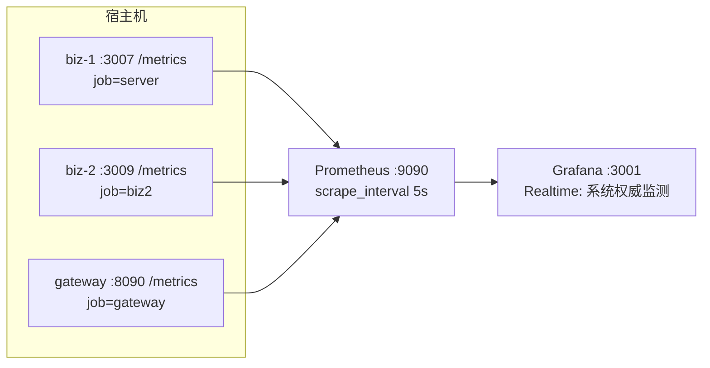

# 监测指标清单与分析方法

> 本文是**当前代码事实**的指标全集:有哪些指标、谁埋的点、每个指标能回答什么问题、怎么查、怎么判读。
> 口径以源码为准:`biz/internal/metrics/metrics.go`、`gateway/internal/metrics/metrics.go`;抓取配置 `docker/monitoring/prometheus.yml`;面板 `docker/monitoring/grafana/dashboards/realtime-system-authority.json`(「Realtime: 系统权威监测」)。
> Node 时代指标(`nodejs_eventloop_lag_seconds`、`nodejs_gc_pause_seconds`)已随 `server/` 退出流量,**不存在**。
> 与《监测指标覆盖审计.md》的关系:那篇是"补齐前 → 补齐后"的审计过程;本文是补齐后的**使用手册**,并如实记录仍存在的口径缺口。

---

## 1. 采集链路与基本约定



| 约定 | 值 / 说明 |
|---|---|
| 抓取周期 | 5s(`prometheus.yml` 的 `global.scrape_interval`) |
| job 命名 | `server` = biz 副本 1(历史兼容名,原指 Node 后端);`biz2` = biz 副本 2;`gateway` = 网关 |
| 指标端口 | biz `:3007` / `:3009`,gateway `:8090`,路径均为 `/metrics` |
| 安全 | `/metrics` 只允许内网访问,禁止对公网暴露(含内部拓扑与流量信息) |
| 时间窗口 | 本文示例统一用 `[1m]`;压测报告里的场景分位用**场景窗口**查询,不用固定窗口 |
| 分位算法 | `histogram_quantile(φ, sum(rate(<metric>_bucket[1m])) by (le))`;必须带 `le` 分组,否则无意义 |

---

## 2. 指标总览(全集)

### 2.1 业务层 biz(`biz/internal/metrics/metrics.go`)

| # | 指标 | 类型 | 标签 | 埋点位置 | 一句话作用 |
|---|---|---|---|---|---|
| 1 | `server_message_duration_seconds` | Histogram | — | `biz/internal/realtime/handleUplink.go:110` | 单条 `message.send` 的服务内处理耗时(收帧→ack/error) |
| 2 | `server_message_in_total` | Counter | — | `handleUplink.go:107` | 收到的 `message.send` 帧数(通过基础校验后) |
| 3 | `server_message_out_total` | Counter | `result=ok\|error` | `handleUplink.go:125/143/148/157` | 消息处理结果分布 |
| 4 | `server_conversation_rate_limited_total` | Counter | — | `handleUplink.go:115` | 会话热点限流拒绝数(429) |
| 5 | `server_downlink_direct_total` | Counter | — | `service/downlink.go:75/108` | 经 gRPC 下行流**定向直发**成功的帧数(按目标用户计) |
| 6 | `server_downlink_fallback_total` | Counter | — | `service/downlink.go:78/117` | 回退 Redis `gw:downlink` pub/sub 的帧数(按目标用户计) |
| 7 | `server_ws_connections` | Gauge | — | `realtime/edge.go:93-96` | **本副本 gRPC edge 流条数**(不是用户连接数) |
| 8 | `server_ws_disconnects_total` | Counter | `reason` | `realtime/edge.go:96` | 实时流断开次数(当前仅 `stream_close`) |
| 9 | `server_online_users` | Gauge | — | 无埋点 | 在线用户数占位,**恒为 0** |
| 10 | `server_broadcast_recipients` | Histogram | — | `service/push.go:65` | 单次广播的接收者数量分布(**仅 HTTP 推送路径埋点**) |
| 11 | `server_call_events_total` | Counter | `event` | `realtime/callRelay.go:24/48/58/73/97/120/160` | 通话信令事件计数 |
| 12 | `server_active_calls` | Gauge | — | `callRelay.go:52/79/103` | 当前通话数(含振铃,近似值) |
| 13 | `server_rum_web_vitals` | Histogram | `name`,`rating` | `api/rum_routes.go:60` | 前端 web-vitals 数值分布(LCP/INP/CLS/FCP/TTFB) |
| 14 | `http_request_duration_seconds` | Histogram | `method`,`route`,`status` | `api/middleware.go:104` | 全部 HTTP 接口的速率/错误/时延 |
| 15 | `db_query_duration_seconds` | Histogram | `model`,`operation` | `store/store.go:145`(pgx tracer) | 单条 SQL 的执行耗时 |

### 2.2 连接层 gateway(`gateway/internal/metrics/metrics.go`)

| # | 指标 | 类型 | 标签 | 埋点位置 | 一句话作用 |
|---|---|---|---|---|---|
| 16 | `gateway_connections` | Gauge | — | `hub/hub.go:93/97` | 当前活跃 WS 连接数(容量/配额水位) |
| 17 | `gateway_handshakes_total` | Counter | `result=ok\|unauthorized\|over_quota\|origin_rejected` | `ws/server.go:67/82/88/107/120` | 握手结果分布 |
| 18 | `gateway_uplink_total` | Counter | `result=ok\|upstream_error` | `hub/conn.go:161/167/214/219` | 上行帧转发结果(**传输层**成败,非业务成败) |
| 19 | `gateway_downlink_total` | Counter | `result=delivered\|dropped\|evicted` | `hub/hub.go:136/141/143` | 下行帧投递分类 |
| 20 | `gateway_evicted_total` | Counter | — | `hub/hub.go:144` | 慢消费者(发送缓冲满)被逐出的连接数 |
| 21 | `gateway_uplink_duration_seconds` | Histogram | — | `hub/conn.go:159/212` | 上行从收帧到拿到 biz ack 的耗时 |
| 22 | `gateway_downlink_duration_seconds` | Histogram | — | `backplane/backplane.go:60` | 下行从收到 backplane 帧到写入连接发送缓冲的耗时(**仅 pub/sub 回退路径**) |

### 2.3 运行时指标(client_golang 默认注册表,两个进程都有)

| 指标 | 类型 | 用途 |
|---|---|---|
| `go_goroutines` | Gauge | 并发水位;gateway ≈ 2/连接 + 常数项 |
| `go_gc_duration_seconds` | Summary(quantile) | GC 停顿;Go 版没有 bucket,只能看分位值/`_sum` 速率 |
| `go_memstats_*` | Gauge/Counter | 堆明细(alloc/inuse/sys 等) |
| `process_resident_memory_bytes` | Gauge | 进程 RSS(内存剖面主指标) |
| `process_cpu_seconds_total` | Counter | 进程 CPU 累计秒(macOS 上可能缺失,以 `ps` 采样为准) |
| `process_open_fds` / `process_max_fds` | Gauge | fd 水位(连接数容量相关) |

> 历史轮次报告里的 `eventloop lag` 只属于 Node 基线期,Go 体系无此指标。

---

## 3. 逐面:作用、功能与分析方法

### 3.1 连接面

#### `gateway_connections`
- **作用**:当前活跃 WS 连接数,判断配额水位与容量趋势。
- **功能**:连接建立 `Inc`、关闭 `Dec`(`hub.go:93/97`);是"真实在线连接"的唯一准确来源。
- **分析**:
  ```promql
  gateway_connections
  gateway_connections / 50000                     # 占 GATEWAY_MAX_CONNS 配额比例
  deriv(gateway_connections[5m])                  # 连接增长斜率
  ```
  判读:接近 `GATEWAY_MAX_CONNS` → 需扩网关副本;非压测时段突然下跌 → 客户端断网/网关重启;锯齿状(约 90s 周期)→ keepalive 参数失配回归。

#### `gateway_handshakes_total{result}`
- **作用**:握手成败结构。`ok` / `unauthorized` / `over_quota` / `origin_rejected`。
- **分析**:
  ```promql
  sum(rate(gateway_handshakes_total[1m])) by (result)
  sum(rate(gateway_handshakes_total{result="ok"}[1m])) / sum(rate(gateway_handshakes_total[1m]))
  ```
  判读:`unauthorized` 激增 → token 过期/密钥不一致/被刷;`over_quota` > 0 → 已触配额;`origin_rejected` → Origin 白名单配置问题。

#### `server_ws_connections`
- **作用**:本副本的 gRPC edge 流条数。
- **关键口径**:它是**流数,不是用户数**。gateway 对每个后端开 `EDGE_GRPC_STREAMS=4` 条流,所以单副本稳态约 4~8,与 1 万连接无关。
- **分析**:掉到 0 = 该副本与网关的流断开(重启/网络/keepalive);配合 `gateway_uplink_total{result="upstream_error"}` 一起看。

#### `server_online_users`
- **作用**:历史契约占位,业务层没有本地连接注册表(presence 在 Redis)。
- **必须知道**:代码中**没有任何赋值**,恒为 0。在线用户数请用 `gateway_connections` 近似(单设备/单连接假设),不要用这个指标。

#### `server_ws_disconnects_total{reason}`
- **作用**:实时流断开次数。
- **当前取值**:仅 `stream_close`(无更细原因)。
- **分析**:`rate(...)` 与 `gateway_connections` 同步下跌可确认是流断开;由于只有单一 reason,无法区分"正常关闭/keepalive 超时/进程退出",需要日志补证。

#### `gateway_evicted_total` / `gateway_downlink_total{result="evicted"}`
- **作用**:慢消费者逐出(发送缓冲 256 帧打满)。
- **分析**:逐出速率上扬 = 有客户端读得太慢或网络差;属于**背压生效**而非服务端故障,报告里必须单列,不能混进"消息失败"。
- **注意**:`gateway_downlink_total{result="evicted"}` 与 `gateway_evicted_total` 在同一分支递增(`hub.go:143-144`),两者应同量。

### 3.2 上行链路(gateway)

#### `gateway_uplink_total{result}`
- **作用**:上行帧转发成败。
- **关键口径**:`ok` 只代表**传输层拿到了 biz 的 ack 帧**,不代表业务成功;业务失败(`message.error`/限流)仍然计入 `ok`,要到 `server_message_out_total{result="error"}` 看。
- **分析**:
  ```promql
  sum(rate(gateway_uplink_total[1m])) by (result)
  # 与 biz 入口对账(应近似相等,差值=在途/流重建窗口)
  sum(rate(gateway_uplink_total{result="ok"}[1m]))
    - sum(rate(server_message_in_total[1m]))
  ```
  判读:`upstream_error` 陡增 → 上行流不可用(流建立窗口/biz 重启/keepalive);先查 gateway 日志"上行流重建"。

#### `gateway_uplink_duration_seconds`
- **作用**:收帧→biz ack 的服务内耗时,是 **RTT 的主要构成**。
- **分析**:
  ```promql
  histogram_quantile(0.99, sum(rate(gateway_uplink_duration_seconds_bucket[1m])) by (le))
  histogram_quantile(0.50, sum(rate(gateway_uplink_duration_seconds_bucket[1m])) by (le))
  ```
  判读:与客户端 RTT p50 对照 —— 若两者吻合(差值 ≤3ms),说明延迟全部发生在"gateway 收帧→biz ack"段;再结合 `server_message_duration` 与 `db_query_duration` 继续下钻。
- **注意**:gRPC 并发模式下该指标**不含** WS 读循环排队时间(排队在客户端视角可见,服务内不可见)。

### 3.3 消息处理(biz)

#### `server_message_in_total` / `server_message_out_total{result}`
- **作用**:消息入口量与处理结果。
- **关键口径**:`in` 只统计**通过基础 JSON/字段校验**的帧(校验失败直接 400,不计数);`out` 分 `ok`/`error`;限流拒绝**不写 out**,单独计 `server_conversation_rate_limited_total`。
- **对账公式**(判断有无静默丢弃):
  ```promql
  sum(rate(server_message_in_total[1m]))
    - sum(rate(server_message_out_total[1m]))
    - sum(rate(server_conversation_rate_limited_total[1m]))
  ```
  正常应 ≈ 0;持续为正 = 有路径未打点/请求还在处理;为负 = 计数重复或重启清零不同步。

#### `server_message_duration_seconds`
- **作用**:单条消息从收帧到 ack/error 的服务内总耗时(含成员查询、发号、幂等、落库、扇出前处理)。
- **分析**:
  ```promql
  histogram_quantile(0.99, sum(rate(server_message_duration_seconds_bucket[1m])) by (le, job))
  ```
  判读:p99 抬升但 `db_query_duration` 平稳 → 瓶颈在 Redis 往返/并发排队;两者同向抬升 → 写库路径(锁/连接池/IO);`eventloop` 类指标已不存在(Go 无此瓶颈)。
- **注意**:buckets 上限 2.5s,超时值全部落入 `+Inf`;`histogram_quantile` 在尾档会失真(报告里标注"bucket 封顶")。

#### `server_conversation_rate_limited_total`
- **作用**:单会话 500 msg/s 限流拒绝数。
- **分析**:`sum(rate(...))` 平坦为 0 是常态;突增 = 热点会话打爆,需结合 `http_request_duration_seconds{status="429"}` 与客户端 `message.error` 计数。
- **坑**:单会话压测若超过 500/s,会被限流误判为"性能问题";需显式调高 `CONV_RATE_LIMIT_MAX`。

### 3.4 下行双通道(核心)

#### `server_downlink_direct_total` / `server_downlink_fallback_total`
- **作用**:定向下行(gRPC 直发)与 pub/sub 回退的**帧数**(按目标用户计,一个群 100 人 → 100 帧)。
- **分析**:
  ```promql
  # 定向占比:健康时应 ≈100%
  (sum(server_downlink_direct_total) or vector(0))
    / ((sum(server_downlink_direct_total) + sum(server_downlink_fallback_total)) or vector(1))
  sum(rate(server_downlink_direct_total[1m])) by (job)
  sum(rate(server_downlink_fallback_total[1m])) by (job)
  ```
  判读:fallback 陡增 = presence 查不到副本/流未建立/定向发送失败;稳态 fallback≈0,仅流建立窗口会有个位数帧。
- **注意**:直发成功只代表"帧已交给目标网关",不代表已送达客户端;送达成功率要看 `gateway_downlink_total{result="delivered"}`。

#### `gateway_downlink_total{result}`
- **作用**:下行投递分类 —— `delivered`(路由到本网关连接)、`dropped`(本副本无此用户连接)、`evicted`(慢消费者)。
- **分析**:
  ```promql
  sum(rate(gateway_downlink_total[1m])) by (result)
  ```
  判读:`dropped` 高 = 用户在别的网关/已离线(pub/sub 全副本广播的正常代价);`evicted` 高 = 慢消费者;`delivered` 应与 direct+fallback 帧数大致对账(差值为跨副本/离线)。

#### `gateway_downlink_duration_seconds`
- **作用**:下行从收到 **backplane(pub/sub)** 帧到写入连接发送缓冲的耗时。
- **关键口径(必须知道)**:只有 `backplane.go` 埋点,**gRPC 定向直发路径没有该指标**。定向下行占比 ≈100% 时,这条直方图几乎没有样本;不能用它的 p99 证明"下行不是瓶颈"。定向路径的下行耗时目前只能由客户端 RTT 减上行耗时间接推算。
- **分析**:仅用于评估 fallback 路径的代投开销。

### 3.5 保护面

| 查询 | 用途 |
|---|---|
| `sum(rate(server_conversation_rate_limited_total[1m])) by (job)` | 会话热点限流拒绝速率 |
| `sum(rate(http_request_duration_seconds_count{status="429"}[1m])) by (route)` | HTTP 层认证/限流类拒绝(如登录限流) |

判读:两者都为 0 才是"未触发保护";任一非 0 时,错误率分析必须把它从"系统故障"里剔除。

### 3.6 通话面

#### `server_call_events_total{event}`
- **event 取值**:`start`(收到 call:start)、`busy`(被叫忙线,原子裁决失败)、`accept`、`reject`、`end`、`rejoin`(重连回归)、`ice`(ICE 候选)。
- **分析**:
  ```promql
  sum(rate(server_call_events_total[1m])) by (event)
  # 接通率(近似):accept / start
  sum(rate(server_call_events_total{event="accept"}[5m]))
    / sum(rate(server_call_events_total{event="start"}[5m]))
  # 忙线率
  sum(rate(server_call_events_total{event="busy"}[5m]))
    / sum(rate(server_call_events_total{event="start"}[5m]))
  ```
  判读:busy 率异常高 = 同一 callId 重复发起/会话未清理;`ice` 速率高但 accept 低 → ICE 协商失败(需日志/信令面补证)。

#### `server_active_calls`
- **作用**:进行中的通话数(近似,含振铃)。
- **关键口径**:`call:start` 成功即 `+1`;只有 `reject`/`end` 会 `-1`。**断连宽限窗到期由 grace 定时器清理会话时不会递减**(`callRelay.go:199-215` 调 `ClearSession`,未动指标)。因此长时间运行后该值会系统性偏高。
- **分析**:用 `start - reject - end` 的累计差做交叉校验;偏差持续扩大即为上述泄漏。

### 3.7 HTTP 面

#### `http_request_duration_seconds{method,route,status}`
- **作用**:一条 histogram 同时给出 HTTP 的 RED(速率/错误/时延)。
- **关键口径**:`route` 取 gin 的路由模式(`c.FullPath()`),未匹配路径记 `unmatched` —— 这是防基数爆炸的关键设计,不要改成原始 URL。
- **分析**:
  ```promql
  # 各端点 QPS
  sum(rate(http_request_duration_seconds_count[1m])) by (route)
  # 错误率(5xx)
  sum(rate(http_request_duration_seconds_count{status=~"5.."}[1m])) by (route)
    / sum(rate(http_request_duration_seconds_count[1m])) by (route)
  # p99
  histogram_quantile(0.99, sum(rate(http_request_duration_seconds_bucket[1m])) by (le, route))
  ```
  判读:`/health` 应为 1 万级 rps、2~3ms;`/api/login` 低 rps 是 bcrypt 12 轮的固有成本,不是缺陷;`/user/messages` 若到秒级,先查全量返回路径与 `db_query{model="messages"}`。

#### `server_rum_web_vitals{name,rating}`
- **作用**:真实用户前端体验(LCP/INP/CLS/FCP/TTFB)。
- **口径**:非 CLS 的值在服务端从 ms 换算为秒(`rum_routes.go:56-59`);`rating` 由 web-vitals 按阈值给出。
- **分析**:
  ```promql
  histogram_quantile(0.95, sum(rate(server_rum_web_vitals_bucket[5m])) by (le, name))
  sum(rate(server_rum_web_vitals_count[5m])) by (name, rating)
  ```
  判读:INP 是 field-only 指标,lab 无法替代;`rating="poor"` 占比上升优先查前端长任务。
- **已知缺口**:前端另有 `reportRealtimeRtt`(`web/src/rum.ts:48-68`)以 `name="realtime_rtt"` 上报,但 biz 的 `rumNames` 白名单只允许 LCP/INP/CLS/FCP/TTFB(`biz/internal/api/rum_routes.go:17`),这类上报会被 **400 拒绝**,不进任何指标。前端实时消息 RTT 目前只能从压测端或客户端埋点获得。

### 3.8 DB 面

#### `db_query_duration_seconds{model,operation}`
- **作用**:单条 SQL 执行耗时,按表名分线。
- **口径**:
  - `model` 从 SQL 的首个 `from|into|update <table>` 提取并小写,提取失败记 `raw`(`store/store.go:127-143`);
  - `operation` 目前恒为 `query`(读写未区分);
  - 只覆盖**单条 SQL 执行**,不含事务内多条语句的总时长、行锁等待、连接池排队。
- **分析**:
  ```promql
  sum(rate(db_query_duration_seconds_count[1m])) by (model)
  histogram_quantile(0.99, sum(rate(db_query_duration_seconds_bucket[1m])) by (le, model))
  ```
  判读:`messages` p99 抬升 → 写入/大读压力;`users`/`conversations` 抬升 → 成员/会话查询变慢;若 DB 指标平稳而消息 p99 抬升,瓶颈在 Redis 往返或并发排队(见 §3.3)。
- **坑**:buckets 上限 1s,`1000ms` 往往是 `+Inf` 的显示值,不是真实 1000ms。

### 3.9 Go 运行时与内存

| 查询 | 用途 |
|---|---|
| `go_goroutines{job="gateway"}` | 并发水位;稳态应 ≈ 2×连接数 + 常数 |
| `go_goroutines{job="gateway"} / gateway_connections` | 每连接 goroutine 成本(>2 要查泄漏) |
| `rate(go_gc_duration_seconds_sum{job=~"server\|biz2\|gateway"}[1m])` | GC 时间占比(Summary 无 bucket,不能算 p99) |
| `process_resident_memory_bytes{job=~"gateway\|server\|biz2"}` | RSS |
| `process_resident_memory_bytes{job="gateway"} / gateway_connections` | 每连接内存(实测 ≈31.5KB) |
| `rate(process_cpu_seconds_total[1m])` | CPU 使用率;macOS 缺失时用 `ps` 采样 |

判读:goroutine 随连接线性增长属正常(2/连接);只增不减 = 连接泄漏/流未释放;RSS 随连接线性增长但 GC 后不回落 = 缓存/池未复用。

### 3.10 副本面(多副本/故障演练)

```promql
# 分流是否均衡
sum(rate(server_message_in_total[1m])) by (job)
# 故障演练:kill 一个副本后,另一副本速率应上升且 uplink 无 error
sum(rate(gateway_uplink_total{result="upstream_error"}[1m]))
```

判读:两副本速率长期 0:100 → 哈希分片不均或某副本未接流;kill 演练中 `upstream_error` 不为 0 → failover 未生效(红线)。

---

## 4. Grafana 面板映射(「Realtime: 系统权威监测」10 个 row)

| Row | 面板 | 指标 | 正常形态 |
|---|---|---|---|
| 连接面 | 网关活跃连接数 | `gateway_connections` | 随压测阶梯上升、无锯齿 |
| | biz gRPC 流数 + 在线用户 | `server_ws_connections` / `server_online_users` | 流数 ≈ 每副本 4;在线用户恒 0(占位) |
| | 握手速率(按结果) | `gateway_handshakes_total` | ok 主导,其余为 0 |
| | 慢消费者逐出 | `gateway_evicted_total` | 0 |
| 上行链路 | 上行帧速率(按结果) | `gateway_uplink_total` | ok≈注入速率,upstream_error=0 |
| | 上行端到端延迟 p50/p95/p99 | `gateway_uplink_duration_seconds` | p99 与客户端 RTT 同档 |
| 消息处理 | 消息收发速率 | `server_message_in_total` / `out{ok}` | 两线基本重合 |
| | 消息处理延迟分位 | `server_message_duration_seconds` | 稳态 p99 数十 ms |
| 下行双通道 | 双通道速率 | `server_downlink_direct_total` / `fallback_total` | direct 主导 |
| | 网关下行投递分类 | `gateway_downlink_total` | delivered 主导,dropped/evicted≈0 |
| | 定向下行占比(stat) | direct/(direct+fallback) | ≈100% |
| | 双通道累计 | 同上 | direct 持续增长 |
| | 下行端到端延迟 | `gateway_downlink_duration_seconds` | 仅 fallback 有样本(见口径) |
| 保护面 | 会话热点限流拒绝 / HTTP 429 | `server_conversation_rate_limited_total` / `http_...{status="429"}` | 0 |
| 通话面 | 通话信令事件 / 活跃通话 | `server_call_events_total` / `server_active_calls` | 事件平衡,active 有界 |
| HTTP 面 | 请求速率 + 延迟 p99 / RUM p95 | `http_request_duration_seconds` / `server_rum_web_vitals` | /health 高 rps 低延迟 |
| DB 面 | 查询速率 / p99 按 model | `db_query_duration_seconds` | 写路径无恶化 |
| Go 运行时 | goroutine / GC / RSS / CPU | `go_*`、`process_*` | 随连接线性、GC 可控 |
| 副本面 | 各 biz 副本消息分流 | `server_message_in_total{job}` | 两线重叠 |

---

## 5. 口径陷阱与已知缺口(诚实清单)

| # | 问题 | 事实 | 影响 / 应对 |
|---|---|---|---|
| 1 | `server_online_users` 恒 0 | 无任何赋值(`metrics.go:58-61`) | 在线数用 `gateway_connections` 近似;不要引用该指标 |
| 2 | `server_ws_connections` 不是连接数 | 每条 gRPC edge 流 `Inc`(`edge.go:93`) | 稳态约 4/副本;用户连接数看 gateway |
| 3 | `server_broadcast_recipients` 基本无实时样本 | 只在 `push.go:65` 的 HTTP 推送路径打点,`message.send` 上行路径未打点 | 压测群扇出时该直方图无数据,不能用来解释"大群慢" |
| 4 | `gateway_downlink_duration_seconds` 只覆盖 fallback | 仅 `backplane.go:60` 埋点,定向直发路径未埋 | direct≈100% 时几乎无样本;不可据此断言"下行不是瓶颈" |
| 5 | `gateway_uplink_total{ok}` ≠ 业务成功 | 传输层拿到 ack 即 ok | 业务失败看 `server_message_out_total{result="error"}` |
| 6 | `server_active_calls` 会泄漏 | grace 清理会话不递减(`callRelay.go:199-215`) | 用 `start-(reject+end)` 交叉校验 |
| 7 | `db_query_duration` 看不到锁等待/池排队 | 计时包在单条 SQL 执行外层(`store.go:134-145`) | 行锁类瓶颈需事务级证据(历史结论来自压测排队现象,不是该指标) |
| 8 | `operation` 标签单值 | 埋点固定传 `"query"`(`store.go:145`) | 读写分线不可用 |
| 9 | 直方图 bucket 封顶 | `message` 封顶 2.5s、`db` 封顶 1s | 尾档分位是 `+Inf` 的显示值,报告须标注 |
| 10 | `process_cpu_seconds_total` 在 macOS 可能缺失 | 无 `/proc` | CPU 以 `ps` 采样(报告 CPUΔ 口径) |
| 11 | 计数器重启清零 | Prometheus counter 语义 | 跨重启累计值标注"重启后累计" |
| 12 | 前端实时 RTT 未入库 | `realtime_rtt` 不在 RUM 白名单,返回 400(`rum_routes.go:17` vs `rum.ts:50`) | 需要时扩展白名单或新增独立指标 |
| 13 | 无 Redis / PG exporter | 未接入 | Redis 往返、PG 缓冲区/连接数/锁等待不可见 |
| 14 | 无广播耗时、无 gateway 发送队列深度 | 只有"逐出"结果指标 | 慢消费者只能看到结果,看不到水位过程 |
| 15 | 无分布式链路追踪 | 未接 OpenTelemetry | 跨进程逐跳耗时只能靠分位对照推断 |

> 其中 #3 / #4 / #12 属于**当前埋点与结论口径不匹配**的高优先级项;若后续要用指标直接证明"扇出规模/下行时延/前端 RTT",需先补埋点再引用。

---

## 6. 常用速查

```bash
# 直查原始指标
curl -s localhost:3007/metrics | grep -E '^server_(message_in|message_out|downlink_(direct|fallback)|conversation_rate_limited|ws_connections)'
curl -s localhost:8090/metrics | grep -E '^gateway_(connections|uplink_total|downlink_total|evicted_total)'

# Prometheus 即时查询
curl -s 'http://localhost:9090/api/v1/query?query=rate(server_message_in_total[1m])'
curl -s 'http://localhost:9090/api/v1/query?query=histogram_quantile(0.99,sum(rate(gateway_uplink_duration_seconds_bucket[1m]))by(le))'

# 确认抓取目标健康
curl -s http://localhost:9090/api/v1/targets | jq '.data.activeTargets[] | {job:.labels.job, health:.health}'
```

| 想知道 | 看哪个指标 |
|---|---|
| 现在有多少在线连接 | `gateway_connections` |
| 消息有没有丢/失败 | `server_message_out_total{result}` + `conversation_rate_limited_total` |
| 延迟慢在哪一段 | 客户端 RTT → `gateway_uplink_duration` → `server_message_duration` → `db_query_duration{model}` |
| 定向下行是否健康 | direct/fallback 比例 + `gateway_downlink_total{result="dropped"}` |
| 瓶颈是不是写库 | `db_query_duration{model="messages"}` + 消息 p99 同向抬升 |
| 网关会不会被打满 | `gateway_connections / GATEWAY_MAX_CONNS` + `handshakes{over_quota}` |
| 副本是否均衡/挂了 | `rate(server_message_in_total[1m]) by (job)` |
| 前端体验是否变差 | `server_rum_web_vitals` 的 P75/P95 + `rating="poor"` 占比 |
