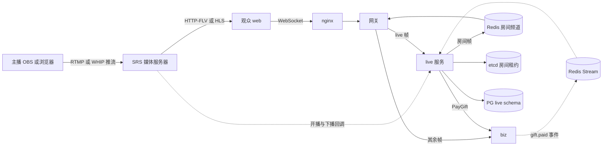

# 直播模块规划：架构设计与开发计划

> 前置阅读：[01-分析-直播作为独立微服务](./01-分析-直播作为独立微服务.md)，那里说明了为什么拆成独立服务、边界怎么划、为什么选 SRS。
> 本文回答：live 服务与媒体服务器、网关、钱包怎样协作；每条核心链路的原子步骤；关键机制怎样选型；分几期做、每期多少小时；用哪些实验证明它是对的。
> 相关模块：[02-发号与消息一致性](../02-发号与消息一致性/开发计划.md)（租约包）、[03-网关与性能](../03-网关与性能/开发计划.md)（网关改造）、[04-稳定性与可观测](../04-稳定性与可观测/开发计划.md)（指标与正确性检查器）、[05-红包与钱包](../05-红包与钱包/开发计划.md)（礼物支付）、[07-部署与交付](../07-部署与交付/开发计划.md)（编排）。

## 0 一段话讲清

**整体分工。** 主播用 OBS 或浏览器把音视频推给 SRS 媒体服务器，观众从 SRS 拉流播放；SRS 每次有人开播，都先回调 live 服务问「这个推流密钥能不能开播」。观众的弹幕走现有的 WebSocket 长连接：网关看到 `live:` 开头的帧，就直接转给 live，不经过 biz。

**弹幕与房间帧。** live 为每个直播间维护一个常驻内存的「房间执行体」（下文的房间 actor，即一个独立 goroutine 加它独占的状态）。它每 200 毫秒把这段时间的弹幕抽样、和在线人数、PK 分数一起打成一帧，发布到这个房间专属的 Redis 频道。有这个房间观众的网关才订阅这个频道，收到后写进每个观众连接的「覆盖槽位」：新帧覆盖旧帧，慢观众丢帧，但不会被踢掉。

**送礼。** 送礼先调钱包扣费，钱只记在钱包；扣费成功后 live 才计分、上榜、播报。live 节点即使宕机，也能从钱包账本重放出全部分数。

## 1 架构总览



## 2 组件职责与接口

| 组件 | 新增或改动 | 职责 | 对外接口 |
|---|---|---|---|
| SRS | 新增容器 | 收推流（RTMP 1935、WHIP）；出播放流（HTTP-FLV 与 HLS，端口 8080）；开播与下播时回调 live | HTTP 回调 on_publish、on_unpublish；HTTP API 1985 |
| live 服务（Go） | 新增服务 | 直播间与场次、推流密钥、房间 actor（弹幕聚合、在线人数、热度、PK）、礼物下单与计分、贡献榜 | HTTP 3010（客户端接口与 SRS 回调）；gRPC 3011（接收网关转来的 live 帧，复用 `ourchat.edge.v1.Realtime/Stream` 契约） |
| 网关 | 改动 | ① 按帧类型前缀路由上行，`live:*` 发往 live，其余仍发往 biz；② 维护房间订阅表（房间到本地连接）；③ 按需订阅与退订房间频道；④ 每个连接增加覆盖槽位 | 不变：仍是同一个 `/ws` 入口 |
| biz（钱包） | 由 05 模块提供 | 礼物扣费与入账；同事务写 outbox；中继投递 gift.paid 事件 | 内部 gRPC：Wallet.PayGift、Wallet.ListGiftPayments |
| Redis | 复用 | 房间频道（发布订阅）；钱包事件流（消费组）；贡献榜（有序集合） | 键前缀 `live:`；事件流 `wallet:events` |
| etcd | 复用（02 模块引入） | 房间租约与归属目录 | 键前缀 `/talqora/live/rooms/` |
| PostgreSQL | 复用实例，独立 schema | live 自己的表，不与 biz 互相读表 | schema `live` |

## 3 数据模型

```sql
CREATE SCHEMA IF NOT EXISTS live;

-- 直播间：一个主播一个直播间
CREATE TABLE live.rooms (
  id          BIGSERIAL    PRIMARY KEY,
  anchor_id   BIGINT       NOT NULL UNIQUE,                 -- 主播在 biz 的用户 id（身份锚点）
  title       VARCHAR(100) NOT NULL,
  status      VARCHAR(16)  NOT NULL DEFAULT 'idle'
              CHECK (status IN ('idle', 'live', 'banned')),
  created_at  TIMESTAMPTZ  NOT NULL DEFAULT now()
);

-- 场次：每次开播一条；推流密钥一次性
CREATE TABLE live.sessions (
  id            BIGSERIAL   PRIMARY KEY,
  room_id       BIGINT      NOT NULL REFERENCES live.rooms(id),
  stream_key    VARCHAR(64) NOT NULL UNIQUE,                -- 随机生成，下播后作废
  status        VARCHAR(16) NOT NULL DEFAULT 'created'
                CHECK (status IN ('created', 'live', 'ended')),
  started_at    TIMESTAMPTZ,
  ended_at      TIMESTAMPTZ,
  peak_viewers  INT         NOT NULL DEFAULT 0
);
-- 同一直播间同一时刻至多一场未结束的场次
CREATE UNIQUE INDEX uniq_live_session_open ON live.sessions(room_id)
  WHERE status IN ('created', 'live');

-- 礼物目录
CREATE TABLE live.gifts (
  id       VARCHAR(32) PRIMARY KEY,                         -- 如 'rocket'
  name     VARCHAR(32) NOT NULL,
  price    BIGINT      NOT NULL CHECK (price > 0),          -- 单价，钱包最小单位
  enabled  BOOLEAN     NOT NULL DEFAULT true
);

-- 礼物订单：记录送礼意图与支付结果；钱的事实在钱包，这里只是镜像
CREATE TABLE live.gift_orders (
  order_id      UUID        PRIMARY KEY,                    -- 幂等键，原样传给 PayGift
  session_id    BIGINT      NOT NULL REFERENCES live.sessions(id),
  sender_id     BIGINT      NOT NULL,
  gift_id       VARCHAR(32) NOT NULL REFERENCES live.gifts(id),
  quantity      INT         NOT NULL CHECK (quantity BETWEEN 1 AND 999),
  amount        BIGINT      NOT NULL CHECK (amount > 0),
  status        VARCHAR(24) NOT NULL DEFAULT 'pending'
                CHECK (status IN ('pending', 'paid', 'insufficient_funds', 'failed')),
  ledger_tx_id  BIGINT,                                     -- 钱包返回的账本交易号
  created_at    TIMESTAMPTZ NOT NULL DEFAULT now(),
  updated_at    TIMESTAMPTZ NOT NULL DEFAULT now()
);
CREATE INDEX idx_gift_orders_pending ON live.gift_orders(created_at) WHERE status = 'pending';

-- PK：用绝对时间记录起止，故障转移后据此恢复倒计时
CREATE TABLE live.pk_battles (
  id           BIGSERIAL   PRIMARY KEY,
  session_a    BIGINT      NOT NULL REFERENCES live.sessions(id),
  session_b    BIGINT      NOT NULL REFERENCES live.sessions(id),
  starts_at    TIMESTAMPTZ NOT NULL,
  ends_at      TIMESTAMPTZ NOT NULL,
  status       VARCHAR(16) NOT NULL DEFAULT 'running'
               CHECK (status IN ('running', 'settled', 'cancelled')),
  owner_epoch  BIGINT      NOT NULL DEFAULT 0,              -- 结算时校验，防止旧属主写入
  score_a      BIGINT,                                      -- 结算时从钱包账本重算写入
  score_b      BIGINT,
  winner       CHAR(1)     CHECK (winner IN ('a', 'b', 'd')), -- d 表示平局
  CHECK (session_a <> session_b),
  CHECK (ends_at > starts_at)
);
```

Redis 键：

| 键 | 类型 | 内容 | 能否丢失 |
|---|---|---|---|
| `live:room:{roomId}:frames` | 发布订阅频道 | 房间帧与优先事件 | 可以：发布订阅本来就不保存消息 |
| `live:sess:{sessionId}:rank` | 有序集合 | 贡献榜，成员是用户 id，分值是累计金额 | 可以：从钱包重放重建 |
| `live:sess:{sessionId}:applied` | 集合 | 已计分的订单号，用于快慢两条路径去重；过期时间为场次结束后 1 天 | 可以：丢失后按账本整体重算 |
| `wallet:events` | 事件流（Stream） | 钱包发出的 gift.paid 等事件；live 使用消费组 `live` | 由钱包模块保证可重发（见 05 计划） |

## 4 核心链路

### 4.1 开播

1. 主播在 web 点「开播」，请求 `POST /live/api/rooms/{id}/sessions`。live 校验三件事：调用者是该房间主播、房间不是 banned、没有未结束的场次（数据库的部分唯一索引兜底）。然后生成 32 字节随机推流密钥，插入一条状态为 created 的场次，返回推流地址 `rtmp://{host}/live/{stream_key}`。
2. 主播用 OBS 推流。SRS 收到推流后，先回调 `POST /internal/srs/on_publish`，请求体含 app 与 stream（即推流密钥）。
3. live 按推流密钥查场次：
   - 不存在或已结束：返回非 0，SRS 立即断开推流；
   - 合法：用条件更新把状态从 created 或 live 改为 live（重推时已经是 live）、记录 started_at，然后为这个房间申请租约，成为房间属主，启动房间 actor，返回 0 允许推流。
4. 回调只允许来自内部网络：nginx 不暴露 `/internal/`，live 还要校验来源地址。

### 4.2 进房

1. 观众打开直播间页面，请求 `GET /live/api/rooms/{id}/snapshot`，拿到播放地址、最近 30 条弹幕、在线人数、贡献榜前 10、PK 状态，首屏不必等第一帧。
2. web 通过已有的 WebSocket 发送 `{type: "live:join", data: {roomId}}`。
3. 网关识别到 `live:` 前缀，在本地房间订阅表里加入该连接；如果它是本网关上这个房间的第一个观众，就对 `live:room:{roomId}:frames` 执行 SUBSCRIBE。
4. 播放器开始拉 HTTP-FLV 流。
5. 离开房间或断开连接时，网关从订阅表移除该连接；本网关上这个房间的最后一个观众离开时执行 UNSUBSCRIBE。

### 4.3 发弹幕

1. web 发送 `{type: "live:danmaku", data: {roomId, text, clientMsgId}}`。
2. 网关在握手时已经验签，这里只按类型前缀把帧装进 `UplinkFrame`，通过 gRPC 流发给 live。帧里的 user_id 以网关验签结果为准。
3. live 把帧交给该房间的 actor（非属主实例收到时转发给属主，见 4.8）。actor 依次校验：
   - 房间正在直播；
   - 用户没有被禁言；
   - 文本 1 到 50 个字符（按 Unicode 字符计，不按字节）；
   - 用户令牌桶：每秒 1 条，突发 3 条。
4. 校验通过，弹幕进入房间缓冲，并立即回 ack。ack 里带上这条弹幕本身，发送者在本地直接显示，保证「自己发的一定看得见」，不依赖抽样。
5. 弹幕不落库。需要留档（审核、回放）时，另外异步批量写入分析库，不在本期范围。

### 4.4 帧聚合与扇出

1. 属主实例上，房间 actor 每 200 毫秒触发一次：从缓冲里按优先级取最多 K 条弹幕（默认 K = 3，即每秒 15 条可见弹幕），组装成一帧：

   ```json
   {"type":"live:frame","data":{"roomId":1024,"frameNo":88231,"epoch":7,
    "online":31452,"heat":98110,
    "danmaku":[[10301,"北辰","这波操作稳"],[20488,"小鱼","来了来了"]],
    "pk":{"id":56,"a":12800,"b":9900,"endsAt":1771234567000}}}
   ```

2. 把帧 PUBLISH 到 `live:room:{roomId}:frames`，缓冲清空。
3. 每个订阅了该频道的网关收到帧后，先比对 epoch（见 5.7），然后遍历本地这个房间的连接，把帧原子地放进每个连接的覆盖槽位。
4. 连接的写协程每次写出时取槽位里的最新帧；如果上一帧还没来得及写出就被覆盖，计入 `gateway_live_frames_skipped_total`。
5. 优先事件（礼物播报、PK 结算、系统公告）不进覆盖槽位，进该连接现有的可靠队列，因为它们不能丢。同一用户连续送同一礼物时，合并成「火箭 × 12」一条，避免优先事件本身变成洪峰。

### 4.5 送礼

1. web 点礼物，请求 `POST /live/api/sessions/{sid}/gifts`，请求体为 `{giftId, quantity, idempotencyKey}`；幂等键由客户端生成，用户连点或网络重试时保持不变。
2. live 计算订单号：`order_id = UUIDv5(命名空间, userId + ":" + idempotencyKey)`。同一用户的同一次点击永远得到同一个订单号；不同用户即使传入相同的键，订单号也不同。
3. 插入状态为 pending 的订单，写法是 `ON CONFLICT (order_id) DO NOTHING`。如果订单已存在，直接按它当前的状态返回，这就是接口层的幂等。
4. 调用钱包 `PayGift(order_id, payer, payee = 主播, gift, quantity, amount, room, session)`，超时 2 秒。可以放心重试，因为钱包按 order_id 幂等。
5. 根据结果处理：

   | 结果 | live 的动作 |
   |---|---|
   | PAID 或 DUPLICATE_PAID | 订单改为 paid 并记下 ledger_tx_id；交给房间 actor 计分：先查 applied 集合去重，再累加分数、ZINCRBY 贡献榜、发优先事件「礼物播报」；返回成功 |
   | INSUFFICIENT_FUNDS | 订单改为 insufficient_funds，返回余额不足 |
   | 超时或未知错误 | 订单保持 pending，返回「处理中」；由事件路径或对账任务收敛 |

6. 事件路径：钱包在 PayGift 的同一个事务里写 outbox，中继把它投递到 `wallet:events`。live 的消费组读到 gift.paid 后，交给对应房间的 actor 按订单号去重、计分，然后 XACK。消费者崩溃后，未确认的消息由另一个消费者用 XAUTOCLAIM 接管。
7. 对账任务每分钟扫描 pending 超过 30 秒的订单，向钱包查询实际结果并收敛状态。

### 4.6 PK（L3）

1. 两位主播发起并接受 PK 后，live 插入一条 pk_battles，`starts_at = now + 3 秒`、`ends_at = starts_at + 5 分钟`，由发起方房间的属主负责计时与结算。
2. 计分口径：PK 窗口内两场直播各自收到的礼物金额之和，以钱包记录的支付时间为准。房间帧里的 pk 字段只是实时展示。
3. 到 ends_at 时，属主调用 ListGiftPayments，按两场场次与时间窗口从账本重算最终分数，**不信任内存里的累计值**。然后执行：

   ```sql
   UPDATE live.pk_battles
      SET status = 'settled', score_a = $2, score_b = $3, winner = $4
    WHERE id = $1 AND status = 'running' AND owner_epoch = $5;
   ```

   影响 0 行，说明已经结算过，或者自己已不是属主。两个房间随后广播结算事件。

### 4.7 下播与断流

1. SRS 回调 on_unpublish。live 不立即结束场次，先开 30 秒宽限，因为主播的网络抖动后常常会重推。
2. 宽限期内用同一推流密钥重新 on_publish，就恢复直播；超时则把场次改为 ended、作废推流密钥、释放房间租约，并广播下播事件。
3. 主播主动点「下播」时，直接结束，不走宽限。

### 4.8 房间属主故障转移（L3）

1. 属主实例崩溃或被暂停，它在 etcd 的租约在 TTL（5 秒）后过期。
2. 其他 live 实例监听到房间无主，按 rendezvous 哈希排出的顺序抢占租约，抢到的实例 epoch 加 1，写入房间归属目录。网关监听这个目录，之后把这个房间的帧路由到新属主。
3. 新属主重建状态：

   | 状态 | 重建方式 | 原因 |
   |---|---|---|
   | 弹幕缓冲 | 不恢复，从空开始 | 可覆盖语义，丢几百毫秒的弹幕无害 |
   | 在线人数 | 等下一轮网关上报，最多 5 秒 | 近似值，自愈 |
   | 贡献榜 | Redis 里还在就直接用；丢了就调用 ListGiftPayments 重建 | 派生数据 |
   | PK 分数与倒计时 | 调用 ListGiftPayments 重放窗口内的支付；倒计时按 pk_battles 的绝对时间继续 | 账本是唯一事实来源；倒计时不依赖内存 |

4. 旧属主如果只是暂停、随后醒来，会被两层隔离挡住：发布帧之前先自检租约，过期则停止；网关丢弃 epoch 小于该房间已见最大 epoch 的帧。结算写库还有 owner_epoch 条件兜底。

### 4.9 排空发布（L4）

1. live 实例收到 SIGTERM，先停止接受新房间。
2. 对自己持有的每个房间：先把最后一帧发出，再主动释放租约。同时在频道里发一条交接提示，让下一个实例立即抢占，而不是等 TTL 过期。
3. 新属主在 1 秒内接手。观众端看到的效果，最多是一帧的停顿。

## 5 关键机制与方案对比

### 5.1 下行语义：覆盖槽位

| 维度 | 有界可靠队列（现有，256） | 无界队列 | **覆盖槽位（房间帧）+ 可靠队列（优先事件）** |
|---|---|---|---|
| 慢观众 | 攒满被踢，重连后再被踢，振荡 | 内存无限增长，最终拖垮网关 | 丢旧帧，只保留最新一帧，不踢人 |
| 内存 | 每连接最多 256 帧 | 无上界 | 每连接 1 帧加少量优先事件 |
| 语义 | 适合可靠消息 | 不适合任何场景 | 帧可覆盖，事件可靠 |
| 选错的代价 | 热门直播间里网络稍差的观众被反复踢 | 一场热门直播把网关撑爆 | — |

覆盖槽位用 `atomic.Pointer[[]byte]` 实现：网关写入时 Swap，写协程读出时 Load 后置空，不需要锁。槽位非空就说明有一帧待写。

### 5.2 扇出拓扑：每房间一个频道

| 维度 | 全局单频道（现有 `gw:downlink`） | **每房间一个 Redis 频道** | NATS 主题 | live 直连每个网关的 gRPC 流 |
|---|---|---|---|---|
| 网关收到的流量 | 所有房间的所有帧，再本地过滤 | 只收有本地观众的房间 | 同左 | 同左 |
| 新增基础设施 | 无 | 无，复用 Redis | 多一套 NATS 集群 | 无 |
| live 端的发送次数 | 每帧 1 次 | 每帧 1 次 | 每帧 1 次 | 每帧 × 网关数 |
| 选错的代价 | 100 个直播间时，每个网关每秒收 500 帧却大多丢弃，CPU 白耗 | — | 为一个模块引入新组件 | live 要维护网关列表与连接，耦合重 |

先用每房间一个 Redis 频道。等房间数到上千、Redis 单线程的发布订阅成为瓶颈时，再换成 NATS。发布订阅这一层封装成接口，换实现不影响 live 和网关的业务代码。

### 5.3 弹幕上行：网关按帧类型路由

| 维度 | 经 biz 中转 | **网关按类型前缀直接路由到 live** | 走 HTTP 上行 |
|---|---|---|---|
| 跳数 | 网关 → biz → live | 网关 → live | nginx → live |
| 对 biz 的影响 | 弹幕洪峰冲击 biz，违背拆分初衷 | 无 | 无 |
| 网关改动 | 无 | 增加按前缀选择上游 | 无 |
| 一致的长连接入口 | 是 | 是 | 否，长连接与 HTTP 两套通道 |

选按类型路由。网关已有多上游的抽象（MultiGrpc），这里扩展为「按帧类型选上游组」。项目约定长连接统一走网关，这样做与之一致。

### 5.4 抽样与限流

三层控制，各管一件事：

| 层 | 规则 | 作用 |
|---|---|---|
| 用户令牌桶 | 每秒 1 条，突发 3 条 | 防刷屏，挡住单用户脚本 |
| 房间缓冲上限 | 每个 200 毫秒窗口最多缓存 500 条，超出直接丢弃并计数 | actor 内存有上界 |
| 每帧可见上限 K | 默认 3 条，按优先级取：送过礼的用户、主播与房管，其余随机抽样 | 观众看得过来；带宽可控（8.1 节） |

### 5.5 在线人数：网关周期上报

| 维度 | 按进出事件计数 | **网关每 5 秒上报本地计数** | HyperLogLog 去重计数 |
|---|---|---|---|
| 网关崩溃时 | 离开事件丢失，人数永久偏高 | 该网关的上报停止，超过 15 秒未上报的网关不计入，自动修正 | 需要定期重建 |
| 精度 | 理论精确，实际会漂移 | 5 秒级近似 | 去重近似 |
| 实现量 | 小 | 小 | 中 |

选周期上报，因为它天然自愈。在线人数允许近似，没必要为精确付出漂移的代价。

### 5.6 礼物一致性：钱在钱包，分数派生

| 维度 | 只走同步调用 | 只走事件 | **快慢双路径加去重加账本重放** | TCC 或 2PC | live 自己记一份账 |
|---|---|---|---|---|---|
| 播报延迟 | 低 | 取决于中继轮询，约百毫秒级 | 低 | 高 | 低 |
| live 在扣费成功后、计分前崩溃 | 分数丢失 | 不丢 | 不丢：事件路径补上，故障转移时从账本重放 | 不丢 | 两本账不一致 |
| 重复计分 | 重试时可能重复 | 至少一次投递可能重复 | 按订单号去重 | 不重复 | 可能 |
| 复杂度 | 低 | 中 | 中 | 高：要实现预留、确认、取消三个阶段 | 中，还要对账 |
| 选错的代价 | 节点一挂，PK 分数就少了 | 送礼后播报明显滞后 | — | 为一个本来不需要分布式事务的问题引入协调者 | 两本账永远在对账 |

这个设计成立的关键是：**live 不持有任何钱的事实**。扣费是钱包的本地事务，live 的分数只是对钱包事实的计算。所以跨服务一致性问题退化成两件事：计算不重复（按订单号去重）、计算不遗漏（事件补投加账本重放）。完全不需要分布式事务。

### 5.7 房间归属与隔离

- **租约**：直接复用 02 模块的「租约加 epoch 两层隔离」内部包。房间是一种「需要唯一属主的有状态单元」，和号段是同一类问题。
- **归属目录**：etcd 里记录 `房间 → 属主实例、epoch`。网关监听目录、缓存在本地，用来把 `live:*` 上行帧发给属主。
- **两层隔离**：
  - 第一层：属主每次发布帧之前，用单调时钟检查自己的租约是否过期；
  - 第二层：帧里带 epoch，网关为每个房间记录已见的最大 epoch，丢弃更小的帧。这相当于把隔离放在消费端，因为发布订阅本身无法拒绝过期写入。
  - 写库的操作（PK 结算）还有 owner_epoch 条件更新兜底。

## 6 协议

### 6.1 WebSocket 帧（沿用 `{type, data}` 信封）

| 类型 | 方向 | 语义 | 下行通道 |
|---|---|---|---|
| `live:join` | 上行 | 进入直播间，`{roomId}` | — |
| `live:leave` | 上行 | 离开直播间，`{roomId}` | — |
| `live:danmaku` | 上行 | 发弹幕，`{roomId, text, clientMsgId}` | — |
| `live:danmaku.ack` | 下行 | 弹幕已受理，携带弹幕本身供本地回显；或携带拒绝原因（限流、禁言、超长） | 可靠队列 |
| `live:frame` | 下行 | 房间帧：弹幕抽样、在线人数、热度、PK 实时分 | **覆盖槽位** |
| `live:gift` | 下行 | 礼物播报（可能是合并后的连击） | 可靠队列 |
| `live:pk` | 下行 | PK 开始与结算 | 可靠队列 |
| `live:notice` | 下行 | 开播、下播、禁言等系统通知 | 可靠队列 |

### 6.2 HTTP 接口（nginx 前缀 `/live/api/`，转发到 live:3010）

| 方法与路径 | 作用 | 鉴权 |
|---|---|---|
| `POST /rooms` | 创建自己的直播间 | 用户令牌 |
| `POST /rooms/{id}/sessions` | 开播，返回推流地址 | 房间主播 |
| `POST /sessions/{sid}/end` | 下播 | 房间主播 |
| `GET /rooms/{id}/snapshot` | 首屏数据 | 用户令牌 |
| `POST /sessions/{sid}/gifts` | 送礼，请求体带幂等键 | 用户令牌 |
| `GET /sessions/{sid}/rank` | 贡献榜 | 用户令牌 |
| `POST /pk`、`POST /pk/{id}/accept` | 发起、接受 PK（L3） | 双方主播 |
| `POST /internal/srs/on_publish`、`on_unpublish` | SRS 回调 | 只允许内网来源，nginx 不暴露 |

用户令牌由业务层 IdP 签发：仿照现有的 agent-token 接口，增加一个 aud 为 live 的 RS256 访问令牌，live 用 JWKS 公钥验签。这样 live 不需要知道业务层的 HS256 会话密钥；共享对称密钥的服务越多，泄露面越大。

### 6.3 服务间接口

- **网关到 live**：复用 `ourchat.edge.v1.Realtime/Stream` 双向流与 EdgeFrame 契约，上行装在 UplinkFrame 里，确认装在 UplinkAck 里，不新增 proto。
- **live 到钱包**：调用 `Wallet.PayGift` 与 `Wallet.ListGiftPayments`，契约以 05 计划为准，服务间用内部令牌鉴权。
- **钱包到 live**：Redis Stream `wallet:events`，live 使用消费组 `live`；事件体至少包含 order_id、payer_id、payee_id、amount、session_id、ledger_tx_id、paid_at。

## 7 任务分解

周次与全项目统一（见 [模块开发计划总览](../README.md)）：W15 是 2 月 22 日至 28 日，W16 是 3 月 1 日至 7 日；面试季是 3 月 8 日至 5 月 30 日。

| 期次 | 周次 | 任务 | 产出 | 小时 | 依赖 |
|---|---|---|---|---|---|
| **L0 房间与播放** | W15 | ① SRS 容器与配置：RTMP、HTTP-FLV、HLS、回调地址；nginx 增加 `/live/stream/` 并关闭 FLV 的代理缓冲；② live 服务骨架：gin、pgx、迁移、指标、日志，与 biz 同一套约定；③ 直播间与场次接口、推流密钥、on_publish 与 on_unpublish（含 30 秒宽限）；④ 业务层增加 live 令牌签发；⑤ web 主播页（展示推流地址，用 OBS 推流）与观众页（mpegts.js 播放） | 能开播、能观看 | 6 | 07 模块的部署链路已修复 |
| **L1 弹幕与在线人数** | W15 | ① 网关：按类型前缀路由上游、房间订阅表、按需订阅与退订房间频道、覆盖槽位与写协程整合、相关指标；② live：房间 actor（200 毫秒聚合、缓冲上限、抽样、令牌桶）、帧发布、在线人数汇总；③ web：弹幕输入与弹幕层 | 弹幕实时可见，慢观众只丢帧 | 8 | 03 模块的写协程改造（W2） |
| **L2 礼物与贡献榜** | W16 | ① 礼物目录与订单接口（确定性订单号、接口幂等）；② PayGift 客户端（超时与重试）、快路径计分与播报、applied 集合去重；③ wallet:events 消费组（去重、XACK、XAUTOCLAIM 接管）；④ 贡献榜；⑤ pending 订单对账任务；⑥ web 礼物面板与榜单 | 送礼扣费、计分、播报全链路 | 8 | 05 模块的礼物支付接口（W14） |
| **L3 PK 与房间高可用** | 面试季 | ① 多实例房间归属：复用 02 的租约包、etcd 归属目录、网关按属主路由；② 帧带 epoch，网关侧隔离；③ 接管后重建（账本重放）；④ PK 创建、接受、计时、结算（条件更新）；⑤ EL3 实验 | 属主挂了分数不丢 | 14 | 02 模块的租约包（W5–W6） |
| **L4 排空与压测报告** | 面试季 | ① SIGTERM 排空与主动交接；② 观众与弹幕施压工具（接收端打点）；③ EL1、EL2、EL4 实验；④ 实验报告与 README 能力证明索引 | 一份可复现的报告 | 12 | 04 模块的正确性检查器 |
| **合计** | | | | **48**（3 月前 22） | |

3 月前的 22 小时如果不够，按这个顺序裁剪：
1. WHIP 推流与 WebRTC 播放：本来就不在 L0 必做范围内；
2. 贡献榜界面，接口保留；
3. 礼物连击合并；
4. 仍然不够时，L2 整体顺延到面试季。

**绝不砍**：订单号幂等，以及「钱只在钱包」的边界。即使 L2 顺延，设计也不能退化成 live 自己记账。

## 8 实验与验证

### 8.1 先算带宽，再定压测规模

每个观众每秒收到的字节数 ≈ 帧率 ×（帧头 + K × 单条弹幕大小）。

按默认值计算：
- 帧率 5，每秒 5 帧；
- 帧头约 80 字节，含在线人数、热度、PK；
- K = 3；
- 单条弹幕约 50 字节（用户 id、昵称、十几个汉字的 UTF-8）。

每个观众约为 5 ×（80 + 150）= 1,150 字节/秒。5 万观众合计约 57.5 MB/秒，约 460 Mbps，这还没算优先事件。

所以压测前要确认施压机到网关的网络能承受多少：
- 如果测试网络只有几百 Mbps，就按网络上限定观众数（比如 2 万），再用 E3 的容量模型外推到 5 万；
- 同时可以对比 K 取 1、3、5 时的带宽与网关 CPU。

这个计算本身就是面试里很好的一段：先估算，再压测。

### 8.2 实验清单

| 编号 | 实验 | 对照组 | 测量方法 | 通过标准（设计目标，以实测为准） |
|---|---|---|---|---|
| EL1 | 弹幕洪峰与热点扇出：单个房间，观众分布在 2–3 个网关副本，每秒输入 5000 条弹幕，持续 5 分钟；其中 5% 的观众人为限速成慢连接 | 逐条推送：每条弹幕单独下行，走可靠队列 | 施压客户端在接收端记录「弹幕被受理时刻」到「收到包含它的帧」的时延，用 HDR 直方图统计；采集网关写次数、CPU、带宽、跳帧数、被踢连接数 | 可见时延 p99 ≤ 400 毫秒；礼物播报零丢失；慢观众只跳帧、被踢数为 0；对照组的网关写次数与 CPU 显著更高，慢观众被踢 |
| EL2 | 礼物资金一致性：1 万次并发送礼，期间注入故障——kill -9 live 属主、kill biz、Redis 不可用 30 秒 | live 只走同步路径计分、不消费事件、不从账本重放 | 实验后由正确性检查器校验新增的不变式：钱包礼物支付总额 = 主播收益账户增量 = live 重建后的计分总和 | 三方差额为 0；对照组差额不为 0 |
| EL3 | 房间属主故障转移：PK 进行中，kill -9 房间属主 | — | 记录租约过期到新属主发出第一帧的时间；接管后对比 PK 分数与账本重算值；结算是否恰好一次 | 恢复 p99 ≤ 5 秒（租约 TTL 5 秒）；分数与账本一致；结算恰好一次 |
| EL4 | 排空发布：持续有弹幕与 PK 时，滚动发布 live 服务 | 直接 kill 重启 | 接收端记录相邻两帧的最大间隔 | 最大帧间隔 ≤ 1 秒；对照组约等于租约 TTL 加重建时间 |
| 功能 | 媒体链路：OBS 推 RTMP，web 播放 HTTP-FLV 与 HLS | — | 推流画面叠加毫秒时钟，与播放端截图对比，估算端到端延迟 | 只做功能验证与延迟记录，不做媒体压测，以免带宽成本过高 |

## 9 部署与运维

**编排新增两个服务。**

| 服务 | 端口 | 说明 |
|---|---|---|
| live | 3010（HTTP）、3011（gRPC），只在内网 | 健康检查拆成存活与就绪；就绪的条件是 etcd、Redis、PG、钱包 gRPC 都可达 |
| srs | 1935/tcp（RTMP，外部推流时需要放行）、8080/tcp（HTTP-FLV 与 HLS，经 nginx 转发）、1985/tcp（API 与 WHIP，经 nginx 转发）、8000/udp（WebRTC，需要放行） | 回调地址指向 `http://live:3010/internal/srs/...` |

**nginx 新增路由。**
- `/live/api/` 转发到 live:3010；
- `/live/stream/` 转发到 srs:8080，FLV 需要 `proxy_buffering off`；
- WHIP 转发到 srs:1985；
- `/internal/` 一律不暴露。

**指标。**

| 来源 | 指标 |
|---|---|
| live 服务 | `live_rooms_active`、`live_viewers`（按房间）、`live_danmaku_in_total`、`live_danmaku_dropped_total`（按原因：限流、超长、缓冲满）、`live_frames_published_total`、`live_frame_interval_seconds`、`live_gift_pay_duration_seconds`、`live_gift_orders_total`（按状态）、`live_room_owner_epoch`、钱包事件消费延迟 |
| 网关 | `gateway_live_frames_skipped_total`、`gateway_live_room_subscriptions` |

**告警。**
- pending 礼物订单超过 30 秒的数量大于 0；
- 钱包事件消费延迟大于 10 秒；
- 房间帧间隔 p99 大于 400 毫秒；
- 同一房间在 1 分钟内 epoch 变化超过 2 次，说明租约在抖动。

告警规则与 04 模块统一管理。

## 10 风险与回退

| 风险 | 触发条件 | 应对 |
|---|---|---|
| 网关改造影响 IM 主链路 | 房间订阅、覆盖槽位的改动引入缺陷 | live 相关逻辑放在独立的代码路径，用配置开关控制；关闭时网关行为与现在完全一致；回归测试覆盖 IM 收发 |
| Redis 发布订阅成为瓶颈 | 房间数上千，或单频道吞吐过高 | 发布订阅层已封装成接口，可替换为 NATS；短期可以降低帧率或 K |
| 钱包事件丢失 | 生产 Redis 未持久化时重启 | 事件路径只是兜底；重建与结算一律从账本重放，事件丢失只会让实时显示短暂滞后 |
| SRS 回调不可用 | live 宕机时无法开播 | 开播鉴权失败即拒绝推流，宁可开不了播，也不能放行非法推流；已在推的流不受影响 |
| 媒体调试拖慢进度 | 推流协议、HTTPS、防火墙 | 先打通 OBS 加 RTMP 加 HTTP-FLV 的最短链路，WebRTC 推拉都放到最后 |

## 11 面试视角

| 可能被问 | 答案要点 |
|---|---|
| 5 万人的直播间，一条弹幕要写 5 万次，怎么扛？ | 先抽样再扇出：每 200 毫秒聚合一帧，每个观众每秒只收 5 帧；两级扇出，live 每帧只发布一次，各网关再在本地扇出；先按公式算带宽（8.1 节）定压测规模 |
| 慢观众怎么处理？和 IM 有什么区别？ | 房间帧是可覆盖语义，用覆盖槽位，慢了就跳帧，不踢人；IM 是可靠语义，宁可断开重连再补拉，也不能丢。同一个网关里两条下行通道共存 |
| 为什么不把每条弹幕存数据库？ | 弹幕是可覆盖的展示数据，丢几条不影响业务；落库会让洪峰直接压到数据库。需要审核留档时异步批量写分析库 |
| 送礼扣了钱、但 live 在计分前挂了怎么办？ | 钱的事实只在钱包；事件路径补投；新属主从账本重放，分数不丢；按订单号去重，分数不重 |
| 为什么不用分布式事务？ | live 不持有钱，扣费是钱包的本地事务，跨服务问题退化成「派生计算不重不漏」；TCC 要引入预留、确认、取消三个阶段和协调者，为不存在的问题付出复杂度 |
| 两个 live 节点都以为自己持有同一个房间怎么办？ | 租约加两层隔离：发布前自检租约；网关按 epoch 丢弃旧帧；写库带 owner_epoch 条件。复用的是保护发号服务的同一个包 |
| PK 进行中节点挂了，倒计时怎么办？ | 起止时间存的是绝对时间，新属主按数据库里的 ends_at 继续；分数从账本重放 |
| 为什么拆成独立服务？什么情况下不该拆？ | 负载性质不同：语义、状态模型、扩缩容维度都与 IM 相反。如果三者都一样，拆了只会多网络跳数和运维成本（分析文档第 3 节） |
| 为什么选 SRS？HTTP-FLV、HLS、WebRTC 怎么选？ | 一对多直播加 HTTP 回调；FLV 延迟约 1–3 秒、实现简单，HLS 兼容性好但延迟高，WebRTC 延迟最低但部署复杂（数字待复核，以实测为准） |

## ★ 关键理解点

- **正向：热点扇出靠「先聚合、再分级扇出」。** 输入端每秒 5000 条弹幕，输出端每个观众每秒只收 5 帧；live 每帧发布一次，网关在本地扇出。写放大从「弹幕数 × 观众数」降到「帧率 × 观众数」。
- **反向：可靠队列推可覆盖数据，慢观众会被反复踢；只信内存里的分数，节点一挂就丢分。** 这两个错误分别对应 EL1 与 EL2 的对照组，实验就是用来证明它们真的会发生。
- **边界：覆盖语义只适用于「新状态完整包含旧状态」的数据。** 房间帧每一帧都带完整的在线人数、热度与 PK 分，所以可以覆盖；礼物播报是离散事件，后一条不包含前一条，所以必须走可靠队列。判断能不能丢，看的是「下一条能不能替代这一条」。
- **对比：同一套租约机制，两种用法。** 发号服务用它保证「号不重」，直播间用它保证「同一时刻只有一个属主在发帧、在结算」。区别在隔离点：发号的第二层隔离在数据库写入时，直播帧的第二层隔离在网关消费时，因为发布订阅本身无法拒绝过期写入。
