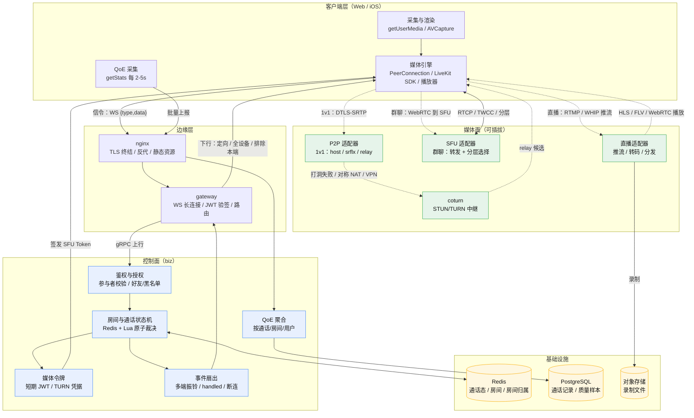
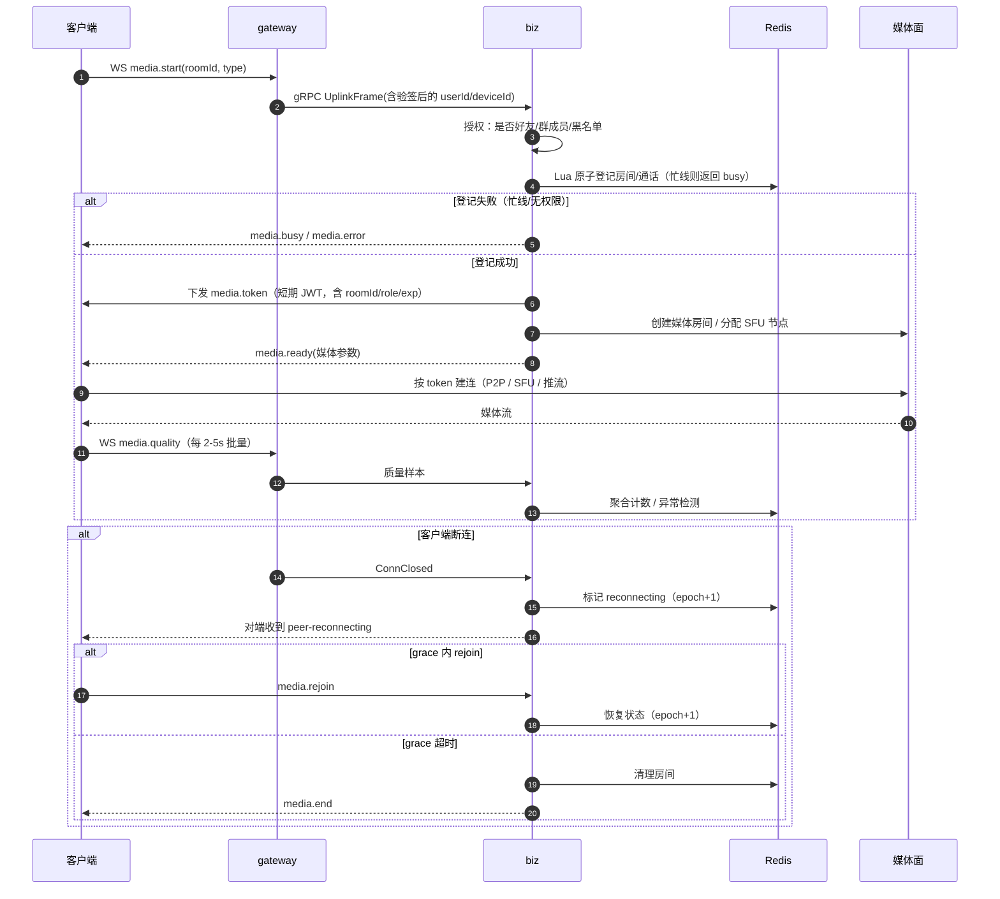
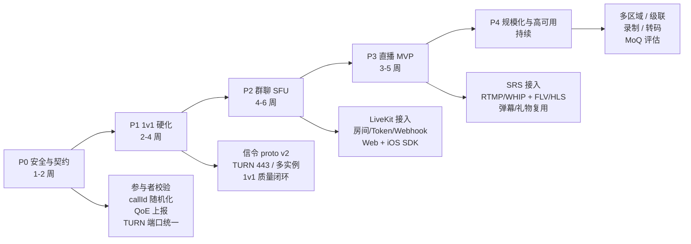

# 音视频模块 · 架构调研总览与演进路线

> 本目录回答一个问题：**要支撑 P2P 通话、群聊音视频会议、直播三条产品线，业界是怎么做的，我们该怎么改。**
>
> 读者对象：后端 / 客户端 / 运维。默认读者了解 IM 与 WebSocket，但不了解 RTC（Real-Time Communication，实时音视频通信）。
>
> 证据分级（全文统一）：
>
> | 级别 | 含义 | 例子 |
> |---|---|---|
> | **A** | 厂商官方文档 / 官方工程博客 / 标准 RFC | Discord 官方博客、Signal 官方博客、IETF 草案 |
> | **B** | 可核验的第三方技术拆解 / 开源代码 | Jitsi Handbook、mediasoup 文档、Zoom 逆向分析 |
> | **C** | 厂商宣传口径 / 估算 / 推断 | "99.9% 优质传输率"、容量估算 |
>
> 标注 **C** 的数字不要直接写进 SLA 或对外材料，必须实测复核。

---

## 0. 一页结论

### 0.1 三条产品线，三种媒体拓扑，不要用一套架构硬扛

| 产品线 | 典型规模 | 正确拓扑 | 关键成本 | 我们的现状 |
|---|---|---|---|---|
| 1v1 通话 | 2 人 | **P2P 优先 + TURN 兜底** | 仅失败那部分的中继带宽 | ✅ 已实现，可继续用 |
| 群聊会议 | 3–16 人（可到 50） | **SFU**（Selective Forwarding Unit，选择性转发单元） | SFU 出向带宽 + CPU | ❌ 没有，P2P 全互联在 4 人以上上行爆炸 |
| 直播 | 1 主播 → 万人 | **RTMP/WHIP 推流 → 转码/封装 → CDN 分发** | CDN 出向带宽 | ❌ 只有规划，未落地 |

**核心判断：控制面可以统一，媒体面必须可插拔。** 把"谁在和谁通话、能不能接、谁有权限"收敛成一套房间/参与者模型；把"媒体怎么走"做成 P2P / SFU / Live 三个适配器。反过来（用一套媒体架构覆盖三种场景）在工程上一定失败：P2P 撑不了群聊，SFU 撑不了万人直播，CDN 给不了 200ms 互动延迟。

### 0.2 业界标杆的共性（五条）

1. **控制面与媒体面彻底分离。** Zoom 的会议元数据存数据库、媒体只在开会时分配到 MMR（Multimedia Router）；Discord 的文本/信令走 Elixir，媒体走 C++ SFU；Signal 的信令与密钥治理在客户端，SFU 只转发密文。**没有一家把"会议状态"放进媒体服务器。**
2. **SFU 是多人实时的事实标准，MCU 只在需要混流/录制/互通时出现。** Zoom 的 MMR、Google Meet、Discord、Signal、Jitsi JVB、LiveKit、mediasoup 都是 SFU。MCU（Mixer，混流）会解码+重编码，成本高、延迟大，但在"服务端录制""SIP/H.323 互通""超低端设备"场景仍需要。
3. **带宽适配靠"分层 + 反馈闭环"：simulcast 或 SVC，加 GCC/TWCC 拥塞控制。** 发送端一次编码多个分辨率（simulcast）或一个可裁剪码流（SVC），SFU 按每个接收端的实时带宽选层；没有这个，一个弱网用户会拖垮整个房间。
4. **区域化 + 级联是规模化的必由之路。** Zoom 用 Meeting Zone + MMR 级联；Discord 13 区域、850+ 语音服务器、etcd 做负载发现；Agora 用 600+ PoP 的全网状私有网；Jitsi 用 Octo 把多个 JVB 级联。单机房单集群只能做 MVP。
5. **可观测性是媒体系统的一等公民。** P2P 下服务端看不到 RTP，必须靠客户端 `getStats()` 上报聚合；SFU 下服务端能看 RTCP，但也要按房间/用户维度打点。没有 QoE（Quality of Experience）数据，弱网问题只能靠用户投诉。

### 0.3 我们项目的五个最紧要问题（按严重度）

| # | 问题 | 证据 | 严重度 | 处理阶段 |
|---|---|---|---|---|
| 1 | 信令不校验参与者身份，`call:end` 可被任意人用来挂断他人通话 | `biz/internal/realtime/callRelay.go:99-121` 直接按 `callId` 解析双方，无会话校验 | **P0 安全** | P0 |
| 2 | `callId` 格式 `call_<a>_<b>_<ts>` 成为隐式协议；`call:ice`/`call:end` 的路由不读会话 | `callRelay.go:109-119`、`:167-179`；`useCall.ts` 生成 | **P1 正确性** | P0/P1 |
| 3 | 单区域单机 + coturn `total-quota=500`，满载约 250 路双边中继；带宽通常先到顶 | `docker/coturn/turnserver.conf:55-56`；部署为单 Lighthouse | **P1 容量** | P1 |
| 4 | 无任何服务端/聚合的媒体质量观测，只有客户端 `getStats()` 未上报 | `web/src/utils/webrtc.ts:706`；指标只有事件计数 | **P1 可观测** | P0 |
| 5 | 无群聊 SFU、无直播落地、iOS 通话未实现 | 代码检索：无 SFU/room/live 实现；`mobile-swift` 仅文档提及 | **P2 能力** | P2/P3 |

> 结论：**当前架构是"合格的 1v1 内测版"，不是"公网可用的音视频平台"。** 先修安全与契约（P0），再补观测与容量（P1），然后才谈群聊和直播（P2/P3）。顺序不能反：在越权可挂断、质量不可观测的前提下扩容量，等于把问题放大。

### 0.4 目标形态（一句话）

**一套控制面（biz `media` 模块 + gateway 长连接 + Redis 状态 + PG 记录）+ 三个媒体适配器（p2p / sfu / live）+ 一条 QoE 反馈闭环。**

---

## 1. 文档地图

| 文档 | 回答什么 | 关键产出 |
|---|---|---|
| **00（本篇）** | 全局结论、路线、文档索引 | 一页结论、五条共性、五个问题、四阶段 |
| [01-技术底座](./01-技术底座-实时音视频协议栈与核心机制.md) | RTC 的协议栈与核心机制：ICE/TURN、RTP/RTCP、NACK/FEC、GCC/TWCC、simulcast/SVC、SFU/MCU | 术语表、延迟预算、拓扑对比公式 |
| [02-会议与通话标杆](./02-标杆剖析-会议与通话产品的架构选择.md) | Zoom / Google Meet / Discord / 腾讯会议 / Agora / Signal / Jitsi / LiveKit / mediasoup 的架构拆解 | 三类架构家族、可借鉴/不可照搬清单 |
| [03-直播标杆](./03-标杆剖析-直播产品的协议栈与分发架构.md) | Twitch / YouTube / 抖音 / B 站 / SRS 的推流、转码、分发、低延迟 | 协议矩阵、直播成本模型、与我们直播规划的对照 |
| [04-规模化与高可用](./04-规模化-容量模型故障域与可观测性.md) | 容量怎么算、故障域怎么分、QoE 怎么观测、成本怎么控 | 容量公式、故障矩阵、SLI/SLO |
| [05-现状评估](./05-现状评估-our-chat音视频模块差距分析.md) | 我们代码级现状、能力边界、架构债 | 证据表、差距分级、可复用资产 |
| [06-目标架构](./06-目标架构-统一控制面与可插拔媒体面.md) | 目标架构、统一信令模型、SFU/直播选型、分阶段路线 | 架构图、时序图、选型决策表 |
| [07-实施计划](./07-实施计划-契约改造实验与风险登记.md) | 具体改哪些文件/契约/指标，做哪些实验，有哪些风险 | 任务清单、实验清单、风险登记 |

建议阅读顺序：**00 → 05 → 06 → 01 → 02 → 03 → 04 → 07**。
先看"我们缺什么、要变成什么"，再看"业界怎么做的、为什么"，最后看"怎么落地"。

---

## 2. 全链路总览（含主流程、分支、异常与缓存）

下图把三条产品线放在同一张图里：上半部分是控制面（所有场景共用），下半部分是三个媒体面（按场景选择）。虚线是反馈与观测。

### 2.1 三条主流程的走法

### 2.2 异常与降级路径（必须显式设计，不能靠"应该没事"）

| 异常 | 当前行为 | 目标行为 |
|---|---|---|
| P2P 打洞失败 | 客户端升级 relay-only，重建 PC | 保留；并上报 `ice_failure_reason` 与 relay 占比 |
| TURN 端口耗尽 | coturn 返回 508，媒体单向 | 容量水位告警；多 TURN 实例 + 端口池；预留扩容 |
| SFU 节点宕机 | 不存在 | 房间重分配到新节点；客户端自动重连；房间 epoch 防脑裂 |
| Redis 故障 | 通话态不可用 | 通话建立 fail-fast；已建立通话尽量本地保活；恢复后对账 |
| 客户端崩溃 | 服务端 grace 后清理 | 保留；增加"最后心跳时间"与设备级清理 |
| 直播推流断开 | 不存在 | 30s 宽限重推；超时结束场次 |
| 质量劣化 | 无感知 | QoE 阈值告警 + 自动降层/降码率 + 用户提示 |

---

## 3. 演进路线（四阶段，每阶段可独立验收）

### 3.1 阶段目标与验收（详细任务见 07 篇）

| 阶段 | 目标 | 验收标准（可测） | 估算 |
|---|---|---|---|
| **P0 安全与契约** | 公网可暴露，不被越权挂断/注入 | 四个上行事件全部校验参与者；`callId` 含 128bit 随机数；QoE 样本可查；TURN 端口段单点定义 | 8–12 人日 |
| **P1 1v1 硬化** | 弱网可用、可观测、可扩容 | P2P 成功率 ≥ 95%（目标，实测口径见 07）；relay 占比可观测；TURN 支持 443/TLS；单区域 2 TURN 实例 | 15–20 人日 |
| **P2 群聊 SFU** | 3–16 人会议可用 | 9 人 720p 房间稳定 30 分钟；加入 < 2s；SFU 节点故障 5s 内恢复；录制可选 | 25–35 人日 |
| **P3 直播 MVP** | 1 主播 → 千级观众 | RTMP/WHIP 推流；FLV 延迟 ≤ 3s；HLS 兜底；弹幕/礼物复用现有链路 | 20–30 人日 |
| **P4 规模化** | 多区域、高可用、成本可控 | 区域故障切换；容量模型误差 < 30%；单位成本可算 | 持续 |

> 估算口径：1 人日 = 6 小时有效编码/调试；不含客户端 UI 打磨与真机联调的长尾。实际以迭代为准。

### 3.2 为什么是这个顺序（不能跳步）

1. **安全先于扩容**：`call:end` 越权的成本是"任意用户可挂断任意通话"，扩容只会扩大攻击面。
2. **契约先于 SFU**：现在信令是 `rawJSON` 原样转发、`relay` 标记未进 IDL（接口定义语言）。直接叠加 SFU 会在同一套"隐式协议"上再叠一层，后续无法维护。
3. **观测先于优化**：没有 QoE 数据，无法判断"群聊卡"是 SFU 带宽、客户端上行、还是 TURN 中继；优化会变成猜。
4. **群聊先于直播**：群聊复用现有 WS 信令与房间模型，是 SFU 能力的最小验证；直播的互动面（弹幕/礼物）已经规划，但媒体面是另一套（SRS/CDN），可以并行但不应先做。

---

## 4. 三条"不要做"的红线

| 红线 | 为什么 | 替代方案 |
|---|---|---|
| **不要用 P2P 全互联做 3 人以上视频** | 上行带宽 = (N-1) × 码率；4 人 720p 就要 4.5 Mbps 上行，移动端直接崩 | SFU |
| **不要自研 SFU 内核（除非目标就是学 SFU）** | ICE/DTLS/SRTP/拥塞控制/分层转发是数年工程量；Signal 重写 SFU 也只为 40 人 | LiveKit / mediasoup / SRS |
| **不要用 SFU 做万人直播** | SFU 出向 = 观众数 × 码率；1 万观众 × 2.5 Mbps = 25 Gbps | CDN + HLS/FLV/MoQ |

---

## 5. 一句话记住

> **1v1 用 P2P 省钱，群聊用 SFU 保体验，直播用 CDN 扛规模；控制面统一，媒体面可换，观测闭环贯穿三者。**
