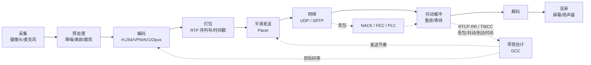
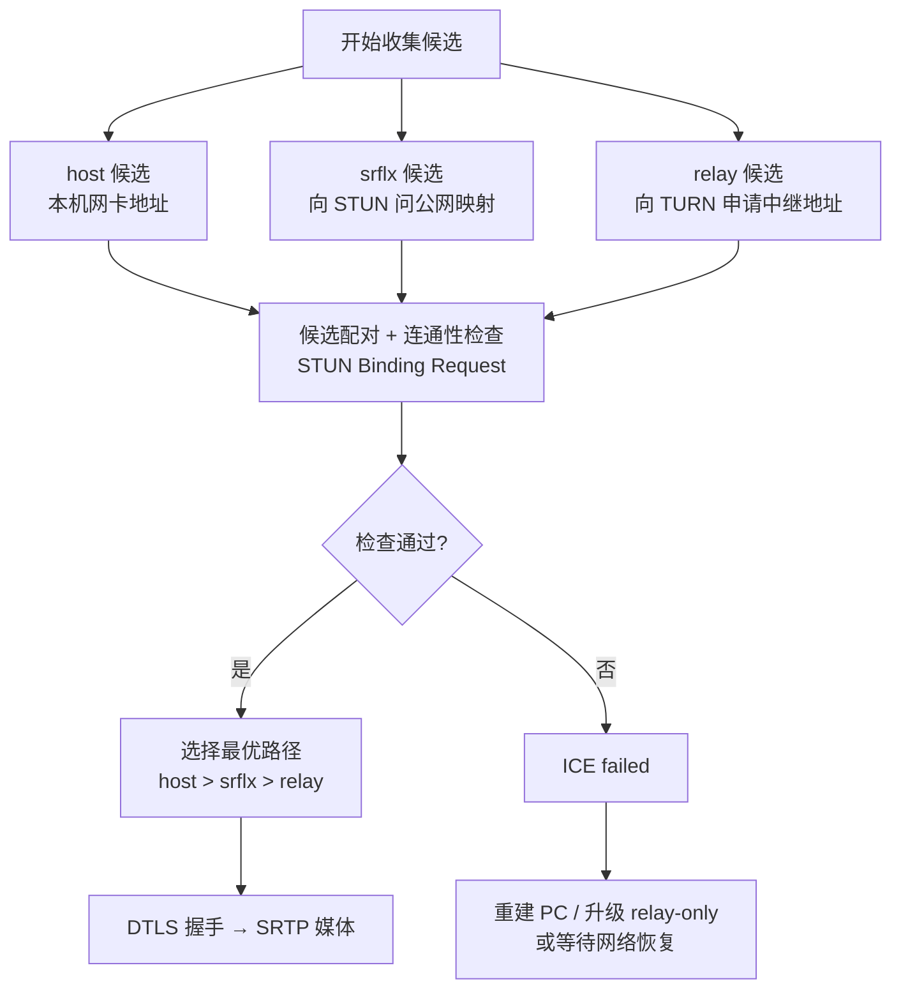
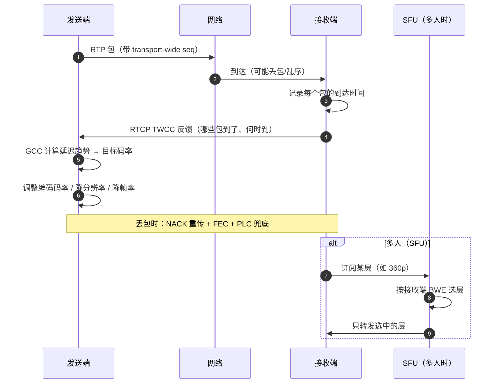
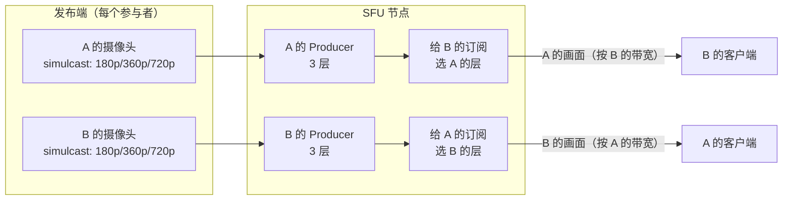

# 音视频模块 · 技术底座：协议栈与核心机制

> 本篇不贴产品，只讲**实时音视频（RTC）为什么这么设计**。读懂这一篇，后面看 Zoom / Discord / 腾讯会议的架构才不会停留在名词层面。
>
> 阅读提示：术语很多，但都是"一个词解决一类问题"。先看 §1 术语表建立映射，再按 §2 的链路顺序读。

---

## 0. TL;DR

- 实时音视频的本质是**在不可靠网络上，用有限带宽，把"时间敏感"的媒体送达，并让双方对延迟/质量形成闭环**。所有机制都是这句话的展开。
- 一条媒体链路有六个环节：**采集 → 预处理 → 编码 → 打包/发送 → 网络 → 抖动缓冲 → 解码 → 渲染**。每个环节都有独立的延迟预算，加起来才是端到端延迟。
- **信令（Signaling）与媒体（Media）必须分离**：信令可靠、有序、可鉴权；媒体不可靠、低延迟、端到端加密。混在一起会互相拖累。
- NAT 穿透靠 **ICE = STUN + TURN**：先试直连（host/srflx），失败再中继（relay）。TURN 不是"备用方案"，是**必选兜底**。
- 抗丢包三板斧：**FEC（前向纠错）+ NACK（重传）+ PLC（丢包隐藏）**；抗拥塞靠 **GCC/TWCC**（基于延迟的趋势，而不是只看丢包）。
- 多人必须用 **SFU**；SFU 的核心不是"转发"，而是**为每个接收端独立选择分辨率层**。这依赖 simulcast 或 SVC。
- 端到端延迟预算：交互式通话目标 **< 200ms**（优秀）、**< 300ms**（可用）；直播 **1–3s** 是另一条曲线。

---

## 1. 术语表（先建立映射）

### 1.1 媒体与编码

| 术语 | 全称 | 通俗解释 |
|---|---|---|
| **RTC** | Real-Time Communication | 实时音视频通信，强调"延迟优先于完整" |
| **Codec** | 编解码器 | 把原始音视频压缩成码流的算法，如 H.264、VP9、AV1、Opus |
| **GOP** | Group of Pictures | 一组帧，以一个关键帧（I 帧）开头，后续是 P/B 帧；GOP 越大，码率越低，但丢包恢复越慢 |
| **I/P/B 帧** | Intra/Predicted/Bidirectional | I 帧可独立解码；P 帧参考前面的帧；B 帧参考前后帧（实时通话通常不用 B 帧，增加延迟） |
| **SVC** | Scalable Video Coding | 可分层编码：一个码流包含基础层 + 增强层，按需裁剪 |
| **Simulcast** | Simultaneous Broadcast | 同时编码多路独立码流（如 180p/360p/720p），SFU 选一路转发 |
| **ABR** | Adaptive Bitrate | 自适应码率，播放器根据带宽切换清晰度（直播/HLS 常用） |
| **Opus** | — | 实时音频编解码器，低延迟、抗丢包、支持 6–510 kbps |
| **PLC** | Packet Loss Concealment | 丢包隐藏：用前后帧"猜"出丢失的音频，避免爆音/断续 |
| **Jitter Buffer** | 抖动缓冲 | 接收端排队重排，用缓冲深度换平滑；缓冲越深越抗抖，但延迟越大 |

### 1.2 传输与网络

| 术语 | 全称 | 通俗解释 |
|---|---|---|
| **RTP** | Real-time Transport Protocol | 承载音视频的 UDP 协议，带序列号、时间戳、SSRC |
| **RTCP** | RTP Control Protocol | RTP 的伴生控制协议，报告丢包、抖动、RTT，驱动拥塞控制 |
| **SRTP** | Secure RTP | 加密的 RTP，密钥由 DTLS 协商 |
| **DTLS** | Datagram TLS | UDP 上的 TLS，用于协商 SRTP 密钥 |
| **ICE** | Interactive Connectivity Establishment | NAT 穿透框架：收集候选、配对、连通性检查 |
| **STUN** | Session Traversal Utilities for NAT | 问服务器"我的公网地址是什么" |
| **TURN** | Traversal Using Relays around NAT | 中继服务器：所有包经它转发，保证连通 |
| **NAT** | Network Address Translation | 家庭/公司路由器把内网地址映射成公网地址 |
| **对称 NAT** | Symmetric NAT | 对每个目标分配不同端口，打洞极难，必须 TURN |
| **TWCC** | Transport-Wide Congestion Control | 接收端报告每个包的到达时间，发送端据此估计带宽 |
| **GCC** | Google Congestion Control | 基于延迟趋势的拥塞控制算法，WebRTC 默认 |
| **BWE** | Bandwidth Estimation | 带宽估计，决定"发多少" |
| **Pacer** | — | 平滑发送器：把编码器突发的码流按估计带宽均匀发出，避免瞬时拥塞 |

### 1.3 架构与拓扑

| 术语 | 全称 | 通俗解释 |
|---|---|---|
| **P2P** | Peer-to-Peer | 两端直连，媒体不经服务器 |
| **Mesh** | 全网状 | 每个参与者与其他所有人直连，连接数 N(N-1)/2 |
| **SFU** | Selective Forwarding Unit | 选择性转发单元：收每个人的流，按订阅关系转发，不解码不混流 |
| **MCU** | Multipoint Control Unit | 多点控制单元：解码 + 混流 + 重编码，输出一路合成流 |
| **Cascading** | 级联 | 多个 SFU 互连，跨区域/跨集群转发 |
| **LastN** | — | 只转发最近 N 个活跃发言者的视频，控制下行带宽 |
| **Simulcast/SVC 层选择** | — | SFU 为每个接收端选择合适的分辨率层 |

---

## 2. 一条媒体链路的全貌

### 2.1 从摄像头到屏幕



**六个延迟来源**（以 720p 视频通话为例，数量级仅用于建立直觉）：

| 环节 | 典型耗时 | 说明 |
|---|---|---|
| 采集 + 预处理 | 10–30ms | 摄像头曝光、降噪、美颜 |
| 编码 | 5–30ms | 硬件编码快，软件编码慢；分辨率越高越慢 |
| 打包 + Pacer | 0–20ms | 平滑发送会引入少量排队 |
| 网络单程 | 5–150ms | 同城 5–20ms，跨省 30–60ms，跨国 100–200ms |
| 抖动缓冲 | 20–100ms | 用延迟换平滑；弱网时自适应加深 |
| 解码 + 渲染 | 10–40ms | 硬件解码快；渲染有 vsync 等待 |
| **合计** | **约 50–370ms** | 交互式目标 < 200ms，超过 300ms 明显"抢话" |

> 这就是为什么"实时"不能用 HLS：HLS 的切片 + 缓冲天然是秒级。协议选择首先由延迟预算决定。

### 2.2 为什么信令与媒体要分开

| 维度 | 信令 | 媒体 |
|---|---|---|
| 传输 | WebSocket / HTTPS / gRPC | UDP（SRTP），失败回退 TCP/TLS |
| 可靠性 | 必须可靠、有序 | 允许丢包，重传有截止时间 |
| 延迟要求 | 百毫秒级可接受 | 越低越好，抖动要小 |
| 加密 | TLS | DTLS-SRTP，端到端 |
| 服务端是否解析 | 需要（鉴权、路由、状态） | P2P 不解析；SFU 只读包头 |
| 失败语义 | 重试/报错 | 丢帧/降码率/重建连接 |

**设计推论**：信令可以走现有的 WS/gRPC 体系（我们已经是这样），媒体必须独立建连。任何"把 SDP 塞进消息表""用消息队列传 RTP"的做法都会把可靠传输的延迟和队头阻塞带进媒体。

### 2.3 SDP 是什么，不是什么

SDP（Session Description Protocol）是**能力协商的文本格式**，描述：

- 有哪些媒体流（audio/video）、方向（sendrecv/sendonly/recvonly）；
- 用什么编解码器（payload type 映射）；
- 用什么传输（ICE 候选、DTLS 指纹）；
- 有哪些分层（simulcast 的 rid、SVC 的层信息）。

**它不是配置，不能"改一个字段就生效"**。`iceTransportPolicy`、编解码器、simulcast 层数这些都在创建 PeerConnection 或生成 SDP 时确定；想改通常要重新协商（renegotiation），甚至重建 PeerConnection。这解释了我们项目里"升级 relay 必须 reset() 重建 PC"的行为。

---

## 3. NAT 穿透：ICE / STUN / TURN

### 3.1 三种候选



| 候选 | 怎么来 | 延迟 | 服务器成本 | 什么时候用 |
|---|---|---|---|---|
| **host** | 本机网卡 | 最低 | 0 | 同局域网 |
| **srflx** | STUN 反射地址 | 低 | 仅 STUN（几乎为 0） | 锥形 NAT，可打洞 |
| **relay** | TURN 分配 | 多一跳（+20–80ms） | 带宽 + 端口 | 对称 NAT / 严格防火墙 / VPN |

### 3.2 TURN 的工作机制（为什么它必须存在）

TURN 不是"转发服务器"这么简单，它有一套分配模型：

1. 客户端向 TURN 发 `Allocate` 请求，服务器分配一个 **relay 地址 + 端口**（一个 allocation 占一个端口）。
2. 客户端通过 `CreatePermission` 允许某个对端 IP 发数据进来（防止被当开放代理）。
3. 数据用 `ChannelData` 或 `Send/Data` 封装转发。
4. allocation 有生命周期（默认 10 分钟），需要 refresh。

**关键工程含义**：

- **端口数 = 并发中继路数的硬上限**。`min-port`/`max-port` 决定端口池，`total-quota` 决定总 allocation 数，两者取小。
- **TURN 服务器必须知道自己的公网地址**（`external-ip`），否则它发给对端的 relay 候选是内网地址，必然不通。
- **TURN 的带宽是双向的**：A→TURN→B 和 B→TURN→A 都占服务器出/入带宽。
- **TURN over TCP/TLS 是穿透企业防火墙的最后手段**：很多网络只放行 443/TCP；`turns:host:443` 比 `turns:host:5349` 的连通率高得多。

### 3.3 一个常见误区：有 STUN 就不需要 TURN

错。STUN 只解决"我知道自己的公网地址"，不解决"对称 NAT 下双方端口映射不一致，打洞失败"。**生产环境的 P2P 成功率通常在 70%–95% 之间**（取决于用户网络分布，**C** 级估算），剩余必须靠 TURN。把 TURN 当"可选优化"的系统，在移动网络/企业网下会出现"部分用户永远打不通"。

---

## 4. 抗丢包与拥塞控制：决定"卡不卡"

### 4.1 三种恢复手段，各管一段

| 手段 | 原理 | 优点 | 缺点 | 适用 |
|---|---|---|---|---|
| **FEC** | 发送冗余包，接收端用冗余恢复丢失包 | 不需要往返，延迟低 | 浪费带宽；突发丢包恢复有限 | 音频、关键帧、低延迟场景 |
| **NACK** | 接收端请求重传丢失包 | 不浪费带宽 | 需要至少 1 RTT；迟到重传可能已过期 | 视频、可容忍 1 RTT 的场景 |
| **PLC** | 用前后帧预测丢失内容 | 零带宽 | 只能"听起来/看起来差不多" | 音频必备；视频有伪影 |

**优先级**：音频 > 视频；关键帧 > 普通帧；小丢包用 FEC，大丢包/关键帧用 NACK，恢复不了用 PLC 掩盖。

### 4.2 为什么实时通信用 GCC，不用 TCP/BBR

| 方案 | 信号 | 行为 | 为什么不适合/适合 |
|---|---|---|---|
| **TCP** | 丢包 = 拥塞 | 重传 + 拥塞窗口减半 | 队头阻塞，延迟尖峰；实时媒体不能等 |
| **BBR** | 瓶颈带宽 + 最小 RTT | 主动探测带宽 | 追求吞吐，排队可能偏大；对随机丢包不敏感，但实时更怕延迟 |
| **GCC（WebRTC 默认）** | 延迟趋势（TWCC）+ 丢包 | 延迟上升就降，平稳就试探升 | 目标是"低延迟 + 不排队"，与通话目标一致 |

**GCC 的核心逻辑**（Signal 博客的总结最直观）：

```text
延迟趋势下降 → 保持速率，让队列排空
延迟趋势平稳 → 逐步提高速率，试探上限
延迟趋势上升 → 按幅度降低速率，避免排队
```

这套逻辑跑在**每个接收端**上：SFU 对每个订阅者维护独立的带宽估计，所以同一个发送者的同一帧，对不同接收者可以转发不同层。

### 4.3 发送端与接收端的配合



---

## 5. 拓扑：P2P / SFU / MCU

### 5.1 一张表看清代价

设每路视频码率 `b`，参与者数 `N`。

| 拓扑 | 上行带宽（每端） | 下行带宽（每端） | 服务器带宽 | 连接数 | 适用 |
|---|---|---|---|---|---|
| **P2P Mesh** | (N-1) × b | (N-1) × b | 0（仅信令） | N(N-1)/2 | 2–3 人 |
| **SFU** | b | (N-1) × b（未优化）<br/>≈ k × b（lastN/分层后） | N × b（入）+ N × (N-1) × b（出，未优化） | N | 3–50 人 |
| **MCU** | b | b（收到一路混流） | N × b（入）+ N × b（出）+ 转码 CPU | N | 需要混流/录制/互通 |

**关键结论**：

- P2P 的上行随 N 线性增长，4 人 720p 就要 4.5 Mbps，移动端直接不可用。
- SFU 的上行恒定（每人只发一份），下行靠 **lastN + 分层**压到 `k × b`（k 通常 3–8）。
- MCU 的服务器成本最高（解码 + 混流 + 编码），但客户端最省（只收一路）。**MCU 不是"落后技术"，而是"用服务器 CPU 换客户端带宽和兼容性"**。

### 5.2 SFU 到底在转发什么



SFU 做四件事：

1. **接收**：每个发布者一条（或几条）流；
2. **选择**：为每个订阅者选一路层（按 BWE、显示尺寸、是否活跃发言者）；
3. **改写**：切层时重写 RTP 序列号/时间戳/SSRC（否则接收端解码器会乱）；
4. **转发**：只复制包，不解码、不混流。

> 第 3 点是 SFU 最容易被低估的复杂度。Signal 的博客详细描述了 VP8 simulcast 切层时必须重写 SSRC、RTP seq、RTP timestamp、VP8 PictureID/TL0PICIDX 四类字段，并在切层首包制造一个序列号空洞，提示解码器"上一帧不完整"。这就是"转发"背后的真实工程量。

### 5.3 simulcast vs SVC：两条路，各有代价

| 维度 | Simulcast | SVC |
|---|---|---|
| 编码方式 | 编码 N 路独立流（180p/360p/720p） | 编码 1 路多层流（基础层 + 增强层） |
| 上行带宽 | N 路之和（约 1.2–1.5 倍单路） | 接近单路（层间共享运动信息） |
| 编码 CPU | 高（N 次编码） | 中（一次编码，但算法复杂） |
| SFU 复杂度 | 需要切层重写 RTP 头 | 按层丢包即可，改写少 |
| 客户端兼容 | 广（VP8/H.264 都支持） | 窄（VP9/AV1 支持较好；H.264 SVC 生态差） |
| 弱网适配 | 粒度粗（整层切换） | 粒度细（可只收 temporal 层） |
| 典型使用者 | Signal（VP8）、多数 WebRTC 默认 | Google Meet/Duo（VP9）、Zoom（部分）、AV1 生态 |

**选择建议**：

- 浏览器为主、要兼容 Safari/旧设备 → **simulcast**（VP8/H.264）。
- 可控客户端（自研 App）、追求弱网细腻度 → **SVC（VP9/AV1）**。
- 两者可以共存：发布端能力协商，SFU 按订阅端能力选择。

---

## 6. 延迟预算与质量指标

### 6.1 延迟预算表（把"卡"拆开）

| 场景 | 目标端到端延迟 | 主要预算分配 |
|---|---|---|
| 1v1 通话 | < 200ms（优秀）< 300ms（可用） | 编码 30 + 网络 60 + 抖动 50 + 解码渲染 40 + 余量 20 |
| 群聊会议 | < 300ms | 多一跳 SFU（+20–50ms），抖动缓冲略深 |
| 互动直播（连麦） | < 500ms | 推流 + SFU + 拉流各一段 |
| 普通直播（FLV） | 1–3s | 编码 + 传输 + 播放缓冲 |
| HLS 直播 | 5–30s | 切片 + 播放器缓冲 |
| LL-HLS | 2–5s | partial segment + 阻塞式 playlist 刷新 |

### 6.2 质量指标（服务端能算的 vs 只能客户端上报的）

| 指标 | 含义 | 采集点 | 用途 |
|---|---|---|---|
| **join time** | 点击到首帧 | 客户端 | 体验门槛（目标 < 2s） |
| **setup time** | 建连到 connected | 客户端 | 诊断 ICE/信令 |
| **RTT** | 往返时延 | RTCP / 客户端 | 区域选择、告警 |
| **jitter** | 抖动 | RTCP / 客户端 | 抖动缓冲调参 |
| **packet loss** | 丢包率 | RTCP / 客户端 | 抗丢包策略 |
| **freeze rate** | 卡顿率（画面冻结时长占比） | 客户端 | 核心 QoE |
| **E2E latency** | 端到端延迟 | 客户端（打点） | 直播/会议核心 |
| **relay ratio** | 走 TURN 的比例 | 服务端（TURN 统计）+ 客户端 | 成本与网络健康 |
| **P2P success rate** | 直连成功率 | 客户端上报 | NAT 分布评估 |
| **MOS** | 语音质量主观分（1–5） | 模型估算 | 音频质量 |

> 关键认知：**P2P 场景服务端看不到 RTP，所有媒体质量只能靠客户端上报**。SFU 场景服务端能看到 RTCP，但"用户看到的画面卡不卡"仍然只有客户端知道。所以 QoE 上报不是"锦上添花"，是媒体系统的必备组件。

---

## 7. 安全：媒体面比信令面更容易被忽略

| 风险 | 说明 | 对策 |
|---|---|---|
| **信令越权** | 不校验参与者，知道 ID 就能挂断/注入 | 每个上行事件读会话校验 `userId ∈ {caller, callee}` |
| **callId 可预测** | 格式含双方 ID + 时间戳，可枚举 | 128bit 随机 nonce；服务端签发 |
| **TURN 被当开放代理** | 公开 TURN 可被用来打内网/刷流量 | `no-multicast-peers`、`denied-peer-ip`、短期 HMAC 凭据、配额 |
| **媒体令牌泄露** | SFU token 长期有效 | 短期 JWT（分钟级），绑 room/role/device |
| **端到端加密** | P2P 下 DTLS-SRTP 是两端之间；SFU 下 DTLS 终止在 SFU，SFU 可见媒体 | 需要 E2EE 时用 SFrame/Insertable Streams；SFU 只转发密文 |
| **录制合规** | 录制需告知/同意 | 录制状态事件 + 合规开关 |

> DTLS-SRTP 的保护范围要分场景说清：
> - **P2P / TURN 中继**：DTLS-SRTP 是**两端之间**的加密，TURN 只转发密文，看不到媒体内容；
> - **SFU**：DTLS 终止在 SFU，SFU 能解密媒体（除非应用层 E2EE）。
>
> 所以 **"WebRTC 默认加密"不等于"服务端看不到"**——在 SFU/录制场景必须说清加密边界。

---

## 8. 一分钟自检清单

读完这一篇，应该能回答：

1. 为什么 4 人视频不能用 P2P？——上行 (N-1)×b，移动端带宽不够。
2. 为什么 TURN 必须有？——对称 NAT/企业防火墙下 STUN 打洞失败。
3. 为什么 SFU 要 simulcast/SVC？——否则无法为不同带宽的接收端选不同分辨率。
4. 为什么实时不用 TCP？——队头阻塞 + 重传导致延迟尖峰。
5. 为什么服务端看不到 P2P 质量？——媒体不经服务器，只能客户端 `getStats()` 上报。
6. 为什么"WebRTC 加密"不等于 E2EE？——DTLS-SRTP 终止在 SFU/TURN，服务端可见。
7. 为什么升级 relay 要重建 PC？——`iceTransportPolicy` 是构造参数，不能运行时修改。

下一层：看 [02 会议与通话标杆](./02-标杆剖析-会议与通话产品的架构选择.md)，看真实产品如何组合这些机制。
