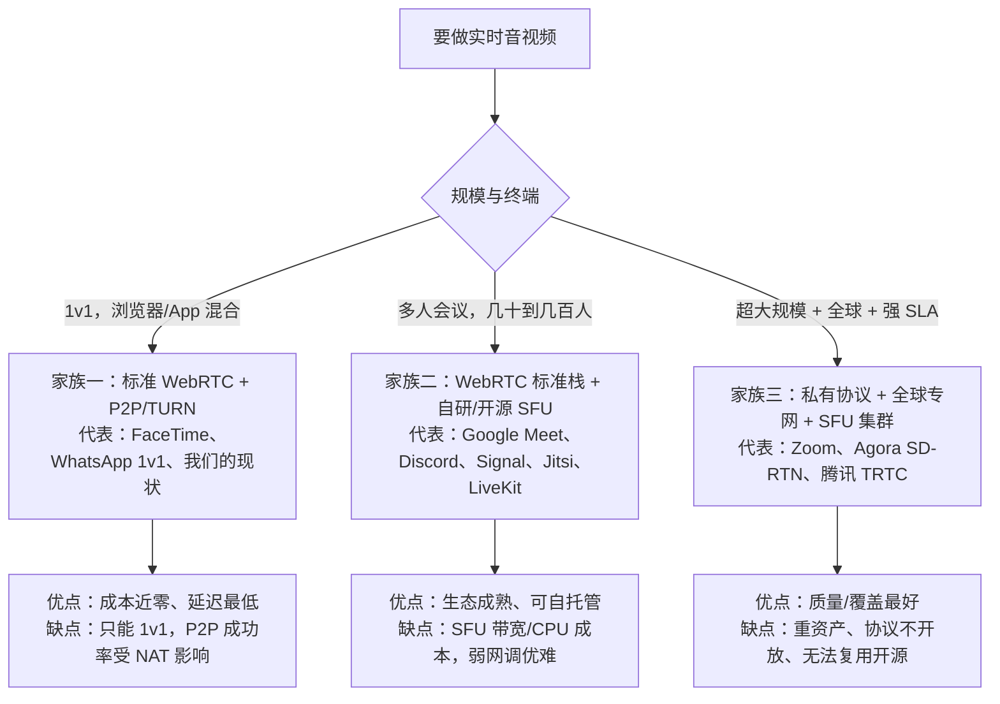
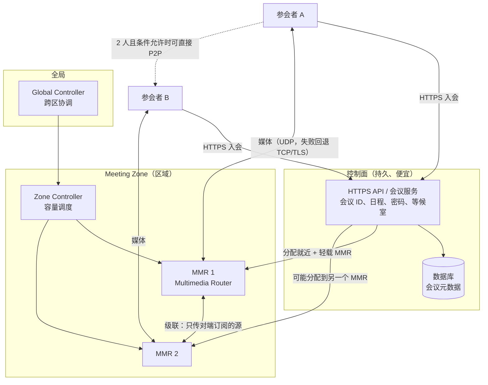
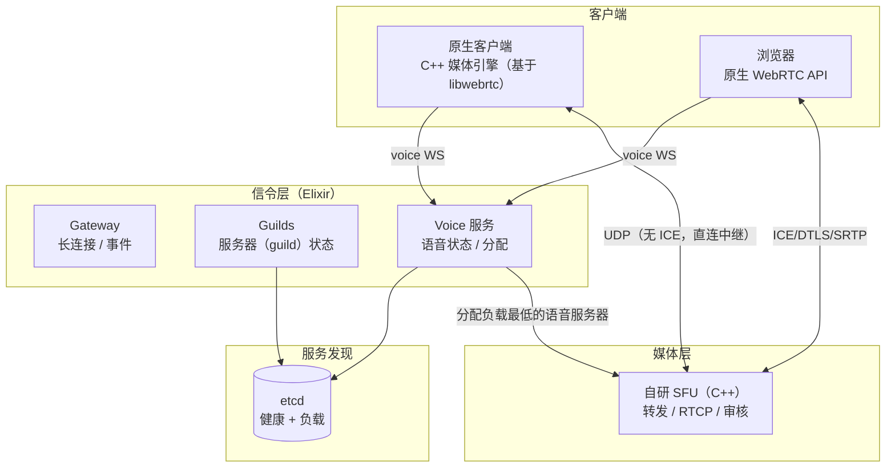

# 音视频模块 · 标杆剖析：会议与通话产品的架构选择

> 本篇拆解 Zoom、Google Meet、Discord、腾讯会议/TRTC、Agora、Signal、Jitsi、LiveKit、mediasoup 的**媒体面与控制面**。
>
> 目的不是"抄"，而是回答三个问题：
> 1. 他们为什么选这个拓扑？
> 2. 规模化时加了什么？
> 3. 哪些能用在 our-chat，哪些不能？
>
> 证据分级见 [00 篇](./00-总览-调研结论与演进路线.md) §0。**厂商宣传口径（C）一律标注，不当事实引用。**

---

## 0. TL;DR：三类架构家族

| 家族 | 媒体传输 | 典型编码/分层 | 规模化手段 | 适合谁 |
|---|---|---|---|---|
| **标准 WebRTC + P2P** | SRTP over UDP，TURN 兜底 | H.264/VP8，通常不分层 | 无（1v1） | 小团队、1v1 产品 |
| **WebRTC + SFU** | SRTP over UDP，SFU 转发 | simulcast（VP8/H.264）或 SVC（VP9/AV1） | 多节点、级联、区域化 | 会议/群聊产品 |
| **私有协议 + 专网** | 私有 UDP（类 RTP），自研拥塞控制/FEC | 私有分层（SVC/多流） | 全球 PoP + 智能路由 | 商业 RTC 平台 |

**一句话**：家族一的成本最低，家族二的工程可控性最好，家族三的质量上限最高但最贵。our-chat 现在在家族一，目标是"家族二为主、家族一保留、家族三只在直播分发借用 CDN"。

---

## 1. Zoom：把"贵的东西"做成临时的

### 1.1 架构骨架

### 1.2 关键事实

| 维度 | 做法 | 证据 |
|---|---|---|
| 媒体节点 | **MMR = SFU**，只按订阅转发，**不解码、不混流、不转码** | B（第三方拆解 + 抓包分析） |
| 发送端 | 同一摄像头**最多同时发 4 路不同分辨率**（simulcast 思路），全屏用户和缩略图用户各取所需 | B |
| 接收端 | 只解码自己正在显示的流；按显示尺寸请求对应码流 | B |
| 协议 | 网页端可走标准 WebRTC；**原生客户端是私有协议**（自定义 RTP 变体） | B |
| 传输 | UDP 优先，网络不允许时回落 TCP/TLS | B |
| 区域 | Global Controller → Zone Controller → MMR 集群；跨区用**级联链路**，只传已订阅的源 | B |
| 1v1 | 满足条件时**跳过 MMR 走 P2P** | B |
| 大会议 | 横向加 MMR + **限制发送方**（webinar 只有主持/嘉宾能发），观众只收 | B |
| QoS | 客户端 Reactive QoS：CPU 瓶颈降帧率、网络瓶颈降分辨率/码率；单个观看者劣化只影响他自己 | B |
| 规模 | 普通会议 1000 互动参与者；webinar 可到数十万/百万（需提前协调） | C（厂商口径） |
| 抗丢包 | 宣称约 45% 丢包仍可用 | C |

### 1.3 最值得学的三点

1. **控制面持久、媒体面临时**：会议元数据长期存库；MMR 只在有人时分配，最后一人离开即销毁。这让"百万场会议"与"几千台媒体服务器"解耦。
2. **发送端多流 + 接收端按显示尺寸取流**：不是"服务器转码出多档"，而是"客户端编多档，服务器选档"。服务器成本低，客户端 CPU 换服务器带宽。
3. **大规模型 webinar 的本质是"限制发送方"**：观众再多，媒体源只有主持/嘉宾几个。这比"让 SFU 扛百万路"现实得多。

### 1.4 不能照搬的

- 私有协议 + 私有客户端：我们没有 Zoom 的端侧控制力，浏览器只能用标准 WebRTC。
- 全球 Meeting Zone + 级联：需要多区域机房与调度系统，超出当前项目阶段。
- "4 路 simulcast"：浏览器端同时编 4 路对 CPU/上行压力大，通常 3 路足够。

---

## 2. Google Meet / Duo：WebRTC 标准栈 + SVC 的样板

### 2.1 架构要点

| 维度 | 做法 | 说明 |
|---|---|---|
| 拓扑 | **SFU** | 每个参与者上行一份，SFU 按订阅转发 |
| 分层 | **SVC**（VP9，后续 AV1） | 一个码流多层，SFU 按接收端带宽裁层；比 simulcast 上行更省 |
| 拥塞控制 | **GCC / TWCC** | Google 是 WebRTC 与 GCC 的主要贡献者 |
| 规模 | 免费版 100 人；Workspace 依版本可到 250/500/1000 | B（公开资料） |
| 客户端 | 浏览器原生 WebRTC | 无插件，跨平台 |
| 网络 | Google 全球骨干 + 边缘 | 具体节点/调度未公开 |

### 2.2 为什么 Google 选 SVC 而不是 simulcast

- Google 同时控制**浏览器（Chrome）与会议服务**，可以推动 VP9/AV1 SVC 的端到端支持；
- SVC 的上行只有一份码流，弱网时 SFU 可以只丢增强层，粒度比"整层切换"细；
- 代价是编码复杂度高、旧设备兼容性差。

**对我们的启示**：如果客户端以浏览器为主、要兼容 Safari/旧 Chrome，**simulcast（VP8/H.264）是更稳的起点**；等自有 App 成熟、编解码可控，再评估 SVC（VP9/AV1）。

### 2.3 公开信息边界

Google 未公开 Meet 的 SFU 单机容量、区域调度算法、级联细节。**不要把"Google 用 SVC"推导成"Google 的 SFU 架构可以照抄"**——它的质量很大程度来自 Chrome 编解码栈与全球网络的协同，这两点我们都没有。

---

## 3. Discord：自研 C++ SFU + Elixir 信令 + etcd 调度

> 以下数据来自 Discord 2018 年官方博客（A）。**这是一篇 2018 年的架构快照，后续是否演进未知；本文不把"Discord 用 mediasoup"当作事实**——该说法在官方博客中没有依据。

### 3.1 架构

### 3.2 关键事实（2018）

| 维度 | 数值/做法 |
|---|---|
| 并发语音用户 | 250 万–260 万 |
| 出网带宽 | > 220 Gbps |
| 出网包速率 | 120 Mpps |
| 语音服务器 | 850+ 台，13 个区域，30+ 数据中心 |
| SFU | **自研 C++**，不是开源 |
| 信令 | Elixir（Gateway / Guilds / Voice） |
| 服务发现 | etcd，上报健康与负载 |
| 原生客户端传输 | **不用 ICE**：所有客户端连媒体中继；不用 DTLS/SRTP，改用 Salsa20；通过 `webrtc::Transport` 自定义传输层 |
| 浏览器 | 标准 SDP/ICE/DTLS/SRTP |
| 编码 | Opus 48kHz 双声道 |
| 静音优化 | 静音期间**不发包**，但接收端要能处理"中断"，并重写序列号 |
| 分配粒度 | **一个 guild 的所有语音频道绑定同一台语音服务器** |
| 故障 | SFU 崩溃 → 信令侧重启并重建状态；语音服务器宕机 → 从 etcd 摘除 → 客户端重连新服务器 |
| 冗余 | 850+ 台中预留大量冗余，吸收数据中心故障与 DDoS |

### 3.3 为什么 Discord 敢不用 ICE

因为**所有客户端都连服务器**，不存在"两端打洞"的问题。这带来三个收益：

1. 不需要 ICE 连通性检查，建连更快；
2. 隐藏用户 IP，防 DDoS 追溯；
3. 管理员可以禁言/踢人（SFU 直接丢包）。

代价是**所有媒体都经服务器**，带宽成本高。Discord 能这么做，是因为它的产品形态（语音频道）天然是"多人中继"，且它自建了 850+ 台服务器。

**对我们的启示**：1v1 场景不要学"全部中继"——P2P 能省下的带宽是纯利润；但**群聊场景必须中继**（SFU），此时"隐藏 IP + 可审核"是附带的正当收益。

### 3.4 可借鉴的工程细节

- **服务发现 + 负载择优 + 全量状态推送**：语音服务器健康上报 etcd，Guilds 选"同区域负载最低"的服务器，然后把 voice state 全量推给客户端。这套模式可以映射到我们的"房间归属 + Redis 目录"。
- **静音不发包 + 序列号重写**：节省带宽与 CPU，但要求接收端正确处理"流中断"。这是"优化反噬"的典型：省了带宽，增加了状态机复杂度。
- **一个 guild 绑定一台服务器**：缩小故障域，简化一致性；代价是超大 guild 受单机容量限制。

---

## 4. 腾讯会议 / TRTC：私有协议 + 全球加速 + 强抗丢包

> 以下多为腾讯云官方文章/产品页口径（C），用于理解设计思路，**数字需实测复核**。

### 4.1 架构要点

| 维度 | 做法 |
|---|---|
| 媒体拓扑 | SFU 为主，部分场景 MCU/混流（录制、直播、SIP 互通） |
| 传输 | 私有 UDP 协议 + 自研拥塞控制；信令侧引入 **QUIC** 提升弱网信令可靠性 |
| 分层 | SVC + 多流；按接收端带宽选层 |
| 抗丢包 | FEC + ARQ（选择性重传）+ PLC + 音频优先策略 |
| 规模 | 单房间 300 人（厂商口径），最多 30 人同时说话 |
| 延迟 | 全球端到端 < 300ms（厂商口径） |
| 弱网 | 40% 丢包可视频通话，70% 丢包仍可通话（厂商口径） |
| 网络 | 全球加速节点 + 就近接入 |

### 4.2 值得注意的两个设计

1. **信令走 QUIC**：在 70% 丢包下 TCP 心跳会断，QUIC 能扛到 80%（厂商测试口径）。这说明**信令的可靠性也会成为弱网瓶颈**——我们的 WS 是 TCP，弱网下重连风暴是已知问题（见 `docs/音视频模块/debug/26-9-21-WS重连风暴与登录问题修复记录.md`）。未来可评估 WebTransport/QUIC 信令，但优先级低于媒体面。
2. **音频优先，视频弹性**：拥塞时先降视频码率/冻结画面，保音频连续。这是所有会议产品的共同策略，因为"听不清"比"看不清"更不可接受。

### 4.3 不能照搬的

- 私有 UDP 协议 + 全球节点：重资产，且与标准 WebRTC 生态不兼容。
- "300 人同时在线、30 人同时说话"：需要 SFU 集群 + 大房间分层（lastN/活跃发言者），不是单机能力。

---

## 5. Agora SD-RTN：把"实时"做成一张专网

### 5.1 架构

| 维度 | 做法 | 证据 |
|---|---|---|
| 网络 | **SD-RTN（Software-Defined Real-Time Network）**：全球数据中心**全网状互联**，持续测量各 DC 间传输质量 | A（SEC 文件） |
| 规模 | 600+ PoP，200+ 国家/地区 | C（官网） |
| 路由 | 软件定义 + 机器学习选最优路径；实时调度 | C |
| 传输 | 私有 UDP 协议 + 自研拥塞控制/FEC | A/B |
| 质量 | 宣称 99.9% "优质传输率" | C |
| 接入 | SDK 负责采集/前处理/编解码/抗丢包/首末公里传输 | A（SEC 文件） |

### 5.2 核心思想

Agora 卖的**不是 SFU 软件，而是一张为实时媒体优化的 overlay 网络**：

- 普通互联网是"尽力而为"，跨运营商/跨国链路抖动大；
- SD-RTN 在每个 DC 之间持续测质量，选一条当前最好的路径；
- 端侧 SDK 做前处理与抗丢包，减少对网络的依赖。

**对我们的启示**：我们没有专网，但可以在**应用层做"区域选择 + TURN 就近 + 多路径尝试"**。例如：客户端同时测多个 TURN 节点的 RTT，选最优；跨区域通话时，SFU 级联而不是让两端直连跨洲。这是"用软件换专网"的可行子集。

### 5.3 不能照搬的

- 全球 600+ PoP：资本开支与运维能力不在一个量级。
- 私有协议：浏览器不支持，必须提供 SDK；我们的 Web 端只能走标准 WebRTC。

---

## 6. Signal：40 人 E2EE 群聊，SFU 的"极简参考实现"

### 6.1 为什么 Signal 的架构值得精读

Signal 要在**端到端加密**前提下支持 40 人群聊：

- Full mesh：上行 N 份，40 人不可能；
- MCU 混流：服务器必须能看/改媒体，与 E2EE 冲突；
- **SFU**：只转发密文，兼容 E2EE。

### 6.2 关键设计

| 维度 | 做法 |
|---|---|
| SFU | **Rust 自研**（Signal-Calling-Service），基于 WebRTC 协议栈（ICE/SRTP/transport-cc/googcc） |
| 分层 | VP8 **simulcast**（3 层），不是 SVC（兼容广谱设备） |
| 切层 | **包重写**：SSRC、RTP seq、RTP timestamp、VP8 PictureID/TL0PICIDX；切层首包制造序列号空洞 |
| 拥塞控制 | 每个接收端独立 **googcc + transport-cc** |
| 速率分配 | 排除超出请求上限的层 → 小层优先 → 请求分辨率大的优先；累计不超过目标速率 |
| E2EE | 每帧在拆 RTP 前加密（类 SFrame）；SFU 只看到后加的 RTP/VP8 头 |
| 密钥轮换 | 有人加入/离开时，每个客户端生成新密钥并发给所有成员，**3 秒后启用** |
| 规模 | 5 → 40 人；重写前基于开源 SFU 改造，**8 人以上 CPU 就过高** |

### 6.3 最值得学的三点

1. **"转发"的难点是切层重写，不是复制包**。这是所有自研 SFU 都会踩的坑。
2. **每个接收端独立带宽估计 + 独立速率分配**。SFU 的正确性在于"对每个人做不同的选择"。
3. **E2EE 与 SFU 可以共存**：加密在帧级、在 RTP 打包之前；SFU 只处理不敏感的头部。这为"合规场景的加密通话"提供了路径。

### 6.4 不能照搬的

- 自研 SFU 内核：Signal 有专门的媒体团队，且重写后也只支撑 40 人。我们直接用 LiveKit/mediasoup 更现实。
- VP8 simulcast + 包重写：如果选 SVC（VP9/AV1），这部分复杂度会低很多，但兼容性变差。

---

## 7. Jitsi：开源会议栈的"教科书"

### 7.1 组件

| 组件 | 职责 |
|---|---|
| **Jitsi Meet** | Web/移动客户端（React/React Native） |
| **JVB（Jitsi Videobridge）** | SFU，转发媒体 |
| **Jicofo** | Conference Focus，管理媒体会话，并在多个 JVB 之间做负载均衡 |
| **Prosody** | XMPP 信令服务器 |
| **Jigasi** | SIP 网关（传统电话接入） |
| **Jibri** | 录制/直播（Chrome 渲染 + ffmpeg 捕获） |
| **Octo** | 多 JVB 级联协议 |

### 7.2 关键机制

- **lastN**：每个端点最多收 N 路视频（按活跃发言者优先），控制下行带宽与解码压力。
- **simulcast + layer suspension**：发送端多层，JVB 按订阅选层；没人看的高层可以暂停。
- **Octo**：单个 JVB 扛不住时，多个 JVB 组成级联，Jicofo 决定参与者分配到哪个 bridge，bridge 之间只转发选定的流。
- **Jibri 录制**：用真实浏览器加入会议并渲染，再用 ffmpeg 抓屏编码。简单可靠，但成本高（每路录制一个 Chrome）。

### 7.3 对我们的启示

- **Jicofo 的角色** = 我们目标架构里的"房间调度器"：决定房间落在哪个 SFU 节点、什么时候级联。
- **lastN 是群聊下行的第一道成本闸门**：9 人房间里，用户通常只需要看清 1–4 个人，其余用缩略图/低层。
- **Jibri 的"浏览器录制"** 是低成本的录制起点；如果选 LiveKit，它自带 Egress，省掉这套。

---

## 8. LiveKit：Go 生态里最完整的开源 SFU

### 8.1 架构与能力

| 维度 | 做法 | 证据 |
|---|---|---|
| 语言 | Go + **Pion**（纯 Go WebRTC 栈） | A |
| 形态 | 独立 SFU 服务（不是库），提供 Room/Participant/Track API | A |
| 分层 | simulcast + SVC；支持按订阅选层 | A |
| 传输 | UDP（默认 50000–60000），TCP 7881 兜底 | A（部署文档） |
| TURN | **内嵌 TURN**，与信令共享鉴权；TURN/TLS 与 TURN/UDP 443 | A |
| 多节点 | Redis 作为共享状态与消息总线；节点上报统计；房间分配到某节点；信令可经其他节点桥接 | A（分布式文档） |
| 房间归属 | **一个房间必须落在一个节点上**（当前实现） | A |
| 缩容 | 连接疏导（draining）：SIGTERM 后引导客户端迁移 | A |
| 录制 | Egress 服务（房间合成/轨道录制/推流） | A |
| 客户端 | Web / iOS / Android / Flutter / React Native SDK | A |
| 单机容量 | 第三方引用 LiveKit 2026 基准：16 核约 **150 路双向 720p** 或 1 发布者 → 3000 观看者 | B/C（需实测） |

### 8.2 为什么它对 our-chat 有吸引力

1. **Go 技术栈**：与 biz/gateway 同语言，运维与排障成本低；
2. **Pion 纯 Go**：不需要为 SFU 引入 Node/C++ 侧车；
3. **开箱即用**：房间、Token、TURN、录制、Webhook、SDK 都有，能把精力放在业务与控制面；
4. **可自托管**：数据留在自己机房，符合"项目可控"的目标；
5. **多节点 + 排空**：比"单机 SFU"更接近生产形态。

### 8.3 必须知道的限制

- **单房间单节点**：超大房间（几百人）受单机 CPU/带宽限制；跨区需要分区部署/云版级联，OSS 版不是"开箱即用的全球网"。
- **基准数据要复核**：150 路双向 720p 是特定硬件/场景，不能直接当容量承诺。
- **控制面会"分叉"**：LiveKit 自己也有 Room 概念。必须明确"业务房间以 biz 为准，LiveKit Room 只是媒体载体"，否则状态会双写冲突。

---

## 9. mediasoup：SFU 的"乐高积木"

### 9.1 设计

| 维度 | 做法 |
|---|---|
| 形态 | **库，不是服务器**（Node.js 模块 / Rust crate） |
| 内部 | JS 控制层 + **C++ 媒体子进程**，通过 IPC 通信 |
| 对象模型 | Worker → Router（房间）→ Transport（WebRtcTransport/PlainTransport/PipeTransport）→ Producer/Consumer |
| 分层 | simulcast + SVC |
| 拥塞控制 | 传输层 BWE + 空间/时间层分配算法 |
| 扩展 | 按 CPU 核起多个 Worker，Router 分配到不同 Worker |

### 9.2 适合谁

- 想**自己掌控信令与房间模型**、愿意写 Node 侧车；
- 需要把 SFU 嵌进已有应用，而不是接受一个"完整产品"的约束；
- 团队有 C++/Node 排障能力。

### 9.3 为什么我们不首选它

- 没有 Go 绑定：要么引入 Node 服务，要么用 Rust crate（团队成本）；
- 只提供"积木"，房间调度、鉴权、TURN、录制都要自己搭；
- 对当前项目，"快速把群聊跑通并稳定"比"完全自定义媒体层"更重要。

---

## 10. FaceTime / WhatsApp / Skype：1v1 与 P2P 的边界

| 产品 | 拓扑 | 关键点 |
|---|---|---|
| **FaceTime** | 1v1 优先 P2P，失败走 relay；群聊走服务器 | 苹果控制端与网络，能推动私有优化 |
| **WhatsApp** | 1v1 P2P，失败 relay；群聊服务器转发 | 与 Signal 类似，E2EE |
| **Skype** | 早期 P2P + **supernode**（普通用户机器当转发节点） | 规模化后质量问题多，最终转向云端媒体；**supernode 是"用用户带宽省服务器"的经典教训** |

**教训**：P2P 在 1v1 是优选，但"把转发责任交给用户"（supernode）不可控——节点随时下线、带宽/ NAT 不可预测。**要么 P2P 直连，要么自己建 SFU/TURN，不要中间态。**

---

## 11. 横向对比

| 产品 | 拓扑 | 传输 | 分层 | 拥塞控制 | 区域/级联 | 录制 | 最大规模（公开） |
|---|---|---|---|---|---|---|---|
| Zoom | SFU（MMR） | 私有 UDP / TCP 回退 | 多流 simulcast（最多 4 路） | 自研 | Meeting Zone + 级联 | 有 | 1000 互动 / 百万 webinar（C） |
| Google Meet | SFU | WebRTC UDP | SVC（VP9/AV1） | GCC/TWCC | 全球骨干（未公开） | 有 | 100–1000（版本而定） |
| Discord | SFU | 原生私有 / 浏览器 WebRTC | simulcast（后续评估 SVC） | 自研 + RTCP | 13 区域 / 850+ 服务器 | 无（语音为主） | 2.6M 并发语音（2018） |
| 腾讯会议/TRTC | SFU + 部分 MCU | 私有 UDP + QUIC 信令 | SVC/多流 | 自研 | 全球加速 | 有 | 300/房间（C） |
| Agora | SFU + SD-RTN | 私有 UDP | 私有分层 | 自研 | 600+ PoP 全网状 | 有 | 平台级（C） |
| Signal | SFU | WebRTC（Rust） | VP8 simulcast | googcc/transport-cc | 单集群为主 | 无 | 40 人 |
| Jitsi | SFU（JVB） | WebRTC | simulcast | GCC | Octo 级联 | Jibri | 数十–上百（视部署） |
| LiveKit | SFU | WebRTC（Pion） | simulcast + SVC | GCC/BWE | Redis 多节点（单房间单节点） | Egress | 150 路双向 720p/16 核（B/C） |
| mediasoup | SFU 库 | WebRTC | simulcast + SVC | BWE | 自建 | 自建 | 视部署 |

---

## 12. 对 our-chat 的"可借鉴 / 不可照搬"清单

### 12.1 直接可借鉴

| 借鉴点 | 来源 | 落地方式 |
|---|---|---|
| 控制面与媒体面分离 | 全部 | biz 只管房间/权限/令牌；媒体交给适配器 |
| P2P 优先 + TURN 兜底 | FaceTime/WhatsApp/我们现状 | 保留，补 TURN 容量与 443 |
| SFU 按接收端选层 | Signal/Meet/Jitsi | 选 LiveKit，开启 simulcast；按显示尺寸设 `maxQuality` |
| lastN + 活跃发言者优先 | Jitsi | 群聊默认只订阅前 N 个活跃者 |
| 服务发现 + 负载择优 | Discord | 房间分配器读节点负载（Redis/心跳） |
| 房间归属 + epoch | 我们的直播规划/Discord | 复用"租约 + epoch"思路，防脑裂 |
| 客户端 QoE 上报 | 全部 | `getStats()` 采样 → 批量上报 → 聚合 |
| 录制用 Egress/Jibri | LiveKit/Jitsi | 群聊用 LiveKit Egress；直播用 SRS DVR |

### 12.2 明确不照搬

| 不照搬 | 原因 |
|---|---|
| 私有 UDP 协议（Zoom/Agora/TRTC） | 浏览器不支持，且需要端侧 SDK 与全球网络 |
| 自研 SFU 内核 | 工程量与团队规模不匹配；Signal 也只做到 40 人 |
| 全网状 P2P（Mesh） | 4 人以上上行爆炸 |
| MCU 混流为主 | 服务器 CPU 成本高；只在录制/互通时用 |
| 单一超大房间 | 单节点容量有限；大房间要"舞台 + 直播分发"模式 |
| 把 SFU 当直播 CDN | 出向带宽 = 观众数 × 码率，不可行 |

### 12.3 一句话总结

> **学 Zoom 的"控制面/媒体面分离"，学 Signal 的"按接收端选层"，学 Discord 的"服务发现 + 故障转移"，学 Jitsi 的"lastN/级联"，但用 LiveKit 的现成实现，不重复造 SFU。**

---

## 13. 延伸阅读（按可信度排序）

| 来源 | 内容 | 链接 |
|---|---|---|
| Discord 官方博客（2018） | 250 万并发语音、C++ SFU、Elixir 信令 | https://discord.com/blog/how-discord-handles-two-and-half-million-concurrent-voice-users-using-webrtc |
| Signal 官方博客（2021） | 40 人 E2EE 群聊、simulcast 包重写、googcc | https://signal.org/blog/how-to-build-encrypted-group-calls/ |
| Jitsi Handbook | JVB/Jicofo/Prosody/Octo | https://jitsi.github.io/handbook/docs/architecture |
| LiveKit 部署文档 | 端口、TURN、分布式 | https://docs.livekit.io/home/self-hosting/deployment/ |
| mediasoup Design | JS + C++ worker、simulcast/SVC | https://mediasoup.org/documentation/v3/mediasoup/design/ |
| Cloudflare MoQ | 直播协议演进（对比 RTMP/HLS/WebRTC） | https://blog.cloudflare.com/moq/ |
| Agora SEC F-1 | SD-RTN 全网状 DC、路由优化 | https://www.sec.gov/Archives/edgar/data/1802883/000162828020009067/agoraf-1.htm |

> 注意：第三方博客（Stream、Fora Soft 等）对 Zoom/LiveKit 的拆解有参考价值，但含营销立场；引用其数字时标 **C**。
