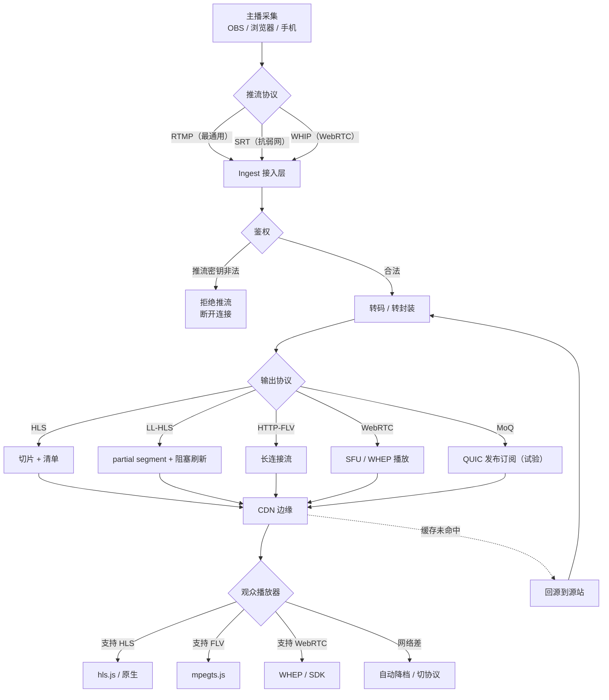
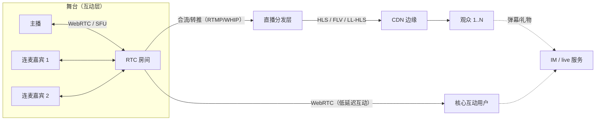

# 音视频模块 · 标杆剖析：直播产品的协议栈与分发架构

> 直播与通话是**两种负载**：通话是双向、低延迟、小规模；直播是单向、可容忍秒级延迟、大规模。把它们混在一套架构里，通常两头都不讨好。
>
> 本篇拆解 Twitch / YouTube / 抖音 / B 站 / SRS 的推流、转码、分发与低延迟方案，并对照我们已有的[直播规划](../直播/02-规划-架构设计与开发计划.md)。

---

## 0. TL;DR

- 直播链路分三段：**Ingest（推流）→ Transcode/Package（转码/封装）→ Distribute（分发）**。三段的技术选型互相独立，不要用"一个协议打通"的思维。
- 推流协议：**RTMP 最通用**（编码器/OBS 都支持，延迟 2–5s）；**SRT 抗弱网**（UDP + ARQ，适合上行差）；**WHIP 最低延迟**（WebRTC 推流，浏览器可用，但生态较新）。
- 分发协议：**HLS 兼容性最好但延迟高（6–30s）**；**LL-HLS 可到 2–5s**；**HTTP-FLV 延迟 1–3s、浏览器友好**；**WebRTC 亚秒级但成本高**；**MoQ 试图同时拿下低延迟与广播规模**（仍在标准化）。
- 规模化的核心不是"服务器多"，而是**CDN 边缘缓存 + 回源收敛**：1 万个观众不应产生 1 万路回源，而应是"每个边缘节点回源一次"。
- 转码阶梯（ABR ladder）是直播的标配：源流 + 多档分辨率，播放器按带宽切换。转码是 CPU/GPU 密集，通常用硬件编码或按需转码。
- 我们已有的直播规划（SRS + RTMP/WHIP + FLV/HLS + live 服务 + 弹幕/礼物）方向正确；缺口在**转码阶梯、录制、边缘/CDN、低延迟播放、容量模型**。

---

## 1. 直播的三段式



### 1.1 三段各自的关注点

| 段 | 关注点 | 典型技术 |
|---|---|---|
| **Ingest** | 连通性、抗弱网、鉴权、协议兼容 | RTMP、SRT、WHIP、RTSP |
| **Transcode/Package** | 码率阶梯、GOP 对齐、封装格式、录制 | FFmpeg、硬件编码（NVENC/QSV/VideoToolbox）、SRS、云端转码 |
| **Distribute** | 规模、延迟、成本、兼容性 | CDN、HLS/LL-HLS、HTTP-FLV、WebRTC、MoQ |

> 关键认知：**Ingest 协议与分发协议不需要相同**。主播用 RTMP 推，观众用 HLS/FLV 看，是最常见的组合；SRS 的"转封装"就是干这个的。

---

## 2. 协议矩阵：延迟、兼容、成本

| 协议 | 方向 | 传输 | 典型延迟 | 浏览器支持 | 优点 | 缺点 |
|---|---|---|---|---|---|---|
| **RTMP** | 推流 | TCP | 2–5s | 需 Flash（已死），但编码器全支持 | 生态最广、OBS 默认 | TCP 队头阻塞；不适合弱网 |
| **SRT** | 推流 | UDP + ARQ | 0.5–3s | 不支持 | 抗丢包、抗抖动、可加密 | 需要 SDK/编码器支持 |
| **WHIP** | 推流 | WebRTC（UDP） | < 1s | 支持（WebRTC） | 浏览器可直接推、低延迟 | 生态较新；需要 ICE/TURN |
| **RTSP** | 推流 | TCP/UDP | 视实现 | 不支持 | 安防/摄像头常用 | 互联网直播少用 |
| **HLS** | 播放 | HTTP | 6–30s | 全平台 | 兼容性最好、可走任意 CDN | 延迟高；切片+缓冲 |
| **LL-HLS** | 播放 | HTTP | 2–5s | Safari 原生；其他用 hls.js | 延迟显著低于 HLS | 实现复杂（partial segment、阻塞刷新） |
| **HTTP-FLV** | 播放 | HTTP 长连接 | 1–3s | 需 mpegts.js（非原生） | 延迟低、实现简单、CDN 友好 | 移动端兼容性一般；非标准 |
| **WebRTC（WHEP）** | 播放 | UDP | < 1s | 支持 | 延迟最低、可互动 | 成本高（SFU 出向）；规模受限 |
| **DASH/CMAF** | 播放 | HTTP | 2–10s | 需 dash.js | 标准化、可 DRM | 生态不如 HLS |
| **MoQ** | 推/播 | QUIC | 设计目标亚秒 | WebTransport（新） | 低延迟 + 广播规模潜力 | 仍是 IETF 草案，生态早期 |

### 2.1 怎么选（按场景）

| 场景 | 推荐 | 理由 |
|---|---|---|
| 秀场/电商直播，延迟 2–3s 可接受 | **RTMP 推 + HTTP-FLV 播**，HLS 兜底 | 成本低、CDN 成熟、兼容性够 |
| 体育/竞猜/强互动，延迟 < 1s | **WHIP/RTMP 推 + WebRTC 播**（或 LL-HLS） | 延迟优先；用 SFU/边缘 WebRTC |
| 大型活动，百万观众 | **RTMP/SRT 推 + 转码 + HLS/LL-HLS + CDN** | 规模优先；WebRTC 只给核心互动层 |
| 浏览器主播，不想装 OBS | **WHIP 推 + FLV/HLS 播** | 零安装；延迟取决于播放协议 |
| 未来统一栈 | **MoQ**（观察） | 一套协议覆盖 ingest/分发，但当前不成熟 |

---

## 3. Twitch：RTMP ingest + 转码阶梯 + HLS 分发

### 3.1 架构

| 层 | 做法 |
|---|---|
| Ingest | 全球 ingest PoP；主播推 **RTMP** 到最近节点 |
| Transcode | 源流 + 多档转码（source/720p60/480p/360p/160p 等，视主播等级） |
| Package | HLS（TS/fMP4），部分场景提供低延迟模式 |
| Distribute | 自建 CDN + 第三方 CDN 混合；边缘缓存 |
| Chat | 独立系统（WebSocket/IRC 风格），与媒体解耦 |
| 延迟 | 普通 HLS 数秒；低延迟模式可到 ~2s（LL-HLS） |

### 3.2 关键设计

1. **Ingest 与 Distribute 解耦**：主播只负责推一路源流；转码与分发在云端完成。
2. **转码阶梯按需**：不是所有主播都转所有档位（成本控制）；大主播多档，小主播可能只转少量。
3. **Chat 独立**：弹幕/聊天是高频小消息，和视频流是两种负载；混在一起会互相拖累。
4. **CDN 多供应商**：避免单一 CDN 故障/涨价；按区域/成本调度。

### 3.3 对我们的启示

- 我们已有规划里的"RTMP 推 + HTTP-FLV/HLS 播"与 Twitch 的主路径一致，方向正确。
- **转码阶梯要按需**：MVP 可以只做"源流 + 1–2 档"，不要一上来全档位。
- **Chat 必须独立**：我们的 live 服务 + 网关覆盖槽位设计已经是对的，不要塞进 biz 的消息主链路。

---

## 4. YouTube Live：SRT/RTMP ingest + 全球 CDN

| 维度 | 做法 |
|---|---|
| Ingest | RTMP 为主；其他 ingest 方式随产品版本变化（以官方文档为准） |
| Transcode | 自动多档；支持 4K/60fps |
| 分发 | HLS/DASH，全球 CDN（Google 骨干） |
| 延迟 | 普通 15–30s；低延迟模式数秒 |
| 互动 | 聊天独立；打赏/超级留言是业务层 |

**启示**：YouTube 的"低延迟"不是靠 WebRTC，而是靠**缩短切片 + 减少播放器缓冲 + 全球边缘**。这说明"低延迟"是一个**端到端预算问题**，不是单一协议问题。

---

## 5. 抖音 / 快手 / B 站：自建 CDN + 多协议并存

> 以下来自公开技术分享/公开资料（B/C），具体实现以官方为准。

### 5.1 共同点

| 维度 | 做法 |
|---|---|
| Ingest | RTMP、SRT；部分场景 QUIC/私有协议 |
| Transcode | 云端转码集群 + 硬件编码；按需多档 |
| 分发 | **自建 CDN** + 多供应商；HTTP-FLV、HLS、LL-HLS、WebRTC（连麦/低延迟） |
| 低延迟 | 边缘节点 + 缩短 GOP/切片 + 播放器策略；部分业务用自研低延迟协议（如字节公开分享提到的 RTM） |
| 互动 | 弹幕/礼物/连麦独立链路；连麦用 RTC，普通观众用 CDN |
| 电商 | 极低延迟（秒杀/拍卖），常用"直播流 + 实时互动层"分离 |

### 5.2 "互动层 + 分发层"的混合架构

这是大规模互动直播的标准答案：



**要点**：

- 连麦嘉宾走 RTC（低延迟、双向）；
- 普通观众走 CDN（规模、成本）；
- 两者通过"服务端合流/转推"桥接；
- 弹幕/礼物走独立的 IM/live 链路，不占媒体带宽。

### 5.3 对我们的启示

- 我们的直播规划是"主播推流 → 观众拉流"，**没有连麦**。这是合理的最小范围。
- 如果未来要做"直播连麦/PK"，必须引入 RTC 房间 + 合流/转推，而不是让主播和嘉宾 P2P（观众看不到）。
- 弹幕/礼物的"可覆盖语义 + 可靠事件"双通道设计（见直播规划 5.1）与业界一致。

---

## 6. SRS：为什么它是当前阶段的合理选择

### 6.1 能力矩阵

| 能力 | SRS |
|---|---|
| 推流 | RTMP、WebRTC（WHIP）、SRT、RTSP、GB28181 |
| 播放 | HTTP-FLV、HLS、HTTP-TS、WebRTC、DASH |
| 转封装 | RTMP ↔ FLV/HLS/WebRTC |
| 转码 | 内置 FFmpeg 转码（可外挂） |
| 鉴权 | HTTP 回调（on_publish/on_unpublish/on_play） |
| 录制 | DVR（FLV/MP4） |
| 集群 | 边缘/回源（Edge/Origin）模式；不支持复杂房间调度 |
| 性能 | 单进程多线程；单核约 3K 直播 / 1K RTC（厂商口径，C） |
| 延迟 | RTMP/FLV ~3s；HLS ~5s；WebRTC ~150–300ms（厂商/教程口径，C） |

### 6.2 为什么选它

1. **一对多直播的最短路径**：OBS 推 RTMP → SRS 转封装 → HTTP-FLV/HLS 播放，一天能跑通；
2. **HTTP 回调**：开播鉴权交给 live 服务，业务状态不被媒体服务器绑架；
3. **协议覆盖全**：同一路流可以同时输出 FLV/HLS/WebRTC，便于按场景选延迟；
4. **部署简单**：单容器，适合当前单机/小集群阶段。

### 6.3 它的边界

- **不是会议 SFU**：多发布者/多订阅者的房间管理、分层选路、Token 鉴权都不是它的强项；
- **集群能力有限**：Edge/Origin 能做 CDN 雏形，但没有全球调度、房间归属、级联会议室；
- **转码能力有限**：大规模转码要外挂 FFmpeg/云转码；
- **可观测性一般**：需要自己补指标（推流数、观看数、卡顿、延迟）。

> 结论：**SRS 做直播，LiveKit 做群聊，coturn 做 1v1 兜底**。三者职责清晰，不要互相替代。

---

## 7. 直播的成本模型（必须先算再压测）

### 7.1 带宽

设码率 `b`（Mbps），观众数 `V`，边缘节点数 `E`。

| 位置 | 带宽公式 | 例子（b=2.5 Mbps，V=10,000） |
|---|---|---|
| 源站出向 | 约 `E × b`（每个边缘回源一路） | E=50 → 125 Mbps |
| CDN 边缘出向 | `V × b` | 25 Gbps |
| 主播上行 | `b` | 2.5 Mbps |

> 关键：**源站带宽与观众数解耦**（只与边缘节点数有关），这是 CDN 的核心价值。没有 CDN 的"源站直连"会变成 `V × b`，1 万观众直接 25 Gbps。

### 7.2 成本估算（示例，C 级）

| 项 | 单价假设 | 10,000 观众 × 1 小时 | 成本 |
|---|---|---|---|
| CDN 出向 | $0.02/GB | 2.5 Mbps × 3600s × 10000 / 8 = 11.25 TB | ≈ $225 |
| 转码 | $0.05/小时/档 | 3 档 × 1 小时 | ≈ $0.15 |
| 源站 | 固定 | — | 视部署 |

> 结论：**直播的成本几乎全在 CDN 出向**。这决定了商业模式（广告/礼物/订阅）必须覆盖带宽成本；也决定了"能用 P2P/边缘分担的就不要走中心 CDN"。

### 7.3 转码成本

- 软件转码（x264）CPU 密集：1 路 1080p30 约 4–8 核（视 preset）；
- 硬件转码（NVENC/QSV/VideoToolbox）效率高，但卡有并发路数上限；
- **按需转码**：只有观众数超过阈值才启用高档位；小主播只留源流。

---

## 8. 低延迟的端到端预算（直播版）

```text
采集 20ms → 编码 30ms → 推流网络 30ms → 转码/转封装 50ms
→ 分发网络 30ms → 播放器缓冲 200–2000ms → 解码渲染 40ms
```

| 协议 | 主要延迟来源 | 可优化点 |
|---|---|---|
| HLS | 切片长度 × 缓冲片数 | 缩短切片（2s）、LL-HLS、减少缓冲 |
| HTTP-FLV | 播放器缓冲 + GOP | 降 GOP、追帧、减少缓冲 |
| WebRTC | 抖动缓冲 + 网络 | TURN 就近、拥塞控制、降码率 |
| MoQ | 中继跳数 + 组调度 | 就近中继、按组丢弃旧数据 |

**低延迟的第一原则：减少缓冲，而不是换协议。** 很多"换 WebRTC 还是卡"的问题，根因是播放器缓冲策略/GOP 太大。

---

## 9. 与我们直播规划的对照

| 规划项 | 业界做法 | 我们的现状 | 差距/建议 |
|---|---|---|---|
| 推流 | RTMP/SRT/WHIP | 规划 RTMP + WHIP | 先 RTMP；WHIP 后置 |
| 播放 | HLS/FLV/WebRTC | 规划 FLV + HLS | 补 LL-HLS 选项；FLV 需 `proxy_buffering off` |
| 转码 | 多档 ABR | 未提 | 加"源流 + 1–2 档"；按需 |
| 录制 | DVR/云录 | 未提 | SRS DVR 或 LiveKit Egress |
| CDN | 多供应商 + 边缘 | 单机 SRS | 先用 nginx 缓存/单机，量大再接 CDN |
| 弹幕 | 聚合 + 抽样 + 覆盖槽位 | 规划已详细 | 按规划落地，注意慢消费者 |
| 礼物 | 钱包扣费 + 事件 | 规划已详细 | 保持"钱只在钱包" |
| 鉴权 | 推流密钥 + 回调 | 规划已详细 | 加来源校验、密钥一次性 |
| 观测 | 推流数/观看数/卡顿/延迟 | 规划有指标 | 补端到端延迟与卡顿率 |
| 容量 | 先算带宽再压测 | 规划有公式 | 补 CDN/转码成本模型 |

### 9.1 建议的最小直播 MVP（与 P3 对齐）

1. SRS 单容器：RTMP 1935、HTTP-FLV/HLS 8080、回调到 live；
2. live 服务：房间/场次/推流密钥/开播回调/30s 断流宽限；
3. nginx：`/live/stream/` 反代，FLV 关闭缓冲；
4. Web：mpegts.js 播 FLV，hls.js 兜底；
5. 弹幕/礼物：复用现有 WS + live 房间 actor（按规划 L1/L2）；
6. 指标：推流数、观看数、首帧时间、卡顿率、端到端延迟（打点）。

**不在 MVP 内**：连麦、PK、转码阶梯、全球 CDN、录制、WebRTC 播放。这些是 P3+/P4。

---

## 10. 一句话总结

> **推流用最通用的（RTMP），分发用最便宜的（FLV/HLS + CDN），低延迟用最贵的（WebRTC）但只给需要的人；转码按需，成本先算，弹幕/礼物与媒体彻底分开。**
