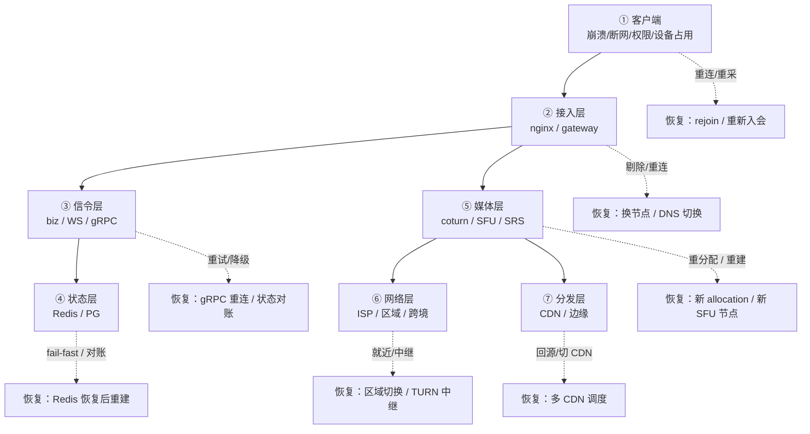
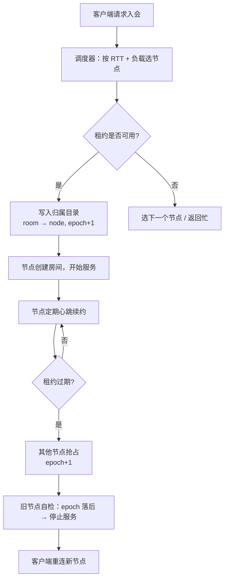
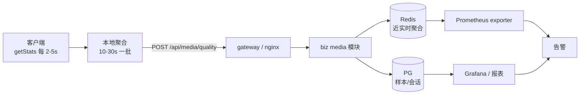

# 音视频模块 · 规模化：容量模型、故障域与可观测性

> 音视频系统的"高可用"不是"多部署几个副本"这么简单：媒体面是有状态的（TURN allocation、SFU 房间、直播流），故障转移意味着**连接重建**，而不是"换个 Pod 继续服务"。
>
> 本篇给出可计算的容量模型、故障矩阵、QoE 观测体系与成本口径。所有数字都标注了"估算/实测"，**不要把估算当承诺**。

---

## 0. TL;DR

- 音视频的容量由**最弱环节**决定：TURN 端口/带宽、SFU CPU/出向带宽、直播 CDN 出向、信令 QPS，四者取最小。
- **端口不是唯一约束**：coturn 的 `total-quota`、云主机带宽、防火墙端口段，任何一个先到顶都会表现为"部分用户无声"。
- 故障域分七层：客户端、接入（nginx/gateway）、信令（biz）、状态（Redis/PG）、媒体（TURN/SFU/SRS）、网络（ISP/区域）、分发（CDN）。每层的恢复语义不同。
- 规模化靠**区域化 + 房间归属 + 级联**，不是"加机器"。
- 可观测性是媒体系统的一等公民：**P2P 只能靠客户端上报，SFU 要补 RTCP/房间维度，直播要补端到端延迟/卡顿**。
- 成本几乎全在**出向带宽**：TURN 中继、SFU 转发、CDN 分发。先算单位经济，再谈扩容。

---

## 1. 容量模型：先把账算清

### 1.1 1v1（P2P + TURN）

设视频码率 `b`（Mbps/方向），中继通话数 `C`。

| 资源 | 公式 | 当前配置（估算） |
|---|---|---|
| TURN allocation 数 | 每通双边中继约 2 个 | `total-quota=500` → 约 **250 通** |
| TURN 端口 | 每个 allocation 1 个 | 49160–50159 = 1000 个 → 1000 allocation（端口不是瓶颈） |
| TURN 出向带宽 | `C × 2 × b`（双向都经中继） | 250 通 × 3 Mbps ≈ **750 Mbps** |
| TURN 入向带宽 | 同上 | ≈ 750 Mbps |
| 信令 | 每通 start/accept/end + ICE 若干 | 远低于消息面 |

**关键结论**：

1. **当前真正的瓶颈是 `total-quota=500` 和云主机带宽，不是 1000 个端口**。`turnserver.conf` 的端口段是 1000，但 `total-quota` 只有 500，二者取小。
2. 750 Mbps 对单台 Lighthouse 是硬墙。若云主机出向只有 100 Mbps，则 **约 33 通视频通话**就打满；1 Gbps 约 330 通。
3. 若只有一端走 relay（另一端 host/srflx），带宽减半，容量翻倍。
4. 音频通话（Opus 约 64 kbps）带宽约为视频的 1/20，同样的机器能扛更多音频通话——**不要用视频容量去估音频**。

> 计算示例：`C = 100` 通视频、`b = 1.5 Mbps` → 出向 300 Mbps。这在 100 Mbps 网卡上已经不可行。

**提高 1v1 容量的手段（按性价比）**：

| 手段 | 收益 | 成本 |
|---|---|---|
| 提高 P2P 成功率（更好的 STUN、IPv6、ICE 候选优化） | 线性减少 relay 需求 | 低 |
| TURN 多实例 + DNS/Anycast | 水平扩容 | 中 |
| TURN 出向带宽升级 / 多线 BGP | 直接提上限 | 高 |
| 自适应码率（弱网降码率） | 降低单路带宽 | 低 |
| 音频优先（拥塞时只保音频） | 降低峰值带宽 | 低 |

### 1.2 群聊（SFU）

设房间人数 `N`，每人发布码率 `b`，每人订阅 `k` 路（lastN + 分层后）。

| 资源 | 公式 | 例子（N=9，b=1.5 Mbps，k=4，缩略图 0.15 Mbps） |
|---|---|---|
| SFU 入向 | `N × b` | 13.5 Mbps |
| SFU 出向（未优化） | `N × (N-1) × b` | 108 Mbps |
| SFU 出向（lastN=4 + 缩略图） | `N × (1×b + 3×0.15)` | 9 × 1.95 ≈ **17.6 Mbps** |
| 单房间 CPU | 与转发流数、分层数、加密相关 | 需实测 |

**关键结论**：

1. **不优化的话，9 人房间就要 108 Mbps 出向**；开启 lastN + 分层后可降到 ~18 Mbps，差 6 倍。
2. 100 个 9 人房间（优化后）≈ 1.76 Gbps；不优化 ≈ 10.8 Gbps。**SFU 的成本主要是出向带宽**。
3. SFU 的单机容量要同时看 CPU 和带宽：CPU 决定能转发多少流，带宽决定能发多少码率。
4. 单房间受单节点限制（LiveKit OSS 当前一个房间落一个节点）；超大房间需要"舞台 + 直播分发"或级联。

**容量基准（C，需实测复核）**：第三方引用 LiveKit 2026 基准，16 核节点约 **150 路双向 720p**，或 1 发布者 → 3000 观看者（观看者不收多层）。这个数字只能作为量级参考，实际取决于码率、分层、加密、CPU 型号。

### 1.3 直播

设码率 `b`（Mbps），观众 `V`，边缘节点 `E`。

| 资源 | 公式 | 例子（b=2.5 Mbps，V=10,000，E=50） |
|---|---|---|
| 主播上行 | `b` | 2.5 Mbps |
| 源站出向 | `E × b` | 125 Mbps |
| CDN 边缘出向 | `V × b` | 25 Gbps |
| 转码 CPU | 档位数 × 分辨率 | 3 档，需 GPU/多核 |

**关键结论**：直播的源站带宽与观众数**解耦**（只与边缘数有关），这是 CDN 的价值；没有 CDN 就是 `V × b`，1 万观众 25 Gbps，单机不可能。

### 1.4 一张"瓶颈排序"表

| 场景 | 第一瓶颈 | 第二瓶颈 | 第三瓶颈 |
|---|---|---|---|
| 1v1 视频 | 云主机出向带宽 | coturn `total-quota` | 端口段/防火墙 |
| 1v1 音频 | `total-quota` | 带宽 | 端口 |
| 群聊 9 人 | SFU 出向带宽 | SFU CPU | 单房间单节点 |
| 群聊 50 人 | 单节点容量 | 客户端下行/解码 | 级联 |
| 直播 1 万 | CDN 出向带宽/成本 | 转码 | 源站回源 |
| 直播 100 万 | CDN 覆盖/调度 | 成本 | 版权/合规 |

---

## 2. 故障域与恢复语义

### 2.1 七层故障域

### 2.2 故障矩阵

| 故障 | 检测 | 影响 | 恢复动作 | RTO（目标） | 数据影响 |
|---|---|---|---|---|---|
| 客户端崩溃 | 心跳/WS 断开 | 该用户通话中断 | 服务端 grace 后清理；客户端重启 rejoin | 12s grace | 通话记录补写 |
| 客户端断网 | ICE disconnected/failed | 媒体中断 | ICE 重启 / rejoin；超时结束 | 5–15s | 无 |
| gateway 副本宕机 | 健康检查/连接断开 | 该副本所有连接断 | 客户端重连其他副本；presence 过期 | < 30s | 无（状态外置） |
| biz 副本宕机 | gRPC 健康 | 该副本处理的信令失败 | gateway 重路由；状态在 Redis | < 10s | 无 |
| Redis 故障 | 连接失败/延迟 | 新通话无法建立；忙线判定失效 | fail-fast；恢复后对账；已建通话尽量保活 | 视恢复 | 可能丢通话态（TTL/持久化） |
| PG 故障 | 连接失败 | 通话记录/质量样本写失败 | 异步重试/降级；不影响媒体 | 视恢复 | 记录延迟 |
| coturn 实例宕机 | 端口/健康检查 | 走该实例的 relay 通话断 | 客户端重连其他 TURN；allocation 重建 | 5–15s | 无 |
| TURN 端口耗尽 | 508/分配失败 | 新 relay 通话失败 | 扩容端口/实例；告警 | 分钟级 | 无 |
| SFU 节点宕机 | 节点心跳/房间健康 | 该节点所有房间断 | 房间重分配；客户端重连；epoch 防脑裂 | 5–15s | 房间状态需重建 |
| SRS 崩溃 | 容器健康/推流断 | 直播中断 | 重启；主播重推；30s 宽限 | < 30s | 场次状态从 DB 恢复 |
| 区域网络故障 | 多区域探测 | 该区域用户不可用 | GeoDNS/Anycast 切换；跨区中继 | 分钟级 | 无 |
| CDN 故障 | 播放失败率 | 部分观众不可看 | 多 CDN 切换；降档 | 分钟级 | 无 |

### 2.3 有状态媒体的"恢复"本质

| 组件 | 状态 | 能否无缝迁移 | 恢复方式 |
|---|---|---|---|
| TURN allocation | 端口、权限、配额 | 否 | 客户端重新 Allocate |
| SFU 房间 | 参与者、订阅、层选择 | 否（媒体连接断开） | 客户端重连新节点，重新发布/订阅 |
| SFU 节点 | 房间列表、负载 | 是（目录） | Redis/etcd 目录 + 心跳 |
| 直播流 | 推流连接、GOP 缓存 | 否 | 主播重推；播放器重连 |
| 通话态 | Redis JSON | 是 | 多副本共享；epoch 防旧写 |

**设计推论**：不要试图"迁移媒体连接"，而是**让客户端快速重建**。因此客户端必须有：自动重连、重协商、幂等、状态恢复（我们已有 rejoin/grace 的基础）。

---

## 3. 区域化、房间归属与级联

### 3.1 区域选择

| 方案 | 原理 | 优点 | 缺点 |
|---|---|---|---|
| **GeoDNS** | 按解析来源返回最近区域 IP | 简单、成熟 | DNS 缓存/递归解析影响精度 |
| **Anycast** | 同一 IP 广播到多区域 | 故障切换快 | 需要网络能力；TCP 长连接切换复杂 |
| **客户端探测** | 客户端测多个入口 RTT，选最优 | 精准 | 增加启动延迟；需要接口 |
| **服务端调度** | 入会后按 IP/ASN/负载分配媒体节点 | 可控 | 需要调度服务 |

**推荐组合**：GeoDNS 做第一层（就近接入）→ 服务端按 RTT + 负载做第二层（选 SFU/TURN 节点）。这与 Discord 的"etcd + 负载择优"、Zoom 的"Zone Controller"同构。

### 3.2 房间归属（避免脑裂）

**三层隔离**（与项目直播规划的"租约 + epoch"一致）：

1. **租约**：节点必须定期续约，过期即失去资格；
2. **epoch**：每次归属变更 +1，旧节点的写入/帧被拒绝；
3. **条件写**：数据库/目录更新带 `owner_epoch` 条件，防止旧属主覆盖。

> 如果直接用 LiveKit，房间分配由 LiveKit 的 Redis 路由负责；业务层仍需保存 `roomId → mediaRoomId` 映射与生命周期，避免"业务房间"和"媒体房间"双主。

### 3.3 级联（Cascading）

| 方案 | 原理 | 适用 | 代价 |
|---|---|---|---|
| **单区域单集群** | 所有人在一个 SFU 集群 | MVP | 跨区延迟高 |
| **区域分区** | 每个区域独立房间，跨区不互通 | 区域化产品 | 跨区通话需另建 |
| **SFU 级联** | 区域 SFU 互连，只转发订阅的流 | 跨区会议 | 带宽/延迟/一致性复杂度 |
| **中心 + 边缘转发** | 中心房间，边缘只做转发 | 直播/大房间 | 中心带宽 |

**级联的核心约束**：级联链路上的每一跳都增加延迟和带宽；只在"跨区参与者必须互通"时使用，不要为了"统一"把所有流量拉回中心。

---

## 4. 优雅发布与排空

| 组件 | 排空步骤 | 用户感知 |
|---|---|---|
| **gateway** | 停止接受新连接 → 发送 close(1001) + 新地址 → 等待客户端迁移 → 关闭 | 短暂重连 |
| **biz** | 从 LB 摘除 → 等待在途请求 → 关闭 gRPC 流 | 无（状态外置） |
| **coturn** | 停止新 allocation → 等待现有 allocation 过期/迁移 → 关闭 | 走该实例的中继通话可能断 |
| **SFU** | 停止新房间 → 通知客户端迁移（draining）→ 等待 → 关闭 | 短暂重连 |
| **SRS** | 停止新推流 → 等待现有流结束/重推 → 关闭 | 直播短暂中断 |

**关键**：媒体连接的排空不能"等它自己结束"（可能几小时），必须**主动通知客户端迁移**。LiveKit 的 connection draining 就是做这个；自研 SFU 需要自己实现。

---

## 5. 可观测性：从"能连"到"好用"

### 5.1 QoE 数据链路

**采样字段（最小集）**：

| 字段 | 说明 |
|---|---|
| `callId/roomId`、`userId`、`deviceId` | 维度 |
| `timestamp` | 时间 |
| `rtt_ms`、`jitter_ms`、`loss_rate` | 网络 |
| `bitrate_up/down`、`resolution`、`fps` | 媒体 |
| `freeze_count`、`freeze_duration_ms` | 卡顿 |
| `ice_state`、`selected_candidate_type`（host/srflx/relay） | 路径 |
| `relay_ratio` | 成本 |
| `join_time_ms`、`setup_time_ms` | 体验 |
| `codec`、`layer`（simulcast/SVC） | 质量 |

**上报策略**：

- 每 2–5s 采一次，10–30s 批量上报（避免高频请求）；
- 失败不阻塞通话；本地缓冲，重连后补报（有上限）；
- 服务端采样率可调（高负载时降采样），但**错误/异常样本全量保留**。

### 5.2 指标分层

| 层 | 指标 | 采集点 |
|---|---|---|
| **信令** | `media_events_total{event}`、`media_active_rooms`、`media_setup_duration` | biz |
| **媒体路径** | `media_p2p_success_rate`、`media_relay_ratio`、`media_ice_failure_reason` | 客户端上报 |
| **TURN** | `turn_allocations`、`turn_port_usage`、`turn_bandwidth`、`turn_508_total` | coturn（Prometheus exporter/日志） |
| **SFU** | `sfu_rooms`、`sfu_participants`、`sfu_cpu`、`sfu_egress_bps`、`sfu_packet_loss` | LiveKit/自研 |
| **直播** | `live_streams`、`live_viewers`、`live_startup_ms`、`live_rebuffer_rate`、`live_e2e_latency_ms` | SRS/live 服务/播放器 |
| **QoE** | `qoe_freeze_rate`、`qoe_mos`、`qoe_join_p95` | 聚合 |

### 5.3 SLI / SLO（建议初值，按业务调整）

| SLI | 定义 | SLO（建议） |
|---|---|---|
| 通话建立成功率 | `connected / start` | ≥ 99% |
| 加入时延 p95 | 点击到首帧 | ≤ 2s |
| P2P 成功率 | 非 relay 的通话占比 | ≥ 90%（目标，看用户网络） |
| 通话掉线率 | 非用户主动结束 / 总通话 | ≤ 1% |
| 卡顿率 | 冻结时长 / 通话时长 | ≤ 5% |
| 直播首帧 p95 | 点击到首帧 | ≤ 2s |
| 直播卡顿率 | rebuffer 时长 / 观看时长 | ≤ 2% |
| 直播端到端延迟 p95 | 采集到播放 | FLV ≤ 3s；LL-HLS ≤ 5s |

### 5.4 告警（按"用户可感知"排序）

| 告警 | 条件 | 级别 |
|---|---|---|
| 通话建立失败率突增 | 5 分钟 > 5% | P1 |
| relay 占比突增 | 5 分钟 > 基线 2 倍 | P1（可能是 STUN/P2P 故障） |
| TURN 508/端口耗尽 | 任意出现 | P1 |
| TURN 带宽 > 80% | 持续 5 分钟 | P2 |
| SFU 节点 CPU > 80% | 持续 10 分钟 | P2 |
| SFU 房间失败/重连率 > 5% | 5 分钟 | P1 |
| 直播推流失败率 > 1% | 5 分钟 | P1 |
| 直播卡顿率 > 5% | 10 分钟 | P2 |
| QoE 上报断流 | 某区域 10 分钟无样本 | P2（观测本身故障） |

---

## 6. 成本模型：出向带宽是主角

### 6.1 单位成本（示例，C 级）

| 场景 | 带宽/小时 | 假设单价 | 成本/小时 |
|---|---|---|---|
| 1v1 视频（中继，3 Mbps） | 1.35 GB | $0.08/GB（云出向） | ≈ $0.11 |
| 1v1 音频（中继，128 kbps） | 0.058 GB | $0.08/GB | ≈ $0.005 |
| 9 人群聊（优化后 18 Mbps） | 8.1 GB | $0.08/GB | ≈ $0.65 |
| 9 人群聊（未优化 108 Mbps） | 48.6 GB | $0.08/GB | ≈ $3.89 |
| 直播 1 万观众（2.5 Mbps） | 11.25 TB | $0.02/GB（CDN） | ≈ $225 |

> 这些是**量级示例**，不是报价。真实成本取决于云厂商、区域、阶梯价、预留带宽。

### 6.2 成本优化顺序

1. **提高 P2P 成功率**：1v1 的中继成本直接消失；
2. **lastN + 分层**：群聊出向降 3–6 倍；
3. **按需转码**：小主播不转高档；
4. **CDN 多供应商 + 阶梯价**：直播成本大头；
5. **边缘缓存/回源收敛**：源站带宽与观众数解耦；
6. **录制/转码异步化**：不在实时路径上做重活。

### 6.3 单位经济要能回答

- 一个 1v1 视频通话分钟的成本是多少？
- 一个 9 人会议小时的成本是多少？
- 一个 1 万观众直播小时的成本是多少？
- 收入（礼物/订阅/广告）能否覆盖？

**没有这三个数，容量规划就是拍脑袋。**

---

## 7. 压测：分层施压，不要拿信令 QPS 冒充媒体容量

| 层 | 工具/方法 | 能测什么 | 不能测什么 |
|---|---|---|---|
| 信令 | `perf/harness-gw.mjs`、`call-bench.mjs` | 建立/接听/挂断 QPS、RTP 时延 | 媒体质量 |
| TURN | `turnutils_uclient`、合成 allocation | 端口/配额/带宽上限 | 真实 NAT 分布 |
| SFU | LiveKit load tester / Pion 合成客户端 | 房间容量、CPU、出向 | 真实设备解码能力 |
| 直播 | 多路 HTTP-FLV/HLS 拉流 | 边缘带宽/连接数 | 真实网络抖动 |
| 端到端 | 真机 + 网络损伤仪（丢包/抖动/限速） | QoE、恢复行为 | 大规模并发 |

**压测红线**：

- 不用"信令 QPS × 假设"推媒体并发；
- 不在没有 QoE 上报的情况下压媒体（只能看到"通/不通"，看不到"好不好"）；
- 压测前先算带宽，避免把测试网打满导致结论失真。

---

## 8. 一分钟自检

1. 当前 TURN 的真实上限是多少？——`min(total-quota, 端口数, 带宽/单路带宽)`，不是端口数。
2. 9 人房间需要多少 SFU 出向？——未优化 `N(N-1)b`，优化后 `N(k×b_thumb + b_active)`。
3. SFU 节点挂了，房间怎么恢复？——客户端重连新节点，重新发布/订阅；不能"迁移连接"。
4. 跨区域怎么通？——区域 SFU + 级联，或接受更高延迟；不要把所有流量拉回中心。
5. 怎么知道用户卡不卡？——客户端 `getStats()` 上报聚合；P2P 服务端看不到。
6. 钱花在哪？——出向带宽（TURN/SFU/CDN），先算单位成本。
