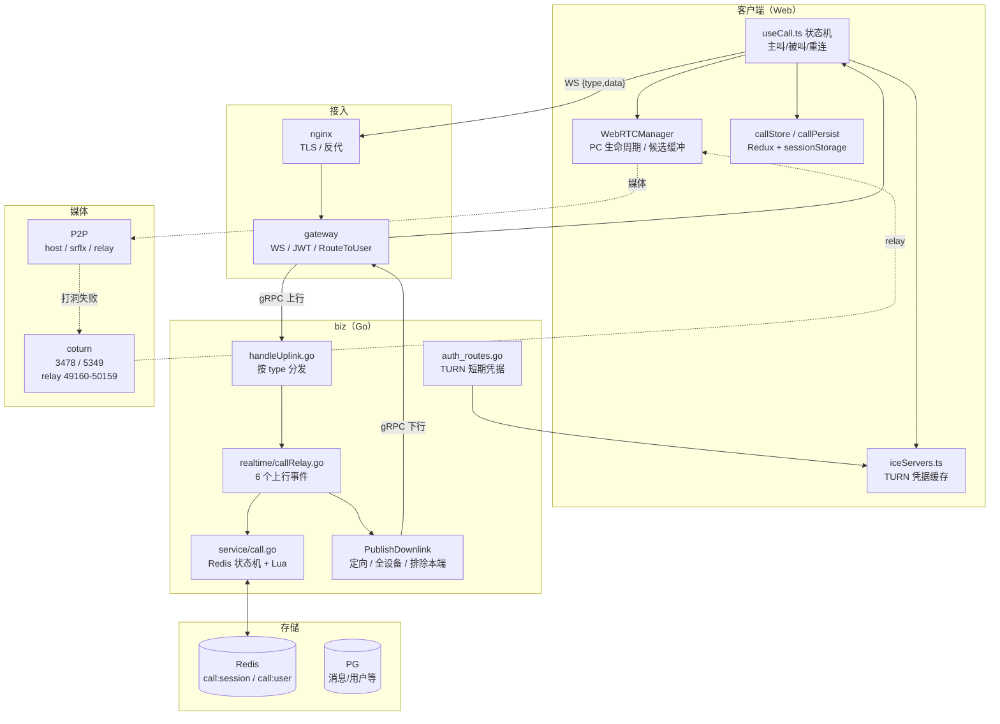

# 音视频模块 · 现状评估：our-chat 的差距与架构债

> 本篇只做一件事：**用代码事实回答"我们现在到底有什么、缺什么、哪里会出事"**。
>
> 结论基于对 `biz/`、`gateway/`、`web/`、`docker/`、`proto/`、`mobile-swift/` 的检索与阅读（2026-11）。所有判断都给了文件与行号；没有代码证据的，标"规划/未实现"。

---

## 0. TL;DR

- **当前是一个"合格的 1v1 内测版"**：信令走 WS/gRPC、状态在 Redis、忙线用 Lua 原子裁决、断连有 12s grace、TURN 有短期凭据、多端有设备级路由。这些设计是对的，不要推翻。
- **但它不是"公网可用的音视频平台"**：
  - 信令**不校验参与者**，知道 `callId` 就能挂断他人通话（P0 安全）；
  - `callId` 是 `call_<a>_<b>_<ts>` 的**隐式协议**，`call:ice`/`call:end` 的路由不读会话（P1 正确性）；
  - 单区域单机，coturn `total-quota=500`，满载约 250 路双边中继；带宽通常先到顶（P1 容量）；
  - **没有媒体质量观测**（只有客户端 `getStats()` 未上报）（P1 可观测）；
  - **没有群聊 SFU、没有直播实现、iOS 通话未落地**（P2 能力）。
- **最大的架构债不是"缺功能"，而是"信令是原样转发的 JSON"**：它让契约无法演进，也让 SFU/直播叠加时没有稳定的抽象层。

---

## 1. 现状全景



**一句话读图**：信令面是完整的（WS → gateway → biz → Redis → 下行），媒体面只有 P2P/TURN，没有 SFU，没有直播。

---

## 2. 代码级事实

### 2.1 信令与状态

| 事实 | 证据 | 评价 |
|---|---|---|
| 上行按 `type` 分发，`call:` 前缀进 `HandleCallEvent` | `biz/internal/realtime/handleUplink.go:40-49` | 简单直接，但没有版本/能力协商 |
| 6 个上行事件：start/accept/reject/end/rejoin/ice | `biz/internal/realtime/callRelay.go:22-181` | 覆盖 1v1 全流程 |
| `call:start` 用 Lua 原子登记，忙线返回 `call:busy` 仅投主叫 | `callRelay.go:34-55`；`service/call.go:82-107` | ✅ 修掉了 Node 版 GET-then-SET 双接 |
| `call:end`/`call:ice` 的**路由不读会话**，按 `callId` 字符串 `split("_")` 解析双方（`call:end` 的 `ClearSession` 会读会话，但只用于清理/计数） | `callRelay.go:109-119`、`:167-179` | ❌ 隐式协议 + 可预测 |
| `call:accept` 用客户端自报的 `to` 转发 answer，不校验等于会话主叫 | `callRelay.go:64-67` | ❌ 可伪造接听 |
| `call:rejoin` 读会话、更新属主设备、按 `TargetDeviceID` 投递 | `callRelay.go:123-161` | ✅ 设备级路由正确 |
| 断连：`MarkReconnecting` → 通知对端 → `go sleep(12s)` 后重读，`epoch` 未变才清理 | `callRelay.go:190-228`；`call.go:157-173` | ✅ 无锁分布式取消，设计好 |
| 会话 TTL 1h，双索引 `call:session:<id>` + `call:user:<uid>` | `call.go:19`、`:44-45` | ✅ 状态外置，多副本可处理 |
| `ActiveCalls` 计数 | `biz/internal/metrics/metrics.go:68-77` | ⚠️ 只适合看趋势，不能当账本（grace/end 竞态） |

### 2.2 媒体与客户端

| 事实 | 证据 | 评价 |
|---|---|---|
| `RTCPeerConnection` 默认 `iceTransportPolicy: 'all'`，`iceCandidatePoolSize: 0` | `web/src/utils/webrtc.ts:12-32` | ✅ 避免候选池撞 coturn quota |
| `forceRelay` 置位后需 `reset()` 重建 PC 才生效 | `webrtc.ts:66-68`、`:146-151` | ✅ 注释写明；这是 `iceTransportPolicy` 的构造参数限制 |
| 自适应升级：`failed` 且未升级 → `escalateToRelay()` | `web/src/hooks/useCall.ts:110-118` | ✅ 只在 `failed` 升级，不误伤 `disconnected` |
| 重连方永远发 offer；15s 客户端兜底（> 服务端 12s） | `useCall.ts:52`、`:502` | ✅ 避免 glare，内外层超时有序 |
| 候选缓冲 `pendingIceCandidates`，`reset()` 保留流与候选 | `webrtc.ts:621-680`、`:765-779` | ✅ 修过"接听黑屏/媒体单向"实测 bug |
| TURN 凭据：TTL 缓存 + 60s 提前量 + 并发去重 + 失败降级 | `web/src/utils/iceServers.ts:13-45` | ✅ 设计合理 |
| `getStats()` 存在但未上报 | `webrtc.ts:706-708` | ❌ 质量不可观测 |
| 信令帧 `rawJSON` 原样转发；`relay` 标记未进 IDL | `callRelay.go:284-291`；`useCall.ts:289` | ❌ 契约漂移隐患 |

### 2.3 部署与容量

| 事实 | 证据 | 评价 |
|---|---|---|
| coturn 监听 3478（UDP/TCP）、TLS 5349 | `docker/coturn/turnserver.conf:10-12` | ⚠️ 缺 443/TCP 兜底，企业网穿透率低 |
| relay 端口 49160–50159（1000 个） | `turnserver.conf:24-25` | 端口够用 |
| `user-quota=100`、`total-quota=500` | `turnserver.conf:52-56` | ⚠️ **500 allocation 是当前真正上限** |
| prod compose 注释写"放行 49160-49200"，与 conf 的 50159 不一致 | `docker/docker-compose.prod.yml:167` vs `turnserver.conf:25` | ❌ 配置漂移；并发上来会"部分无声" |
| 单区域单机（Lighthouse + docker compose） | `docker/docker-compose.prod.yml`、README | ⚠️ 无多区域/无故障转移 |
| 无 SRS / live 服务容器 | `docker-compose.prod.yml` 检索无 srs/live；`gateway`/`biz` 无 `live:` 路由 | 直播仅在规划中 |
| 无 `call-bench.mjs`（信令压测脚本） | `perf/` 检索无匹配 | ⚠️ 通话信令无压测覆盖 |

### 2.4 契约

| 事实 | 证据 | 评价 |
|---|---|---|
| `CallStart.call_id` 注释明确 `call_{fromId}_{toId}_{timestamp}` | `proto/ourchat/call/v1/call.proto:27-33` | ❌ 把实现细节写进契约 |
| `CallRejoin` 只有 `call_id/from/to/offer`，没有 relay/房间/轨道 | `call.proto:59-65` | ⚠️ 无法承载群聊/分层 |
| 没有 `Room`/`Participant`/`Track`/`Transport` 抽象 | `proto/ourchat/call/v1/call.proto` 全文 | ❌ 群聊/直播无法复用 |
| `CallAccept.from/to` 是 int64，`CallStart.from/to` 是对象 | `call.proto:28-40` | ⚠️ 同一语义两种形态，客户端易错 |

### 2.5 客户端与移动端

| 事实 | 证据 | 评价 |
|---|---|---|
| Web 端 1v1 语音/视频完整（含 rejoin、relay 升级、多端） | `useCall.ts`、`webrtc.ts`、`callStore.ts` | ✅ 可作参考实现 |
| iOS 无 WebRTC/通话代码 | `mobile-swift` 检索仅文档提及，无 `RTCPeerConnection`/`CallService` | ❌ iOS 通话未落地 |
| 多标签页/多实例问题已用模块级单例规避 | `useCall.ts:35-48` | ✅ 但属于"补丁式"设计，长期要收敛到单一 store/service |

---

## 3. 能力矩阵

| 能力 | 现状 | 说明 |
|---|---|---|
| 1v1 语音 | ✅ | 720p 视频，`facingMode: user` |
| 1v1 视频 | ✅ | 同一套信令，`callType` 区分 |
| 多端同时振铃 | ✅ | `call:start` 扇给所有设备；`call:handled` 排除本端 |
| 刷新/断网恢复 | ✅ | rejoin 重协商 + 12s grace |
| 弱网/严格 NAT 兜底 | ✅ | 自适应 relay-only + coturn |
| 静音/关摄像头 | ✅ | `track.enabled` 本地生效 |
| **群聊（3 人以上）** | ❌ | 无 SFU、无房间模型 |
| **屏幕共享** | ❌ | 未实现（`getDisplayMedia` 可加，但群聊需要 SFU） |
| **服务端录制** | ❌ | 无 Egress/DVR |
| **通话质量服务端可观测** | ❌ | 只有 `getStats()`，未上报 |
| **直播** | ❌ | 仅有规划文档 |
| **iOS 通话** | ❌ | 仅规划 |
| **E2EE** | ❌ | P2P 下 DTLS-SRTP 是两端之间（TURN 只转发密文）；无 SFrame 级应用层 E2EE；未来 SFU 场景 SFU 可见媒体 |
| **多区域/高可用** | ❌ | 单机 |
| **信令压测** | ❌ | 无 `call-bench` |
| **恶意呼叫防护** | ❌ | 不校验被叫存在/好友/黑名单；无频率限制 |

---

## 4. 做得对的地方（不要推翻）

1. **状态外置**：`call:session` + `call:user` 双索引在 Redis，任意 biz 副本可处理任意通话。这是多副本的前提，也是后续 SFU 房间目录的基础。
2. **Lua 原子忙线裁决**：把"检查 + 写入"压成一个原子操作，修掉了 Node 版的并发双接。这个模式可以直接复用到"房间名额/主持人唯一"。
3. **grace + epoch**：不用分布式定时器，用"数据版本号"让在途定时器自动失效。这是很漂亮的分布式技巧，群聊的"成员超时/房间接管"可以复用。
4. **设备级路由**：`TargetDeviceID`/`ExceptDeviceID` 让多端振铃、接听收起、rejoin 定向投递都成立。群聊的"某设备订阅某轨道"可以在此基础上扩展。
5. **TURN 短期凭据**：HMAC + TTL + 缓存/提前刷新/失败降级，是生产级的做法。
6. **客户端候选缓冲与 reset 保留流/候选**：这是实测踩出来的，换任何 SFU 方案仍然适用。

---

## 5. 问题清单（按严重度）

### 5.1 P0：公网暴露前必须修

| # | 问题 | 证据 | 影响 | 修复 |
|---|---|---|---|---|
| P0-1 | 四个上行事件不校验参与者 | `callRelay.go:58-181` 均未读会话校验 `userId ∈ {caller,callee}` | 知道 `callId` 可挂断他人通话、注入 ICE、伪造接听 | 每个事件先 `GetCallSession`，校验参与者；不匹配 403 |
| P0-2 | `callId` 可预测 | `call.proto:28`；`useCall.ts` 生成 `call_<a>_<b>_<ts>` | 枚举时间戳即可命中 | 128bit 随机 nonce；服务端签发或校验格式 |
| P0-3 | `call:accept` 信任客户端 `to` | `callRelay.go:64-67` | answer 可投递给任意用户 | 从会话取主叫 ID，忽略客户端 `to` |
| P0-4 | 无被叫存在性/好友/黑名单校验 | `callRelay.go:26-33` 只解析 ID | 任意 userId 可被骚扰；ID 可枚举 | 校验用户存在、关系、黑名单、频率限制 |

### 5.2 P1：规模化前必须修

| # | 问题 | 证据 | 影响 | 修复 |
|---|---|---|---|---|
| P1-1 | `call:end`/`call:ice` 依赖 `callId` 格式 | `callRelay.go:109-119`、`:167-179` | 客户端改格式 → 挂断通知失效 → 通话挂 1h | 读会话取双方 ID；`callId` 退回不透明 |
| P1-2 | `relay` 标记未进 IDL，靠 `rawJSON` 穿透 | `useCall.ts:289`；`callRelay.go:284-291` | proto 改版/字段白名单会静默失效 | 进 proto，或改为服务端下发的媒体策略 |
| P1-3 | coturn `total-quota=500`，端口段 1000 | `turnserver.conf:24-25`、`:55-56` | 满载约 250 路双边中继；带宽更早到顶 | 容量水位监控；多实例；按带宽扩容 |
| P1-4 | 端口段与防火墙注释不一致 | `compose:167` vs `conf:25` | 第 42 路中继起"分配成功但媒体不通" | 单点定义（配置生成/校验） |
| P1-5 | 无 TURN over 443/TCP | `turnserver.conf:10-12` | 企业网/严格防火墙穿透率低 | 增加 443/TCP（或反代/独立 IP） |
| P1-6 | 无 QoE 上报聚合 | `webrtc.ts:706` 仅本地 | 弱网问题靠投诉；无法定位 | `getStats()` 采样 + 批量上报 + 聚合 |
| P1-7 | 单区域单机 | compose/README | 机房/网络故障全站不可用 | 多区域/多实例；至少 TURN 双实例 |
| P1-8 | `ActiveCalls` 会漂 | `metrics.go:68-77`；grace/end 竞态 | 指标不可信 | 用 Redis key 数或事件对账 |

### 5.3 P2：能力缺口

| # | 缺口 | 影响 | 方案 |
|---|---|---|---|
| P2-1 | 无群聊 SFU | 3 人以上不可用 | LiveKit（推荐）/ mediasoup |
| P2-2 | 无直播 | 产品线缺失 | SRS + live 服务（已有规划） |
| P2-3 | 无录制 | 合规/回放缺失 | LiveKit Egress / SRS DVR |
| P2-4 | 无屏幕共享 | 会议体验缺失 | 群聊时随 SFU 一起做 |
| P2-5 | iOS 通话未实现 | 移动端缺口 | 接 LiveKit iOS SDK 或 libwebrtc |
| P2-6 | 无信令压测 | 容量未知 | `call-bench.mjs` |
| P2-7 | 无 E2EE | 合规场景受限 | SFrame/Insertable Streams（远期） |

---

## 6. 架构债：三个"看起来能跑，但会挡住演进"的设计

### 6.1 债一：信令是"原样转发的 JSON"

```go
// callRelay.go:284-291
func rawJSON(data json.RawMessage) map[string]json.RawMessage {
    var m map[string]json.RawMessage
    if err := json.Unmarshal(data, &m); err != nil {
        return nil
    }
    return m
}
```

**好处**：加字段不用改服务端，客户端自洽。
**代价**：

- 服务端无法校验不认识的字段（`relay` 就是这么"偷偷"加上的）；
- 无法做版本协商/能力协商；
- 无法在服务端做媒体策略（如"强制 relay""限制码率"）；
- 群聊/直播叠加时，字段会爆炸，没人知道哪些是契约、哪些是私有。

**结论**：P1 阶段把信令升级为**有 schema 的 proto**，保留一个 `extensions` 字段做逃生口，而不是"整帧透传"。

### 6.2 债二：`callId` 既是标识又是路由信息

```go
// callRelay.go:109-119
parts := strings.Split(callID, "_")
id1, _ := strconv.ParseInt(parts[1], 10, 64)
id2, _ := strconv.ParseInt(parts[2], 10, 64)
```

**代价**：

- 客户端改格式 → 服务端挂断/ICE 转发失效；
- ID 明文可推导，配合"不校验参与者"形成越权；
- 群聊的 `roomId` 无法用同样方式编码（参与者是集合，不是二元组）。

**结论**：`callId` 改为不透明随机 ID；路由信息一律读会话/房间状态（一次 Redis GET，成本可忽略）。

### 6.3 债三：没有"房间/参与者/轨道"抽象

现在的模型是 `CallSession{callerId, calleeId, callerDevice, calleeDevice}`，二元组假设渗透到信令、Redis、客户端。群聊需要的是：

```text
Room
  ├── participants: Map<userId, Participant>
  │       ├── devices: Map<deviceId, Device>
  │       └── tracks: Map<trackId, Track{kind, direction, layers}>
  └── media: {sftpNode, roomEpoch, ...}
```

**结论**：P1 引入 `Room` 抽象，1v1 作为 `Room` 的特例（2 人）。这样 SFU/直播可以复用同一套房间生命周期，而不是再写一套 `groupCallRelay.go`。

---

## 7. 容量现实（把估算写成可核对的账）

| 项 | 当前配置 | 上限 | 说明 |
|---|---|---|---|
| coturn allocation | `total-quota=500` | 500 | 端口 1000 不是瓶颈 |
| 双边中继视频通话 | 2 allocation/通 | ≈ 250 通 | 视频 1.5 Mbps/方向 |
| 中继出向带宽 | 250 × 3 Mbps | ≈ 750 Mbps | 云主机带宽通常先到顶 |
| 100 Mbps 主机的实际上限 | 100 / 3 | ≈ 33 通 | 这才是很多小机器的真实数字 |
| 音频通话 | 128 kbps/通 | ≈ 500 通（quota 先到） | 不要用视频容量估音频 |
| 群聊 | 无 | 0 | 需要 SFU |
| 直播 | 无 | 0 | 需要 SRS/CDN |

**结论**：当前配置适合"几十路以内的 1v1 内测"，不适合"公网规模化"。扩容前先加 QoE 与容量水位监控，否则不知道什么时候到顶。

---

## 8. 结论

| 判断 | 结论 |
|---|---|
| 现有 1v1 架构 | **保留**，修安全与契约，补观测与容量 |
| 群聊 | **新增 SFU**，不要改 P2P |
| 直播 | **新增 SRS + live 服务**，不要塞进 biz |
| 信令 | **升级为 proto + 房间模型**，不要继续透传 JSON |
| 客户端 | Web 可复用；iOS 直接接 SFU SDK，不要重写 1v1 那套 |
| 运维 | 单区域先做稳（TURN 双实例 + 监控），再谈多区域 |

下一步看 [06 目标架构](./06-目标架构-统一控制面与可插拔媒体面.md)，那里给出"怎么改"的具体设计。
