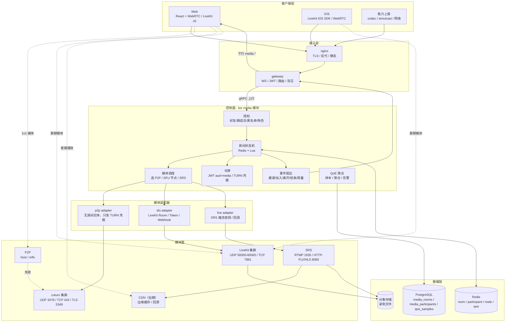
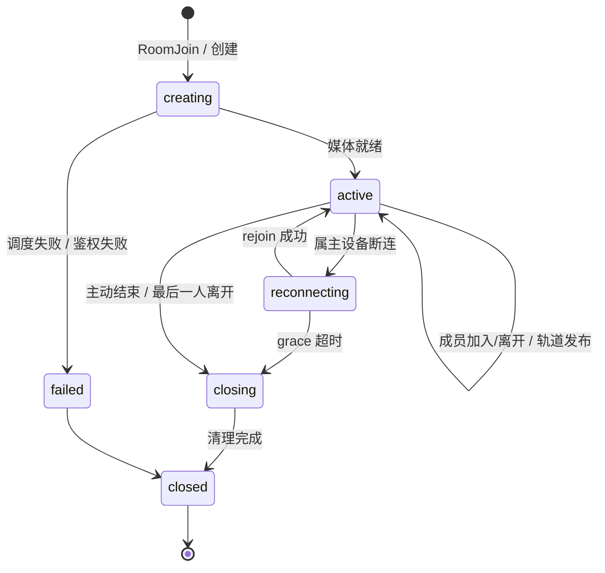
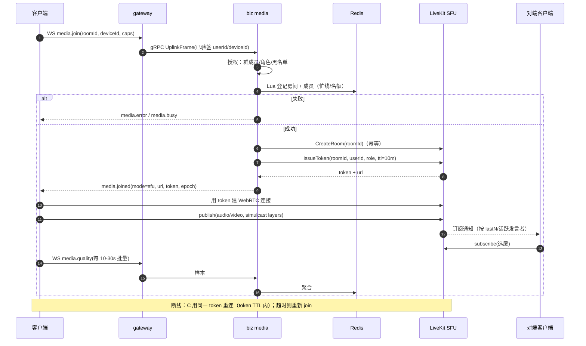
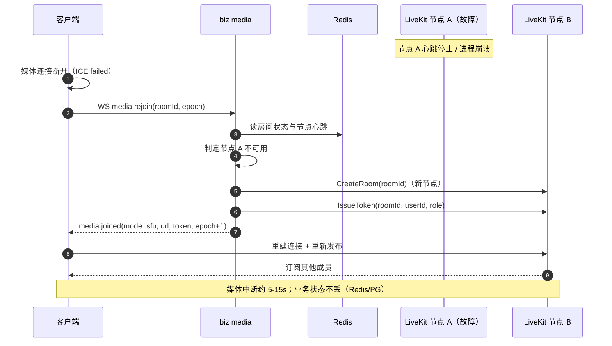
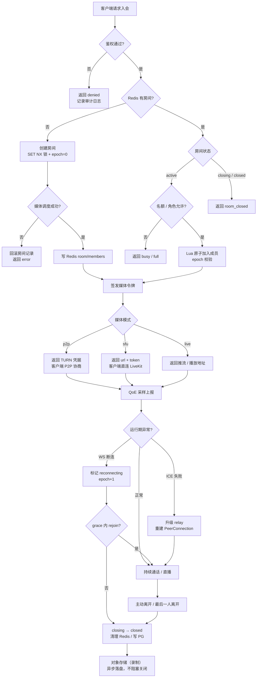
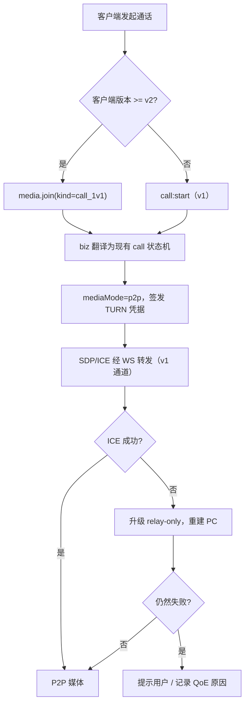
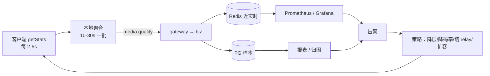

# 音视频模块 · 目标架构：统一控制面与可插拔媒体面

> 前置阅读：[05 现状评估](./05-现状评估-our-chat音视频模块差距分析.md)。本篇回答"要变成什么样、为什么这样选、分几步走"。
>
> 核心主张：**统一的是业务控制面与房间模型，不是媒体传输通道。** 1v1 继续 P2P，群聊接 SFU，直播接 SRS/CDN；三者共享"房间/参与者/令牌/事件/QoE"，但媒体各走各的。

---

## 0. TL;DR

- **一套控制面**：biz 新增 `media` 模块，负责房间生命周期、参与者权限、媒体令牌、事件扇出、QoE 聚合；gateway 只做连接与路由；Redis 存状态；PG 存记录。
- **三个媒体适配器**：
  - `p2p`：1v1，保留现有 P2P + coturn，不引入 SFU 成本；
  - `sfu`：群聊，**推荐 LiveKit**（Go/Pion、内置 TURN/Egress/SDK、可自托管）；
  - `live`：直播，**SRS**（RTMP/WHIP 推流 + FLV/HLS/WebRTC 播放）。
- **统一领域模型**：`Room` / `Participant` / `Device` / `Track`，1v1 是 2 人房间的特例。这样群聊/直播不需要另写一套状态机。
- **统一业务信令**：`media.*` 事件（join/leave/invite/token/state/quality），用 proto 定义；**SDP/ICE 在 1v1 走我们的 WS，在群聊走 LiveKit SDK 自己的信令**——不强行统一传输层。
- **QoE 闭环**：客户端 `getStats()` 采样上报 → biz 聚合 → Prometheus/Grafana/告警；SFU/直播用服务端事件补充。
- **演进分四段**：P0 安全与契约 → P1 1v1 硬化 → P2 群聊 SFU → P3 直播 → P4 多区域/高可用。

---

## 1. 设计原则（六条）

| 原则 | 含义 | 反面案例 |
|---|---|---|
| **控制面与媒体面分离** | 房间状态、权限、计费在 biz；媒体转发在 SFU/TURN/SRS | 把"谁在房间"存进 SFU 内存，SFU 一挂全丢 |
| **媒体面可插拔** | 同一套房间模型，底层可换 P2P/SFU/Live | 为群聊另写一套 `groupCallRelay.go` |
| **状态外置** | Redis/PG 是权威；进程内存只做缓存 | 通话态放本地 map，多副本不一致 |
| **幂等 + 可重放** | 所有变更带 `requestId`/`epoch`；重复事件不产生副作用 | `call:accept` 重复处理导致两次 `setRemoteDescription` |
| **能力协商** | 客户端上报 codec/分层/带宽能力，服务端下发媒体策略 | 服务端硬编码"所有人都 720p" |
| **可观测优先** | 没有 QoE 数据就不做"优化" | 凭感觉调码率/缓冲 |

---

## 2. 目标架构全景



### 2.1 三条产品线的拓扑

| 产品线 | 媒体路径 | 为什么 |
|---|---|---|
| **1v1 通话** | 客户端 ↔ 客户端（P2P）；失败 → coturn | 成本最低、延迟最低；1v1 不需要 SFU |
| **群聊会议** | 客户端 ↔ LiveKit SFU ↔ 客户端 | 上行恒定、下行按需选层；可录制/屏幕共享 |
| **直播** | 主播 → SRS/WHIP → FLV/HLS/WebRTC → CDN | 一对多必须靠分发网络，SFU 扛不了万人 |

### 2.2 为什么群聊不继续用 P2P

| 人数 | P2P 上行（720p，1.5 Mbps） | 结论 |
|---|---|---|
| 2 | 1.5 Mbps | 可用 |
| 3 | 3 Mbps | 勉强 |
| 4 | 4.5 Mbps | 移动端吃紧 |
| 6 | 7.5 Mbps | 多数家庭上行不可用 |
| 9 | 12 Mbps | 不可行 |

P2P 的上行是 `(N-1) × b`，SFU 是 `b`。**3 人以上就该考虑 SFU**，4 人以上基本必须。

---

## 3. 统一领域模型

### 3.1 实体

```text
MediaRoom
  ├── roomId        string      // 业务 ID：call_xxx / group_xxx / live_xxx
  ├── kind          enum        // call_1v1 | conference | live
  ├── ownerId       int64       // 创建者/主播
  ├── status        enum        // creating | active | closing | closed
  ├── mediaMode     enum        // p2p | sfu | live
  ├── mediaNode     string      // SFU 节点 / SRS 节点；p2p 为空
  ├── epoch         int64       // 每次归属/状态变更 +1
  ├── createdAt     int64
  └── closedAt      int64

MediaParticipant
  ├── roomId, userId, deviceId
  ├── role          enum        // host | guest | viewer
  ├── status        enum        // invited | joined | left | kicked
  ├── joinedAt, leftAt
  └── tracks        []MediaTrack

MediaTrack
  ├── trackId, userId, deviceId
  ├── kind          enum        // audio | video | screen
  ├── direction     enum        // publish | subscribe
  ├── layers        []Layer     // simulcast/SVC 层：rid / resolution / bitrate
  └── status        enum        // publishing | paused | ended
```

### 3.2 1v1 是特例，不是另一套模型

| 概念 | 1v1 | 群聊 | 直播 |
|---|---|---|---|
| Room | `call_<random>` | `group_<conversationId>_<random>` | `live_<sessionId>` |
| Participant | 2 人 | N 人 | 1 主播 + N 观众 |
| Role | caller/callee | host/guest | host/viewer |
| mediaMode | p2p | sfu | live |
| Track | 1 audio + 1 video | 每人多 track | 主播 track |

> 这样 `Room` 的状态机（创建/加入/离开/关闭/超时/接管）只写一遍。

### 3.3 Redis 键设计

| 键 | 类型 | 内容 | TTL | 能否丢 |
|---|---|---|---|---|
| `media:room:<roomId>` | String(JSON) | Room 全量状态 | 2h | 不能（可从 PG 重建） |
| `media:room:<roomId>:members` | Hash | `userId:deviceId → role/status` | 2h | 不能（可重建） |
| `media:user:<userId>` | String | 当前 roomId（忙线索引） | 2h | 不能 |
| `media:node:<nodeId>` | String(JSON) | 心跳/负载/房间数 | 30s | 可丢（心跳重建） |
| `media:room:<roomId>:epoch` | String(int) | 归属 epoch | 2h | 不能 |
| `media:room:<roomId>:qoe` | Hash | 近实时聚合（计数/分位） | 10min | 可丢 |
| `media:room:<roomId>:lock` | String | 创建/接管互斥（SET NX PX） | 5s | 可丢 |

**与现状的关系**：保留 `call:session`/`call:user` 作为 1v1 的快路径（或迁移为 `media:*` 的兼容视图），新增 `media:*` 承载房间模型；迁移期双写/双读，P1 完成后收敛。

---

## 4. 业务信令 v2

### 4.1 统一的是"业务事件"，不是"SDP 通道"

| 层 | 1v1 | 群聊 | 直播 |
|---|---|---|---|
| 业务信令 | 我们的 WS `media.*` | 我们的 WS `media.*` | 我们的 WS `live.*` + `media.*` |
| 媒体协商 | 我们的 WS 转发 SDP/ICE | **LiveKit SDK 自带信令** | WHIP/RTMP（SRS） |
| 媒体传输 | P2P / TURN | WebRTC → SFU | RTMP/HTTP → CDN |

**为什么不在群聊里自己转发 SDP**：LiveKit 的 SDP/ICE/重协商/分层/带宽估计是一整套状态机，自己转发会重复实现且容易错。正确做法是**业务层发 token，客户端直连 SFU**。

### 4.2 事件集（proto 草案）

```proto
syntax = "proto3";
package ourchat.media.v1;

message RoomJoin {
  string room_id = 1;
  string kind = 2;              // call_1v1 | conference | live
  string device_id = 3;
  ClientCapabilities caps = 4;
}

message ClientCapabilities {
  repeated string codecs = 1;    // h264, vp8, vp9, av1, opus
  bool simulcast = 2;
  bool svc = 3;
  int32 max_bitrate_kbps = 4;
}

message RoomJoined {
  string room_id = 1;
  int64 epoch = 2;
  MediaMode mode = 3;            // P2P | SFU | LIVE
  MediaEndpoint media = 4;       // 依 mode 填：p2p 填 ice_servers；sfu 填 url+token；live 填推流/播放地址
  repeated Participant participants = 5;
}

message MediaEndpoint {
  string url = 1;
  string token = 2;
  repeated IceServer ice_servers = 3;
  string publish_url = 4;        // live 推流地址
  string play_url = 5;           // live 播放地址
}

message RoomLeave { string room_id = 1; string reason = 2; }
message RoomState { string room_id = 1; int64 epoch = 2; repeated Participant participants = 3; }
message TrackPublish { string room_id = 1; string track_id = 2; string kind = 3; repeated Layer layers = 4; }
message TrackUnpublish { string room_id = 1; string track_id = 2; }
message QualityReport { string room_id = 1; repeated QualitySample samples = 2; }
message QualitySample { int64 ts = 1; int32 rtt_ms = 2; int32 jitter_ms = 3; float loss_rate = 4;
                        int32 bitrate_up_kbps = 5; int32 bitrate_down_kbps = 6;
                        int32 freeze_ms = 7; string candidate_type = 8; string codec = 9; }
```

> 注：`MediaMode`、`IceServer`、`Participant`、`Layer` 是省略的辅助类型，落地时按 §3.1 的字段补齐；`RoomJoined.media` 按 `mode` 填不同字段（p2p 填 `ice_servers`，sfu 填 `url+token`，live 填 `publish_url/play_url`）。

**兼容策略**：

- 1v1 的 `call:*` v1 保留；biz 内部把它翻译成 `media.*` 语义；
- 新客户端优先用 `media.*`；旧客户端继续 `call:*`；
- 服务端按 `client_capabilities.version` 选择事件集；
- 所有事件带 `request_id`，服务端去重（复用 Redis SETNX）。

### 4.3 信令状态机（房间级）



---

## 5. 媒体适配器接口

```go
// media.Adapter 是媒体面的统一抽象；实现可以是 p2p / sfu / live。
type Adapter interface {
    // CreateRoom 创建媒体房间；p2p 实现为空操作（只返回 TURN 配置）。
    CreateRoom(ctx context.Context, room *Room) (*RoomInfo, error)
    // CloseRoom 关闭房间；幂等。
    CloseRoom(ctx context.Context, roomID string) error
    // IssueToken 签发媒体访问令牌；p2p 返回 TURN 凭据。
    IssueToken(ctx context.Context, roomID string, p Participant) (*Token, error)
    // ListParticipants 查询媒体侧参与者（用于对账）。
    ListParticipants(ctx context.Context, roomID string) ([]Participant, error)
    // Kick 踢出参与者（审核/封禁）。
    Kick(ctx context.Context, roomID string, userID int64) error
}

type RoomInfo struct {
    Mode      Mode   // p2p | sfu | live
    Node      string
    PublishURL string // live
    PlayURL    string // live
    ICEServers []ICEServer // p2p
}
```

### 5.1 三个实现

| 实现 | CreateRoom | IssueToken | 说明 |
|---|---|---|---|
| `p2pAdapter` | 空操作，记录 `mediaMode=p2p` | 返回 TURN 短期凭据 | 不产生 SFU 成本；沿用现有 1v1 逻辑 |
| `livekitAdapter` | 调 LiveKit RoomService `CreateRoom` | 用 LiveKit AccessToken（room/identity/role/ttl） | 客户端用 LiveKit SDK 直连；webhook 回 biz |
| `srsAdapter` | 调 SRS HTTP API / 生成推流密钥 | 返回推流地址 + 播放地址 | 开播鉴权走 SRS `on_publish` 回调 |

> `srsAdapter` 更准确地说是"直播适配器"，它不实现 `Kick`（直播踢人走 live 服务/业务层）。

### 5.2 选型决策：为什么是 LiveKit

| 维度（权重） | LiveKit | mediasoup | Janus | Jitsi | SRS | 云 RTC（Agora/TRTC） |
|---|---|---|---|---|---|---|
| Go 技术栈匹配（20%） | 5 | 2（Node/Rust） | 1（C） | 2（Java） | 3（C++，但 HTTP API 简单） | 1（SDK） |
| 功能完整度（20%） | 5（房间/分层/TURN/录制/SDK） | 3（积木） | 4（插件） | 4（完整栈） | 3（直播强，会议弱） | 5 |
| 运维复杂度（15%） | 4 | 3 | 2 | 2（XMPP/Jicofo/JVB） | 5（单容器） | 5（托管） |
| 可自托管/数据主权（15%） | 5 | 5 | 5 | 5 | 5 | 1 |
| 扩展性（15%） | 4（Redis 多节点，单房间单节点） | 4（多 Worker） | 4（级联） | 4（Octo 级联） | 3（Edge/Origin） | 5（全球网） |
| 生态/文档（10%） | 5 | 4 | 3 | 4 | 4 | 4 |
| 成本（5%） | 5（自托管） | 5 | 5 | 5 | 5 | 2 |
| **加权分** | **4.75** | **3.35** | **3.15** | **3.4** | **3.45** | **3.2** |

**结论**：

- **群聊选 LiveKit**：Go/Pion、开箱即用、可自托管、SDK 全、内置 TURN/Egress/多节点/排空。
- **直播选 SRS**：RTMP/FLV/HLS 成熟、回调简单、单容器；LiveKit 的 Ingress/Egress 可作为统一栈的备选，但一对多分发仍应交给 CDN。
- **1v1 保留 P2P**：不为 2 人场景引入 SFU 成本。
- **若目标是"学 SFU 内核"而不是"最快上线"**，选 mediasoup（积木更底层），但要接受 Node 侧车与自建房间/鉴权/录制的工作量。

---

## 6. 关键流程

### 6.1 群聊入会与发布



**设计要点**：

1. `CreateRoom` 必须幂等：同一 `roomId` 重复调用返回已有房间。
2. Token TTL 10 分钟，足够重连；过期后 biz 重新签发（客户端自动刷新）。
3. `epoch` 用于防止旧房间/旧节点的事件乱序。
4. 客户端能力（simulcast/SVC）决定发布层数；服务端只做上限约束。

### 6.2 SFU 节点故障转移



**关键**：媒体连接不能"迁移"，只能"重建"。所以 **token 要可重签、客户端要能自动重连、房间状态要在 Redis**。

### 6.3 房间生命周期全流程（主流程 / 分支 / 异常 / 缓存）



**图中四个容易被忽略的点**：

1. **创建房间的锁**：`SET NX PX` 防止并发创建；锁过期时间要短（秒级），失败可重试。
2. **缓存分层**：Redis 是权威；biz 进程内可做只读缓存（带 epoch 校验），但**写必须回 Redis**。
3. **异常不是"错误返回"就完了**：`reconnecting` 是正式状态，要有 grace、rejoin、超时清理。
4. **录制落盘异步化**：关闭房间不能被大文件上传阻塞。

### 6.4 1v1 的兼容路径



> 迁移期不要"一刀切"：v1 与 v2 双跑，biz 内部统一到房间模型；旧客户端继续工作。

---

## 7. 鉴权与令牌

| 令牌 | 签发者 | 受众 | TTL | 内容 | 校验者 |
|---|---|---|---|---|---|
| **会话 JWT** | biz IdP | our-chat | 常规 | userId/deviceId | gateway |
| **媒体 JWT** | biz media | media | 5–15min | roomId/userId/role/deviceId/epoch | SFU / live |
| **TURN 凭据** | biz media | coturn | 10–60min | `expiry:userId` + HMAC | coturn |
| **推流密钥** | live 服务 | SRS | 一次性/场次 | sessionId + 随机 | SRS 回调 live |

**原则**：

- 媒体令牌**短期、最小权限、绑房间/角色**；
- SFU 的 API Secret 只存在 biz，绝不下发客户端；
- TURN secret 只存在 biz 与 coturn；
- 所有令牌可吊销（房间关闭/踢人时 epoch+1，旧 token 失效）。

---

## 8. QoE 闭环



**最小可用版本（P0 就能做）**：

1. Web 端每 3s `getStats()`，取 `candidate-pair`、`inbound-rtp`、`outbound-rtp`、`remote-inbound-rtp`；
2. 聚合成一条样本（RTT/jitter/loss/bitrate/freeze/candidateType）；
3. 每 15s `POST /api/media/quality`（批量）；
4. biz 写 Redis（近实时）+ PG（样本），暴露 Prometheus 指标；
5. Grafana 面板：按房间/用户看丢包、RTT、relay 占比、卡顿；
6. 告警：失败率、relay 占比突增、TURN 508、SFU CPU。

---

## 9. 高可用与多区域

| 层级 | 单区域（P1–P3） | 多区域（P4） |
|---|---|---|
| 接入 | nginx 双实例 / LB | GeoDNS / Anycast |
| 信令 | biz ×N + Redis 主从 | 多区域 biz + 跨区 Redis 复制 |
| TURN | 2 实例 + DNS 轮询/就近 | 每区域 TURN 集群 |
| SFU | 2+ LiveKit 节点 + Redis | 区域 SFU + 级联/分区 |
| 直播 | SRS 单机 + nginx 缓存 | 多 CDN + 边缘回源 |
| 数据 | PG 主从 + Redis | 跨区只读/异步复制 |

**房间归属**：

- LiveKit 自己按 Redis 选节点；biz 记录 `roomId → node`，用于排障与迁移；
- 若未来自研 SFU，复用"租约 + epoch + 条件写"（见 04 篇 §3.2）。

**排空**：

- LiveKit 支持 connection draining；biz 在发布时先把房间标记 `draining`，引导新入会到其他节点；
- TURN 排空靠"停止新 allocation + 等待过期"；
- SRS 排空靠"停止新推流 + 主播重推"。

---

## 10. 分阶段路线与验收

| 阶段 | 范围 | 关键交付 | 验收 |
|---|---|---|---|
| **P0 安全与契约** | 1v1 | 参与者校验、callId 随机化、`to` 校验、QoE 上报、TURN 端口单点定义 | 越权测试全通过；QoE 样本可查；端口配置一致 |
| **P1 1v1 硬化** | 1v1 | 信令 v2 骨架、房间模型、TURN 443/双实例、ICE 失败原因、容量水位 | P2P 成功率 ≥ 95%（目标）；relay 占比可观测；TURN 打满前告警 |
| **P2 群聊 SFU** | 3–16 人 | LiveKit 接入、Token/Webhook、Web SDK、iOS SDK、屏幕共享、录制（可选） | 9 人 720p 30 分钟稳定；加入 < 2s；节点故障 15s 内恢复 |
| **P3 直播 MVP** | 1 → 千级 | SRS + live 服务 + 弹幕/礼物复用 + FLV/HLS | FLV 延迟 ≤ 3s；1000 观众（按带宽/CDN 条件）；断流 30s 宽限 |
| **P4 规模化** | 多区域 | GeoDNS、多 TURN、SFU 分区/级联、多 CDN、成本模型 | 区域故障切换；容量模型误差 < 30% |

### 10.1 P2 的容量目标（示例，需实测）

| 项 | 目标 | 说明 |
|---|---|---|
| 单房间 | 16 人 720p | 超过则启用 lastN/仅活跃发言者 |
| 单节点 | 20 个 9 人房间（≈180 参与者） | 16 核基准折算，需实测 |
| 出向 | 每房间 ≤ 25 Mbps | lastN=4 + 缩略图 |
| 加入时延 | p95 ≤ 2s | 含 token/建连/首帧 |
| 故障恢复 | ≤ 15s | 节点 kill 到重新入会 |

### 10.2 P3 的容量目标（示例）

| 项 | 目标 | 说明 |
|---|---|---|
| 单流观众 | 500（1 Gbps 源站 + 1.5 Mbps） | 超过必须上 CDN |
| 延迟 | FLV p95 ≤ 3s | 端到端打点 |
| 首帧 | p95 ≤ 2s | 播放器起播 |
| 断流恢复 | 30s 宽限 | 主播重推 |

---

## 11. 迁移策略与回滚

| 风险 | 迁移手段 | 回滚 |
|---|---|---|
| 信令 v2 破坏旧客户端 | 双版本共存；服务端按 `caps.version` 分流 | 关闭 v2 开关，回退 v1 |
| SFU 引入新故障 | `MEDIA_SFU_ENABLED` 按房间/用户灰度 | 关闭开关，群聊降级为"暂不可用" |
| LiveKit 运维不熟 | 先单节点 + 只读监控；再双节点 | 回退到单节点 |
| 直播带宽打满 | 先小范围白名单 + 限流 | 关闭直播入口 |
| 数据库迁移 | 新表 `media_*`，不改旧表 | 旧表不受影响 |

**双写策略**：P1 期间 `call:session` 与 `media:room` 双写，读以 `call:session` 为准；P2 后读切换到 `media:room`，`call:session` 作为兼容视图。

---

## 12. 一页总结

> **1v1 继续 P2P（省钱），群聊接 LiveKit（保体验），直播接 SRS（扛规模）；biz 用一套房间模型管住三者，gateway 只管连接，Redis/PG 存状态，QoE 闭环决定优化方向。**

下一篇：[07 实施计划](./07-实施计划-契约改造实验与风险登记.md) 给出具体任务、实验与风险登记。
